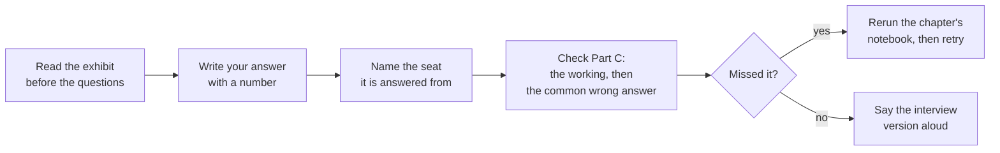
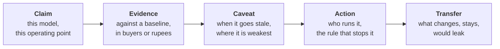
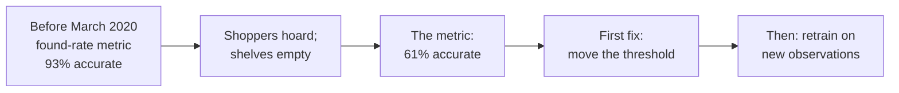
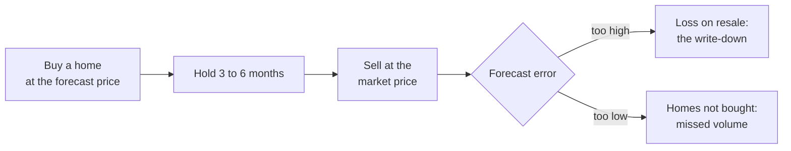
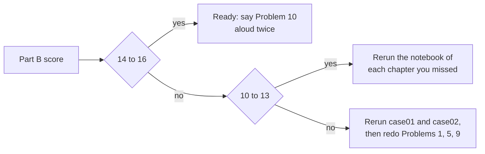
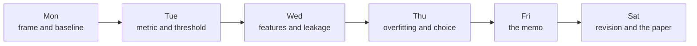

# Week 5 Friday practice set: the committee memo

Ten problems and sixteen self-check questions on model justification: the error bill, staleness, the transfer to lending, and defending the memo. Two and a half hours with checking.

## How do you use this set?

| Part | What | Minutes |
|---|---|---|
| Recap | One page of the day's pictures and rules | 10 |
| Part A | Ten problems: three warm-ups (5 each), four medium (10 each), three interview-grade (15 each) | 100 |
| Part B | Sixteen self-check questions | 25 |
| Part C | Mark yourself against the key and the model solutions | 15 | The bill is within 4 percent of calling everyone, so the assertion fails | The assertion fails | The reason holds: 7,412 of 8,238 are called | **Key:** the bill sits within 4 percent of calling everyone |



The numbers come from the day's notebooks on UCI Bank Marketing and German Credit. Numbers marked invented are typed for teaching. Six seats answer problems in this set: business owner, product manager, solution architect, senior ML engineer, implementation engineer, QA.

<div class="page-break"></div>

## What did the day establish, on one page?



| Idea | The rule | What flips it |
|---|---|---|
| The justification | Lead with the decision and its rupees; every part carries a number | The reader is the ML lead reviewing the method |
| The error bill | `bill = wasted calls x Rs 40 + missed buyers x Rs 1,200`; called buyers are the gain | A budget caps the calls: then compare buyers in the top k |
| The cost cut | Act when `p > cheap / (cheap + expensive)`: `40 / 1,240 = 0.032` | The scores are not honest probabilities (a stale or reweighted model) |
| The simpler model | Recommend it when the gap sits inside its band | A fresh month's band clears zero |
| Staleness | Watch the promise against reality among the people you acted on | Ceiling sized from the month's call count: `2 x sqrt(p x (1 - p) / n)` |
| The weakest segment | Name the weakest group whose band is narrow enough to read | A small group's low reading is noise until its band narrows |
| The transfer | Same pipeline; the target, the costs and the cut change; columns written after the decision leak | A column's name is never the test; its time stamp is |


<div class="page-break"></div>

## Part A: the ten problems

### Problem 1 (warm-up, 5 minutes): what does each threshold cost Kalpa?

**Seat: business owner (Anand, Finance).** Kalpa's nudge costs Rs 40; a buyer never nudged costs Rs 1,200 of margin. The logistic model scored the bank's 8,238 validation customers (928 buyers).

| Threshold | Called | Buyers found | Wasted calls | Missed buyers |
|---|---|---|---|---|
| 0.032 | 7,412 | 910 | 6,502 | 18 |
| 0.10 | 1,927 | 603 | 1,324 | 325 |
| Call everyone | 8,238 | 928 | 7,310 | 0 |

a) Compute the error bill at each of the three rows.

b) Which row would you put in the memo if there were no budget, and how far is it from calling everyone, in percent?

c) Marketing can afford only 1,000 calls. Which number now decides between models?

*Interview version: "Your model's threshold is 0.10. What does that cost the business compared with 0.032?"*

### Problem 2 (warm-up, 5 minutes): which part of this memo fails the committee?

**Seat: product manager.** A first draft lands on the PM's desk:

```text
CLAIM.    We built a gradient boosting model with 21 features.
EVIDENCE. Validation AUC is 0.803, the best of three models.
CAVEAT.   Models can drift over time.
ACTION.   Deploy the model.
```

a) For each part, say whether it carries a number the PM can act on.

b) Rewrite the claim and the action so the PM can run the list next Monday.

c) Which part would Finance push on first, and what number is missing there?

*Interview version: "Here is a model summary from a junior. What would you send back?"*

### Problem 3 (warm-up, 5 minutes): where does the line sit in three businesses?

**Seat: business owner.** Write each cut on the probability of the good outcome.

| Business | Cheap mistake | Expensive mistake |
|---|---|---|
| Kalpa's nudge | a wasted nudge, Rs 40 | a missed buyer, Rs 1,200 |
| A telecom retention offer (invented costs) | an offer to someone who would stay, Rs 300 | a churner never offered, Rs 4,000 |
| Rohan's loan | a good applicant turned away, Rs 3,000 | a default approved, Rs 60,000 |

a) Compute the three cuts.

b) Two of them are on "P(the customer acts)" and one on "P(repay)". Say which, and why the lender's line sits near 1.

c) Which cut would fall if the expensive mistake halved?

*Interview version: "Why is the approval threshold for loans so much higher than for a marketing campaign?"*

<div class="page-break"></div>

### Problem 4 (medium, 10 minutes): how did Instacart know its model had gone stale?

**Seat: senior ML engineer.** Fortune reported on 9 June 2020 that in March 2020 the accuracy of the metric Instacart uses to judge how many items are found at a store "dropped to 61% from 93%", which told its engineers to retrain the item-availability model. Instacart's own 2023 post says out-of-stock cancellations "spiked during the onset of COVID", that models respond sluggishly because they need enough new observations to adapt, and that thresholds on top of the model were adjusted "without having to train new ML models".



a) Before answering, write the one clarifying question you would ask about how the 93 percent was measured.

b) Which number moved first: the model's inputs, its promise, or reality? What in the exhibit tells you?

c) Why was moving the threshold a sensible first fix while retraining waited?

d) Write a monitoring rule for this model with its number, ceiling, window and owner.

*Interview version: "How would you know your model has gone stale, and what do you do in the first week?"*

### Problem 5 (medium, 10 minutes): when should the alarm fire on Kalpa's list?

**Seat: QA.** The model trained on May 2008 to April 2009 scored the later months. Each month the top 12 percent of the list was called.

| Month | Called | Promised | Real |
|---|---|---|---|
| 2009-04 | 194 | 22.6% | 30.9% |
| 2009-05 | 703 | 13.6% | 14.2% |
| 2009-06 | 87 | 45.1% | 46.0% |
| 2009-07 | 22 | 32.4% | 54.5% |
| 2009-08 | 93 | 31.6% | 44.1% |
| 2009-09 | 32 | 44.6% | 46.9% |

a) With a ceiling of 10 points and a window of two months running, in which month does the rule fire?

b) Redo it with a ceiling of 5 points. Does the answer change, and what does April do?

c) How far could July's 22 calls swing by luck alone at a promise near 32 percent? Use `2 x sqrt(p x (1 - p) / n)`.

d) What ceiling would you set for a month of 1,000 calls at a promise near 30 percent?

*Interview version: "Your monitoring alert fired. How do you tell drift from noise?"*

### Problem 6 (medium, 10 minutes): where does the model run on Monday morning?

**Seats: solution architect and implementation engineer.** The committee approves the memo and asks how the list will be produced each month. Two ways are on the table.

| Way | Build effort | What it leaves behind |
|---|---|---|
| A notebook a TA runs on the first Monday | none | a CSV of 1,000 names in someone's downloads folder |
| A scheduled job writing scores to a table, with a log | about a day (invented) | a scores table, a log of the cut used, the monthly counts |

a) Size each way against the staleness rule: which one leaves the numbers the rule reads?

b) Where does the threshold, or the budget of 1,000, live, and who may change it?

c) Name the one test QA would write to prove the deployed list uses the budget the memo names.

d) What fact would make the notebook the right choice?

*Interview version: "The model is approved. Walk me through how it runs in production on day one."*

<div class="page-break"></div>

### Problem 7 (medium, 10 minutes): which segment goes in the caveat?

**Seats: senior ML engineer and QA.** AUC inside each job group on the 8,238 validation customers, with a 95 percent band from 200 resamples.

| Job | Customers | Buyers | AUC | Band |
|---|---|---|---|---|
| entrepreneur | 275 | 26 | 0.655 | 0.54 to 0.81 |
| blue-collar | 1,834 | 122 | 0.707 | 0.65 to 0.76 |
| management | 589 | 68 | 0.757 | 0.68 to 0.83 |
| student | 183 | 58 | 0.759 | 0.69 to 0.83 |
| admin. | 2,114 | 286 | 0.800 | 0.77 to 0.83 |
| unemployed | 212 | 28 | 0.869 | 0.80 to 0.92 |

a) Which group goes in the memo's caveat, and why not entrepreneur?

b) Unemployed reads highest. Would you tell Marketing to target the unemployed? Give the reason in one line.

c) What would you need before you could say entrepreneur is the weakest?

*Interview version: "Your model works well overall. How do you check whether it fails for a group of customers?"*

### Problem 8 (interview-grade, 15 minutes): what would Zillow's committee have needed to see?

**Seat: business owner, as the committee.** Zillow Offers bought homes on a price forecast. Zillow's 8-K of 2 November 2021 recorded a "$304.4 million write-down of inventory associated with Zillow Offers" and a wind-down cutting about 25 percent of its workforce. The shareholder letter says the business needed to forecast prices "three to six months into the future" and that Zillow was "unable to accurately forecast future home prices at different times in both directions", with unit economics swinging about 1,200 basis points from Q2 to an expected minus 500 to minus 700 in Q4 2021.



a) Before answering, write the clarifying question you would ask about how one point of forecast error turns into money per home.

b) Name the two mistakes in Zillow's error bill, in the shape of Kalpa's wasted call and missed buyer.

c) Write the staleness rule a committee could have approved, with its number, ceiling, window and owner.

d) What would you have put in the memo's caveat about the forecast horizon?

*Interview version: "Tell me about a model failure at a well-known company and what monitoring would have caught it."*

### Problem 9 (interview-grade, 15 minutes): what transfers to Rohan's loan book?

**Seat: Rohan, head of risk, Kalpa Financial.** German Credit (1,000 applicants, 700 good, 300 bad) documents its own cost matrix: approving a bad customer costs 5, turning away a good one costs 1. A logistic model scored 300 validation applicants (210 good, 90 bad).

| Approve when P(repay) is above | Approved | Bad loans approved | Good applicants turned away |
|---|---|---|---|
| 0.50 | 226 | 47 | 31 |
| 0.83 | 128 | 13 | 95 |
| 0.95 | 43 | 3 | 170 |
| approve everyone | 300 | 90 | 0 |

a) Compute the cost of each row under the 5 : 1 matrix, and the cost of the 0.83 and 0.95 rows under Rohan's Rs 60,000 against Rs 3,000.

b) Write the transfer paragraph in three sentences: what changes, what stays, what would leak.

c) German Credit has a column named `duration`. Does it leak? Answer with the test, never the name.

d) RECAP task: list the three questions Rohan would ask on Monday, each with your one-line answer.

*Interview version: "What would change if this model moved to a lending business?"*

### Problem 10 (interview-grade, 15 minutes): your memo, and your ninety seconds

**Seats: all six.** This is tonight's WRITE task. Your exhibit is your own run of case notebooks 01 to 03; the class run gave these numbers.

| Number | Class run |
|---|---|
| Buyers in the top 1,000 on the sealed test | 482, against 113 at random |
| Boosting minus logistic in 1,000 calls (validation) | 13, band about -1 to 28 |
| Bill at 0.032, any model | within 4 percent of calling everyone |
| Late months | real 24.6 in 100 against a promise of 15.9 |

a) Write your memo in five parts (claim, evidence, caveat, action, transfer), under 300 words, every sentence with a number from your run.

b) The marketing lead says "Boosting scored higher. Use it." Write your answer in three sentences: the number, the reason, the condition that would flip your call.

c) Write one choice you made differently from the class run, and why. Then time yourself saying the memo aloud: it must fit in ninety seconds.

*Interview version: "Walk me through a model you built and why you chose it."*

<div class="page-break"></div>

## Part B: sixteen self-check questions

Post one line, for example: 1c 2a 3d ... (letters made up; the key is in Part C).

**One correct answer**

**1.** A model's bill at its threshold is Rs 2.82 lakh and calling everyone costs Rs 2.92 lakh. What does that say?

- a) The model is 97 percent accurate on the validation slice
- b) At these costs the model barely matters without a budget
- c) The threshold must be raised to 0.5
- d) The model should be replaced by boosting at once, since it scores higher

**2.** Which counts make up the error bill under a threshold?

- a) Wasted calls and missed buyers
- b) Buyers found and buyers missed
- c) Every call made and every buyer found
- d) True negatives and false positives only

**3.** A wasted offer costs Rs 300 and a lost churner Rs 4,000. Make the offer when P(churn) is above:

- a) 0.930
- b) 0.50
- c) 0.07
- d) 0.265, the churn rate

**4.** Boosting finds 13 more buyers in 1,000 calls; the bootstrap band runs from -1 to 28. What goes in the memo?

- a) Logistic, as a tie, with the condition that flips it
- b) Boosting, since 13 extra buyers are worth Rs 16,120 to Kalpa
- c) Neither model, until the band gets narrower
- d) Both models averaged, to share out the risk

**5.** Trained on 2008 and scored on 2010, a model's AUC falls from 0.80 to 0.66 and its mean promise stays at 16 in 100 while 25 buy. What broke first for the bill?

- a) The ranking, since the AUC fell by 0.14
- b) The features, since they were all scaled on the 2008 months
- c) Nothing yet, since 0.66 still beats 0.5
- d) The promise, since the bill is priced from it

**6.** Which column would leak in a lending model?

- a) The loan term in months, set on the application form itself
- b) The applicant's income, from last year's return
- c) A collections flag, set three months after approval
- d) The bureau score, pulled two days before approval

**7.** A segment reads AUC 0.655 on 26 buyers, band 0.54 to 0.81. What do you write?

- a) It is the weakest segment, so exclude it
- b) Too few buyers to read; name the weakest readable group
- c) It proves that the model is unfair to entrepreneurs as a group
- d) Retrain on that group alone

**8.** Which sentence is a monitoring rule someone else could check?

- a) Retrain the model on the first working day of every single month
- b) Keep a close eye on the AUC and retrain whenever it starts to drop
- c) Set up dashboards and alerts for any drift in any of the model's features
- d) Over 10 points off the promise two months running, Kavya pauses it

**More than one correct answer (choose all that apply)**

**9.** Which stay the same when the nudge pipeline moves to lending?

- a) The target
- b) Sealing the test slice before modelling
- c) The bill formula's shape
- d) The cut of 0.032

**10.** Which are reasons to recommend the simpler model at a near-tie?

- a) The gap sits inside its band
- b) Fewer columns to maintain and check
- c) A simple model never goes stale
- d) It is easier to explain to the committee

**11.** Which belong in a staleness rule?

- a) The number watched
- b) The algorithm's name
- c) The ceiling and the window
- d) The person who acts

**True or false, with the reason**

**12.** "The test slice can be opened again after a second round of tuning, since it was never trained on."

- a) True, since no test row entered training
- b) False, since choosing by it turns it into validation
- c) True, as long as the second look is only meant as a check
- d) False, since the test slice is too small to use

**13.** "A model with AUC 0.66 is safe to keep, since it still ranks better than chance."

- a) True, since anything above 0.5 adds value
- b) True, as long as the threshold stays where it was set at 0.032
- c) False, since an AUC below 0.7 is never usable
- d) False, since ranking says nothing of the promise

**Assertion and reason**

**14.** Assertion: the lender's cut sits near 0.95. Reason: a default costs twenty times a wrongful rejection.

- a) Both true, and the reason explains the assertion
- b) Both true, and the reason does not explain the assertion
- c) The assertion is true and the reason false
- d) The assertion is false and the reason true

**15.** Assertion: at Rs 40 against Rs 1,200, the model's bill at the cost cut is far below the bill of calling everyone. Reason: the cost cut of 0.032 calls about nine customers in ten.

- a) Both true, and the reason explains the assertion
- b) Both true, and the reason does not explain the assertion
- c) The assertion is true and the reason false
- d) The assertion is false and the reason true

**Match**

**16.** Match each seat to its push: (1) Finance, (2) product manager, (3) QA, (4) risk head. Pushes: (p) "How do we know the cut is live?", (q) "What carries over?", (r) "What does wrong cost?", (s) "What does the customer get?"

- a) 1r, 2s, 3p, 4q
- b) 1s, 2r, 3p, 4q
- c) 1r, 2p, 3s, 4q
- d) 1q, 2s, 3p, 4r

<div class="page-break"></div>

## STOP. Part C: the key and the model solutions

Answers: 1b 2a 3c 4a 5d 6c 7b 8d 9bc 10abd 11acd 12b 13d 14a 15d 16a

### The model solutions to Part A

**Problem 1.**
- Working: 0.032: `6,502 x 40 + 18 x 1,200 = 2,60,080 + 21,600 = Rs 2,81,680`. 0.10: `1,324 x 40 + 325 x 1,200 = 52,960 + 3,90,000 = Rs 4,42,960`. Everyone: `7,310 x 40 = Rs 2,92,400`.
- b) 0.032, Rs 10,720 or about 4 percent below calling everyone. At these costs the model barely matters without a budget.
- c) The budget binds: compare buyers in the top 1,000 (precision at k), 462 for logistic against 113 at random.
- What the interviewer listens for: both mistakes priced, the comparison with calling everyone, and the budget named as the real constraint.
- Common wrong answer: 0.10 "because it makes fewer calls". It saves Rs 2.39 lakh of calls and loses Rs 3.68 lakh more of buyers.

**Problem 2.**
- a) Claim: no operating point; evidence: AUC with no baseline and no rupees; caveat: no condition or segment; action: no owner, no rule. None carries a number the PM can act on.
- b) Claim: "Call the 1,000 customers the logistic model ranks highest each month." Action: "The PM runs the list on the first Monday; if real sits more than 10 points from the promise two months running, Kavya pauses it."
- c) Evidence: Finance asks what wrong costs, so the bill in rupees against calling everyone or calling nobody.
- Interviewer listens for: the operating point and the owner. Common wrong answer: polishing the wording of "AUC 0.803" instead of replacing it.

**Problem 3.**
- a) Nudge `40 / 1,240 = 0.032`; offer `300 / 4,300 = 0.070`; loan `3,000 / 63,000 = 0.048` on P(default), which is `P(repay) > 0.952`.
- b) The nudge and the offer are on P(acts); the loan is stated on P(repay), the good outcome, and the expensive mistake sits on the approve side, so the line sits near 1.
- c) The cut is cheap / (cheap + expensive): if the expensive mistake halves, the cut rises. Nudge: `40 / 640 = 0.0625`.
- Common wrong answer: 0.05 for the loan on P(repay), the ratio put on the wrong side.

**Problem 4.**
- a) Clarifying question: "93 percent of what, measured against which outcome and over which stores and weeks?"
- b) Reality moved first: shoppers emptied shelves, so items the model called available were gone. The metric falling from 93 to 61 percent is the outcome side; the model's own promise had not changed.
- c) A threshold change acts the same day and needs no new labels; a retrain needs enough new observations, which the post says arrive slowly.
- d) Example: "Each day, compare the found rate the model promised with the found rate shoppers report; if it is more than five points off for three days running, the on-call ML engineer lowers the threshold and opens a retrain ticket." The interviewer listens for all four parts and for the first-week action.
- Common wrong answer: "retrain every week", a calendar offered as a rule.

**Problem 5.**
- a) Ten points: July (22.1) and August (12.5) are both over, so it fires in August 2009.
- b) Five points: April (8.3) is over alone, May is not, so April does not fire; July and August fire it in August again. A lower ceiling raises false alarms without catching this drift sooner.
- c) `2 x sqrt(0.32 x 0.68 / 22) = 0.20`, about 20 points. July's 22-point gap is barely beyond luck; August's 12.5 points on 93 calls (band about 9.6) is the stronger signal.
- d) `2 x sqrt(0.3 x 0.7 / 1,000) = 0.029`, so about 3 points, rounded up to 4 or 5.
- Interviewer listens for: the ceiling tied to the sample size, and the window as protection against one noisy month.

**Problem 6.**
- a) The job leaves the scores, the cut used and the monthly counts, which are exactly what the rule reads. The notebook leaves a CSV and no record of the promise.
- b) In one configuration value the memo names, changed only by the PM with the change logged; never inside the code.
- c) A test that runs the job on a fixed list and asserts exactly 1,000 names, all with scores at or above the 1,000th score, and that the log records 1,000.
- d) A one-off campaign that will never be rerun.
- Common wrong answer: "the notebook, since it is only a prototype"; an approved model is no longer a prototype.

**Problem 7.**
- a) Blue-collar: the lowest AUC whose band (0.65 to 0.76) sits clear of the overall 0.795. Entrepreneur's band runs from 0.54 to 0.81 on 26 buyers, so its low reading may be luck.
- b) No. A high AUC inside a group says the model ranks well within it; whom to target is set by the score and the budget.
- c) More buyers in that group, from another month or a larger slice, until its band narrows below the overall line.
- Common wrong answer: naming entrepreneur because 0.655 is the lowest number on the page.

**Problem 8.**
- a) "How much does one percentage point of price error cost per home held three to six months, and are the two directions equally costly?"
- b) Too high a forecast: homes bought dear and resold at a loss (the write-down). Too low: good homes not bought (missed volume).
- c) Example: "Each month, compare the price each home sold for with the price forecast when it was bought; if the median error is more than two points off zero for two months running, the head of pricing halts new purchases until the model is reviewed." Number, ceiling, window, owner.
- d) That the forecast must hold three to six months out, so the error can only be measured after the money is committed, and that both directions cost money.
- Interviewer listens for: the bill named in both directions, and a rule whose owner can stop buying.

**Problem 9.**
- a) 5 : 1 costs: 0.50 `47 x 5 + 31 = 266`; 0.83 `13 x 5 + 95 = 160`; 0.95 `3 x 5 + 170 = 185`; approve everyone `90 x 5 = 450`. Rohan's costs: 0.83 `13 x 60,000 + 95 x 3,000 = Rs 10.65 lakh`; 0.95 `3 x 60,000 + 170 x 3,000 = Rs 6.9 lakh`.
- b) "The pipeline, the sealed test, the baseline and the bill formula stay. The target becomes repayment, the costs flip sides, and the cut moves to P(repay) above 0.95 at Kalpa's 20 : 1. Any column written after approval, such as days past due or a collections flag, would leak."
- c) It does not leak: it is the loan term in months, set on the application, so it is known at the moment of decision. Wednesday's `duration` leaked because it was written after the call.
- d) Example: "Which cut, and why there?" (0.95, from Rs 60,000 against Rs 3,000). "What will it cost when wrong?" (about Rs 6.9 lakh on 300 applicants, mostly good applicants turned away). "How will we know it is stale?" (the default rate among approved loans against the promise, two months running, and the risk head acts). Note the caveat: 300 applicants and 3 bad loans approved is a thin sample.
- Common wrong answer: "lending needs a different, more accurate model"; the threshold is a business decision on the same machinery.

**Problem 10.** Scored against five checks: every part present; every sentence carries a number from your run; the claim names the operating point; the caveat names both staleness and a readable segment; the action names an owner and a rule. For b), the shape is: "13 more buyers per 1,000 calls, about Rs 16,000, inside a band that reaches zero; the simpler model costs less to check each month; boosting ships if next month's band clears zero." Common wrong answer: a tour of every model tried.

### One line on every option in Part B

| Q | a | b | c | d |
|---|---|---|---|---|
| 1 | Accuracy is a different quantity from the bill | **Key:** the bill is about 4 percent below calling everyone | 0.5 raises the bill by missing buyers | Boosting's bill at 0.032 is the largest of the three |
| 2 | **Key:** the two mistakes, each priced | Buyers found are the gain, never a cost | Counts every call, so double-counts the hits | Leaves out the expensive mistake |
| 3 | Ratio inverted on the wrong side | The default, with no costs in it | **Key:** 300 / 4,300 = 0.07 | The base rate is no cost cut |
| 4 | **Key:** a tie, the simpler model, and its flip | Ignores the band reaching zero | Refuses to decide when a tie decides it | Averaging hides the decision |
| 5 | Ranking fell, yet the bill is priced from the promise | Scaling is fitted once; it is not what moved | 0.66 beats chance and still costs more than calling everyone | **Key:** calibration broke |
| 6 | Set at application: known at decision | Known at decision | **Key:** written after approval | Known at decision |
| 7 | A wide band cannot support exclusion | **Key:** too few buyers to read | A low AUC is not a fairness finding by itself | 26 buyers cannot train a model |
| 8 | A calendar, no number | No ceiling, no window, no owner | No number or owner | **Key:** number, ceiling, window, owner |
| 9 | The target changes to repayment | **Key** | **Key** | The cut moves to 0.95 |
| 10 | **Key** | **Key** | Every model can go stale | **Key** |
| 11 | **Key** | The algorithm does not make a rule checkable | **Key** | **Key** |
| 12 | Choosing by it leaks without training on it | **Key** | A second look is still a choice | Size is not the reason |
| 13 | Ranking above chance is not a safe bill | The cut was priced on the old promise | 0.7 is no universal line | **Key** |
| 14 | **Key:** 60,000 / 63,000 = 0.952 | The reason is the cause | Both are true | Both are true |
| 15 | The base rate alone does not set the cut | **Key:** the cut of 0.032 is what calls nine in ten | Both are true | The assertion is true |
| 16 | **Key** | Finance asks about cost | QA asks whether the cut is live | The risk head asks what carries over |

## How did you do, and what next?



| Missed questions | Revisit |
|---|---|
| 1, 2, 3 | Chapter 2 and case01 |
| 4, 10, 16 | Chapters 1 and 5 |
| 5, 7, 8, 11, 13 | Chapter 3 and case02 |
| 6, 9, 14 | Chapter 4 and case03 |
| 12, 15 | Case01 and case03 |

## Where do you read more?

- UCI Bank Marketing, the dataset page and its variable notes: https://archive.ics.uci.edu/dataset/222/bank+marketing (verified 28 October 2026)
- scikit-learn, probability calibration: https://scikit-learn.org/stable/modules/calibration.html (verified 28 October 2026)
- Google's Rules of Machine Learning, rule 37 on training and serving skew: https://developers.google.com/machine-learning/guides/rules-of-ml (verified 28 October 2026)
- Zillow Group's shareholder letter, Q3 2021: https://www.sec.gov/Archives/edgar/data/1617640/000161764021000085/exhibit993.htm (verified 28 October 2026)
- StatQuest video index, for any idea from the week that felt shaky: https://statquest.org/video_index.html (verified 28 October 2026)

## Saturday's ten-minute pre-read: the week in five terms

| Term | One line |
|---|---|
| Base rate | The share of yes in the data; doing nothing scores 1 minus it |
| Precision at k | Of the k you act on, the share that were right |
| Calibration | Whether a promise of 16 in 100 means 16 in 100 |
| Cost cut | `cheap / (cheap + expensive)`, on the probability of the good outcome |
| Monitoring rule | Number, ceiling, window, owner |


