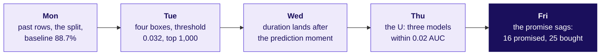

# Week 5 cheat sheet: the ML core, closed with the committee memo

## The week's picture, complete: frame, split, features, compare, justify; monitoring comes in Week 14

## Friday's hard terms

| Term | Plain meaning | Rule or formula | Trap, or what flips it |
|---|---|---|---|
| Model justification | One page a committee can approve | Claim, evidence, caveat, action; each with a number | Opening with AUC |
| Error bill | What being wrong costs | `wasted x Rs 40 + missed x Rs 1,200` | Counting found buyers as a cost |
| Cost cut | The cheapest threshold | `cheap / (cheap + expensive)`: 0.032 | Flips when scores are stale or a budget binds |
| Budget cut | Act on the top k only | Compare buyers in the top k | Mixing it up with the cost cut |
| Paired bootstrap | Is a gap bigger than luck? | Resample, recount, read the band | A tie flips once the band clears zero |
| Calibration | Does 16 in 100 mean 16 in 100? | Promise against reality | High AUC is not calibration |
| Staleness rule | When to stop trusting the model | Number, ceiling, window, owner | "Retrain every month" |
| Luck band | How far a share moves by chance | `2 x sqrt(p x (1 - p) / n)` | One month over is not drift |
| Weakest segment | Where the model ranks worst | Weakest group with a readable band | The lowest number on a tiny group |
| Transfer paragraph | What carries over to a new business | Changes, stays, would leak | "Lending needs a better model" |
| The envelope | The sealed test slice | Opened once, after choosing | A second look makes it validation |

## Everything so far, one line each

| Week | Day | The one line |
|---|---|---|
| 1 | Mon, Tue | The revenue tree first; like with like: same window, same denominator |
| 1 | Wed, Thu | Profile before you analyse; real or noise, sample size, the four-part note |
| 2 | Mon to Wed | SQL: selection to CTEs, joins without fan-out, window functions |
| 2 | Thu, Fri | pandas groupby, merge and reshape; Excel for the leadership deck |
| 3 | Build 1 | Profile, clean, reconcile, and one headline claim defended |
| 4 | Mon, Tue | A metric that cannot be gamed; one slide for three people who disagree |
| 4 | Wed, Thu | Lift beyond chance; cohorts and funnels find where the loss happens |
| 4 | Fri | A forecast must beat a baseline that is hard to beat |
| 5 | Mon | Is it an ML problem; the split, the seal, the 88.7 percent baseline |
| 5 | Tue | Four boxes, precision and recall, the cost cut and the budget cut |
| 5 | Wed | Known at prediction time, or a leak: `duration` lifts AUC 0.80 to 0.94 |
| 5 | Thu | Memorise or learn; cross-validate; the simpler model wins a tie |
| 5 | Fri | The memo: claim, evidence, caveat, action, and the transfer to lending |

## The week's interview anchors

| Tag | Question | The shape of the answer |
|---|---|---|
| [S] | Walk me through a model you built and why you chose it | Claim, evidence against a baseline, caveat, action, one choice of yours |
| [F] | How would you know your model has gone stale? | Number, ceiling, window, owner |
| [F] | What would change if this moved to a lending business? | Target, costs, cut change; split and bill stay; post-decision columns leak |
| [D] | The committee wants the higher score; you recommend the simpler one | The gap in buyers and rupees, its band, the flip |

## Three facts that make it stick

- Zillow's forecast had to hold three to six months out; its 8-K of 2 November 2021 recorded a $304.4 million write-down of Zillow Offers inventory: https://www.sec.gov/Archives/edgar/data/1617640/000161764021000085/z-20211102.htm (verified 28 October 2026)
- In March 2020 the accuracy of Instacart's found-items metric dropped from 93 to 61 percent, the signal to retrain: https://fortune.com/2020/06/09/instacart-coronavirus-artificial-intelligence (verified 28 October 2026)
- The bank file's own notes say `duration` "should be discarded if the intention is to have a realistic predictive model": https://archive.ics.uci.edu/dataset/222/bank+marketing (verified 28 October 2026)
