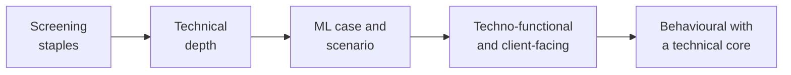

# Week 5 Friday interview bank: justifying a model

Twenty-six questions on the committee memo, the error bill, staleness and the transfer to lending. Tags: [S] a staple asked everywhere, [F] frequent in product-company and global capability centre screens, [D] a differentiator. Each answer is a scaffold to reason from: the 30-second version, the depth, what the interviewer listens for, the common wrong answer, and the two follow-ups it usually draws. The numbers are from the week's run on UCI Bank Marketing and German Credit; say your own.

## Screening staples

### 1. [S] Walk me through a model you built and why you chose it.

- **30 seconds.** "I scored 8,238 bank customers for a call campaign. I recommended a logistic model calling the top 1,000 by score: on a sealed test slice it found 482 buyers against 113 at random. Boosting found 13 more on validation, inside a band that reaches zero, so I chose the simpler one."
- **The depth.** The caveat (trained on one period, it promised 16 in 100 when 25 bought later), the action (a monthly list and a rule that pauses it), and one choice you made yourself, such as sizing the alarm's ceiling from the month's call count.
- **Listens for.** A decision, a number against a baseline, a caveat with a condition, and a choice that was yours.
- **Common wrong answer.** A tour of every algorithm tried, in the order tried.
- **Follow-ups.** "What would have made you choose boosting?" "What did the test slice say, and when did you look at it?"

### 2. [S] What is an error bill, and how do you compute it?

- **30 seconds.** Price the two mistakes and add them: wasted calls times the cost of a call, plus missed buyers times the margin lost. At Rs 40 and Rs 1,200 the logistic model's bill at the cost cut was Rs 2.82 lakh against Rs 2.92 lakh for calling everyone.
- **The depth.** Correct calls are the gain the bill is set against, so they never enter it. Under a fixed budget the bill moves only through buyers found, each worth the call cost plus the margin, Rs 1,240.
- **Listens for.** Both mistakes priced, and the bill compared with a do-nothing or do-everything baseline.
- **Common wrong answer.** Counting every call as a cost, including the buyers found.
- **Follow-ups.** "Where do the Rs 40 and Rs 1,200 come from, and who signs them off?" "What changes when Marketing caps the calls?"

### 3. [S] How do you pick a classification threshold?

- **30 seconds.** From the two costs: act when the probability beats `cheap / (cheap + expensive)`. Rs 40 against Rs 1,200 gives 0.032.
- **The depth.** The rule assumes honest probabilities; a stale or reweighted model breaks it. When a budget caps the actions, the threshold is the score of the k-th customer, and precision at k decides between models.
- **Listens for.** The formula with its condition and the budget as the flip.
- **Common wrong answer.** "0.5, the default", or "where F1 peaks", with no costs.
- **Follow-ups.** "What if the probabilities are not calibrated?" "What if the costs are unknown?"

### 4. [S] What does AUC measure, in one sentence a manager can repeat?

- **30 seconds.** Pick one buyer and one non-buyer at random; AUC is how often the model scores the buyer higher. In the gym example, model A ranked 60 of 75 such pairs the right way, 0.80.
- **The depth.** It says nothing about the threshold, the costs, or whether a promise of 16 in 100 means 16 in 100.
- **Listens for.** Pairs, in plain words, and what AUC cannot tell you.
- **Common wrong answer.** "The accuracy of the model across thresholds."
- **Follow-ups.** "Can a model with a higher AUC have a higher bill?" (Yes: boosting did at 0.032.) "When would you report AUC at all?"

### 5. [S] What is model drift, and how is it different from overfitting?

- **30 seconds.** Overfitting is a gap between training and validation at build time; drift is a gap between validation and the world after deployment, because the world moved.
- **The depth.** Trained on May 2008 to April 2009, the bank model promised 16 in 100 on later months while 25 in 100 bought. Validation, drawn from the same period, could never have shown it.
- **Listens for.** Time as the difference, and a split by time as the way to see it before deployment.
- **Common wrong answer.** "Drift is overfitting that shows up later."
- **Follow-ups.** "How would you test for it before shipping?" "Which number moves first?"

## Technical depth

### 6. [F] How would you know your model has gone stale?

- **30 seconds.** A rule with four parts: the number (the share of acted-on customers who respond, against the share the model promised), the ceiling (just above luck for that month's count), the window (two months running), and the owner who acts.
- **The depth.** On the bank's later months with a 10-point ceiling the rule fires in August 2009. Luck moves a share by about `2 x sqrt(p x (1 - p) / n)`: 9 points at 100 calls, 3 at 1,000. Drift detection methods and retraining pipelines are taught from Week 14.
- **Listens for.** A number someone else can check, and the ceiling tied to sample size.
- **Common wrong answer.** "Retrain every month."
- **Follow-ups.** "You only see outcomes for the people you called. Does that bias the check?" "What do you do in the first week after it fires?"

### 7. [F] AUC fell from 0.80 to 0.66 on new data. Is the model still usable?

- **30 seconds.** Before answering: what does the decision rest on, the ranking or the probability? If the bill is priced from the probability, the bigger problem is calibration.
- **The depth.** On the bank's later months the stale model's bill at 0.032 was Rs 4.62 lakh, Rs 89,000 more than calling everyone. 231 people it scored below 0.032 bought at about one in three.
- **Listens for.** The clarifying question, then the bill against a no-model baseline.
- **Common wrong answer.** "Yes, 0.66 is better than chance."
- **Follow-ups.** "What would you ship this week while you fix it?" "How would you have seen this before deployment?"

### 8. [F] What does calibration mean, and why does a cost threshold need it?

- **30 seconds.** A calibrated model's 16-in-100 promise comes true about 16 times in 100. The cost cut compares the probability with a cost ratio, so a wrong probability gives a wrong decision.
- **The depth.** Class weighting pushes the mean score far above the base rate and makes the formula call everyone. Calibration methods (Platt scaling, isotonic regression) are beyond today's session.
- **Listens for.** Promise against reality, in counts.
- **Common wrong answer.** "Calibration means high accuracy."
- **Follow-ups.** "How would you check calibration on validation?" "What happens to calibration when the base rate moves?"

### 9. [F] Two models are within 0.01 AUC. How do you decide whether the gap is real?

- **30 seconds.** Resample the validation customers with replacement and recount the gap each time: a paired bootstrap. If the band reaches zero, call it a tie.
- **The depth.** Boosting found 13 more buyers than logistic in 1,000 calls; over 300 resamples the band ran from about -1 to 28. The tie goes to the simpler model, with the flip stated: boosting ships when a fresh month's band clears zero.
- **Listens for.** A band, measured on the decision's own metric (buyers in the top k), and a stated flip.
- **Common wrong answer.** "The higher number wins."
- **Follow-ups.** "Why pair the resamples?" "Why measure the gap in buyers instead of AUC?"

### 10. [F] Why open the test set only once?

- **30 seconds.** Every look you act on turns it into validation, and its number stops estimating the future.
- **The depth.** The bank's test slice was sealed on Monday and opened on Friday: AUC 0.801, 482 buyers in the top 1,000, against 0.795 and 462 on validation. That number goes in the memo whatever it says.
- **Listens for.** Selection as the leak, without any test row being trained on.
- **Common wrong answer.** "It is fine to check it, as long as you do not train on it."
- **Follow-ups.** "The test number comes out worse. Do you retune?" "How big must a test slice be to trust its number?"

### 11. [F] How do you find the segment where a model is weakest?

- **30 seconds.** Score the model inside each group and put the group size and a band beside each reading; name the weakest group whose band is narrow enough to read.
- **The depth.** Entrepreneurs read AUC 0.655 on 26 buyers, band 0.54 to 0.81: unreadable. Blue-collar read 0.707 on 122 buyers, band 0.65 to 0.76: the weakest readable group. Telephone contacts ranked worse than mobile ones, 0.721 against 0.779.
- **Listens for.** Sample size before the finding.
- **Common wrong answer.** Naming the lowest number on the page.
- **Follow-ups.** "What would you do about the weak segment?" "Is a weak segment a fairness problem?"

### 12. [F] What is the difference between the cost cut and a budget cut?

- **30 seconds.** The cost cut acts on everyone above `cheap / (cheap + expensive)`; the budget cut acts on the top k because the money runs out first.
- **The depth.** At Rs 40 against Rs 1,200 the cost cut called 7,412 of 8,238. Marketing could afford 1,000, so the budget binds and the decision is a ranking.
- **Listens for.** Which constraint binds, said with the counts.
- **Common wrong answer.** Treating them as two names for one threshold.
- **Follow-ups.** "When does the cost cut bind instead?" "How do you compare two models under a budget?"

## ML case and scenario

### 13. [D] The committee wants the higher-scoring model and you recommend the simpler one. Make the case in ninety seconds.

- **30 seconds.** "Boosting finds 13 more buyers in 1,000 calls, about Rs 16,000; the band runs from -1 to 28, so it is a tie. The simpler model costs less to check each month and to explain when it drifts. Boosting ships if next month's band clears zero."
- **The depth.** Name the seat that decides: Finance, if the gap is priced; the PM, who runs the monthly check. Say why the others do not bind.
- **Listens for.** The gap in the committee's units, its band, the flip.
- **Common wrong answer.** "Simple models are always better."
- **Follow-ups.** "What if the gap had been 40 buyers?" "Who owns the decision to switch?"

### 14. [F] At your costs the model's bill is within 4 percent of calling everyone. What do you tell Marketing?

- **30 seconds.** That without a budget the model is not worth running; with the 1,000-call budget it finds about four times the random count, so that is where it earns its keep.
- **The depth.** The cost ratio of 1 : 30 puts the cut at 0.032, so almost everyone qualifies; a tighter ratio (Rs 40 against Rs 120) would move the cut to 0.25 and make the model matter without a budget.
- **Listens for.** The honest "barely matters", then where it does.
- **Common wrong answer.** Defending the model's AUC.
- **Follow-ups.** "What cost ratio would make the model matter?" "Would you still build it?"

### 15. [D] Marketing wants a model that predicts who will buy if called. What do you ask first?

- **30 seconds.** "What decision changes with the score, what does each mistake cost, and how many calls can we afford?" The answers set the target, the cut and the budget.
- **The depth.** Then the prediction moment (what is known on the morning of the call), the baseline to beat, and the split by time.
- **Listens for.** The clarifying questions before any algorithm.
- **Common wrong answer.** "I would start with XGBoost."
- **Follow-ups.** "The costs are unknown. Now what?" "How do you define 'buy'?"

### 16. [F] A committee member says your model is wrong 54 percent of the time it calls. Is that right, and what do you say?

- **30 seconds.** Yes: precision in the top 1,000 is 0.46, so 54 percent of calls are wasted. Each wasted call costs Rs 40 and each buyer found is worth Rs 1,200, so a hit rate near one in two pays many times over.
- **The depth.** Offer the trade: a smaller list raises the hit rate and loses buyers; show both counts.
- **Listens for.** Owning the chosen error with its price.
- **Common wrong answer.** "But the accuracy is 90 percent."
- **Follow-ups.** "What list size would you pick if calls cost Rs 400?" "How would you show this on one slide?"

### 17. [D] Design the monitoring for a model whose outcomes arrive three months late.

- **30 seconds.** Before answering: what can be seen on day one? The score distribution and the share above the cut can; outcomes cannot. Watch the inputs and the scores weekly, and the promise against reality once outcomes land.
- **The depth.** Zillow had to forecast home prices three to six months out and missed in both directions. A rule on the score mix needs no outcomes, so it can fire months before resale losses show (that is our reasoning, never Zillow's account). Name the owner who can stop new decisions.
- **Listens for.** Leading and lagging signals, each with an owner.
- **Common wrong answer.** "Wait for the outcomes, then retrain."
- **Follow-ups.** "Which input would you watch first?" "What would you pause, and who decides?"

### 18. [F] Your model's alert fired once. Is it drift or noise?

- **30 seconds.** Compare the gap with the luck band for that month's count; one month over can be luck, which is why the rule waits for two.
- **The depth.** July 2009 was 22 points over on 22 calls, where luck alone reaches about 20 points; August was 12.5 points over on 93 calls, where luck reaches about 9.6. August is the stronger signal.
- **Listens for.** The band computed from n.
- **Common wrong answer.** "Retrain immediately."
- **Follow-ups.** "How would you lower the false alarm rate?" "What if you cannot wait two months?"

## Techno-functional and client-facing

### 19. [F] What would change if this model moved to a lending business?

- **30 seconds.** The target (repayment), the costs and so the cut, which moves to P(repay) above 0.95 at Rs 60,000 against Rs 3,000. The pipeline, the sealed test, the baseline and the bill stay. Anything written after approval would leak.
- **The depth.** On German Credit's documented 5 : 1 matrix the line is 0.83, and the cost on 300 validation applicants falls from 266 at 0.5 to 160.
- **Listens for.** All three columns: changes, stays, leaks.
- **Common wrong answer.** "Lending needs a more accurate model."
- **Follow-ups.** "Which column would leak?" "How would you find the weakest segment there?"

### 20. [F] Explain to a head of risk why his threshold is 0.95 and Marketing's is 0.03.

- **30 seconds.** "Both lines come from one formula: the cost of the cheap mistake over the sum. Your expensive mistake is approving a default, so the line sits near certainty; Marketing's expensive mistake is missing a buyer, so its line sits near zero."
- **The depth.** Say both on the same quantity: nudge when P(buy) is above 0.03; lend when P(repay) is above 0.95.
- **Listens for.** One formula, two cost structures, words he can repeat.
- **Common wrong answer.** "Lending is riskier, so the threshold is higher."
- **Follow-ups.** "What happens to my line if defaults cost half as much?" "Can I trust the probability at 0.95?"

### 21. [F] A column named duration sits in the loan data. Do you drop it?

- **30 seconds.** Ask when it is written. In German Credit it is the loan term in months, set on the application, so it stays. In the bank file it was the call's length, written after the call, so it leaked.
- **The depth.** The prediction-time question decides, never the name.
- **Listens for.** The time stamp as the test.
- **Common wrong answer.** "Yes, duration leaked last time."
- **Follow-ups.** "Name a column that would leak in lending." "How would you audit fifty columns quickly?"

### 22. [F] The product manager asks what she needs from your memo. What do you give her?

- **30 seconds.** The operating point as one number (the top 1,000 each month), the monthly check and its ceiling, and who to call when it fires.
- **The depth.** The CEO needs the decision and its cost; the PM needs what she runs on Tuesday morning and what stops it.
- **Listens for.** The seat named, and what that seat does with the memo.
- **Common wrong answer.** The same memo for every reader.
- **Follow-ups.** "Where does the threshold live in production?" "Who may change it?"

### 23. [D] Where does the threshold live once the model is deployed?

- **30 seconds.** In one configuration value the memo names, changed only by its owner and logged; never inside the model code.
- **The depth.** A scheduled job that writes scores, the cut used and the monthly counts leaves exactly what the staleness rule reads; a notebook a TA runs leaves none of it.
- **Listens for.** Configuration, ownership, and a log the rule can read.
- **Common wrong answer.** "Hard-coded in the scoring script."
- **Follow-ups.** "Which test proves the deployed list uses it?" "What if Marketing changes the budget mid-month?"

## Behavioural with a technical core

### 24. [S] Tell me about a time a stakeholder wanted a result you could not stand behind.

- **30 seconds.** Situation: Marketing wanted the higher-scoring model. Action: I sized the gap in buyers and rupees, showed its band reaching zero, and offered a fresh-month test. Result: the simpler model shipped with a stated condition for switching.
- **The depth.** Keep the disagreement about the number, never the person.
- **Listens for.** "I" statements, a number, and the condition you offered.
- **Common wrong answer.** "I escalated to my manager."
- **Follow-ups.** "What if the fresh month had favoured boosting?" "How did the stakeholder react?"

### 25. [F] Tell me about a model that failed after it shipped. What would have caught it?

- **30 seconds.** Instacart's item-availability model in March 2020: the accuracy of its found-items metric fell from 93 to 61 percent as shoppers hoarded (Fortune, 9 June 2020). The first fix was a threshold change; the retrain followed once new observations arrived.
- **The depth.** A rule on the promise against reality, daily, with an owner who may move the threshold at once.
- **Listens for.** A verified case, the signal, the first-week action.
- **Common wrong answer.** A vague "the data changed".
- **Follow-ups.** "Why not retrain at once?" "How would you have known before customers did?"

### 26. [D] A colleague wants to report the validation score instead of the test score because it looks better. What do you do?

- **30 seconds.** Report the test score, opened once, and explain that the validation score was used to choose and is optimistic by however much the choosing bought.
- **The depth.** Here the test came out higher (482 against 462 buyers), which shows the point is honesty in both directions, never the flattering number.
- **Listens for.** The principle stated with a number, and no blame.
- **Common wrong answer.** "Report whichever is more favourable."
- **Follow-ups.** "What if the test were 20 percent worse?" "Who decides what goes in the memo?"
