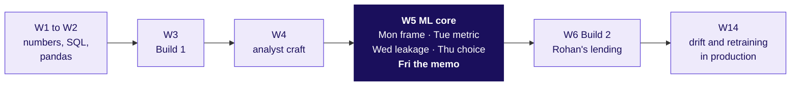

# Week 5 Friday study notes: the committee memo

Friday turned the week's model into one page a committee can approve: which model, what being wrong costs, how we will know it has gone stale, and what carries over to a lending business. These notes follow the day's five topics, then the bank case, then three real companies.

## Where does Friday sit?

Monday framed the problem and set the baseline (calling nobody is 88.7 percent accurate). Tuesday priced the mistakes and set the threshold. Wednesday removed `duration`, the column written after the call. Thursday found three models within 0.02 of AUC. Friday writes the memo that chooses one and says what it costs.

## 1. Selling a model to people who don't care about AUC

*The model justification: claim, evidence, caveat, action. Also searched as: presenting ML results to stakeholders.*

**The idea in three lines.** A justification is Week 1's four-part note at model scale. The claim names the model and its operating point; the evidence compares it with a baseline in the reader's units; the caveat says when it breaks and where it is weakest; the action names who runs it and the rule that stops it. Every part carries a number.

**Worked example (invented).** A gym in Indore has 20 lapsed members, two models, Rs 30 a call and Rs 900 lost per member who would have returned uncalled. Model B's AUC is 0.85, model A's 0.80. Both put the same 4 of the 5 returners in their top 6 calls: a bill of Rs 960 either way, against Rs 4,500 for calling nobody. The memo recommends A because it ties on the decision and runs on two columns the front desk can check.

**The trap.** Opening with "Model B's AUC is 0.85". The owner hears a number with no decision attached. AUC is the share of returner and non-returner pairs ranked the right way round (B: 64 of 75), useful to the ML lead and silent on whom to call.

**The interview line.** "I lead with the decision and its rupees, and I give the method when the reader is the ML lead."

## 2. What will mistakes cost us

*The error bill in rupees under the chosen threshold. Also searched as: cost-benefit analysis of a model, expected cost.*

**The idea in three lines.** The bill prices the two mistakes: `wasted calls x cost of a call + missed buyers x margin lost`. Buyers who were called are the gain, so they never enter the bill. The cheapest cut, when the scores are honest probabilities, is `cheap / (cheap + expensive)`.

**Worked example (invented).** At the default 0.5 the gym calls 4 members, wastes one call (Rs 30) and misses two returners (Rs 1,800): Rs 1,830. Calling all 20 costs Rs 450. The formula cut, `30 / 930 = 0.032`, calls 17 and costs Rs 360, the cheapest in the sweep.

**The trap.** "0.5 makes only four calls, so it is cheap." Fewer actions look cheaper on the call count and cost more on the bill.

**The interview line.** "The cut is the cheap mistake's cost over the sum, while the scores are honest; a budget or a stale model moves it."

## 3. When the model goes stale

*Staleness: the monitoring rule and the weakest segment. Also searched as: model drift, model monitoring.*

**The idea in three lines.** A model goes stale when the world moves and its promise does not. A monitoring rule has four parts: the number watched (the real share among the people acted on, against the share promised), the ceiling (just above luck), the window (two months running) and the owner who acts. The weakest segment is the weakest group whose band is narrow enough to read.

**Worked example (invented).** A rival gym closes in July and comebacks rise from 12 to 20, 22, then 25 in 100 while the model keeps promising 12. With 200 calls a month, luck moves a share by about `2 x sqrt(0.12 x 0.88 / 200) = 0.046`, so the ceiling is 5 points. July is over once; August makes two months running, and the front-desk manager pauses the list.

**The weakest segment.** In September, student plans show a 15-point gap on 20 calls, where luck alone reaches 16 points: unreadable. Family plans show a 20-point gap on 80 calls against a 7-point band: that is the reading to act on. This is the Week 1 sample-size reason again.

**The trap.** "Retrain every month." A calendar fires when nothing has changed and waits a month when something has.

**The interview line.** "I watch the promise against reality among the people we acted on, with a ceiling sized from the sample." Drift detection methods and retraining pipelines are taught from Week 14.

## 4. Moving the model to lending

*The transfer paragraph: what changes, what stays, what would leak. Also searched as: domain transfer, credit risk model.*

**The idea in three lines.** The same pipeline moves; the costs flip sides, so the cut moves to the other end. Stated on the same quantity: nudge when P(buy) is above 0.03; lend when P(repay) is above 0.95 at Rohan's Rs 60,000 against Rs 3,000. A column leaks when it is written after the decision, whatever it is called.

| Changes | Stays | Would leak |
|---|---|---|
| The target: bought becomes repaid | Split first, seal the test, beat a baseline | Anything written after approval |
| The costs, so the cut | The four boxes and the bill formula | Days past due, a collections flag |
| The moment of prediction | The four-part memo | |
| The weakest segment, found again | The monitoring rule's four parts | |

**Worked example (invented).** A two-wheeler lender in Nagpur loses Rs 40,000 on a default and Rs 2,000 of margin on a good applicant turned away: `40,000 / 42,000 = 0.952`. At 0.5 it approves 9 of 10 applicants and two defaults cost Rs 80,000; at 0.952 it approves 3 and turns away 4 good applicants for Rs 8,000.

**The trap.** Copying `cheap / (cheap + expensive)` without asking which mistake is now the expensive one, and landing on 0.05.

**The interview line.** "Same pipeline, the other side's costs, the opposite threshold, and the column written after the decision."

## 5. Defending it in the room

*Reading the memo aloud under challenge. Also searched as: ML case interview, stakeholder pushback.*

**The idea in three lines.** Each seat pushes on one thing: Marketing on the higher score, Finance on the bill, the product manager on what the customer gets, QA on whether the cut is live, the risk head on what carries over. A good answer carries a number in the reader's units, the reason, and the condition that would change the call. Ninety seconds holds the memo and one choice you made yourself.

**Worked example (invented).** "B scores 0.05 higher, use B." Answer: "Both find the same 4 returners in 6 calls, so the gap is worth Rs 0 this week; B ships if it finds more on next month's list."

**The trap.** Explaining what AUC measures to someone who asked for a decision.

**The interview line.** "A number in your units, the reason, and what would change my mind."

## The case: the bank's 41,188 calls, from three models to one memo

| Step | What the run showed |
|---|---|
| Three models on validation (8,238 customers, 928 buyers) | AUC: logistic 0.795, tuned tree 0.787, boosting 0.803 |
| The bill at the cost cut 0.032 | Rs 2.82, 2.83 and 2.83 lakh; calling everyone Rs 2.92 lakh. Boosting's is the largest |
| The 1,000-call budget | 462, 469 and 475 buyers found, against 113 at random |
| Is boosting's 13 real? | Paired bootstrap band about -1 to 28: a tie, so the simpler model, with its flip stated |
| Train early, score late | Trained on May 2008 to April 2009 (5.6 in 100 bought), scored to November 2010 (24.6 in 100); the promise stayed at 15.9; AUC 0.664 |
| What staleness cost | At 0.032 the stale bill was Rs 4.62 lakh against Rs 3.73 lakh for calling everyone |
| The rule | Over 10 points from the promise two months running: fires in August 2009 |
| The weakest segment | Blue-collar, AUC 0.707 on 122 buyers; entrepreneur reads 0.655 on 26 buyers, too few to read |
| German Credit (300 validation applicants) | Cost 266 at 0.5, 160 at 0.83 under the documented 5 : 1 |
| The envelope | Test AUC 0.801; 482 buyers in the top 1,000 |

## The six seats on the day's case

| Seat | The question they ask of the memo | The answer from the run |
|---|---|---|
| Business owner (Meera, Anand) | Which model, and what does wrong cost? | The logistic top 1,000; Rs 2.82 lakh at the cost cut, within 4 percent of calling everyone |
| Product manager (today's spotlight) | What do I run each month, and what stops it? | The top 1,000 list, the promise-against-reality check, Kavya as the owner |
| Solution architect | Where does the threshold live? | In one configuration value the memo names, read by a scheduled job that logs it |
| Senior ML engineer | Is the choice honest? | Chosen on validation, tested once on the sealed slice: 0.801 |
| Implementation engineer | What runs on Monday morning? | A job writing scores, the cut used and the monthly counts to a table |
| QA | How do we know the cut is live, and where does it break? | A test asserting exactly 1,000 names; blue-collar and telephone contacts are the weakest |

## What do three real companies teach about the bill and staleness?

**Zillow Offers.** Zillow bought homes on a forecast that had to hold "three to six months into the future". Its 8-K of 2 November 2021 recorded a "$304.4 million write-down of inventory associated with Zillow Offers" and a wind-down cutting about 25 percent of the workforce; the shareholder letter says Zillow was "unable to accurately forecast future home prices at different times in both directions". Source: https://www.sec.gov/Archives/edgar/data/1617640/000161764021000085/exhibit993.htm (verified 28 October 2026). The lesson for the memo: both directions of error belong in the bill, and the caveat must name the forecast horizon.

**Instacart.** In March 2020 the accuracy of the metric Instacart uses to judge how many items are found at a store "dropped to 61% from 93%", which told engineers to retrain the item-availability model (Fortune, 9 June 2020: https://fortune.com/2020/06/09/instacart-coronavirus-artificial-intelligence, verified 28 October 2026). Instacart's own post says thresholds on top of the model were adjusted "without having to train new ML models" while retraining caught up: https://company.instacart.com/tech-innovation/how-instacarts-item-availability-evolved-over-the-pandemic (verified 28 October 2026). The lesson: the first fix can be the threshold, owned by someone who may move it the same day.

**Google's Rules of ML.** Rule 37 asks teams to measure training and serving skew: training against holdout, holdout against next-day data, next-day data against live scores. Source: https://developers.google.com/machine-learning/guides/rules-of-ml (verified 28 October 2026). The lesson: a split by time is the deployment test the random split cannot give.

## Check yourself without writing

1. Say the four parts of a model justification, each with one number from your run.
2. Price the bill at 0.032 from two counts, without looking.
3. Say the staleness rule in one sentence with its four parts.
4. Explain why the lender's cut sits near 0.95 and the nudge's near 0.03, on the same quantity.
5. Answer "use the higher-scoring model" in three sentences: the number, the reason, the flip.

## What do you read next?

- scikit-learn, probability calibration: https://scikit-learn.org/stable/modules/calibration.html (verified 28 October 2026)
- Google MLCC, thresholds and the confusion matrix: https://developers.google.com/machine-learning/crash-course/classification/thresholding (verified 28 October 2026)
- StatQuest video index, any entry that felt shaky this week: https://statquest.org/video_index.html (verified 28 October 2026)
