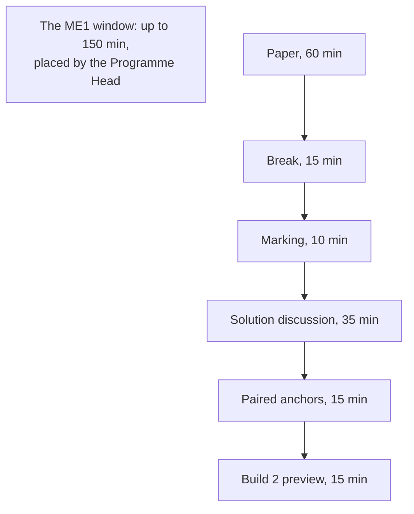

# Week 5 Saturday: the discussion guide

**TRAINER ONLY.** Posts to <!-- sync:module:W05/SAT -->Module 2: Applied Machine Learning<!-- /sync:module:W05/SAT -->, on <!-- sync:day-date:W05/SAT -->Sat 07 Nov 2026<!-- /sync:day-date:W05/SAT -->.

The Academic TA leads the day. The paper the room sits is the Word file in `paper/`; the key in
`answer-key/` carries every item's key, tag, level, day, interview anchor, why the key holds, why
each wrong option fails, the bank items folded into each item, and the stretch answers. The
item-analysis workbook beside it takes the ticks by seat and orders the discussion.

The paper puts the week back to the room on one real file: the 41,188 calls a Portuguese bank made
to sell a term deposit (UCI Bank Marketing, CC BY 4.0), with every number as the week's pipeline
printed it. The rupee costs are Kalpa's, from the labs: Rs 40 a wasted nudge, about Rs 1,200 a missed
repeat buyer, and for Rohan Desai's lending book Rs 60,000 a default against Rs 3,000 a wrongful
rejection. Two public cases sit in Part 5, Instacart and Booking.com, each with its source on the page.
The day teaches nothing new.

---

## The shape of the day

| Block | Duration | What happens |
|---|---|---|
| The ME1 window | up to 150 min | Held for ME1; the Programme Head decides whether and where it runs. Minutes ME1 does not use run as revision (below). |
| The paper | 60 min | 26 items in five parts, pen and paper, no notes and no assistant, paced at 59 minutes; anyone who finishes early turns to the untimed stretch page. |
| Break | 15 min | Papers stay face down on the desks. |
| Marking | 10 min | Papers swap and are marked against the key the Academic TA reads out. |
| The solution discussion | 35 min | The three most-missed items (15 min), then the nine anchors aloud with random call-outs (18 min), then the step-one ratings against the work (2 min). |
| Paired anchors | 15 min | In pairs, each learner gives the 30-second model story and answers one anchor and its follow-up, then they swap. |
| Build 2 preview | 15 min | Rohan Desai's business, with the constraint written into each brief. |

The day runs 300 minutes, the campus Saturday in `data/programme/facts.yaml`. The row's own blocks
keep the row's minutes: the paper 60, marking 10, the discussion 35 and the Build 2 preview 15.

---

## The ME1 window

- **What to say aloud, once.** ME1 covers four theme areas: statistics, data manipulation, analyst
  technique, and the machine learning core of this week.
- **What never to say.** No marks, no weight, no day and no slot. ME1 runs during its week as a
  continuous activity, and no file states its day or slot until the Programme Head fixes it. A
  learner who asks is told that the Programme Head's note will say.
- **When the window is not used for ME1, it runs as revision**, in this order:

| Revision block | Duration | What the room does |
|---|---|---|
| Redraw the week's picture | 20 min | Each learner draws the timeline from memory: past rows, the cut, the prediction moment and the outcome window; then adds Tuesday's two score humps and the threshold, Wednesday's duration in red to the right of the prediction moment, Thursday's U of validation error against depth, and Friday's score sagging across 2008 to 2010. Pairs compare. |
| The five day questions | 40 min | One question per day, answered aloud in groups with the day's own numbers: should we build a model at all; why can 89 percent call nobody; why was 0.93 too good; why did 99.6 on training fall below doing nothing; and what goes in the committee memo. |
| Open doubts | the rest | Doubts in the order the room raises them; anything about ME1's format goes to the Programme Head. |

---

## The paper, 60 minutes

Hand out the Word paper face down and start the time together. Step one on the first page comes
before any item: each learner rates the five parts from 1 to 4 on the answer sheet, as they are today.
Laptops closed and phones away for the whole sitting. Announce the time left at 30 minutes and at 10
minutes.

Say three things once, before the start:

- The bank's data is real: a Portuguese bank's calls from May 2008 to November 2010, published by
  the UCI repository; every number on the page is what the room's own pipeline printed.
- The rupees are Kalpa's costs from the labs, so the paper reads the bank's matrix at Kalpa's prices,
  as Tuesday did.
- Every number an item needs is on the page. Anyone who finishes early turns to the stretch page,
  which is untimed and uncounted; its third item comes back in the paired round.

If a learner asks what an item means during the sitting, the only answer is that every number the
item needs is on the page. Write the item number and the question on a slip: an item two careful
readers take two ways goes to the tracker's owner after the day.

---

## Marking, 10 minutes

1. Papers swap along the row, so nobody checks their own.
2. Read the key part by part from the key file: letters in runs of five; the five word-bank letters
   one at a time (Q5, Q11, Q16, Q21 and Q22); and the two worked items slowly (Q7 and Q8).
3. The key's rule settles the edge cases. On the four more-than-one items (Q4, Q13, Q18 and Q24),
   every correct letter and no other. Q7 is right with all three figures to two places, 0.65, 0.19
   and 0.29. Q8 is right with about 0.032, or 1 in 31, and the threshold moving down. There is no
   partial credit, because the programme has set no rule for it.
4. The marker writes each part's ticks beside that part's rating and their total as Items right, out
   of 26, and hands the paper back.
5. The Academic TA enters each paper by seat in `answer-key/C2_W05_SAT_item_analysis_TRAINER.xlsx`,
   never by name: 1 for a tick, 0 for a cross and a blank for an item left empty, and the five
   ratings. Its Discussion sheet gives the most-missed order.

The key's guessing line: a blind guesser averages 5.0 of 26, and a score of 8 or below is within reach
of guessing alone, so a paper there opens a conversation in the next session. The next
session is Build 2's first day, Tuesday 10 November, since Monday 9 November is off after Diwali; where
the key and the workbook say Monday, read Tuesday.

---

## The solution discussion, 35 minutes

### Most-missed first, 15 minutes

Take the three most-missed items from the workbook's Discussion sheet, about five minutes each. For
each, ask "a cross on item n?", call one person who crossed it to say what they wrote and why it
looked right, then put the question below to the room before reading the repair. An item the sheet
ranks higher than this list takes its place, and the key file has the reason behind every wrong
option.

| Item | What most papers will get wrong | Ask the room | The repair, said aloud | Where the week taught it |
|---|---|---|---|---|
| Q2, the split | (a), because the split is stratified, or (b), because the model never sees a date | "Which columns tell the model what month a call was made in?" | The month and the five economic indicators mark the period, so a random split lets the model learn when; the yes rate ran from 5.6 to 24.6 percent across the file, and Friday's split by date cut the AUC from 0.795 to 0.657. Train early, score late, because the ask is about the next campaign. | Monday's split by time; Friday's staleness chapter |
| Q6, the accuracy claim | (b), the true count of 848 errors against 928 | "Is a wasted call worth the same as a missed buyer?" | No: Rs 40 against Rs 1,200. Calling nobody already scores 0.887, so a point of accuracy says little; the model finds 174 of 928 buyers, a recall of 0.19. | Tuesday: why 89 percent can mean zero |
| Q7, the matrix | Recall divided by the people called; F1 taken as the plain average of 0.65 and 0.19, 0.42 | "Of the 928 buyers out there, how many did the model call?" | 174 of 928 is recall, 0.19; precision is 174 of the 268 called, 0.65; F1 on counts is 2 times 174 over 2 times 174 plus 94 plus 754, 348 over 1,196, 0.29. The harmonic mean sits near the smaller figure. | Tuesday: four boxes that tell the truth |
| Q9, the bill | (a), the prices swapped, or (d), the misses alone | "Which box costs Rs 1,200, and which costs Rs 40?" | The bill is 94 times 40 plus 754 times 1,200 at 0.5, Rs 908,560, and 2,138 times 40 plus 312 times 1,200 at 0.10, Rs 459,920: the threshold that wastes more calls costs Rs 448,640 less. | Tuesday: what each mistake costs |
| Q10, the budget | (b), the highest precision at 268 calls | "How many of the 1,000 calls does (b) leave unused, and what do the next ones convert at?" | 732 calls unused. Ranked by score, the top 1,000 hold 404 buyers, 0.404 against the base rate of 0.113, about 3.6 times. At Kalpa's costs the cost line calls nearly everyone: its bill is Rs 279,000 against Rs 292,400 for calling all 8,238, so the budget binds first and the ranking decides. | Tuesday: the budget cut, precision at k |
| Q12, the junior | (b), since accuracy barely moved | "What did recall do when duration joined?" | Buyers found went from 211 to 390 while accuracy moved 0.899 to 0.907: on an 89 percent no outcome accuracy hides a leak. The length of a call exists only once the call ends, so the list cannot use it; the dataset's own notes say to discard it. Report 0.795. | Wednesday: answers from the future |
| Q13, the columns | (b) left out, because 65 percent yes looks too good | "When was poutcome written: before this campaign or after it?" | Before: it is the last campaign's result, so it passes however strong it is. Duration fails on timing alone. | Wednesday: interrogating every column |
| Q19, the folds | (c), reading 4,942 as each model's training rows | "Which part does each fold's model train on, and which does it score?" | Five models, each trained on four folds, about 19,770 clients, and scored on the fifth, about 4,942. The scores ran 0.769 to 0.798, so one split could have read anywhere in that band. | Thursday: five exams instead of one |
| Q20, the winner | (a), the highest number | "How far apart did the five folds of one model land, and how far apart are the three families?" | The folds spread 0.03; the families sit within 0.011, inside the noise. On a tie the explainable logistic model ships, and the memo names the gap at which boosting would. | Thursday: why the boring model often ships |
| Q23, the alarm | (b), retraining every night | "How would nightly retraining tell you the old model had failed?" | It cannot: nothing is measured. The rule sets the called clients' yes rate against the mean score, monthly, with the gap stated in advance; on the late rows the mean score was 0.152 against 24.6 percent yes. Instacart's alarm was a monitored metric, 93 to 61 percent, and its first fix was a threshold. | Friday: when the model goes stale |
| Q26, the lending line | (c), the expensive error's cost on top | "Which error is cheap in lending, and which is cheap in the nudge?" | The line is the cheap error's cost over both: 3,000 over 63,000, about 0.05 chance of default, so Rohan lends only above about 95 percent sure of repayment, while the nudge acts on a 3 percent chance of a yes. | Friday: moving the model to lending; Tuesday's hand count |

When a learner connects an item to Kalpa, keep to what the labs did with Kalpa's costs and people, and
add no figure: the Kalpa numbers the row once planted belonged to a dataset that was never generated,
so no answer quotes them. When a learner asks about Instacart or Booking.com, keep to what Exhibit 5B
reports.

### The anchors aloud, 18 minutes

Ask each anchor as an interviewer would: name the person, ask the question, then wait. Give sixty
seconds to one learner called at random, then ask the room for the one sentence that would make the
answer stronger, and read the scaffold below only if nobody gets there. Each anchor takes two minutes.
The scaffolds are reasoning to rebuild aloud in the learner's own words: the 30-second version, the depth
an interviewer pushes for, and two follow-ups with what a strong answer says.

#### 1. [S] Overfitting: what it is, how you detect it, how you fix it.

*Items Q17, Q18 and Q21. Thursday: memorising against learning; putting brakes on the model.*

- **30 seconds.** Overfitting is a model that memorises its training rows instead of the pattern.
  You see it as a gap between training and validation: the room's unlimited tree scored 0.996 on
  training and 0.837 on validation, below the 0.887 of calling nobody. You fix it with a brake, a depth
  cap, a minimum leaf size or a penalty on the weights, with its strength chosen on validation or by
  cross-validation.
- **The depth.** Draw the U: training error keeps falling as the tree deepens, validation error
  falls and then rises, and the brake sits at the bottom of the U, depth 5 by AUC here.
- **Follow-up: "Training and validation both read 0.93. Are you safe?"** Not yet: a leak lifts both,
  as duration did to 0.932 on validation. Check every column's timing and score a later period.
- **Follow-up: "The penalty lowered your training score. Why accept that?"** Training is never the
  goal; the penalty trades a little training fit for a model that holds up on rows it has not seen.

#### 2. [S] Precision, recall and F1 from a confusion matrix.

*Items Q7 and Q11. Tuesday: four boxes that tell the truth; of those we flagged, of those we missed.*

- **30 seconds.** Precision is of those I flagged, how many were right: 174 of 268 called, 0.65.
  Recall is of those out there, how many I found: 174 of 928 buyers, 0.19. F1 is their harmonic mean,
  0.29, which stays near the weaker of the two.
- **The depth.** On counts, F1 is 2TP over 2TP plus FP plus FN, which needs no decimals. Moving the
  threshold from 0.5 to 0.10 trades them: recall 0.19 to 0.66, precision 0.65 to 0.22.
- **Follow-up: "When would you report F1?"** When both errors matter and nobody has priced them;
  once the costs are known, the error bill in rupees decides and F1 is a summary.
- **Follow-up: "Which one rises when you lower the threshold?"** Recall, because more of the real
  buyers clear the bar; precision usually falls, because more non-buyers do too.

#### 3. [S] What is data leakage, and how do you catch it?

*Items Q12, Q13 and Q16. Wednesday: answers from the future; interrogating every column.*

- **30 seconds.** Leakage is information in training that will not exist when the model is used.
  I catch it with one question per column, when does this value exist, and with suspicion of any jump
  that looks too good: adding the call's duration lifted AUC from 0.795 to 0.932, and a call's length
  exists only after the call.
- **The depth.** A leak can be a process as well as a column: a scaler or an imputer fitted on all the
  rows before the split, or, on a random split, the economic columns telling the model which month a
  call was made in. Pipelines fitted inside each fold and a split by time catch both.
- **Follow-up: "65 percent of past successes say yes again. Is poutcome a leak?"** No. It was recorded
  before this campaign began, so it passes the timing test however strong it is.
- **Follow-up: "What would leak in Rohan's lending model?"** Anything written after the approval,
  such as days past due or a collections flag, which exists only for loans that were granted.

#### 4. [S] Train, validation, test: which is spent once?

*Items Q1, Q2 and Q5. Monday: don't peek at the exam paper; the sealed envelope.*

- **30 seconds.** Training fits the model, validation chooses among models and thresholds, and the
  test is spent once, at the end, on the model already chosen. The week sealed it on Monday and opened
  it on Friday.
- **The depth.** When the question is about the future, split by time as well: train on the earlier
  calls and score the later ones, because the yes rate moved from 5.6 to 24.6 percent across the file.
- **Follow-up: "You peeked at the test and changed the threshold. Now what?"** Say so. The test has
  become validation; the honest score comes from data nobody has touched, such as next month's calls.
- **Follow-up: "Why keep a test if you cross-validate?"** Cross-validation does the choosing, so its
  score carries the choice; the test reports the chosen model once, untouched by any decision.

#### 5. [F] Accuracy is 96 percent on a 96 to 4 split; good model?

*Item Q6. Tuesday: why 89 percent can mean zero.*

- **30 seconds.** It tells me nothing yet: a model that always says no scores 96 percent. I quote the
  base rate first, then recall and precision, then the bill. On the bank's file, calling nobody scores
  0.887 and the model 0.897, and the model finds 174 of the 928 buyers.
- **The depth.** Accuracy weighs every error the same, and the two errors here cost Rs 40 and Rs 1,200.
- **Follow-up: "When does accuracy stop lying?"** When the classes are near balanced and the two
  errors cost about the same; that is the rule's flip condition.
- **Follow-up: "What do you report instead?"** Recall at a stated precision, or precision at the
  budget's cut, with the error bill in rupees beside it.

#### 6. [F] Why cross-validation instead of one split?

*Items Q19 and Q22. Thursday: five exams instead of one.*

- **30 seconds.** One split is one draw of which rows land in validation. Five-fold cross-validation
  fits five models, each on four-fifths of the rows, so every row is validated once; the room's folds
  ran from 0.769 to 0.798, so one split could have reported anything in that band. I quote the mean,
  0.786, and the spread.
- **The depth.** A gap between two models smaller than the spread of the folds is a tie.
- **Follow-up: "The rows run in date order. Does k-fold still hold?"** Not for a question about the
  future: train on earlier folds and validate on the later one, rolling forward.
- **Follow-up: "Where is the scaler fitted?"** Inside each fold's training part, through a pipeline,
  or the validation fold has leaked into the scaling.

#### 7. [F] Precision or recall for fraud, and why?

*No item; the bank holds none. Tuesday's cost line and Build 2's fraud seed.*

- **30 seconds.** It depends on what each error costs and what a flag does. If a flag sends a
  transaction to review, a missed fraud costs far more than a review, so recall leads. If a flag
  blocks a genuine customer's payment, a false alarm has a real price, and precision gains weight.
  With a fixed review team, the answer is precision at the team's capacity.
- **The depth.** Build 2's fraud seed has half a percent positives, so flagging nothing scores 99.5
  percent accuracy; the line comes from the two costs, as Tuesday drew it.
- **Follow-up: "The team can review 200 cases a day. Now what?"** Rank by score, review the top 200,
  and report precision and recall at 200.
- **Follow-up: "Fraud is confirmed weeks later. What does that do to your matrix?"** The latest weeks
  hold frauds still labelled genuine, so evaluate on a window whose labels have matured.

#### 8. [D] Your tuned model beats a simpler one by a hair: which ships, and why?

*Items Q20, Q24 and Q25. Thursday: why the boring model often ships; Friday's memo.*

- **30 seconds.** Inside the noise, the simpler one. Boosting led logistic regression by 0.011 AUC
  while the five folds of one model moved by 0.03, so it is a tie, and the logistic model is explained
  in one line per weight, monitored easily and moved to lending with less to re-check.
- **The depth.** Name the gap that would flip the call: one that clears the folds' spread and finds
  enough extra buyers in the same 1,000 calls, at about Rs 1,200 each, to pay for running and
  explaining the complex model. Then ask for a randomised trial, since Booking.com found offline gains
  and business gains almost uncorrelated across 23 comparisons.
- **Follow-up: "What gap would change your mind?"** The one above, stated in AUC and in rupees before
  the comparison is run.
- **Follow-up: "The committee only wants the best score."** Offline scores are the health check; the
  trial on deposits sold is the evidence, and the memo asks for it.

#### 9. [D] The same model in retail and lending: why are the thresholds opposite?

*Items Q8 and Q26. Tuesday: same model, opposite threshold; Friday: moving the model to lending.*

- **30 seconds.** The line sits at the cheap error's cost over the sum of both. For the nudge that is
  40 over 1,240, about 0.032: act on a 3 percent chance, since a miss costs thirty times a wasted
  nudge. For Rohan, 3,000 over 63,000, about 0.05 chance of default: lend only above about 95 percent
  sure of repayment, since a default costs twenty times a wrongful rejection.
- **The depth.** Both rules assume calibrated probabilities. The week's pipeline file measured that
  `class_weight="balanced"` pushes the mean prediction to about 0.39 against a true 0.11, which would
  make the nudge's rule call everyone.
- **Follow-up: "What has to be true of the scores?"** They must be calibrated on recent data, which is
  also what goes stale first, as the bank's late rows showed.
- **Follow-up: "What changes in the memo for lending?"** The error bill, the threshold and the
  caveat; the method, the split and the leak test carry over unchanged.

### Ratings against the work, 2 minutes

Ask each learner to set the five ratings from step one beside the five part scores, and to circle the
part where the gap is widest. A 4 beside a low score is the one to work on first.

---

## Paired anchors, 15 minutes

- Pairs. The first learner gives the 30-second model story from Stretch 3: the problem, three numbers
  from the week's run and one choice they would make differently. The partner then asks one anchor
  from the list above and its first follow-up. Then they swap.
- The listener says one thing only: which seat decides the answer they just heard (the business
  owner, the product manager, the solution architect, the senior ML engineer, the implementation
  engineer or QA), and whether the answer named it.

---

## The Build 2 preview, 15 minutes

Build 2 opens on Tuesday 10 November, since Monday 9 November is off after Diwali, at Kalpa Financial
Services, Rohan Desai's payments and lending business. Each sub-problem arrives with a constraint
written into its brief; the briefs ship when they lock, so say the five seeds and what each carries
over from this week, and nothing about how the build is assessed.

| Sub-problem seed (`docs/07_Client_Zero.md`) | The constraint written in | What carries over from Week 5 |
|---|---|---|
| Credit approval | A default costs twenty times a wrongful rejection | Friday's line: lend only above about 95 percent sure of repayment, on calibrated scores |
| Fraud | Half a percent of cases are positive | Tuesday: accuracy lies at 99.5 percent; recall, precision and precision at the review team's capacity |
| Collections prioritisation | A fixed team | Tuesday's budget cut: rank, cut at capacity, report precision at k |
| Churn on the payments app | The target is defined first | Monday: the target, the prediction moment and the outcome window before any model |
| The lending campaign that lifted approvals 9 percent | Cause or mix | Wednesday: what an importance chart cannot tell you, and Week 4's mix effect |

Close on one question for the room to carry into Tuesday: in Rohan's business, which column would
leak?

---

## After the session

- The Academic TA sends any item the workbook flags, with the room's rate, to the tracker's owner,
  and brings the tally by tag and by part to Build 2's first day.
- Learners who rated a part 3 or 4 and scored low in it revisit StatQuest's index for that topic:
  cross-validation, the confusion matrix, ROC and AUC, regularisation, decision trees, random forests
  and logistic regression are all listed in StatQuest's video index,
  https://statquest.org/video_index.html (checked 28 October 2026).
