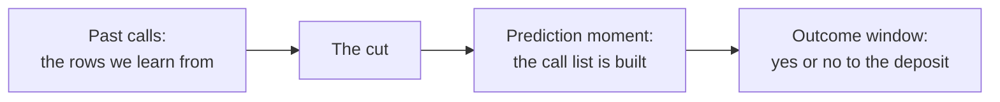
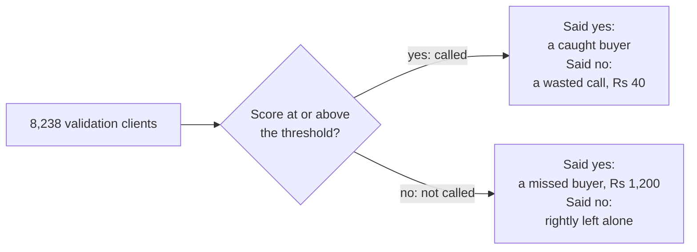
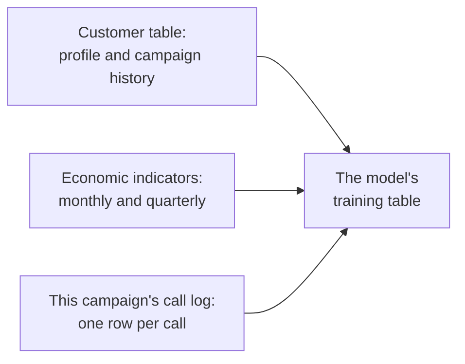
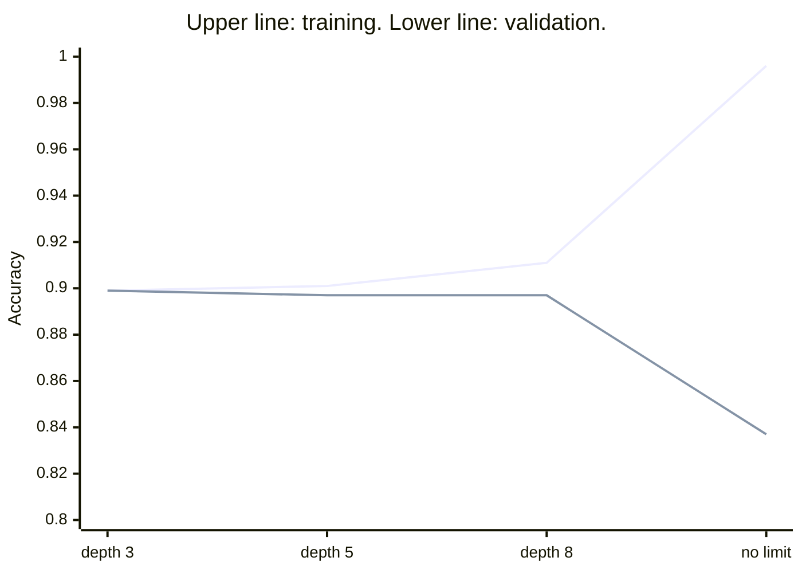
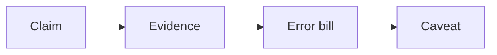

# Week 5 recap paper

Saturday 7 November 2026 · 60 minutes · 22 items in 5 parts · pen and paper, no assistant, no notes

Name: ____________________    Marked by: ____________________    Items right: ____ of 22

## What this paper is for

This week one real file carried every decision: 41,188 calls a Portuguese bank made to sell a term deposit, scored by the pipeline the room ran from Monday to Friday. The same questions ran on Kalpa in the lab, priced in Kalpa's rupees. This paper puts the week's calls back to you: whether a question needs a model and how the rows are split, which number tells the truth on a lopsided outcome and where the threshold goes, which columns the model was allowed to know, whether a model is learning or memorising, and what the committee needs before it signs and what moves to lending. Most items join two of the week's ideas on one exhibit, the way an interviewer pushes past the first answer. The room's score in each part, set beside the rating you give that part in step one, tells the next session where to start.

## How this paper works

- 60 minutes in one sitting. Each part gives its minutes as a guide, not a limit.
- Every item names its format beside its number: circle one letter, circle every correct letter, or show the working and the answer.
- Every item also names its level, easy, medium or hard, so you can plan your time. A hard item is several steps on an exhibit, never an obscure fact.
- A wrong answer costs nothing, so answer every item on the line under it.
- Pen and this paper only: no laptop, no phone, no notes and no assistant.
- Afterwards the papers are swapped and marked against the key, and the discussion takes the items the room missed most. The paper is ungraded and ranks nobody; the room's rates by part and by tag set Monday's revision.
- Every part opens on the UCI Bank Marketing dataset (Moro, Rita and Cortez, CC BY 4.0), a real bank's real calls, and on the numbers the week's pipeline printed on it; the rupee costs are Kalpa's, from the labs. Kalpa Retail's people are Meera Raghavan, the CEO, and Anand Iyer, the finance controller, with the marketing lead named by role; Kalpa Financial Services is Rohan Desai's payments and lending business, where he is head of risk. Items that use a public case (Zech and others on pneumonia X-rays, Instacart, Booking.com, Stripe and Flipkart) give the source beside the fact, and every number an item needs is on the page.

## Step one, before Part 1

Before you read any item, rate yourself from 1 to 4 on each part in the table below, as you are today. The comparison between your rating and your score in each part is the most useful thing this paper produces for Monday.

- 1: I have not used this
- 2: I can follow it when someone shows me
- 3: I can do it alone on a small problem
- 4: I can find and fix mistakes in someone else's version

Your ratings: Part 1 ___ · Part 2 ___ · Part 3 ___ · Part 4 ___ · Part 5 ___

## The paper at a glance

| Part | What it shows | Items | Minutes | Easy | Medium | Hard |
|---|---|---|---|---|---|---|
| 1. Should the bank build a model, and what must it beat? | whether you can frame a prediction problem, split the rows honestly and read what a model's score says | Q1 to Q4 (4) | 10 | 0 | 1 | 3 |
| 2. Which number tells the truth, and where does the line go? | whether you can read a confusion matrix, price each error and set the line the business can afford | Q5 to Q9 (5) | 15.5 | 0 | 3 | 2 |
| 3. What was the model allowed to know? | whether you can test each column against the moment of prediction and say what a coefficient does and does not prove | Q10 to Q13 (4) | 10.5 | 0 | 1 | 3 |
| 4. Is the model learning, or memorising? | whether you can read training against validation, choose complexity by cross-validation and say when the simpler model ships | Q14 to Q17 (4) | 10 | 0 | 3 | 1 |
| 5. Would the committee sign, and what moves to lending? | whether you can say what a memo must prove, how a model is caught going stale and why the same model draws an opposite line in lending | Q18 to Q22 (5) | 12.5 | 0 | 1 | 4 |
| Total | | 22 | 58.5 | 0 | 9 | 13 |

---

## Part 1. Should the bank build a model, and what must it beat? (Q1 to Q4)

*What it shows: whether you can frame a prediction problem, split the rows honestly and read what a model's score says. 4 items, about 10 minutes.*

From May 2008 to November 2010 a Portuguese retail bank phoned its clients to sell a term deposit. The UCI Machine Learning Repository publishes the 41,188 calls, in date order, as the Bank Marketing dataset (bank-additional-full.csv, CC BY 4.0), and 4,640 of them, 11.27 percent, ended in a yes. This week the room ran one pipeline on that file: on Monday 20 percent of the rows were sealed as the test slice, to be opened once on Friday, and the rest split three to one into training and validation. Exhibit 1A shows the week's picture, the slices and the first two scores on the 8,238 validation clients. The bank's marketing head asks whom to call in the next campaign. In the lab the same question ran at Kalpa Retail, where the marketing lead asked which members to nudge and Anand Iyer priced a wasted nudge at Rs 40 and a missed repeat buyer at about Rs 1,200.

**Exhibit 1A.** The week's picture and the week's split: UCI Bank Marketing, bank-additional-full.csv, as the week's pipeline split and scored it (random seed 42, the outcome kept at the same share in every slice).

| Line | On the week's run |
|---|---|
| Training slice | 24,712 clients, 11.27 percent yes |
| Validation slice | 8,238 clients, 928 of them yes (11.26 percent) |
| Test slice, sealed on Monday | 8,238 clients, opened once on Friday |
| Call nobody, on validation | accuracy 0.887; finds 0 of the 928 buyers |
| Logistic regression on the customer table, threshold 0.5 | accuracy 0.897; AUC 0.761; finds 174 of the 928 |

#### Q1 · Medium · circle every correct letter · Sort the asks

The bank's marketing head brings four asks. Which need a model that predicts? Circle every correct letter.

a) the clients to call first next month, ranked by their chance of saying yes
b) each month's chance of a yes in 2009, counted from the calls for the annual report
c) the clients whose previous campaign ended in success, listed by branch
d) each new client's own chance of a yes on a first call, before anyone calls

#### Q2 · Hard · circle one letter · Read one score

The logistic model on the customer table gives one client a score of 0.71, and its validation AUC is 0.761 (Exhibit 1A). What does the 0.71 say, and what would let the memo read it that way?

a) A 71 percent chance of a yes, and the AUC of 0.761 already shows the scores can be read as chances.
b) The model is right on about 71 percent of the clients it scores, if the validation slice confirms it.
c) The client will say yes, since a score above 0.5 is a yes once the model beats calling nobody.
d) About 71 in 100 such clients say yes, if about 71 in 100 validation clients scored near 0.71 did.

#### Q3 · Hard · circle one letter · Predict the fresh score

On Monday a junior tried 60 versions of the model, each on a different list of the customer table's columns, scored all 60 on the same 2,000 held-out clients and kept the best: accuracy 0.9055 there, where calling nobody scores 0.8875. On 6,238 fresh clients, where calling nobody scores 0.8873, what does the chosen version score, and what have the 2,000 clients become?

a) About 0.906 again, since the version never trained on the 2,000; they remain a fair test of it.
b) About 0.887, since the loop found only luck and its edge vanishes; the 2,000 have become training.
c) About 0.897: part of the 1.8-point edge was luck the loop picked; the 2,000 are now validation.
d) About 0.902: a peek doubles an edge, so half of the 1.8 points was luck; the 2,000 are now validation.

#### Q4 · Hard · circle one letter · Judge the split

The calls run in date order. On the week's run the earliest 70 percent of rows say yes 5.6 percent of the time and the latest 30 percent say yes 24.6 percent of the time. Statement: for the question "whom do we call in the next campaign", a split by date estimates the model's score more honestly than a random split of all the rows. True or false, and why?

a) True: a random split trains on later months than it validates on; train early and score late, like the ask.
b) True: a split by date keeps more yes rows in validation, so its score is less noisy than a random split's.
c) False: a stratified random split keeps 11.27 percent yes in every slice, so each is a fair sample of clients.
d) False: the model never reads a date column, so the order in which the calls were made cannot move its score.

---

## Part 2. Which number tells the truth, and where does the line go? (Q5 to Q9)

*What it shows: whether you can read a confusion matrix, price each error and set the line the business can afford. 5 items, about 15.5 minutes.*

On Tuesday the room scored the customer-table model the way the business will judge it. Exhibit 2A gives two matrices on the same 8,238 validation clients: calling nobody, and the model at the default threshold of 0.5. Each outcome is priced at Kalpa's costs, as Tuesday priced them: a call to a client who says no wastes Rs 40, and a buyer the list leaves out loses about Rs 1,200 of margin. The marketing head's question is the bank's version of the marketing lead's at Kalpa: whom to call, and how many.

**Exhibit 2A.** Two confusion matrices on the 8,238 validation clients, and what each box costs at Kalpa's prices.

| Matrix | Called, said yes | Called, said no | Not called, said yes | Not called, said no |
|---|---|---|---|---|
| Call nobody | 0 | 0 | 928 | 7,310 |
| Model at 0.5 | 174 | 94 | 754 | 7,216 |

#### Q5 · Medium · circle one letter · Judge the accuracy claim

Statement: an accuracy of 0.897 against 0.887 for calling nobody shows that the model at 0.5 is good enough to run the campaign. True or false, and why?

a) True: it beats its baseline on the same 8,238 clients, and a model that beats its baseline is ready to run.
b) True: it gets 848 clients wrong against the baseline's 928, so it makes 80 fewer mistakes in the campaign.
c) False: accuracy is fair only on the sealed test slice, so 0.897 means nothing until Friday's envelope is opened.
d) False: calling nobody already scores 0.887, so accuracy says little; at 0.5 the model finds 174 of 928 buyers.

#### Q6 · Medium · show the working, then the answer · Work the matrix

From the model's row of Exhibit 2A, compute its precision, recall and F1 at the threshold of 0.5, each to two decimal places. Show the working.

Working:

Answer: ____________________

#### Q7 · Medium · show the working, then the answer · Draw the line

A call to a client who says no wastes Rs 40, and a buyer left off the list loses about Rs 1,200. Above what chance of a yes is a call worth making, and which way does that move the threshold from 0.5? Show the working.

Working:

Answer: ____________________

**Exhibit 2B.** The customer-table model at four thresholds on the 8,238 validation clients.

| Threshold or cut | Called | Caught buyers | Wasted calls | Missed buyers |
|---|---|---|---|---|
| 0.5 | 268 | 174 | 94 | 754 |
| 0.20 | 864 | 376 | 488 | 552 |
| 0.10 | 2,754 | 616 | 2,138 | 312 |
| The cost line | 7,438 | 913 | 6,525 | 15 |

#### Q8 · Hard · show the working, then the answer · Choose by F1 or by the bill

Two teammates choose between the thresholds of 0.20 and 0.10 in Exhibit 2B: one by F1, the other by the error bill at Rs 40 a wasted call and Rs 1,200 a missed buyer. Which threshold does each choose, with the figures that decide it, and why do the two choices differ? Show the working.

Working:

Answer: ____________________

#### Q9 · Hard · circle one letter · Spend 1,000 calls

The call centre can make 1,000 calls in the next campaign, and the cost line would call 7,438 of these 8,238 clients (Exhibit 2B). Which plan goes to the marketing head?

a) Call the 864 clients above 0.20, at a precision of 0.435, and hold the other 136 calls in reserve.
b) Call the 268 clients above 0.5, where precision is at its highest, and save the rest of the budget.
c) Rank every client by score and call the top 1,000, wherever that cut happens to fall on the scores.
d) Draw 1,000 clients at random from the 7,438 above the cost line, since every one of them clears it.

---

## Part 3. What was the model allowed to know? (Q10 to Q13)

*What it shows: whether you can test each column against the moment of prediction and say what a coefficient does and does not prove. 4 items, about 10.5 minutes.*

On Wednesday two more feeds were joined to the customer table: five economic indicators, each published for its month or quarter, and this campaign's call log. Exhibit 3A gives the validation scores as each feed joins. A junior analyst wants to ship the last line tonight, and the marketing head asks which line to trust for next month's call list.

**Exhibit 3A.** The three feeds joined on Wednesday, and the logistic model's validation scores as each feed joins, threshold 0.5, the 928 validation buyers.

| Columns in the model | Validation AUC | Accuracy at 0.5 | Buyers found at 0.5 |
|---|---|---|---|
| The customer table: profile and campaign history | 0.761 | 0.897 | 174 |
| The customer table and the five economic indicators | 0.795 | 0.899 | 211 |
| All of those and duration, the call's length in seconds | 0.932 | 0.907 | 390 |

#### Q10 · Medium · circle one letter · Answer the junior

The junior's message reads: "Adding duration lifts AUC from 0.795 to 0.932. Shipping tonight." What is the reply?

a) Ship it: the dataset's authors put duration in the file, so it is a fair column for the model.
b) Hold it: accuracy only rose from 0.899 to 0.907, so the AUC jump must be noise in validation.
c) Drop it: a call's length exists only once the call ends, so no list can use it; report 0.795.
d) Keep it but scale it first, since a column measured in raw seconds is what inflates the AUC.

#### Q11 · Hard · circle every correct letter · Test each column

The list for next month's campaign is built on the morning before the first call. Which columns pass the prediction-time question? Circle every correct letter.

a) duration, the length in seconds of this campaign's last call to the client
b) poutcome, the last campaign's result; 65 percent of its successes say yes
c) age, job and housing, as they stand in the customer table that morning
d) a callback flag an agent sets when a client asks to be called again in this campaign

**Exhibit 3B.** A pneumonia model trained on chest X-rays from two hospital systems, as Zech and others report it (PLOS Medicine, 2018).

| What the paper reports | Value |
|---|---|
| The model's AUC on held-out X-rays from its own two hospital systems | 0.931 |
| The same model's AUC at a third hospital system | 0.815 |
| Pneumonia rate in the two training systems | 34.2 percent and 1.2 percent |

#### Q12 · Hard · circle one letter · Diagnose the drop

Exhibit 3B reports a pneumonia model that scored well on held-out X-rays and worse at a new hospital. Which reading holds, and which check would have caught it before launch?

a) It learned which hospital took each X-ray, a shortcut its held-out set shared; test it on a new site.
b) It memorised its training X-rays, so a stronger penalty or a smaller network would have closed the gap.
c) The new hospital's X-rays were poorer, so the drop says nothing about the model and needs no check.
d) 0.815 is still a strong AUC, so the model carries over, and the drop is the noise of one test set.

**Exhibit 3C.** Two readings of Wednesday's models on the week's run: the importance chart of the model with every column, and the logistic model's weight on euribor3m, the three-month interest rate, on the standardised scale.

| What the week's run shows | Value |
|---|---|
| duration's place on the importance chart of the model with every column | first |
| Mean call length: clients who said yes; clients who said no | 553 seconds; 221 seconds |
| euribor3m's weight with no other column in the model | -0.92 |
| euribor3m's weight beside the customer table and the other four indicators | +0.39 |

#### Q13 · Hard · circle one letter · Check two conclusions

The marketing head reads Exhibit 3C and draws two conclusions. One: longer calls make deposits, so agents should be coached to keep clients on the line. Two: higher rates bring deposits, since euribor3m's weight is +0.39 once the other columns are held fixed. Which reply holds?

a) Both hold: the chart and the weight come from models that scored well on the validation slice.
b) One fails, since a yes makes the call long; two holds, since the full model holds the other columns fixed.
c) One holds, since 332 seconds is far beyond chance; two fails, since the weight flips as columns join.
d) Both fail: a yes lengthens the call, and the rate moves with the other indicators; neither is an effect.

---

## Part 4. Is the model learning, or memorising? (Q14 to Q17)

*What it shows: whether you can read training against validation, choose complexity by cross-validation and say when the simpler model ships. 4 items, about 10 minutes.*

On Thursday the room grew a decision tree on the honest columns Wednesday's audit kept, first with no limit on its depth and then reined in. Exhibit 4A gives the tree's training and validation scores by depth; calling nobody scores 0.887 accuracy on the same validation clients. The committee's question for Friday is which model goes into the memo, and why that one.

**Exhibit 4A.** A decision tree on the honest columns: accuracy on training and on validation by maximum depth, with validation AUC, the week's split.

| Maximum depth | Training accuracy | Validation accuracy | Validation AUC |
|---|---|---|---|
| 3 | 0.899 | 0.899 | 0.751 |
| 5 | 0.901 | 0.897 | 0.783 |
| 8 | 0.911 | 0.897 | 0.777 |
| No limit | 0.996 | 0.837 | 0.619 |

#### Q14 · Medium · circle one letter · Read the depth curve

The unlimited tree scores 0.996 on training and 0.837 on validation, below calling nobody. Which reading and which next step are right?

a) It memorised the training clients; cap the depth near the validation peak, confirmed by CV.
b) It needs more columns to learn from; join the call log so validation catches up with training.
c) It has not trained long enough; grow it further until validation rises to meet training.
d) Validation has drifted from training; refit the unlimited tree on validation and report it.

#### Q15 · Medium · circle every correct letter · Pick the brakes

Which of these put a brake on overfitting? Circle every correct letter.

a) capping the tree's depth, or asking for more clients in every leaf
b) a stronger penalty on the logistic weights, a smaller C in scikit-learn
c) refitting until the training rows score 1.0 at every new setting
d) a simpler depth or penalty, chosen by five-fold cross-validation

**Exhibit 4B.** Five-fold cross-validation of the logistic model on the 24,712 training clients, honest columns, and three model families scored on the 8,238 validation clients.

| Run | AUC |
|---|---|
| Logistic, fold 1 | 0.771 |
| Logistic, fold 2 | 0.769 |
| Logistic, fold 3 | 0.797 |
| Logistic, fold 4 | 0.796 |
| Logistic, fold 5 | 0.798 |
| Logistic, mean of the five folds | 0.786 |
| Logistic regression, on validation | 0.795 |
| Random forest, on validation | 0.799 |
| Gradient boosting, on validation | 0.806 |

#### Q16 · Medium · circle one letter · Count the folds

Five-fold cross-validation of the logistic model gave the five fold scores in Exhibit 4B. How many models were fitted, on about how many clients each, and what does the spread tell the committee?

a) One model, scored five times on 4,942 clients each; the spread is that one model's error.
b) Five models on about 19,770 clients each; one split could have read 0.77 or 0.80.
c) Five models on about 4,942 clients each; the spread says the model needs more rows.
d) Five models on all 24,712 clients each; the spread is noise and says nothing of a split.

#### Q17 · Hard · circle one letter · Judge the winner

Statement: the logistic model should go into the memo, although gradient boosting scores the highest validation AUC of the three families in Exhibit 4B. True or false, and why?

a) True: a logistic model cannot overfit its rows, so its validation score is the safer one to quote.
b) True: a lead must hold fold by fold and pay its upkeep in rupees; until then, the plainer model ships.
c) False: 0.806 is above 0.799 and 0.795 on the same validation rows, and the memo reports the best found.
d) False: AUC cannot compare models of different families, so the committee needs each accuracy at 0.5.

---

## Part 5. Would the committee sign, and what moves to lending? (Q18 to Q22)

*What it shows: whether you can say what a memo must prove, how a model is caught going stale and why the same model draws an opposite line in lending. 5 items, about 12.5 minutes.*

On Friday the room wrote the memo for Meera Raghavan's committee: Anand Iyer, the marketing lead and Rohan Desai of Kalpa Financial Services, who is watching for his own business. The bank's file showed what time does to a model. Trained on the earliest 70 percent of the calls and scored on the latest 30 percent, the logistic model on the honest columns met a world where far more clients said yes than it had learned (Exhibit 5A). Exhibit 5B sets two public cases beside it.

**Exhibit 5A.** The four lines of the committee memo, and the bank's file split by date: the logistic model on the honest columns.

| Line | On the week's run |
|---|---|
| Earliest 70 percent of calls, 28,831 clients | 5.6 percent said yes |
| Latest 30 percent of calls, 12,357 clients | 24.6 percent said yes |
| Mean predicted chance of a yes on the latest 30 percent | 0.159 |

**Exhibit 5B.** Two public cases. Instacart: Fortune, 9 June 2020, and Instacart's engineering blog, 10 July 2023. Booking.com: Bernardi, Mavridis and Estevez, KDD 2019, section 3.

| Case | What the source reports |
|---|---|
| Instacart's item-availability model, March 2020 | A metric used to evaluate the model that predicts whether an item is in stock fell from 93 percent to 61 percent, which told the engineers to retrain; by June it read about 85 percent |
| Instacart, looking back | Models respond slowly to a shock because they need enough new observations; thresholds on top of the model were changed without training new models |
| Booking.com, 23 comparisons of a new model against a proven one | Offline gain (ROC AUC or mean reciprocal rank) against the gain in a business metric when the two models were compared live: Pearson correlation -0.1, 90 percent interval -0.45 to 0.27 |

#### Q18 · Hard · circle one letter · Set the alarm

On the latest 30 percent of calls the model's mean score was 0.159 while 24.6 percent said yes (Exhibit 5A), and Exhibit 5B sets Instacart's case beside it. Which monitoring rule catches this first, and what happens to the cut on these scores that the cost line sets?

a) Set each month's called yes rate against the mean score, with a stated gap; the cut moves down, as scores run low.
b) Set each month's called yes rate against the mean score, with a stated gap; the cut moves up, as more clients now say yes.
c) Retrain every night on the newest calls; the scores then stay current, so the cut on them needs no second look.
d) Compare training accuracy month by month; a fall there flags the drift, and the cut stays where Tuesday drew it.

#### Q19 · Medium · circle every correct letter · Fill the caveat

Which lines belong in the memo's caveat? Circle every correct letter.

a) the validation AUC of 0.795, against 0.761 for the customer table alone
b) the segment where the model performs worst, with how many clients it holds
c) the reading that would retire the model, stated as a number before launch
d) the number of calls the campaign budget pays for in the next month

#### Q20 · Hard · circle one letter · Choose the evidence

Anand Iyer asks what evidence would make him sign. Across 23 comparisons, Booking.com found offline gains and business gains almost uncorrelated (Exhibit 5B). Which test does the memo propose for next month?

a) Call every client by the list next month, then compare its deposits per call with this month's, before the switch.
b) Assign next month's clients at random, half to the list and half to today's rule; compare the list half's AUC with 0.795.
c) Call every client by the list next month, then compare its AUC on those calls with the 0.795 it scored on validation.
d) Assign next month's clients at random, half to the list and half to today's rule; compare deposits per call.

#### Q21 · Hard · circle one letter · Move the line to lending

Rohan Desai's lending book: approving a borrower who defaults costs Rs 60,000, and rejecting a good borrower costs Rs 3,000 of lost interest. His model, calibrated on recent loans, gives applicant P a 4 percent chance of default and applicant Q an 8 percent chance. Whom does Rohan approve?

a) Both: each is far below a 50 percent chance of default, the neutral line for a yes or no decision.
b) P only: the line sits near a 5 percent chance of default, so Q at 8 percent costs more than it pays.
c) Both: an 8 percent chance of default means 92 in 100 such borrowers repay, a strong book for any lender.
d) Neither: the line sits near the nudge's 3 percent, so even P at 4 percent of default costs more than it pays.

**Exhibit 5C.** Two public fraud cases. Stripe: its primer on machine learning for fraud protection. Flipkart with Carnegie Mellon: Hooi and others, BIRDNEST, arXiv 1511.06030.

| Case | What the source reports |
|---|---|
| Stripe's worked example | A sale earns a profit of 2.08 dollars and a fraudulent sale loses 38.92 dollars, so one fraud costs the profit of 18.71 good sales and the break-even precision of a block is 5.07 percent |
| Stripe, on false declines | In a survey Stripe cites, 33 percent of consumers said they would not shop again at a business after a false decline |
| Flipkart's ratings-fraud model | The trust team investigated the 250 accounts the model ranked most suspicious, and 211 of them were involved in fraud |

#### Q22 · Hard · circle one letter · Answer Rohan's question

Rohan Desai asks one question about a fraud model for Kalpa Financial Services' payments app: "Do we tune it for precision or for recall?" Exhibit 5C sets two public cases beside his question. Which reply holds?

a) Recall: Stripe's arithmetic blocks above a 5 percent break-even, so a missed fraud is the cost; catch all of it.
b) Ask first how rare fraud is: below 1 in 100 payments, false alarms swamp any team, so precision leads.
c) Ask first what a flag does, block the payment or send it to review, and how many the team can review a day.
d) Precision: a third of customers leave after a false decline, so flag only the payments the model is sure of.

---

## Stretch: untimed, and not marked

For anyone who finishes early. Nothing here is counted; each item is the kind an interviewer asks after your first answer, so write the answer you would say.

### Stretch 1

German Credit, the take-home's dataset (OpenML credit-g), documents its own cost matrix: classing a bad borrower as good costs 5, and classing a good borrower as bad costs 1. Above what chance of repaying should that lender approve, and how does it sit beside Rohan Desai's line?

### Stretch 2

Two models score within a hair of each other on validation, and one is far harder to explain. Name the evidence that would make you ship the harder one, and say how you would size the gap in rupees at the budget of 1,000 calls.

### Stretch 3

An interviewer asks: "Walk me through a model you built." Write the 30-second version with three numbers from this week's run and one choice you would make differently.
