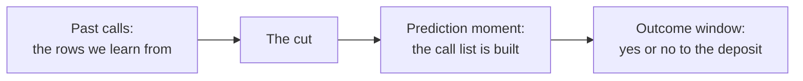
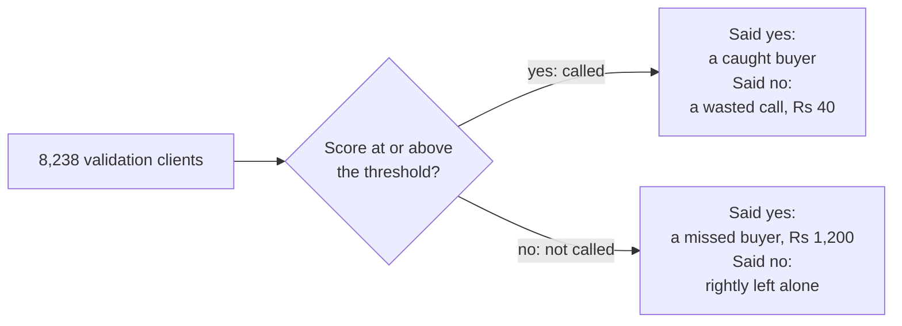
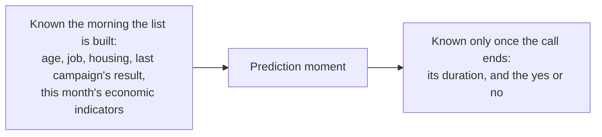
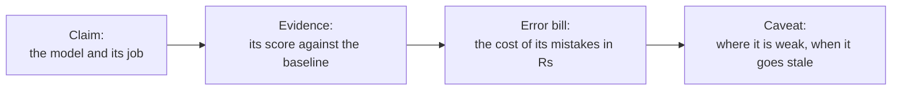

# Week 5 recap paper

Saturday 7 November 2026 · 60 minutes · 26 items in 5 parts · pen and paper, no assistant, no notes

Name: ____________________    Marked by: ____________________    Items right: ____ of 26

## What this paper is for

This week one real file carried every decision: 41,188 calls a Portuguese bank made to sell a term deposit, scored by the pipeline the room ran from Monday to Friday. The same questions ran on Kalpa in the lab, priced in Kalpa's rupees. This paper puts the week's calls back to you: whether a question needs a model and how the rows are split, which number tells the truth on a lopsided outcome and where the threshold goes, which columns the model was allowed to know, whether a model is learning or memorising, and what the committee needs before it signs and what moves to lending. The room's score in each part, set beside the rating you give that part in step one, tells the next session where to start.

## How this paper works

- 60 minutes in one sitting. Each part gives its minutes as a guide, not a limit.
- Every item names its format beside its number, and a word bank or a match table names it once, above its items: circle one letter, circle every correct letter, write the letter from the word bank, or show the working and the answer.
- Every item also names its level, easy, medium or hard, so you can plan your time. A hard item is several steps on an exhibit, never an obscure fact.
- A wrong answer costs nothing, so answer every item on the line under it.
- Pen and this paper only: no laptop, no phone, no notes and no assistant.
- Afterwards the papers are swapped and marked against the key, and the discussion takes the items the room missed most. The paper is ungraded and ranks nobody; the room's rates by part and by tag set Monday's revision.
- Every part opens on the UCI Bank Marketing dataset (Moro, Rita and Cortez, CC BY 4.0), a real bank's real calls, and on the numbers the week's pipeline printed on it; the rupee costs are Kalpa's, from the labs. Kalpa Retail's people are Meera Raghavan, the CEO, and Anand Iyer, the finance controller, with the marketing lead named by role; Kalpa Financial Services is Rohan Desai's payments and lending business, where he is head of risk. Items that use a public case (Instacart, Booking.com) give the source beside the fact, and every number an item needs is on the page.

## Step one, before Part 1

Before you read any item, rate yourself from 1 to 4 on each part in the table below, as you are today. The comparison between your rating and your score in each part is the most useful thing this paper produces for Monday.

- 1: I have not used this
- 2: I can follow it when someone shows me
- 3: I can do it alone on a small problem
- 4: I can find and fix mistakes in someone else's version

Your ratings: Part 1 ___ · Part 2 ___ · Part 3 ___ · Part 4 ___ · Part 5 ___

## The paper at a glance

| Part | What it shows | Items | Minutes | Easy | Medium | Hard |
|---|---|---|---|---|---|---|
| 1. Should the bank build a model, and what must it beat? | whether you can frame a prediction problem, split the rows honestly and read what a model's score says | Q1 to Q5 (5) | 10.5 | 1 | 2 | 2 |
| 2. Which number tells the truth, and where does the line go? | whether you can read a confusion matrix, price each error and set the line the business can afford | Q6 to Q11 (6) | 15.5 | 1 | 2 | 3 |
| 3. What was the model allowed to know? | whether you can test each column against the moment of prediction and say what a coefficient does and does not prove | Q12 to Q16 (5) | 11 | 1 | 0 | 4 |
| 4. Is the model learning, or memorising? | whether you can read training against validation, choose complexity by cross-validation and say when the simpler model ships | Q17 to Q22 (6) | 12 | 1 | 2 | 3 |
| 5. Would the committee sign, and what moves to lending? | whether you can say what a memo must prove, how a model is caught going stale and why the same model draws an opposite line in lending | Q23 to Q26 (4) | 10 | 0 | 1 | 3 |
| Total | | 26 | 59 | 4 | 7 | 15 |

---

## Part 1. Should the bank build a model, and what must it beat? (Q1 to Q5)

*What it shows: whether you can frame a prediction problem, split the rows honestly and read what a model's score says. 5 items, about 10.5 minutes.*

From May 2008 to November 2010 a Portuguese retail bank phoned its clients to sell a term deposit. The UCI Machine Learning Repository publishes the 41,188 calls, in date order, as the Bank Marketing dataset (bank-additional-full.csv, CC BY 4.0), and 4,640 of them, 11.27 percent, ended in a yes. This week the room ran one pipeline on that file: on Monday 20 percent of the rows were sealed as the test slice, to be opened once on Friday, and the rest split three to one into training and validation. Exhibit 1A shows the week's picture, the slices and the first two scores on the 8,238 validation clients. The bank's marketing head asks whom to call in the next campaign. In the lab the same question ran at Kalpa Retail, where the marketing lead asked which members to nudge and Anand Iyer priced a wasted nudge at Rs 40 and a missed repeat buyer at about Rs 1,200.

**Exhibit 1A.** The week's picture and the week's split: UCI Bank Marketing, bank-additional-full.csv, as the week's pipeline split and scored it (random seed 42, the outcome kept at the same share in every slice).

| Line | On the week's run |
|---|---|
| Training slice | 24,712 clients, 11.27 percent yes |
| Validation slice | 8,238 clients, 928 of them yes (11.26 percent) |
| Test slice, sealed on Monday | 8,238 clients, opened once on Friday |
| Call nobody, on validation | accuracy 0.887; finds 0 of the 928 buyers |
| Logistic regression on the customer table, threshold 0.5 | accuracy 0.897; AUC 0.761; finds 174 of the 928 |

**Word bank 1.** Write the letter of the word or phrase that completes each statement. Each is used once at most, and some are not used.

| Letter | Word or phrase |
|---|---|
| a | training |
| b | validation |
| c | test |
| d | baseline |
| e | threshold |

#### Q1 · Easy · write the letter from Word bank 1 · Name the sealed slice

Of the three data splits, the ____ set is spent once, at the end.

Answer: ____________________

#### Q2 · Hard · circle one letter · Catch the peek

On Thursday an analyst opens the sealed test slice, sees 0.79, moves the threshold until the test score improves and reports the new test score to the committee. What is wrong, and what should the committee be told?

a) Nothing is wrong: the test rows were never used to fit the weights, so any score read from them stays honest.
b) The test helped choose the threshold, so its score flatters; say it was spent and score once on new calls.
c) The threshold belongs on the training rows, so move it there and the test score can be reported as it stands.
d) The slice is too small at 8,238 clients, so merge it with validation and report the pooled score as the test.

#### Q3 · Hard · circle one letter · Judge the split

The calls run in date order. On the week's run the earliest 70 percent of rows say yes 5.6 percent of the time and the latest 30 percent say yes 24.6 percent of the time. Statement: for the question "whom do we call in the next campaign", a random split of all the rows estimates the model's score as honestly as a split by date. True or false, and why?

a) True: the split keeps 11.27 percent yes in every slice, so each slice is a fair sample of the bank's clients.
b) True: the model never reads a date column, so the order in which the calls were made cannot move its score.
c) False: a random split trains on later months than it validates on; train early and score late, like the ask.
d) False: a random split leaves too few yes rows in validation, so its score is noisy; a split by date adds them.

#### Q4 · Medium · circle one letter · Read one score

The logistic model gives one client a score of 0.71. What does the 0.71 say?

a) The client will say yes, because any score above 0.5 is read by the model as a yes.
b) The model is right about 71 percent of the clients it scores on the validation slice.
c) The client is 71 percent more likely to say yes than the average client in the file is.
d) Of clients scored like this one, about 71 in 100 say yes, if the scores are calibrated.

#### Q5 · Medium · circle every correct letter · Sort the asks

The bank's marketing head brings four asks. Which need a model that predicts? Circle every correct letter.

a) the clients to call first next month, ranked by their chance of saying yes
b) the count of yes answers in each month of 2009, for the annual report
c) the clients whose previous campaign ended in success, listed by branch
d) the chance that a client never called before says yes on the first call

---

## Part 2. Which number tells the truth, and where does the line go? (Q6 to Q11)

*What it shows: whether you can read a confusion matrix, price each error and set the line the business can afford. 6 items, about 15.5 minutes.*

On Tuesday the room scored the customer-table model the way the business will judge it. Exhibit 2A gives two matrices on the same 8,238 validation clients: calling nobody, and the model at the default threshold of 0.5. Each outcome is priced at Kalpa's costs, as Tuesday priced them: a call to a client who says no wastes Rs 40, and a buyer the list leaves out loses about Rs 1,200 of margin. The marketing head's question is the bank's version of the marketing lead's at Kalpa: whom to call, and how many.

**Exhibit 2A.** Two confusion matrices on the 8,238 validation clients, and what each box costs at Kalpa's prices.

| Matrix | Called, said yes | Called, said no | Not called, said yes | Not called, said no |
|---|---|---|---|---|
| Call nobody | 0 | 0 | 928 | 7,310 |
| Model at 0.5 | 174 | 94 | 754 | 7,216 |

**Word bank 2.** Write the letter of the word or phrase that completes each statement. Each is used once at most, and some are not used.

| Letter | Word or phrase |
|---|---|
| a | positives |
| b | negatives |
| c | calls |
| d | thresholds |

#### Q6 · Easy · write the letter from Word bank 2 · Complete the formula

Recall is true positives divided by true positives plus false ____.

Answer: ____________________

#### Q7 · Medium · circle one letter · Judge the accuracy claim

Statement: an accuracy of 0.897 against 0.887 for calling nobody shows that the model at 0.5 is good enough to run the campaign. True or false, and why?

a) True: it beats its baseline on the same 8,238 clients, and a model that beats its baseline is ready to run.
b) True: it gets 848 clients wrong against the baseline's 928, so it makes 80 fewer mistakes in the campaign.
c) False: accuracy is fair only on the sealed test slice, so 0.897 means nothing until Friday's envelope is opened.
d) False: calling nobody already scores 0.887, so accuracy says little; at 0.5 the model finds 174 of 928 buyers.

#### Q8 · Hard · show the working, then the answer · Work the matrix

From the model's row of Exhibit 2A, compute its precision, recall and F1 at the threshold of 0.5, each to two decimal places. Show the working.

Working:

Answer: ____________________

#### Q9 · Medium · show the working, then the answer · Draw the line

A call to a client who says no wastes Rs 40, and a buyer left off the list loses about Rs 1,200. Above what chance of a yes is a call worth making, and which way does that move the threshold from 0.5? Show the working.

Working:

Answer: ____________________

**Exhibit 2B.** The customer-table model at four thresholds on the 8,238 validation clients, and the week's budget cut: everyone ranked by score.

| Threshold or cut | Called | Caught buyers | Wasted calls | Missed buyers |
|---|---|---|---|---|
| 0.5 | 268 | 174 | 94 | 754 |
| 0.20 | 864 | 376 | 488 | 552 |
| 0.10 | 2,754 | 616 | 2,138 | 312 |
| The cost line | 7,438 | 913 | 6,525 | 15 |
| Top 1,000 by score | 1,000 | 404 | 596 | 524 |

#### Q10 · Hard · circle one letter · Price two thresholds

At Rs 40 a wasted call and Rs 1,200 a missed buyer, what is the error bill at the thresholds of 0.5 and 0.10 in Exhibit 2B, and which costs less?

a) Rs 142,960 at 0.5 and Rs 2,578,080 at 0.10, so 0.5 is cheaper by Rs 2,435,120.
b) Rs 908,560 at 0.5 and Rs 459,920 at 0.10, so 0.10 is cheaper by Rs 448,640.
c) Rs 3,760 at 0.5 and Rs 85,520 at 0.10, so 0.5 is cheaper by Rs 81,760 in all.
d) Rs 904,800 at 0.5 and Rs 374,400 at 0.10, so 0.10 is cheaper by Rs 530,400.

#### Q11 · Hard · circle one letter · Spend 1,000 calls

The call centre can make 1,000 calls in the next campaign, and the cost line would call 7,438 of these 8,238 clients (Exhibit 2B). Which plan goes to the marketing head?

a) Keep the cost line and call the first 1,000 clients above it in the order the file lists them.
b) Raise the threshold to 0.5 and call its 268 clients, since precision is the highest there, at 0.65.
c) Rank every client by score and call the top 1,000; 404 of them said yes, 3.6 times the base rate.
d) Call 1,000 clients drawn at random, since a ranking on an outcome this rare is mostly noise.

---

## Part 3. What was the model allowed to know? (Q12 to Q16)

*What it shows: whether you can test each column against the moment of prediction and say what a coefficient does and does not prove. 5 items, about 11 minutes.*

On Wednesday two more feeds were joined to the customer table: five economic indicators, each published for its month or quarter, and the call log. Exhibit 3A gives the validation scores as each feed joins. A junior analyst wants to ship the last line tonight. The dataset's own notes, read aloud in class, say that the call's duration "is not known before a call is performed" and "should be discarded if the intention is to have a realistic predictive model" (bank-additional-names.txt in the UCI download). In the lab Kalpa's feed held the same trap in settlement_status, a field written after delivery.

**Exhibit 3A.** What is known when, and the logistic model's validation scores as each feed joins, threshold 0.5, the 928 validation buyers.

| Columns in the model | Validation AUC | Accuracy at 0.5 | Buyers found at 0.5 |
|---|---|---|---|
| The customer table: profile and campaign history | 0.761 | 0.897 | 174 |
| The customer table and the five economic indicators | 0.795 | 0.899 | 211 |
| All of those and duration, the call's length in seconds | 0.932 | 0.907 | 390 |

**Word bank 3.** Write the letter of the word or phrase that completes each statement. Each is used once at most, and some are not used.

| Letter | Word or phrase |
|---|---|
| a | drift |
| b | imbalance |
| c | leakage |
| d | collinearity |
| e | overfitting |

#### Q12 · Easy · write the letter from Word bank 3 · Name the trap

A feature that would not be known at prediction time is a case of data ____.

Answer: ____________________

#### Q13 · Hard · circle one letter · Answer the junior

The junior's message reads: "Adding duration lifts AUC from 0.795 to 0.932. Shipping tonight." What is the reply?

a) Ship it: the dataset's authors put duration in the file, so it is a fair column for the model.
b) Hold it: accuracy only rose from 0.899 to 0.907, so the AUC jump must be noise in validation.
c) Drop it: a call's length exists only once the call ends, so no list can use it; report 0.795.
d) Keep it but scale it first, since a column measured in raw seconds is what inflates the AUC.

#### Q14 · Hard · circle every correct letter · Test each column

The list for next month's campaign is built on the morning before the first call. Which columns pass the prediction-time question? Circle every correct letter.

a) duration, the length in seconds of this campaign's last call to the client
b) poutcome, the last campaign's result; 65 percent of its successes say yes
c) age, job and housing, as they stand in the customer table that morning
d) euribor3m, the three-month rate as published on the morning of the list

#### Q15 · Hard · circle one letter · Judge the chart

In the leaky model duration tops the importance chart, and clients who said yes talked 553 seconds on average against 221 for those who said no. Statement: longer calls cause deposits, so agents should be coached to keep clients on the line. True or false, and why?

a) False: a client who means to buy stays on to arrange it, so the yes drives the length as much as the reverse.
b) False: an importance chart is valid for tree models only, so the logistic weights say nothing about duration.
c) True: duration carries the largest weight in the model, and the largest weight marks the cause of the yes.
d) True: a gap of 332 seconds is too large to be chance across 41,188 calls, so the effect has to be causal.

#### Q16 · Hard · circle one letter · Explain the flip

On its own, euribor3m takes a coefficient of -0.92 on the standardised scale; beside the four other economic indicators it takes +0.39. What is the likeliest cause?

a) a bug in the library's solver, which flips signs once a model has more than ten columns
b) too few rows: 24,712 training clients cannot pin down five coefficients at once
c) the 11 percent yes rate, which pushes the coefficients of a rare outcome toward zero
d) the five indicators move together, so the model splits one shared signal among them

---

## Part 4. Is the model learning, or memorising? (Q17 to Q22)

*What it shows: whether you can read training against validation, choose complexity by cross-validation and say when the simpler model ships. 6 items, about 12 minutes.*

On Thursday the room grew a decision tree on the honest columns, the customer table and the economic indicators, first with no limit on its depth and then reined in. Exhibit 4A gives the tree's training and validation scores by depth; calling nobody scores 0.887 accuracy on the same validation clients. The committee's question for Friday is which model goes into the memo, and why that one.

**Exhibit 4A.** A decision tree on the honest columns: accuracy on training and on validation by maximum depth, with validation AUC, the week's split.

| Maximum depth | Training accuracy | Validation accuracy | Validation AUC |
|---|---|---|---|
| 3 | 0.899 | 0.900 | 0.751 |
| 5 | 0.901 | 0.897 | 0.783 |
| 8 | 0.911 | 0.897 | 0.777 |
| No limit | 0.996 | 0.837 | 0.619 |

**Word bank 4.** Write the letter of the word or phrase that completes each statement. Each is used once at most, and some are not used.

| Letter | Word or phrase |
|---|---|
| a | overfitting |
| b | underfitting |
| c | threshold |
| d | split |
| e | leakage |
| f | seed |

#### Q17 · Easy · write the letter from Word bank 4 · Name the failure

A model that scores 100 percent on training and 61 percent on validation is ____.

Answer: ____________________

#### Q18 · Medium · write the letter from Word bank 4 · Name what averages out

Cross-validation averages away the luck of one particular ____.

Answer: ____________________

#### Q19 · Hard · circle one letter · Read the depth curve

The unlimited tree scores 0.996 on training and 0.837 on validation, below calling nobody. Which reading and which next step are right?

a) It memorised the training clients; cap the depth where validation AUC peaks, depth 5 here.
b) It needs more columns to learn from; join the call log so validation catches up with training.
c) It has not trained long enough; grow it further until validation rises to meet training.
d) Validation has drifted from training; refit the unlimited tree on validation and report it.

#### Q20 · Medium · circle every correct letter · Pick the brakes

Which of these put a brake on overfitting? Circle every correct letter.

a) capping the tree's depth, or asking for more clients in every leaf
b) a stronger penalty on the logistic weights, a smaller C in scikit-learn
c) refitting until the training rows score 1.0 at every new setting
d) choosing the depth or the penalty by five-fold cross-validation

**Exhibit 4B.** Five-fold cross-validation of the logistic model on the 24,712 training clients, honest columns, and three model families scored on the 8,238 validation clients.

| Run | AUC |
|---|---|
| Logistic, fold 1 | 0.771 |
| Logistic, fold 2 | 0.769 |
| Logistic, fold 3 | 0.797 |
| Logistic, fold 4 | 0.796 |
| Logistic, fold 5 | 0.798 |
| Logistic, mean of the five folds | 0.786 |
| Logistic regression, on validation | 0.795 |
| Random forest, on validation | 0.799 |
| Gradient boosting, on validation | 0.806 |

#### Q21 · Hard · circle one letter · Count the folds

Five-fold cross-validation of the logistic model gave the five fold scores in Exhibit 4B. How many models were fitted, on about how many clients each, and what does the spread tell the committee?

a) One model, scored five times on 4,942 clients each; the spread is that one model's error.
b) Five models on about 19,770 clients each; one split could have read 0.77 or 0.80.
c) Five models on about 4,942 clients each; the spread says the model needs more rows.
d) Five models on all 24,712 clients each; the spread is noise and says nothing of a split.

#### Q22 · Hard · circle one letter · Judge the winner

Statement: gradient boosting should go into the memo, since it scores the highest validation AUC of the three families in Exhibit 4B. True or false, and why?

a) True: 0.806 is above 0.799 and 0.795 on the same validation rows, and the memo reports the best found.
b) True: boosting fits each round to the errors of the rounds before, so it generalises best of the three.
c) False: 0.011 is inside the 0.03 one split moves by, so it is a tie, and the explainable logistic ships.
d) False: AUC cannot compare different model families, so the committee needs each accuracy at 0.5.

---

## Part 5. Would the committee sign, and what moves to lending? (Q23 to Q26)

*What it shows: whether you can say what a memo must prove, how a model is caught going stale and why the same model draws an opposite line in lending. 4 items, about 10 minutes.*

On Friday the room wrote the memo for Meera Raghavan's committee: Anand Iyer, the marketing lead and Rohan Desai of Kalpa Financial Services, who is watching for his own business. The bank's file showed what time does to a model. Trained on the earliest 70 percent of the calls and scored on the latest 30 percent, the logistic model on the honest columns met a world where far more clients said yes than it had learned (Exhibit 5A). Exhibit 5B, with the first item, sets two public cases beside it.

**Exhibit 5A.** The four lines of the committee memo, and the bank's file split by date instead of at random: the logistic model on the honest columns.

| Line | On the week's run |
|---|---|
| Earliest 70 percent of calls, 28,831 clients | 5.6 percent said yes |
| Latest 30 percent of calls, 12,357 clients | 24.6 percent said yes |
| Mean predicted chance of a yes on the latest 30 percent | 0.152 |
| AUC on the latest 30 percent | 0.657, against 0.795 on the random split |

**Exhibit 5B.** Two public cases. Instacart: Fortune, 9 June 2020, and Instacart's engineering blog, 10 July 2023. Booking.com: Bernardi, Mavridis and Estevez, KDD 2019, section 3.

| Case | What the source reports |
|---|---|
| Instacart's item-availability model, March 2020 | The accuracy of the metric used to judge how many items are found fell from 93 percent to 61 percent, which told the engineers to retrain; by June it read about 85 percent |
| Instacart, looking back | Models respond slowly to a shock because they need enough new observations; thresholds on top of the model were changed without training new models |
| Booking.com, 23 comparisons of a new model against a proven one | Offline gain (ROC AUC or mean reciprocal rank) against business gain in a randomised trial: Pearson correlation -0.1, 90 percent interval -0.45 to 0.27 |

#### Q23 · Hard · circle one letter · Set the alarm

Which monitoring rule would have caught the bank's model going stale earliest?

a) Each month, set the called clients' yes rate against their mean score, and alert past a stated gap.
b) Retrain the model every night on the newest calls, so that the question of staleness never comes up at all.
c) Compare the model's training accuracy month by month, and read a fall there as the sign of drift.
d) Wait for the marketing head to say the campaign feels weaker than it did when the model launched.

#### Q24 · Medium · circle every correct letter · Fill the caveat

Which lines belong in the memo's caveat? Circle every correct letter.

a) the validation AUC of 0.795, against 0.761 for the customer table alone
b) the segment of clients the model ranks worst, with how many clients it holds
c) the gap between predicted and actual yes rates that would trigger a retrain
d) the number of calls the campaign budget pays for in the next month

#### Q25 · Hard · circle one letter · Choose the evidence

Anand Iyer asks what evidence would make him sign. Across 23 comparisons, Booking.com found offline gains and business gains almost uncorrelated (Exhibit 5B). What does the memo propose?

a) a random trial: half the next calls by the model's list, half by today's rule, scored on deposits
b) a bigger validation slice, so that the AUC of 0.795 can be quoted to three decimal places
c) a switch to gradient boosting, whose 0.806 gives the committee the strongest offline case
d) the sealed test score on its own, since a slice opened once is all the evidence a committee needs

#### Q26 · Hard · circle one letter · Move the line to lending

Rohan Desai's lending book: approving a borrower who defaults costs Rs 60,000, and rejecting a good borrower costs Rs 3,000 of lost interest. Where does Rohan's approval line go?

a) Approve on the nudge's own cost line, read as a chance of repaying, since the method is the same.
b) Approve at the neutral 0.5, since a loan is a yes or no decision with no budget in the way.
c) Approve while the chance of default is under 60,000 in 63,000, about 0.95, since defaults cost more.
d) Approve only while the chance of default is under 3,000 in 63,000, about 0.05: repay above 0.95.

---

## Stretch: untimed, and not marked

For anyone who finishes early. Nothing here is counted; each item is the kind an interviewer asks after your first answer, so write the answer you would say.

### Stretch 1

German Credit, the take-home's dataset (OpenML credit-g), documents its own cost matrix: classing a bad borrower as good costs 5, and classing a good borrower as bad costs 1. Above what chance of repaying should that lender approve, and how does it sit beside Rohan Desai's line?

### Stretch 2

Gradient boosting beats the logistic model by 0.011 AUC on validation. Name the gap at which you would ship boosting instead, and say how you would size it in rupees at the budget of 1,000 calls.

### Stretch 3

An interviewer asks: "Walk me through a model you built." Write the 30-second version with three numbers from this week's run and one choice you would make differently.
