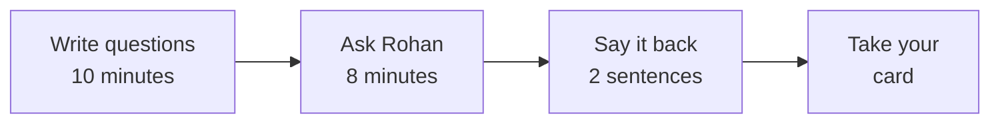

# Whom do we call before the due date?

*Build 2's ticket. Read it alone, in silence, with no AI open. It takes six minutes.*

## What is Rohan asking for?

> "We are launching credit cards in India with no card history of our own, so I have licensed a
> public card book to prove the method first: 30,000 cardholders in Taiwan, six monthly statements
> each, April to September 2005. Before October's due date, whom should my team call? A missed
> default costs us about five times a wasted call. And tell me the error bill of the list you hand
> me." Rohan Desai, head of risk, Kalpa Financial Services

## What is decided, and what does each error cost?

| What is decided | A wasted call costs | A missed default costs |
|---|---|---|
| Who gets the one action, a call from Kalpa's team, before October's due date | 1 unit: a call to someone who would have paid | 5 units: no call to someone who then defaulted |

## What does a finished answer sound like?

A unit gets its rupee price once Kalpa's call centre runs. Fill the blanks with your own numbers:

> "Call these ___ cardholders before the due date. The list costs ___ cost units per 1,000
> cardholders, against ___ if we call nobody. Taiwan's score proves the pipeline and is never
> Kalpa's score."

## What do we hand in, and on which day?

| Day | What you hand in |
|---|---|
| Tuesday | Workbook pages 1 to 3, on paper |
| Wednesday | Pages 4 and 5, a first page 6, and the POC running in your repository |
| Thursday | The approach gate: pages 1 to 6 and the POC run live, every member questioned |
| Friday | Page 7, the README and the model card; the repository freezes |
| Saturday | The twelve-minute talk: seven slides, every member speaking |

## Where may we use AI?

- **No AI:** the frame on paper (Tuesday), the gate and its questions (Thursday), the defence
  (Saturday) and your numbers passport.
- **AI allowed, and logged:** code. Every use goes in the AI log, and before an AI-written line is
  committed, a member who did not write the prompt explains it line by line.

## How do we run the discovery call?

1. **Write.** For ten minutes, write as many questions as you can. Do not stop to answer them.
   Turn every statement into a question. Then mark your best seven.
2. **Ask.** Every member asks at least two. Rohan answers only what you ask, so a fact nobody asks
   for stays hidden.
3. **Say it back.** Rohan picks one member to say the problem back in two sentences: whom we call,
   why, and what a wrong call costs. He says yes, or he names the gap.

Tick each kind of question once you have asked it:

| The decision | Who uses the list | What each error costs | When each column is known | Rules and limits | What success looks like | What could go wrong |
|---|---|---|---|---|---|---|
|   | | | | | | |

## What does our constraint card say?

Rohan hands it over at the end of the call. Copy it here, word for word.

| Our constraint card |
|---|
| **Card number**    |
| **Rohan's rule, in his words**     |
| **What we predict it changes in our answer**     |
| **The first question we will ask about it**    |

## Which eight stages does the week climb?

Each stage has one workbook page, and stage 0 is page 1. Tick a stage when its page's last line,
"You are ready for the next stage when", is true for every member.

| 0 Business | 1 Frame | 2 Requirements | 3 Options | 4 POC | 5 Architecture | 6 MVP slice | 7 Defend |
|---|---|---|---|---|---|---|---|
|   | | | | | | | |

*Data: Yeh, I. (2009). Default of Credit Card Clients [Dataset]. UCI Machine Learning Repository.
https://doi.org/10.24432/C55S3H. CC BY 4.0, checked 29 October 2026.*
