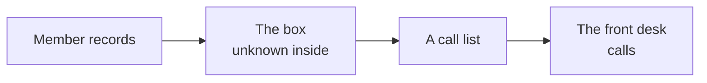
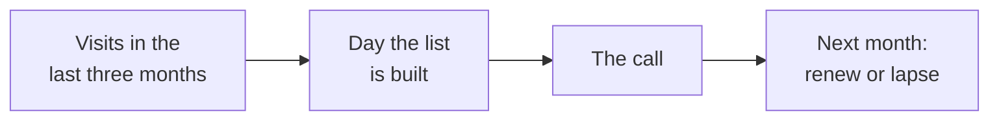
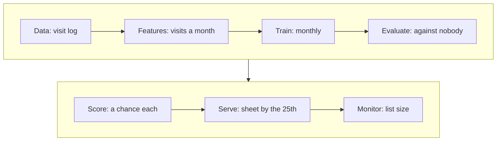

# How do we get from Rohan's ask to a list each of us can defend?

*Build 2's workbook: one page per stage, then the numbers passport, the run sheet, the challenges
log and the AI log. Fill it in pen. It comes with you to Thursday's gate and Saturday's defence.*

Every stage page runs the same way: the question, why a real team does the step, a gym worked
beside your boxes, and the line that says you are ready for the next stage. **Why a gym?** A
different business shows the method without giving away your answer. The gym has 1,000 members, and
about 15 in 100 let their membership lapse each month. The front desk can call a member and offer a
free coaching session. A wasted call, to someone who would have stayed, costs 1 unit; a missed
lapse costs 4 units. Every gym number here is invented.

## Which page answers which question, and who leads each stage?

Roles rotate by stage, so nobody owns all the code. Write a name in each box.

| Page | Stage, and the question it answers | Day | Builder | Evaluator | Decision owner |
|---|---|---|---|---|---|
| 1 | 0 The business: who pays, and what does a wrong call cost? | Tue | | | |
| 2 | 1 The frame: what is decided, from what is known when? | Tue | | | |
| 3 | 2 Requirements: what must the system do, and never do? | Tue | | | |
| 4 | 3 Options: two ways to decide, and which do we choose? | Wed | | | |
| 5 | 4 The POC: does our list beat doing nothing on the error bill? | Wed | | | |
| 6 | 5 The architecture: what are the boxes, and one box inside? | Wed, Thu | | | |
| 7 | 6 The MVP slice: what could Rohan use tomorrow? | Fri | | | |
| 8 | 7 Present and defend: which sentence would Rohan act on? | Sat | Slide 1 is drawn on the day | | |

The builder writes the code or the page, the evaluator checks every number, and the decision owner
says what it means for Rohan. Stages 0 to 2 are on paper with no AI; from stage 3, AI may write code
and every use goes in the AI log.

## Stage 0, the business: who pays, and what does a wrong call cost?

**Who needs the answer.** Rohan, before he trusts any list: a list that ignores who pays for its
mistakes is one he cannot use.

**The questions on the way.** Who pays Kalpa, and for what? Who decides whom to call? What does each
kind of wrong call cost? What goes into the box, and what comes out?

### Why does a real team start here?

A list only matters if it changes what someone does, and it only costs money when someone pays for
its mistakes. Ketan Doshi, who builds machine learning for enterprises, writes that in a demo
someone has already framed the problem, while in a real project the team must find it and agree the
business goal first (his Enterprise ML blog, 2021).

### What does it look like for the gym, and for Kalpa?

| Question | The gym (invented) | Kalpa: our answer, written in pen |
|---|---|---|
| Who pays, and for what? | Members pay a monthly fee to keep training. |    |
| Who decides whom to call, and who calls? | The owner decides; the front desk calls. |    |
| What does a wasted call cost, and why? | 1 unit: a free session given to a member who would have stayed. |    |
| What does a missed case cost, and why? | 4 units: a member lost. |    |
| What does doing nothing cost? | Every lapse is missed: 15 in 100 x 4 units = 60 units per 100 members. |    |
| What goes into the box, and what comes out? | Member records in; a call list for the front desk out. |    |

### Are we ready for stage 1?

You are ready for the next stage when every member can say, without notes and in under thirty
seconds, who pays, who decides and what each wrong call costs.

## Stage 1, the frame: what is decided, from what is known when?

**Who needs the answer.** Rohan, who has to hear his problem said back correctly before he believes
the group understood it.

**The questions on the way.** What exactly is decided, for whom and how often? What is known on the
day of the decision, and what is not known yet? What outcome do we predict, and how often?

### Why does a real team frame before it models?

A wireless company tested a retention offer and found that among its highest-risk customers, 95.3
percent left without the offer and 93.7 percent left with it, so calling the riskiest people barely
changed anything (Ascarza, Journal of Marketing Research, 2018). "Who will leave?" and "whom will a
call keep?" are different questions, and a team that does not choose answers the wrong one.

### What does it look like for the gym, and for Kalpa?

| Frame question | The gym (invented) | Kalpa: our answer, written in pen |
|---|---|---|
| What is decided? | Whether the front desk calls this member this month. |    |
| About whom, and how often? | One member, once a month. |    |
| What is known on the day of the list? Name the months. | Visits in each of the last three months, months as a member, plan type. |    |
| What is not known yet, and when will it be? | Whether the member renews; known next month. |    |
| What outcome do we predict? | Lapsed next month: yes or no. |    |
| How often does it happen? | 15 in 100 members: the base rate. |    |

| Our frame in one sentence |
|---|
| We decide ___ for each ___, from what is known by ___, to predict ___.    |

### Are we ready for stage 2?

You are ready for the next stage when your frame fits the sentence above and Rohan answered your
restate-back with a yes.

## Stage 2, requirements: what must the system do, and never do?

**Who needs the answer.** Rohan and Kalpa's compliance team, who refuse a list that nobody can
explain, or that uses data the team may not use, however good its numbers.

**The questions on the way.** What must the system do? How well? Which limits can we not move? Who
may touch it, which data may it use, and who answers for it?

### Why does a real team write requirements down?

In November 2019 a customer said his Apple Card credit limit was 20 times his wife's, and a customer
service agent could not explain the decision. New York's regulator checked the underwriting data for
nearly 400,000 applicants and found no fair lending violation, and the bank explained each decision
with ordinary factors once asked (NYDFS report, March 2021). The model was lawful; the requirement
nobody wrote down was the explanation and the appeal path.

### What does it look like for the gym, and for Kalpa?

The gym's first row is filled. Write all six rows for Kalpa.

| Kind | The question to ask | The gym (invented) | Kalpa: our answer, written in pen |
|---|---|---|---|
| Functional (FR): what it must do | What does the user get, and when? | By the 25th, the front desk gets a ranked list of members to call, each with one reason. |    |
| Non-functional (NFR): how well | How fast, how often, how right? | |    |
| Constraint: a limit we cannot move | What can we not change? | |    |
| Security: who may touch it | Who may see or change the list and the model? | |    |
| Privacy: what data may be used | Which data may we not use, or not keep? | |    |
| Governance: who answers for it | Who signs it off, and who can stop it? | |    |

| Our constraint card on this page |
|---|
| Which row does our card's rule belong in, and what does it add there?     |

### Are we ready for stage 3?

You are ready for the next stage when each of the six rows has a line of your own and your card's
rule appears in at least one of them.

## Stage 3, options: what are two ways to decide, and which do we choose?

**Who needs the answer.** Rohan, who pays for a model only if it beats what his team could do with
a simple rule, and your evaluator, who presents this sheet on slide 4.

**The questions on the way.** What is the best simple rule a person could run without a model?
What is the model? What does each cost in errors, hours and explanation? Which do we choose, and
what fact would flip the choice?

### Why does a real team compare two ways?

Under a no-action letter from the US consumer finance regulator, the lender Upstart compared its
model with a traditional model on the same applicants for 22 months, with the comparison agreed
before any results came in. Upstart reported 27 percent more applicants approved and 16 percent
lower average interest rates; the regulator did not replicate the numbers (CFPB, August 2019).

### What does it look like for the gym, and for Kalpa?

Fill the error bill row once page 5 has its numbers.

| Row of the sheet | Gym A: call members with under 2 visits last month | Gym B: a logistic regression on visits, tenure, plan | Our A: our best simple rule | Our B: our model |
|---|---|---|---|---|
| What it is | A rule the desk runs on paper | A chance of lapsing for each member |    | |
| Error bill per 1,000 | 470 units | 367 units | | |
| Build time | 1 hour | 1 day | | |
| Can the owner, or Rohan, explain a call? | Yes: "you came once last month" | Yes: the factor that raised the chance most |    | |
| How it fails, and how we would notice | Misses members who visit but have decided to leave | Fails quietly if the visit log breaks; the list size jumps |    | |
| Our call, and the fact that would flip it | We choose B: it saves 103 units per 1,000 a month | With only 50 calls, the two top-50 lists match and A wins on build time |     | |

### Are we ready for stage 4?

You are ready for the next stage when all four of your cells in each row are filled, numbers
included, and the last row names one fact, such as a call capacity or a cost ratio, that would
change your call.

## Stage 4, the POC: does our list beat doing nothing?

**Who needs the answer.** Rohan's finance team, and your evaluator, who presents slides 4 and 5.

**The questions on the way.** What do calling nobody and calling everyone cost? Where does the
threshold sit? What does our list cost, does it hold on another split, and can we trust the rows?

### Why does a real team count an error bill instead of accuracy?

Accuracy prices both mistakes the same, and a lender never does: the German credit data on UCI
ships with a cost matrix where passing a bad customer costs 5 and refusing a good one costs 1.

### What does it look like for the gym, and for Kalpa?

The gym's test book holds 300 members, 45 of whom lapsed; the desk calls at a chance of 0.2 or more.

| | Lapsed | Stayed |
|---|---|---|
| Called | 30 caught, cost 0 | 50 wasted, 1 unit each |
| Not called | 15 missed, 4 units each | 205 fine, cost 0 |

The list's bill is 50 x 1 + 15 x 4 = 110 units on 300 members, or 367 per 1,000. The threshold 0.2
is 1 / (1 + 4): call when the chance x 4 is more than (1 minus the chance) x 1.

| Number or check | The gym (invented) | Kalpa: our answer, written in pen |
|---|---|---|
| Base rate | 15 in 100 | |
| Bill of calling nobody, per 1,000 | 600 units | |
| Bill of calling everyone, per 1,000 | 850 units | |
| Threshold, or list size | 0.2 | |
| Our list's bill, per 1,000 | 367 units | |
| Our list's bill on five splits, lowest to highest | 350 to 390 units | |
| Does every row describe a different person? | Yes | |
| Is every value in the data dictionary? | Yes | |
| Is any group's rate far from the rest? | The student plan lapses twice as often | |
| Can we trust each column? | No: booked classes counted as visits, so we used check-ins | |
| Inputs known in time? Test book opened once? | Yes, and yes | |

### Are we ready for stage 5?

You are ready for the next stage when your list's bill beats calling nobody and calling everyone on
the test book, and every member can recompute it by hand from the four counts.

## Stage 5, the architecture: what boxes, and one box inside?

**Who needs the answer.** Kalpa's engineering lead, who runs the list monthly, and Thursday's gate.

**The questions on the way.** Which boxes sit inside the black box (the high-level design)? What
does one box take in, do and give back (the low-level design)? What if a column arrives late?

### Why does a real team draw boxes before it ships?

Stripe's fraud system decides on a payment in under 100 milliseconds (Stripe engineering blog,
March 2023); a list built once a month needs none of that speed, so it runs as one batch job.

### What does it look like for the gym, and for Kalpa?

| Our white box: draw five to seven boxes with arrows, and circle the one we zoom into |
|---|
|     |

| Low-level question | The gym's score box (invented) | Our zoomed box, written in pen |
|---|---|---|
| What goes in? | The member table on the 24th, one row per member |   |
| What happens inside? | Check columns, load the model, score, keep 0.2 or more, sort, add the reason |   |
| What comes out, and how fast? | A file of member, chance, reason and order, in under a minute |   |
| If a column is late? | The run stops and alerts the owner; no list beats a wrong list |   |

### Are we ready for stage 6?

You are ready for the next stage when a member who did not draw it can point to where the score is
computed, who receives the list, and what happens if one column arrives a day late.

## Stage 6, the MVP slice: what could Rohan use tomorrow?

**Who needs the answer.** Rohan, who has to decide what to fund next, and your decision owner, who
presents slide 6.

**The questions on the way.** What did the POC prove, and what can it never prove? What is the
smallest thing Kalpa's team could use tomorrow? What does a production system add on top?

### Why does a real team separate the POC from the MVP?

Ketan Doshi calls the model "only the tip of the iceberg" and, in his own estimate, puts the work of
getting it into production at up to 90 percent of the time and effort (his Enterprise ML blog,
2021). A POC presented as a product hides that work from the client.

### What does it look like for the gym, and for Kalpa?

| | What the POC proved | What an MVP adds | What production adds |
|---|---|---|---|
| The gym (invented) | On 300 held-out members, the list cost 367 units per 1,000 against 600 for calling nobody. | A script writes the desk's sheet every month, tried for one month at one branch. | It runs itself, alerts when the list size jumps, retrains on new lapses, and a named person can switch it off. |
| Kalpa: ours |     | | |
| Kalpa: ours |     | | |
| Kalpa: ours |     | | |

Two lines your plan carries, whatever your card:

1. The Taiwan score proves the pipeline and is never Kalpa's score.
2. This data allows no out-of-time split, so the MVP must add one.

### What does our slice hold on Friday?

| Piece | Done? |
|---|---|
| A scoring function: one cardholder in; chance, call or not, main reason and cost out | |
| A live demo: score one cardholder, show the reason and the cost, change our card's number | |
| The README, answer first, and the model card | |

### Are we ready for stage 7?

You are ready for the next stage when a stranger can clone your repository, run one command and see
one cardholder's decision, its reason and its cost.

## Stage 7, present and defend: which sentence would Rohan act on?

**Who needs the answer.** Rohan's panel, who will question every member by name, and each of you,
since any slide number can be drawn for you to recompute. No AI in the room.

**The questions on the way.** What is our one sentence, with its numbers? Which questions do we
fear most, and who answers each? What would change our call? What is our biggest risk?

### Why does a real team defend its numbers in person?

US bank supervisors' model risk guidance of April 2026 (SR 26-2) keeps the idea of effective
challenge: critical analysis of a model by objective, qualified and independent people. Saturday's
panel is your effective challenge.

### What does it look like for the gym?

> "Call the 80 members whose chance of lapsing is 0.2 or more. On last year's members that list
> cost 367 units per 1,000 against 600 for calling nobody. It was tested on one gym's past members
> and must be re-tested at the new branch." (invented)

### What is our defence for Kalpa?

| Stage 7 for Kalpa |
|---|
| **Our one sentence, with its numbers**     |
| **The three questions we fear most, and who answers each**     |
| **What would change our call**    |
| **Our top risk from Wednesday's pre-mortem**    |

### Are we ready for Saturday?

You are ready when any member, drawn at random, says slide 1 in ninety seconds and recomputes any
slide number from the repository in under two minutes.

## Which five numbers must I defend alone?

*The numbers passport. One copy per member. Fill it alone, in your own words, from your group's own
run. No AI.*

Name: ______________________

| # | The number | Our value | What it means, in my words | Where it is computed (file and cell) |
|---|---|---|---|---|
| 1 | The base rate | |    | |
| 2 | The do-nothing bill (calling nobody) | |    | |
| 3 | Our threshold or list size | |    | |
| 4 | Our list's bill | |    | |
| 5 | Our card's number | |    | |

The two honesty lines, which I can explain in my own words:

1. The Taiwan score proves the pipeline and is never Kalpa's score.
2. This data allows no out-of-time split, so the MVP must add one.

| My recompute drill | Number drawn | Minutes taken | Matched the slide? |
|---|---|---|---|
| First try | | | |
| Second try | | | |

## Who says what, minute by minute, on Saturday?

*The run sheet. Twelve minutes, seven slides, every member speaking. A member of another group holds
the timing cards.*

| Minutes | Slide | Who | What | Our speaker |
|---|---|---|---|---|
| 0:00 to 1:30 | 1 | Drawn by the panel | The recommendation and its error bill in one sentence, then situation, complication, question | Drawn |
| 1:30 to 3:00 | 2 | Decision owner | What each error costs, as one picture, and the metric that follows | |
| 3:00 to 6:00 | 3 | Builder | The live demo: score one customer, show the reason and the cost, change the card's number | |
| 6:00 to 8:00 | 4 | Evaluator | A against B on the error bill, and why we chose | |
| 8:00 to 9:30 | 5 | Evaluator | How honest the number is: the do-nothing bill, the spread, the trap we caught | |
| 9:30 to 11:00 | 6 | Decision owner | What the POC proved and what an MVP still needs (FR, NFR, constraints) | |
| 11:00 to 12:00 | 7 | Builder | What would change our call, the top pre-mortem risk, the ask | |

Each day closes with the opener: one member of every group, drawn, says slide 1 to the room in
ninety seconds, timed by another group. There is no score.

| Rehearsal | Total time | Slide that ran over, and by how much | What we cut |
|---|---|---|---|
| Dry run 1, Thursday, with our red-team partner | | | |
| Dry run 2, Friday, cold and recorded | | | |

## What surprised us, and what did we decide?

*The challenges log. One line per decision or surprise, in the group's own words. Log every sealed
hint you open.*

| Day | Stage | What surprised us or went wrong | What we decided, and why | Hint opened | Logged by |
|---|---|---|---|---|---|
| | |    | | | |
| | |    | | | |
| | |    | | | |
| | |    | | | |
| | |    | | | |
| | |    | | | |
| | |    | | | |
| | |    | | | |
| | |    | | | |
| | |    | | | |
| | |    | | | |
| | |    | | | |
| | |    | | | |
| | |    | | | |
| | |    | | | |
| | |    | | | |
| | |    | | | |

## Where did AI write code for us, and who can explain it?

*The AI log. One line for every use of AI. The explainer is a member who did not write the prompt,
and explains the code line by line before it is committed.*

| Day | Stage | Tool | What we asked | What we kept | How we checked it | Explained by |
|---|---|---|---|---|---|---|
| | | |    | | | |
| | | |    | | | |
| | | |    | | | |
| | | |    | | | |
| | | |    | | | |
| | | |    | | | |
| | | |    | | | |
| | | |    | | | |
| | | |    | | | |
| | | |    | | | |
| | | |    | | | |
| | | |    | | | |
| | | |    | | | |
| | | |    | | | |
| | | |    | | | |
| | | |    | | | |
| | | |    | | | |
