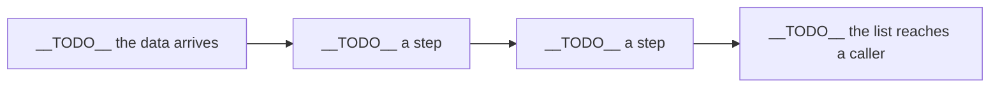

# __TODO__ Your project's title, written as the question Rohan asked

> Example: Whom should the bank call about a term deposit?

## How do you set this repository up?

1. Make your group's own copy. On the starter's GitHub page, click **Use this template**, then
   **Create a new repository**, and add the other two members as collaborators. If you were given a
   zip instead, create an empty repository and upload every file in it, including the hidden
   folders `.devcontainer` and `.streamlit` and the file `.gitignore`.
2. Open the repository in a Codespace: the green **Code** button, then the **Codespaces** tab, then
   **Create codespace**. While it starts, it installs Python 3.12 and every package in
   `requirements.txt`.
3. In the Codespace's terminal, run `pip install -r requirements.txt`. If the Codespace already did
   it, this finishes in seconds.
4. Open `notebooks/breadcrumbs.ipynb`, pick the Python 3.12 kernel when VS Code asks, and run the
   first cell.
5. Run `python -m pytest -rs`. A new copy reads `4 skipped`, and each skip names a function your
   group still has to write.

## What is in this repository?

| Path | What it holds |
|---|---|
| `notebooks/breadcrumbs.ipynb` | The only notebook: ladder stages 1 to 6, each with sealed hints |
| `notebooks/kit.py` | The notebook's checks and pictures, which you never need to edit |
| `src/data.py` | Step 1: download the book and load it, one row per cardholder |
| `src/features.py` | Step 2: the inputs a model reads |
| `src/train.py` | Step 3: the split, the model and the error bill |
| `src/score.py` | Step 4: one customer in, a chance of default and a reason out |
| `app/app.py` | The live demo, started with `streamlit run app/app.py` |
| `app/no_server.py` | The same demo printed in the terminal, for when the page will not open |
| `tests/test_pipeline.py` | Four promises the code keeps |
| `templates/` | The model card, the decisions log, the AI log and the challenges log |
| `requirements.txt` | Every package, with its version pinned |

Search the repository for `__TODO__` to find everything your group still has to write. Everything
below the line is the page a recruiter reads in sixty seconds: replace each `__TODO__` with your
group's words, and delete each example once your own line is written.

---

## What problem does this solve?

__TODO__ One sentence: who decides what, for whom, from which data.

> Example: A bank's marketing team decides each morning which clients to call about a term deposit,
> from 13 columns it holds before the call.

## What did we find, and how far can you trust it?

__TODO__ One sentence with the result and its error bill against doing nothing, then one sentence
with the caveat.

> Example: Calling every client whose chance of a yes was above 0.032 cut the bill of mistakes from
> Rs 292,400 for calling everyone to Rs 279,000, on 8,238 clients the model never saw. Trained on the
> early months and used on the late ones, the bank's model saw its AUC fall from 0.80 to 0.66.

## How do you run it?

```bash
# once in every new Codespace: run notebooks/breadcrumbs.ipynb from the top, which saves the model
python -m pytest -rs           # the four tests
streamlit run app/app.py       # the live demo, on port 8501
python app/no_server.py        # the same demo with no server
```

__TODO__ Add any step your group added.

## How is it built?



__TODO__ One sentence per box, naming the file that holds it.

> Example: The bank's feature step keeps only the columns known on the morning of the call.

## Which decisions did we make, and why?

__TODO__ The three decisions that changed the result most, each with its reason. The full log is
`templates/DECISIONS.md`, and the model card is `templates/MODEL_CARD.md`.

> Example: We dropped the call's length, because the call log writes it when the call ends.

## Where does it stop working?

__TODO__ The limits a user must know: what the data cannot show, and what would make the list wrong.

> Example: The bank's file holds the clients of its own campaigns, so the list says nothing about
> people the bank never called.

Two limits hold for every group in this build. The Taiwan score proves the pipeline and is never
Kalpa's score. This data allows no out-of-time split, so the MVP must add one.

## What would the MVP add?

__TODO__ What the proof of concept showed, then what an MVP and production must add, written as
functional requirements, non-functional requirements and constraints.

> Example: The bank's MVP puts a reason beside each client on the list, and production adds a
> monthly check of the promised buying rate against the real one.

## Whose data is this?

Yeh, I. (2009). Default of Credit Card Clients [Dataset]. UCI Machine Learning Repository.
https://doi.org/10.24432/C55S3H (checked 29 October 2026). Licensed CC BY 4.0, which allows
sharing and adapting the data with this credit given.

__TODO__ Say what your group changed in the data, and why.

## Who built it, and how was AI used?

__TODO__ Each member's name and the stages they led.

AI use, prompt by prompt, is in `templates/AI_LOG.md`, and every AI-written line was explained by
the group before it was committed.
