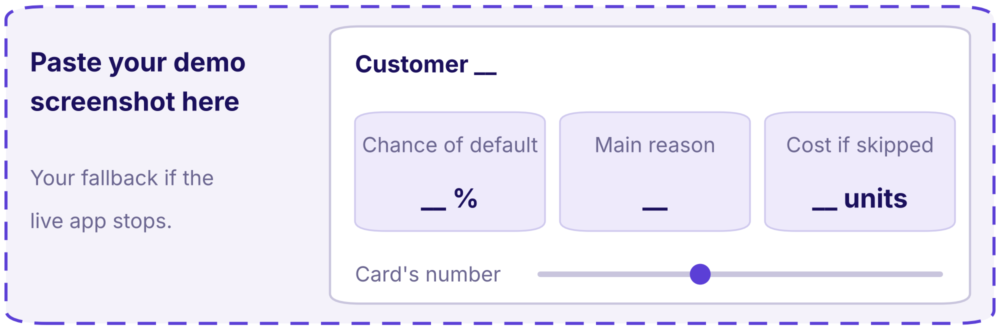
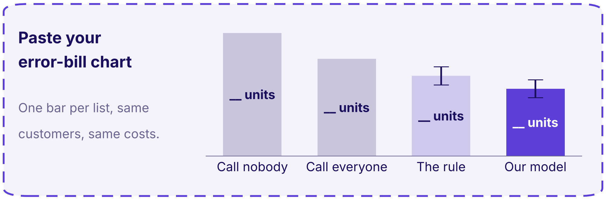

# Whom Kalpa calls before the due date

Header: KALPA FINANCIAL  ·  GROUP __  ·  CARD __

```notes
How to use this template. Seven slides, twelve minutes, every member speaking, plus one backup slide
the panel may ask for. Keep every headline as a sentence and fill its blanks with your own numbers
from your repository; never add a slide titled Agenda, Introduction, Problem statement or About the
dataset. Replace the two dashed boxes with your own screenshot and your own chart. The speaker and
the minutes for each slide are in its notes.
```

---

## S1. Call our top __: the error bill falls __ units
*Rohan acts on the first sentence he hears, so it carries the list, the bill and the caveat.*


**Say this first.** Rohan, call the __ customers our list ranks highest before the due date: the list's error bill is __ cost units, __ fewer than calling nobody, and __ would change our call.

| Part | Seconds | Your words |
|---|---|---|
| Situation | 20 | Kalpa launches cards in India with no card history, so we proved the method on __. |
| Complication | 25 | A missed default costs __ wasted calls, the team can make __ calls, and our card says __. |
| Question | 15 | So whom do we call first, and what does that list cost when it is wrong? |

```notes
SPEAKER: drawn by the panel on the day, so all three of you rehearse this slide. 0:00 to 1:30.
0:00 to 0:20. Read the headline, then the "Say this first" line word for word, with your numbers in it.
0:20 to 1:20. Situation, complication, question: one row each, inside the seconds in the table.
1:20 to 1:30. Hand over: "[name] now shows what each mistake costs."
Your first word is "Rohan". Never open with a greeting, your group's name, an agenda, the dataset or
how you worked; the panel has read the ticket.
Rehearse with a phone timer. Over 90 seconds: cut words from the situation, never the number.
```

---

## S2. A missed default costs __ wasted calls
*So we judge every list by its error bill in cost units, which accuracy cannot see.*


| | The customer defaults | The customer pays |
|---|---|---|
| We call | Caught: 0 units | Wasted call: 1 unit |
| We do not call | Missed default: __ units | Left alone: 0 units |

**The metric that follows.** Error bill = 1 x wasted calls + __ x missed defaults, on the same __ customers.

**So the line sits at.** Call when the chance of default is above __, which is 1 in __.

```notes
SPEAKER: the decision owner. 1:30 to 3:00, ninety seconds.
Read the four cells as a story about one customer: "If we call and they default, we caught it..."
Then say the formula with your card's ratio in it, and where your line sits and why.
Then one sentence on accuracy: "Calling nobody is __ percent accurate and misses every defaulter."
Do not explain the data again. Hand over: "[name] scores one customer live."
```

---

## S3. Customer __ is __% likely to default, so we call
*One customer, scored live: the chance, the main reason and what skipping them costs.*


```stats
value: __% | label: chance of default | note: customer __, from score()
value: __ | label: main reason | note: the column that moved the score most
value: __ units | label: cost if we skip them | note: chance x the cost of a miss
```

**Change the card's number.** At __ instead of __, the list becomes __ customers and its bill __ units.



```notes
SPEAKER: the builder. 3:00 to 6:00, three minutes, the longest slide.
0:00 to 0:20. Open the app. It is already running from a fresh start.
0:20 to 1:20. Pick one customer, read the three numbers aloud, and say what Rohan's caller does next.
1:20 to 2:20. Change your card's number live and read the new list size and bill aloud.
2:20 to 3:00. What that means for Rohan in one sentence, then hand over:
"[name] shows why we chose this way over the other."
Show no code. If the app stops, say what stopped it, show the screenshot on this slide, and carry on;
the clock does not stop. Rehearse the demo from a fresh Codespace at least twice.
```

---

## S4. __ beats __ by __ units, so we chose __
*Two ways to make the same call, scored on the same customers and the same costs.*


| | A: __ | B: __ |
|---|---|---|
| What it is, in one line | | |
| Error bill on the same __ customers | __ units | __ units |
| Build time | __ hours | __ hours |
| Can Rohan say why a customer is called | | |
| How it fails, and how we would notice | | |
| The fact that would flip our choice | | |

```notes
SPEAKER: the evaluator. 6:00 to 8:00, two minutes.
Read the bill row first, then the explanation row, then the row that would flip your choice.
Say one sentence on why a group with another card might choose the other way.
Hand over: "So how honest is our number? [name] again."
```

---

## S5. Our bill is __ units, give or take __
*Measured against doing nothing, with its spread, and with the trap that would have flattered it.*




**The trap we caught.** __, which would have made our bill look __ units better.

**Honesty line one.** The Taiwan score proves the pipeline and is never Kalpa's score.

**Honesty line two.** This data allows no out-of-time split, so the MVP must add one.

```notes
SPEAKER: the evaluator. 8:00 to 9:30, ninety seconds.
Point at calling nobody first, then your list, then the spread: "Across five splits it moved by __."
Say the trap you caught in one sentence and what it would have done to the number.
Read both honesty lines as they are written. Hand over: "[name]: what this proved, and what it did not."
```

---

## S6. The POC proved __; an MVP still needs __
*What the public book proved, and what Kalpa needs before one real customer is called.*


| | What the POC proved | What the MVP still needs |
|---|---|---|
| Functional: what it must do | | |
| Non-functional: how well, how fast | | |
| Constraints: rules, security, privacy, governance | | |

**Not in the MVP.** __ and __.

```notes
SPEAKER: the decision owner. 9:30 to 11:00, ninety seconds.
One row at a time, left column then right. Say where each constraint comes from: your card, Rohan's
call, or a rule a lender in India works under.
Name the two things the MVP will not do, so nobody asks for them.
Hand over: "[name] closes on what would change our call."
```

---

## S7. We would change our call if __
*The one fact that would flip the recommendation, the risk we watch and what we ask of Rohan.*


```cards
icon: refresh-cw | eyebrow: What would flip it | title: __ | body: If __ moved to __, we would __.
icon: triangle-alert | eyebrow: Our top risk | title: __ | body: From our pre-mortem: __, and we watch it by __.
icon: hand | eyebrow: Our ask | title: __ | body: Rohan, we need __ from your team by __. | tone: dark
```

```notes
SPEAKER: the builder. 11:00 to 12:00, one minute.
Say each card in one sentence, the ask last. Then stop: no thank you and no summary.
This slide stays on screen while the panel asks its questions.
```

---

## S8. Backup: the five numbers behind every slide
*Any member recomputes any of these live from the repository when the panel asks.*

| Number | Value | What it means | Where it is computed |
|---|---|---|---|
| Base rate | __ | | `src/__`, function __ |
| Do-nothing bill | __ units | | |
| List size or threshold | __ | | |
| Our model's bill | __ units | | |
| Our card's number | __ | | |

**Both honesty lines hold.** The Taiwan score is never Kalpa's score, and the MVP adds an out-of-time split.

```notes
Shown only when the panel asks for a number. Whoever the panel names opens the repository, finds the
line in the right-hand column and reruns it. Each of you rehearses all five, since any of you can be
named.
```
