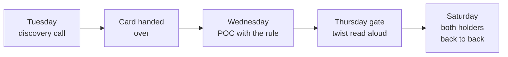

# Which card does each group hold, and what does its twist change?

TRAINER. Eight constraint cards, one page each. The top half of each page is handed to the group at
the end of its discovery call on Tuesday; everything under the cut line stays with the trainer and
is read aloud at Thursday's approach gate as the twist. Print the cards with
`python3 scripts/build_doc.py content/W06/D2/4_trainer_only/C2_W06_D02_constraint_cards_TRAINER.md`,
which puts each card on its own A4 page, then cut each page along the line.

Every number below the cut comes from the executed reference build,
`C2_W06_D02_reference_build_TRAINER.ipynb`, section 7, and matches
`docs/detailing/W06_research/W06_datasets.md` section 3(c). Five-split numbers are means over seeds
0 to 4; seed-42 numbers are on the week's test book of 9,000 cardholders.

## Who gets which card?

Thirteen groups: cards 1, 2, 4, 5 and 6 go to two groups each, and cards 3, 7 and 8 to one. Both
holders of a card present back to back on Saturday, so the panel can ask why two groups with the
same rule landed in different places.

| Card | The rule in one line | Groups holding it |
|---|---|---|
| 1 | A missed default costs 5 wasted calls | ______ and ______ |
| 2 | The team can make 1,000 calls | ______ and ______ |
| 3 | The team is paid on balance protected | ______ |
| 4 | Every caller says the main reason | ______ and ______ |
| 5 | Sex, marital status, age and education may not be used | ______ and ______ |
| 6 | September's statement arrives after the list | ______ and ______ |
| 7 | October's outcomes arrive in November | ______ |
| 8 | A code outside the dictionary is a question | ______ |

## Card 1: what if a missed default costs five wasted calls?

| Card 1 |
|---|
| **Rohan's rule.** "A missed default costs us five times a wasted call. Set the list by that." |
| **Where a rule like this comes from.** Lenders price the two mistakes differently. The German credit data on the UCI repository ships with a cost matrix of exactly this shape: passing a bad customer as good costs 5 and refusing a good customer costs 1. A missed default writes off a balance; a wasted call spends an agent's time on someone who would have paid. |
| **What your group brings to Thursday's gate.** The threshold this ratio sets and why, the list it gives, and that list's error bill beside calling nobody and calling everyone. |

---

**Cut here.** Everything below this line stays with the trainer.

### What does Rohan say at the gate?

"My CFO has run the numbers again. A missed default costs us twenty wasted calls, not five. What
changes?"

| Number | Tuesday, 5 to 1 | Thursday, 20 to 1 |
|---|---|---|
| Threshold | 0.16 tuned on validation (theory 1/6 = 0.167) | theory 1/21 = 0.048 |
| Share of the book called | 44.5 percent | 97.7 percent |
| The list's bill per 1,000 cardholders | 568 | 765 |
| Calling everyone | 779 | 779 |
| Calling nobody | 1,106 | 4,424 |
| The default threshold 0.5 | 762, barely under calling everyone | not worth quoting |

**A strong group says.** At 20 to 1 the model calls almost everyone and beats "call everyone" by only
1.8 percent, so the model no longer earns its keep for a call. Either the action changes (something
cheaper than a call for the bulk, a call for the top) or the group challenges the ratio.

**The trap.** Quoting the drop from 1,106 to 568 as the model's value: calling everyone already gets
to 779, so the model's honest gain at 5 to 1 is 211 units per 1,000, about 27 percent.

**Saturday's question.** "Your twin group chose a different threshold from the same ratio. Which
of you tuned on the test book?"

## Card 2: who are the best 1,000 to call?

| Card 2 |
|---|
| **Rohan's rule.** "The collections team can make 1,000 calls this month, out of these 9,000 cardholders." |
| **Where a rule like this comes from.** A call centre has a fixed number of agents and hours in a month. The list has to fit the team before it can be clever, and the question changes from "who is risky?" to "who are the best 1,000?" |
| **What your group brings to Thursday's gate.** Your best 1,000, how many defaulters they reach, and how that compares with the simplest list a person could sort by hand and with 1,000 picked at random. |

---

**Cut here.** Everything below this line stays with the trainer.

### What does Rohan say at the gate?

"Good news. We hired. The team can make 2,000 calls. Does your answer change?"

| Number (five-split means) | Tuesday, 1,000 calls | Thursday, 2,000 calls |
|---|---|---|
| Defaulters reached by the model | 687 | 1,079 |
| Defaulters reached by "sort by months late in September" | 666 | 1,010 |
| The model's lead | 21, about 3 percent | 69, about 7 percent |
| A random list | about 221 | about 442 |

On seed 42 alone the gap at 1,000 calls is 2 (676 against 674), so a group quoting one split cannot
tell the two apart.

**A strong group says.** At 1,000 calls the hand-sorted rule is the defensible choice: it is free to
build, any caller can explain it, and the model adds 21 defaulters. At 2,000 calls the model earns
its place.

**The trap.** Claiming the model "wins" from one split, or comparing the model with a random list
instead of with the rule.

**Saturday's question.** "Rohan can hire ten more agents or buy your model. Which do you advise?"

## Card 3: what does a team paid on balance protected want?

| Card 3 |
|---|
| **Rohan's rule.** "My collections team is paid on the balance it protects. Build them a list they would want." |
| **Where a rule like this comes from.** When a team is measured on money, a large balance at moderate risk can be worth more than a small balance at high risk. The incentive changes what "the best list" means even when the model does not change. |
| **What your group brings to Thursday's gate.** Your list of 1,000 and the defaulted balance it protects, in NT dollars and as a share of all defaulted balance in the test book. |

---

**Cut here.** Everything below this line stays with the trainer.

### What does Rohan say at the gate?

"Rank them by the chance of default times what they owe, and put that list beside yours."

| Number (seed 42, top 1,000, September bill clipped at zero) | Ranked by chance alone | Ranked by chance x balance |
|---|---|---|
| Defaulted balance protected, of 100.1 million NT dollars | 42.7 million, 42.7 percent | 62.9 million, 62.8 percent |
| Defaulters reached | 676 | 469 |

**A strong group says.** The same model gives two different lists. The chance x balance list
protects 20 more points of balance while reaching 207 fewer defaulters, so the choice depends on
whether Rohan counts heads or money, and the group names which.

**The trap.** Ranking by balance alone (the biggest bills first), which ignores the chance, or
forgetting that negative September bills are credit balances and clipping them.

**Saturday's question.** "Your list reaches 207 fewer defaulters. Who answers for them?"

## Card 4: can every caller say why a customer is on the list?

| Card 4 |
|---|
| **Rohan's rule.** "Every caller must be able to say the main reason a customer is on the list, in one sentence." |
| **Where a rule like this comes from.** The Reserve Bank of India's circular of 6 March 2007 asks lenders to "convey in writing the main reason / reasons" for rejecting a loan application, "including credit card applications". A call is gentler than a rejection, and Rohan applies the same spirit to it. |
| **What your group brings to Thursday's gate.** For any cardholder on your list, the main reason in words a caller can say, and what that requirement costs your list, if anything. |

---

**Cut here.** Everything below this line stays with the trainer.

### What does Rohan say at the gate?

"Compliance has read your list. They want the reason in writing, for every customer called, and they
want to know how you got it."

| Number (five-split means) | Value |
|---|---|
| Gradient boosting AUC | 0.778 |
| Logistic regression, status codes as categories, AUC | 0.765 |
| The cost of a model whose reasons read off its coefficients | 0.013 of AUC |
| Logistic regression, status codes as plain numbers, AUC | 0.717 |

**A strong group says.** Coding the status columns right is worth about four times the choice of
model, and a logistic regression's written reasons cost 0.013 of AUC. A boosted model can still give
a reason by setting one input at a time to a typical value and seeing which change lowers the chance
most, which is how the reference build's `score()` does it.

**The trap.** Reading the status codes as numbers on a line, which makes -2 "better" than -1, and
then blaming logistic regression for the low score.

**Saturday's question.** "Read me the reason for the third customer on your list, as the caller
would say it."

## Card 5: what happens without sex, marital status, age and education?

| Card 5 |
|---|
| **Rohan's rule.** "Sex, marital status, age and education may not be used to decide whom we call." |
| **Where a rule like this comes from.** Rohan's rule keeps traits a customer is not to be judged on out of the decision, and a careful lender also checks outcomes by group when a trait is not an input. In 2021 New York's financial regulator tested Apple Card's outcomes by gender on the underwriting data of nearly 400,000 applicants. |
| **What your group brings to Thursday's gate.** A list built without those four columns, its error bill, and what dropping them cost. |

---

**Cut here.** Everything below this line stays with the trainer.

### What does Rohan say at the gate?

"Show me the share of men and the share of women your list calls, and the share of each who actually
defaulted."

| Number | With the four columns | Without them |
|---|---|---|
| AUC, five-split mean | 0.7779 | 0.7769 |
| Defaulters in the top 1,000, seed 42 | 676 | 675 |
| Men flagged in the top 1,000, seed 42 | 11.5 percent | 11.3 percent |
| Women flagged in the top 1,000, seed 42 | 10.9 percent | 11.0 percent |
| True October default rate, test book | men 23.9 percent, women 21.0 percent | the same |

**A strong group says.** Dropping the columns costs almost nothing and leaves the gap between men and
women in place, because the gap follows the true default rates. Fairness is checked on the outcomes
by group; removing the inputs alone proves nothing.

**The trap.** Announcing the list "fair" because the columns are gone, without looking at who it
calls.

**Saturday's question.** "Your list calls men more often than women. Is that a problem, and how
would you know?"

## Card 6: what is lost when September's statement arrives late?

| Card 6 |
|---|
| **Rohan's rule.** "September's statement lands after the call list is built. Build only from what exists on list day." |
| **Where a rule like this comes from.** A statement is produced after its cycle closes and reaches the bank's systems later still, so a list built before that moment can only see earlier months. A model trained on a month the live system will not have looks better on paper than it will in use. |
| **What your group brings to Thursday's gate.** A list built only from the statements that exist on list day, and what it costs against a list that could see September. |

---

**Cut here.** Everything below this line stays with the trainer.

### What does Rohan say at the gate?

"The list goes out on the 1st, so you have April to August and nothing else. What does the simple
rule lose, and what does your model lose?"

| Number | With September | Without September |
|---|---|---|
| AUC, five-split mean | 0.778 | 0.747 |
| Model's top 1,000, five-split mean | 687 | 614 |
| The rule's top 1,000 (September status, then August status) | 666 | 563 |
| The model's lead | 21 | 51 |

A group that already dropped September on Tuesday gets the twist one month further: without
September and August, seed 42 gives AUC 0.7295 and 564 defaulters in the top 1,000.

**A strong group says.** The lag takes away the rule's best column, so the model goes from optional
to necessary: its lead over the rule grows from 21 to 51.

**The trap.** Keeping `PAY_0`, `BILL_AMT1` or `PAY_AMT1` in the inputs because they sit in the file,
which reports 0.778 for a list the live system can never build.

**Saturday's question.** "Your twin group's AUC is higher than yours. What did they keep that you
dropped?"

## Card 7: what can we train on before October is known?

| Card 7 |
|---|
| **Rohan's rule.** "October's outcomes arrive in November. I want the list before then." |
| **Where a rule like this comes from.** A default is known only after the due date passes, so a model trained today can learn only from outcomes that have already happened. Waiting for the true label costs a month; training on a stand-in costs accuracy. |
| **What your group brings to Thursday's gate.** Which label you could train on today, what waiting a month would cost, and when you would know whether the list worked. |

---

**Cut here.** Everything below this line stays with the trainer.

### What does Rohan say at the gate?

"Train today, on what you already know, and tell me in defaulters what the stand-in costs."

| Number (seed 42; train on April to August, score May to September, judge on October) | AUC | Defaulters in the top 1,000 |
|---|---|---|
| Stand-in label: September status 1 or worse (base 22.7 percent) | 0.747 | 539 |
| Stricter stand-in: September status 2 or worse (base 10.4 percent) | 0.652 | 652 |
| The true October label, same window | 0.779 | 680 |

**A strong group says.** The stand-in costs 141 defaulters per 1,000 calls, so the choice is between
waiting a month and accepting that loss. The stricter stand-in ranks the very top well (652) and the
rest badly (AUC 0.652), so with a fixed 1,000 calls it may be the better stand-in.

**The trap.** Training on September's status with September's own columns still in the inputs, which
predicts a label from itself.

**Saturday's question.** "Would you wait a month? What does a month of waiting cost Rohan?"

## Card 8: what do we do with a code the dictionary does not explain?

| Card 8 |
|---|
| **Rohan's rule.** "A code that is not in the data dictionary is a question for my data team, never a guess." |
| **Where a rule like this comes from.** Datasheets for Datasets (Gebru and colleagues, 2018) argues that every dataset should carry a sheet saying what each field means; for this book the UCI page is that sheet. A guessed code becomes a guessed input, and sometimes a guessed label. |
| **What your group brings to Thursday's gate.** Every value you found that the UCI page does not define, how many rows carry it, the question you put to Rohan's data team, and what your list assumes until it is answered. |

---

**Cut here.** Everything below this line stays with the trainer.

### What does Rohan say at the gate?

"My data team has ruled: an account that owed nothing and paid nothing for six months cannot
default. What moves?"

| Number (whole book of 30,000) | Value |
|---|---|
| September statuses coded -2 or 0, neither on the UCI page | 17,496, 58.3 percent |
| Education coded 0, 5 or 6, and marital status coded 0 | 345 and 54 rows |
| Accounts with a zero bill and a zero payment in all six months | 795 |
| Of those, labelled default | 299, 37.6 percent, which is 4.5 percent of all 6,636 defaults |
| Base rate as given, after relabelling the 299, after removing the 795 | 22.1, 21.1 and 21.7 percent |
| The call-nobody bill per 1,000, as given and after the ruling | 1,106 and 1,056 |

**A strong group says.** The ruling changes the label, so the base rate, the do-nothing bill and
every number built on them move; the group reruns the POC rather than patching one slide.

**The trap.** Recoding -2 and 0 as "paid" because they sit near -1, which is exactly the guess the
card forbids.

**Saturday's question.** "Which of your numbers would move if the data team ruled the other way?"
