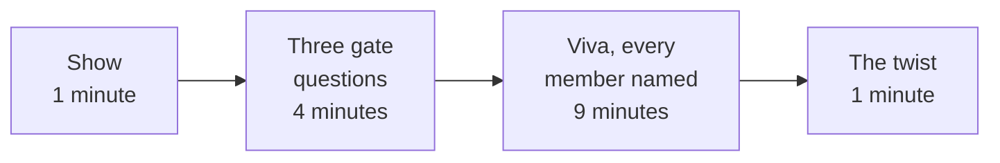

# Is each group's approach sound enough to build on, and can every member defend it?

TRAINER. Thursday's approach gate, fifteen minutes per group, with the Mock R2 viva inside it and
every member questioned. Thirteen groups at fifteen minutes is 195 minutes, about 65 for each of the
three staff, so each runs four or five gates. No AI is open in the room, for the group or the
assessor. The Mock R2 written sheet runs separately, later the same day.

**Who needs the answer.** The assessor, who has to decide in fifteen minutes whether a group builds
on Friday or fixes first, and the Programme Head, who reads which members could not defend a number.

**The questions on the way.** What does the group show? Which three gate questions decide go or not
yet, and what does each sound like? How is each member questioned, and which follow-up separates
understanding from recital? How is the twist handed over?

## How do the fifteen minutes run?

| Minutes | What happens | What the assessor holds |
|---|---|---|
| 0:00 to 1:00 | The group opens workbook pages 1 to 5 and the first draft of page 6, and restarts its POC from a fresh kernel | This sheet and the group's card |
| 1:00 to 5:00 | The three gate questions, each to a member the assessor names | The pass and not-yet lines below |
| 5:00 to 14:00 | The viva: about three minutes per member, two prompts each plus two passport draws in total | The prompts by stage below |
| 14:00 to 15:00 | The twist, read aloud from the card's lower half | `C2_W06_D02_constraint_cards_TRAINER.md` |

The POC run is the evidence. If it fails from a fresh kernel, the gate is "not yet" whatever the
answers, and a TA sits with the group before Friday's build starts.

## Which three questions decide go or not yet?

Name the member before each question; the others stay silent. A member may say "I do not know; I
would check it in this cell", which is a better answer than a guess.

| # | The gate question | A pass sounds like | "Not yet" sounds like |
|---|---|---|---|
| 1 | What is decided, and what does each wrong call cost? | "Whom Kalpa's team calls before October's due date. A wasted call is 1 unit, a missed default 5. About 22 in 100 defaulted." | Accuracy as the goal; no action named; the two costs missing or treated as equal |
| 2 | What does your list cost against calling nobody and calling everyone, and on which rows did you measure it? | A bill per 1,000 cardholders beside both simple bills, on a test book opened once; a threshold that follows from the costs (near 1/6) or a list size from the card | AUC alone; a threshold of 0.5 with no reason; a comparison with calling nobody only; a threshold tuned on the test book |
| 3 | What does your card change, and what is your A against B call? | The card's number computed or a plan to compute it; a simple rule A with its numbers; a choice and the fact that would flip it | The card not yet used; no rule A, so the model is compared with nothing |

**Go** needs all three. **Not yet** names the one thing to fix by Friday morning, written in the
group's challenges log in the assessor's words, with a TA slot booked.

### What are the reference numbers, for a quick check?

From the executed reference build, seed 42 unless marked. A group on another split, model or row set
will differ; ask which split, which threshold and which rows before calling a number wrong.

| Number | Reference |
|---|---|
| Base rate | 22.1 percent, 6,636 of 30,000 |
| Calling nobody, per 1,000 | 1,106 |
| Calling everyone, per 1,000 | 779 |
| Threshold from the costs | 1/6 = 0.167 in theory, 0.16 tuned on validation |
| The model's list at that threshold, per 1,000 | 568, calling 44.5 percent of the book |
| The model at 0.5, per 1,000 | 762 |
| Rule A, "September status 1 or worse", per 1,000 | 661, precision 0.50 and recall 0.50 |
| Gradient boosting AUC, five-split mean and range | 0.778, from 0.775 to 0.782 |

## How is each member questioned?

Each member gets two prompts from different stages, chosen from what that member built or presented
on the workbook's roles table, then one stage they did not lead. Ask the prompt, wait, then always ask
its follow-up: a recited answer survives the prompt and breaks on the follow-up.

| Stage | The prompt | The follow-up that separates understanding from recital | Recital sounds like | Understanding sounds like |
|---|---|---|---|---|
| 0 The business | Who pays when your list misses a defaulter? | And when it calls someone who would have paid, who pays, and how much? | "The bank loses money." | "Kalpa writes off the balance, 5 units; a wasted call is an agent's time and a chased good customer, 1 unit." |
| 1 The frame | What does your list know on the day it is built? | Point to a column that would not exist if a statement arrived late. | "All 23 features." | "Six months of statements to September; if September were late, these three columns go." |
| 2 Requirements | Name one non-functional requirement and how you would test it. | What happens on list day if it fails? | "It must be fast and accurate." | "The book scores in under a minute; we time it in the notebook; if it fails, no list goes out and Rohan is told." |
| 3 Options | Why your choice between rule A and model B? | Give me the one fact that would make you switch. | "The model has a higher AUC." | From a card 2 group: "At 1,000 calls the model reaches 21 more defaulters than the rule, which costs nothing to build; at 2,000 the lead is 69, so the hire decides it." |
| 4 The POC | Recompute your list's bill from its four counts, on paper, now. | Why that threshold, and not 0.5? | "We tuned it." | "A missed default costs five wasted calls, so we call anyone above one in six; tuning on validation landed beside that." |
| 4 Honesty | How do you know the bill is not a lucky split? | What spread did you see across splits, and where in the repository? | "We used a random seed." | "Five splits; the AUC moved by under 0.01; this cell." |
| 5 The architecture | Where does the score live, and who calls it? | What happens if September's bill column arrives empty? | "In the model." | "A function in `src/` the monthly job calls; an empty column stops the run before a list goes out." |
| 6 The MVP | What did the POC prove that Kalpa can use? | Why can this data never give you an out-of-time split? | "That the model works." | "That the pipeline beats calling everyone on held-out rows; every cardholder shares one snapshot, so the MVP must test on later months of Kalpa's data." |

### How do the passport draws run?

Twice per group, name a member and a passport number (1 to 5). The member says what it means and
recomputes it from the repository in under two minutes, with the group silent. A member who cannot
is marked "not yet" for that number and retakes it with a TA on Friday; Saturday is then the second
time they defend it, never the first.

### What does the assessor record?

| Member | Prompt 1: stage and result | Prompt 2: stage and result | Passport draw: number and result | Notes for Friday |
|---|---|---|---|---|
| | | | | |
| | | | | |
| | | | | |

Results are "defended", "defended after the follow-up" or "not yet". Scoring follows the Mock R2
viva rubric in the run session's files, which is proposed for the Programme Head and not yet locked;
nothing on this sheet states a mark.

## How is the twist handed over?

At minute fourteen, read the twist from the lower half of the group's card in Rohan's words, give no
number, and say: "Bring me what this changes on Friday. It goes on slide 7, under what would change
our call." Do not answer questions about it; the group's first reaction goes in its challenges log.

| Card | The twist, in one line |
|---|---|
| 1 | The CFO says a missed default costs twenty wasted calls |
| 2 | The team can make 2,000 calls |
| 3 | Rank by chance times balance, and compare the lists |
| 4 | Compliance wants the reason in writing |
| 5 | Show the list's flag rate by group |
| 6 | The list goes out on the 1st, so only April to August exist; one month further for a group that already dropped September |
| 7 | Train today on a stand-in label, and say what it costs |
| 8 | An account owing nothing cannot default |
