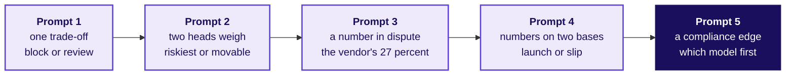

# GD prompts, Build 2: which five lending decisions do the groups argue, and how does a chair run and score a round?

**TRAINER ONLY.** For the two GD chairs on Friday: the industry expert in room 1 and the Programme
Head in room 2 (the GD owners are still open in `facts.yaml`, decision `build-owners`). Each prompt
is a card on its own page: print the part above its cut line, five copies a room, and keep the
chair's notes below the line. Which group meets which prompt, and in which round, is in the run
sheets' Friday section.

The GD is a thread separate from the project. It is unprepared by design: no group sees its card
before the round, and nothing on a card needs the group's build. Every real fact on a card was
checked on 29 October 2026 against the source printed beside it (the verification is in
`docs/detailing/W06_research/W06_references.md`); every other number is marked illustrative.

## How do the five prompts climb?

| Prompt | Level | What makes it harder than the one before | Read, then discuss | Kept from the groups holding card |
|---|---|---|---|---|
| 1 Block at checkout or review overnight | 1 | One decision, one trade-off, every number agrees | 4, then 17 | none |
| 2 Call the riskiest or the most movable | 2 | Two heads want different lists from the same scores, and the evidence comes from another industry | 4, then 17 | 3 |
| 3 The vendor's 27 percent | 3 | The headline number is the vendor's own claim, and whether it can be trusted decides the card | 5, then 16 | none |
| 4 Launch on the date or slip | 4 | The cost of slipping and the cost of launching unready sit on different bases and fall on different firms | 5, then 16 | none |
| 5 Which model does the committee approve first | 5 | A draft rule, a survey and an accuracy gap pull different ways, and no option wins on every count | 6, then 15 | 4 and 5 |

**Variant B.** A prompt used a second time in the day carries one changed number, read aloud by the
chair as the round opens, so a group that heard about the first round cannot replay it. Each card's
notes give its variant line.

## How does a 30-minute round run?

| Part | Minutes | The chair | The group |
|---|---|---|---|
| Open | 1 | Says the opening below, then the variant line if the round uses one | Cards face down |
| Read | 4, 5 or 6 | Silent; starts the countdown on screen | Reads alone, may write |
| Discuss | 17, 16 or 15 | Writes evidence by seat and minute; steps in only on the triggers below | Reaches one position |
| Two questions | 4 | Asks the card's two questions, each to a learner named first, the quietest first | Answers alone; one other may add |
| Notes and changeover | 4 | Finishes the evidence, types the four scores per learner into the GD sheet | Leaves; the next group sits |

**The opening, said word for word.** "You are Kalpa Financial's risk team, and the question on this
card has come to you. Read it alone for the minutes printed on it, then talk to each other and
reach one position as a group. When I call time I want the position, the one number that carries it
and where on the card it comes from, and what would change your mind; if you cannot agree, tell me
where you split and why. Any number marked illustrative is yours to challenge. I answer no question
about the numbers once you start, so say any assumption out loud. Then I put two questions, each to
one of you by name. I score each of you alone on how you frame the problem, the evidence you use,
how you build on each other and bring in anyone quiet, and whether you land a recommendation with
its risk."

**The moves to listen for, and the criterion each counts toward.**

| Move | What it sounds like | Counts toward |
|---|---|---|
| Framing the decision | "So Kalpa chooses between blocking at checkout and reviewing overnight, before launch." | Structures the problem |
| Naming the metric | "We should judge this on money lost plus good customers turned away, per million payments." | Structures the problem |
| Using one number from the card | "One good customer blocked for every fraud stopped: that is the trade." | Uses evidence |
| Challenging a number | "The 27 percent is the vendor's own figure, and nobody replicated it." | Uses evidence |
| Building on a member | "Taking your point on friction further: the blocked customer calls the helpline too." | Engages |
| Bringing in a quiet member | "You have not said where you land on the appeal path. Where are you?" | Engages |
| Stating what would change the mind | "If wrong blocks went above five per fraud, I would switch to review." | Lands a conclusion |
| Landing the recommendation with its risk | "Block at checkout, and the risk is the good customers; we watch the complaint rate weekly." | Lands a conclusion |

**When the chair steps in.** Only four times: a learner talks over another for a second time (say
"one at a time"); the group asks the chair for a number (say "use the card, and say your
assumption"); nobody has spoken for 30 seconds (say "what would Rohan ask you next?"); five minutes
are left and nobody has proposed a position (say "five minutes, and I have not heard a position
yet").

**From evidence to a score.** Score each criterion from what the notes show, never from an
impression at the end. A learner who said one framing line, used one number correctly, built on
one person and helped land the close sits near the middle of each criterion; full marks need the
move made early, unprompted and right. A learner who never spoke before the chair's questions
cannot score above a third of any criterion except on what the named question shows.

## Prompt 1, level 1: should Kalpa's card block a suspected fraud at checkout, or let it through and review overnight?

**Read 4 minutes, then discuss 17.**

Kalpa Financial's card goes live next quarter. Its fraud team must choose how a suspected fraud is
handled before the first payment is made.

| Option | What happens to a payment the model flags |
|---|---|
| Block at checkout | Declined on the spot; the customer calls the helpline to unblock it |
| Review overnight | Approved; an analyst checks it the next morning and calls the customer if it looks wrong |

**What a large processor reports.** Stripe's fraud system decides each payment in under 100
milliseconds; fraud runs at about 1 in 1,000 payments; and its model wrongly blocks about 0.1
percent of legitimate payments. Source: Stripe's engineering blog on Stripe Radar, 29 March 2023,
https://stripe.dev/blog/how-we-built-it-stripe-radar, checked 29 October 2026.

**Exhibit. One million payments at those rates.**

| | Count |
|---|---|
| Frauds among them, about 1 in 1,000 | about 1,000 |
| Good payments wrongly blocked, 0.1 percent of about 999,000 | about 999 |

**The question.** Which option does Kalpa launch with, and what would make you switch?

**Deliver.** One position, the number that carries it, and what would change your mind.

---

*Cut here. Below this line, the chair's notes.*

| | |
|---|---|
| The number to argue from | About one good customer blocked for every fraud stopped |
| Positions that hold | Block: the money never leaves, and one blocked good customer per fraud is a fair price for a new card with no history. Review: a new card's first customers are its reputation, and an overnight review stops the second payment if not the first. A strong group splits by size: block above an amount, review below it. |
| The plausible wrong number | "0.1 percent is tiny, so blocking costs nothing": it is as many people as the frauds |
| Full marks on this card | Frames the decision as fraud loss against good customers turned away, uses the one-to-one count, and lands on a position with the complaint rate as its watch number |
| Question 1, to the quietest | "What does Kalpa lose on one blocked good customer that it does not lose on one fraud?" |
| Question 2 | "What number would you watch in the first month, and at what value would you switch?" |
| Variant B line | "One change: suppose our own model wrongly blocks 0.5 percent of good payments, an illustrative figure." About 5,000 good customers per 1,000 frauds, five per fraud, so review or a size split gains ground. |

## Prompt 2, level 2: should Kalpa's 1,000 calls go to the riskiest cardholders or to those a call is most likely to move?

**Read 4 minutes, then discuss 17.**

Kalpa's collections head wants this month's 1,000 calls to go to the 1,000 cardholders most likely
to default. The analytics lead wants them to go to the 1,000 whose payment a call is most likely to
change. Both use the same model's scores.

**What a field study found.** In two field experiments on retention offers, at a wireless provider
in the Middle East and a North American membership organisation, targeting customers by how much
the offer changed their behaviour, instead of by their risk of leaving, would have cut churn by a
further 4.1 and 8.7 percentage points. In the wireless study the offer barely moved the riskiest
tenth: 95.3 percent left without it and 93.7 percent with it. Only about half of the most movable
customers were also among the riskiest. Source: Ascarza, Journal of Marketing Research, February
2018, the author's post-print on the HBS site,
https://www.hbs.edu/ris/Publication%20Files/ascarza_jmr_18_783d54d4-e548-41ed-b1d7-8a180f1ae85a.pdf, checked 29 October 2026.

**Exhibit. The riskiest tenth in the wireless study.**

| | Left |
|---|---|
| No offer | 95.3 percent |
| Offer made | 93.7 percent |
| What the offer changed | 1.6 points |

**The question.** Whom should Kalpa's 1,000 calls go to, and what would you need to know first?

**Deliver.** One position, the number that carries it, and what would change your mind.

---

*Cut here. Below this line, the chair's notes.*

| | |
|---|---|
| The number to argue from | 1.6 points moved in the riskiest tenth, against 4.1 and 8.7 points gained by targeting on the change |
| Positions that hold | Riskiest: a default is a loss whether or not the call moves it, and Kalpa has no data yet on who a call moves. Most movable: a call that changes nothing is a wasted call, and the study shows the riskiest may be past saving. A strong group names the transfer gap (retention offers, not collections calls) and proposes a test: split the 1,000 calls and measure. |
| The plausible wrong number | "93.7 percent still left, so calling the riskiest is useless": the study measured an offer, never a collections call |
| Full marks on this card | Frames it as "who does a call change" against "who is most at risk", uses the 1.6 points with its limits, and lands on a test that would settle it for Kalpa |
| Question 1, to the quietest | "What would Kalpa have to record on every call to know whom a call moves?" |
| Question 2 | "If the two lists overlapped almost completely, would this argument matter?" |
| Variant B line | "One change: suppose, for Kalpa's card book, nine in ten of the most movable were also among the riskiest, an illustrative figure." The two lists nearly agree, so the argument moves to cost and measurement. |

## Prompt 3, level 3: should Kalpa sign with a vendor whose model approves 27 percent more applicants?

**Read 5 minutes, then discuss 16.**

A vendor pitches Kalpa a machine learning model to approve card applications. Its deck quotes a
lender's published comparison as proof of what such a model can do.

**What the regulator published.** Under a No-Action Letter, the lender Upstart compared its model
(alternative data plus machine learning) against a hypothetical traditional model, under an agreed
model risk and compliance plan. The results, provided by Upstart and not replicated by the US
Consumer Financial Protection Bureau: 27 percent more applicants approved and average rates 16
percent lower; near-prime applicants (credit scores 620 to 660) approved about twice as often. The
Bureau said the letter endorsed no variables or techniques. Source: the CFPB's blog post of 6 August
2019,
https://www.consumerfinance.gov/archive/blog/update-credit-access-and-no-action-letter/, checked 29 October 2026.

**Exhibit. What the deck shows, and what it does not.**

| The deck shows | The deck does not show |
|---|---|
| 27 percent more approvals | How many of the extra approvals later defaulted |
| 16 percent lower average rates | Who measured it |
| About twice the near-prime approvals | Whether it holds on Indian card applicants |

**The question.** Does Kalpa sign, and what would it need to see before it did?

**Deliver.** One position, the number that carries it, and what would change your mind.

---

*Cut here. Below this line, the chair's notes.*

| | |
|---|---|
| The number to argue from | 27 percent more approvals, self-reported, with no default figure beside it |
| Positions that hold | Sign with conditions: run the vendor's model beside Kalpa's own rule on the same applicants, with the comparison designed before anyone looks, as Upstart's was. Do not sign: approvals are the vendor's metric and losses are Kalpa's, and nothing on the card says what the extra approvals cost. A strong group notices that "more approvals" is the wrong metric for a lender until defaults are counted. |
| The plausible wrong number | "27 percent more customers is 27 percent more revenue": it is 27 percent more approvals of unknown quality |
| Full marks on this card | Names the metric gap (approvals against losses), uses who measured it as evidence, and lands on a conditional signature with a pre-agreed test |
| Question 1, to the quietest | "What one number would you ask the vendor for before the next meeting?" |
| Question 2 | "How would you design the comparison so the vendor cannot pick the result?" |
| Variant B line | "One change: suppose the vendor adds that defaults among the extra approvals ran twice the book's rate, an illustrative figure." The signature now needs a price for the risk, and "do not sign" gains ground. |

## Prompt 4, level 4: should Kalpa launch its card on the date, or slip until the disputes system is ready?

**Read 5 minutes, then discuss 16.**

Kalpa's card is due to launch on a date the board announced. The disputes and appeals process, where
a customer contests a charge or asks why a limit was set, will be about four weeks late (an
illustrative figure).

**What happened at one launch.** The Apple and Goldman Sachs agreement let Apple seek USD 25
million for each 90-day delay caused by Goldman. Four days before the August 2019 launch, a readiness
assessment told Goldman's board there were "no significant impediments to launch" while also
reporting that the disputes system was "not fully ready". Goldman then mishandled hundreds of
thousands of disputes, including about 157,000 acknowledgement notices not sent on time. In
October 2024 the CFPB ordered Apple to pay a USD 25 million penalty, and Goldman to pay at least USD
19.8 million in redress and a USD 45 million penalty, barring Goldman from launching a new consumer
card without a credible compliance plan. Source: CFPB, prepared remarks on the Goldman Sachs and
Apple enforcement action, 23 October 2024,
https://www.consumerfinance.gov/archive/newsroom/prepared-remarks-of-cfpb-director-rohit-chopra-on-the-goldman-sachs-and-apple-enforcement-press-call/, checked 29 October 2026; the Goldman consent order,
https://files.consumerfinance.gov/f/documents/cfpb_goldman-sachs-bank-usa-consent-order_2024-10.pdf, checked 29 October 2026.

**Exhibit. The two costs, on their own bases.**

| Cost | Size | Paid by | When |
|---|---|---|---|
| Slipping, by contract | USD 25 million per 90-day delay | Goldman, to Apple | At the delay |
| Launching unready, by order | USD 25 million, USD 45 million, at least USD 19.8 million, and a bar on new cards | Apple, Goldman, Goldman | About five years after launch |

**The question.** Does Kalpa launch on the date or slip, and what would change your call?

**Deliver.** One position, the number that carries it, and what would change your mind.

---

*Cut here. Below this line, the chair's notes.*

| | |
|---|---|
| The number to argue from | USD 89.8 million in orders and a bar on new cards, against USD 25 million per 90 days of delay |
| Positions that hold | Slip: four weeks is under a third of one 90-day period, and the unready launch cost more than three such periods plus the right to launch again. Launch: Kalpa has no partner penalty, the delay costs the board's credibility, and a manual disputes desk can run for four weeks. A strong group puts both costs on one footing (per month, and who pays) and asks whether a manual desk is a fix or a promise. |
| The plausible wrong number | "USD 25 million against USD 25 million, so it is a wash": the two 25s are different firms' payments on different bases, and the orders add USD 64.8 million beside Apple's 25 |
| Full marks on this card | Puts the costs on one basis, names the bar on new cards as the cost no number shows, and lands on a launch rule ("launch only if a staffed manual desk answers every dispute inside the time Kalpa's grievance rules set") |
| Question 1, to the quietest | "Which cost on the exhibit would Kalpa's board feel first, and which last?" |
| Question 2 | "What would you need to see in week one to know the manual desk is working?" |
| Variant B line | "One change: suppose the disputes system will be 30 weeks late, an illustrative figure." More than two 90-day periods; slipping costs more, and a phased launch to a small first group becomes the strong answer. |

## Prompt 5, level 5: which model should Kalpa's risk committee approve for the card's first year?

**Read 6 minutes, then discuss 15.**

Kalpa's risk committee must approve the model that ranks card customers before the first statement.
The growth head wants a gradient-boosted model. Compliance wants a scorecard, a logistic regression
whose every reason can be read off its weights, until Kalpa has a year of its own card data.

**What the Indian rules and the regulator's survey say.**

- Since March 2007 the RBI has asked banks and financial institutions to give the main reason or
  reasons in writing when they reject a loan application, credit card applications included. Source:
  RBI circular DBOD.No.Leg.BC.65/09.07.005/2006-07, 6 March 2007,
  https://www.rbi.org.in/scripts/NotificationUser.aspx?Id=3315, checked 29 October 2026.
- The RBI's draft guidance on model risk, published for comment in June 2026 (whether it has been
  finalised was not verified), asks for explainability set by how material a decision is, compensating controls where full explainability is not possible,
  monitoring of drift, and human oversight with override and kill-switch arrangements. Source: RBI
  press release 2026-2027/528, 24 June 2026,
  https://rbi.org.in/Scripts/BS_PressReleaseDisplay.aspx?prid=63006, checked 29 October 2026.
- An RBI committee's survey (FREE-AI, August 2025) found that 20.80 percent of 612 supervised
  entities were using or developing AI, that credit underwriting was 13.70 percent of 583 AI
  applications, and that entities preferred simpler models for ease, legacy fit and explainability.
  Source: RBI press release 2025-2026/902, 13 August 2025,
  https://www.rbi.org.in/scripts/BS_PressReleaseDisplay.aspx?prid=61018, checked 29 October 2026,
  and the committee's report, https://rbi.org.in/scripts/PublicationReportDetails.aspx?ID=1306, checked 29 October 2026.

**Exhibit. The two models on Kalpa's proof data, illustrative figures.**

| | Scorecard | Boosted model |
|---|---|---|
| Defaulters reached in the first 1,000 calls | 540 | 560 |
| Can a caller read the main reason off it | Yes | Only with an explanation tool |
| Change when Kalpa's own data arrives | Refit the weights | Refit and re-explain |

**The question.** Which model does the committee approve for the first year, and what would make it
switch?

**Deliver.** One position, the number that carries it, and what would change your mind.

---

*Cut here. Below this line, the chair's notes.*

| | |
|---|---|
| The number to argue from | 20 more defaulters per 1,000 calls (illustrative), against a written-reasons rule and a draft that asks for explainability by materiality |
| Positions that hold | Scorecard first: the reasons rule is old and clear, the draft points the same way, most regulated entities chose simpler models, and 20 defaulters per 1,000 calls is a gap Kalpa can measure on its own data before switching. Boosting with controls: a reason code from an explanation tool can be written into a letter, the gap is real money, and the draft allows compensating controls. A strong group separates what is law (2007), what is draft (2026) and what is a survey, and sets a switching rule. |
| The plausible wrong number | "Only 20.80 percent use AI, so AI is risky": the survey counts adoption, never failure |
| Full marks on this card | Frames the decision as accuracy against explainability under a binding rule, weighs law, draft and survey at their true strength, and lands on an approval with a switching rule and the kill switch named |
| Question 1, to the quietest | "Which of the three sources on the card binds Kalpa today, and which do not?" |
| Question 2 | "What would the committee need to see after a year to switch models?" |
| Variant B line | "One change: suppose the boosted model reaches 660 defaulters in the first 1,000 calls, an illustrative figure." A gap of 120 per 1,000 calls makes boosting with controls the stronger case, and the argument moves to the controls. |
