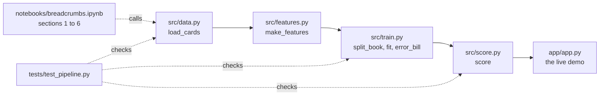

# Starter repo: how groups get it, when a hint unseals, and what each `__TODO__` expects

TRAINER ONLY. The starter is `content/W06/D2/2_starter_repo/`, which every group copies on Tuesday
and works in until Saturday. Its executed solution twin is the project session's
`4_trainer_only/C2_W06_D02_reference_build_TRAINER.ipynb`, which uses the same stage order and the
same function names, so the two open side by side.

## What is in the repository, and which stage does each file serve?

| File | Ladder stage | Worked on | Finished for the group | Left as `__TODO__` |
|---|---|---|---|---|
| `src/data.py` | 1, the data under the frame | Tuesday and Wednesday | `download()`, `read_raw()`, the constant `TARGET = "default"` | `load_cards()` |
| `src/features.py` | 3 and 4 | Wednesday | `without(cards, columns)`, which raises on a misspelt name | `make_features(cards)` |
| `src/train.py` | 3 and 4 | Wednesday | `split_book(cards, seed=42)`, 70 to 30, stratified; `MISS_COST = 5`, `WASTED_COST = 1` | `fit(X, y)`, `error_bill(outcome, called, miss_cost, wasted_cost)` |
| `src/score.py` | 6 | Friday | `save_model()`, `load_model()` | `score(customer, model=None)`, returning `(probability, reason)` |
| `app/app.py`, `app/no_server.py` | 6 and 7 | Friday | The page, the cost table, the no-server print | One control for the group's card |
| `notebooks/breadcrumbs.ipynb` | 1 to 6 | Tuesday to Friday | The first audit, executed: download, shape (30,001 by 25), first three rows | Every section's cells |
| `tests/test_pipeline.py` | 4 and 6 | All week | All four tests | Nothing |
| `templates/` | All | All week | One invented example row each, on Week 5's bank | Every other row |

## How does each group get its copy on Tuesday?

**Before Tuesday, the operations TA:**

- Copies `2_starter_repo/` into a new repository that every learner can see, hidden folders
  included (`.devcontainer`, `.streamlit`, `.gitignore`), with `presentation/` from the run session.
- Ticks **Settings, Template repository** on it, which GitHub documents at
  https://docs.github.com/en/repositories/creating-and-managing-repositories/creating-a-template-repository (checked 29 October 2026).
- Opens one Codespace from it and runs the readiness checks below once, so a broken pin shows up
  before the room does.

**In Tuesday's set-up slot, each group's builder:**

- Clicks **Use this template**, then **Create a new repository**, as GitHub documents at
  https://docs.github.com/en/repositories/creating-and-managing-repositories/creating-a-repository-from-a-template (checked 29 October 2026).
- Adds the other two members as collaborators, and each member opens a Codespace.

**Readiness, which a TA checks per group before the group leaves the slot:**

| Check | What the TA sees when it passes | The usual fix when it fails |
|---|---|---|
| The Codespace started | A terminal and the file tree | Wait for the post-create install to finish |
| Packages installed | `pip install -r requirements.txt` ends without an error | Rerun it; check the kernel is Python 3.12 |
| The tests run | `python -m pytest -rs` reads `4 skipped`, each naming a function | Run it from the top folder, never from `tests/` |
| The notebook runs | The first five code cells run and the shape prints `(30001, 25)` | Pick the Python 3.12 kernel; if UCI is down, share the zip and put the `.xls` in `data/` |

## When does a TA unseal which hint?

- A group asks; the TA checks that `templates/CHALLENGES.md` holds a row for that stage, which shows
  a real try, before anything opens.
- Hints open in order. Hint 2 opens only once hint 1 is logged and the group is still stuck, and
  hint 3 only after hint 2.
- Every opening is logged in the group's `CHALLENGES.md`, in the hint column. Whether an opened hint
  moves a mark is open in `data/programme/facts.yaml`, so log it either way.
- Hint 3 is always Week 5's bank, a different problem, so it teaches the method and never the
  group's answer. A TA who explains hint 3 says nothing about the Taiwan book.

| Notebook section | Worked on | Earliest unsealing | Hint 1, a question | Hint 2, a pointer | Hint 3, the bank |
|---|---|---|---|---|---|
| 1 The frame | Tuesday on paper, Wednesday in code | Wednesday's checkpoint | Which columns could a caller see on the day the list is built? | Week 5 Monday chapter 2 and case 1; explorer `#p1` | The bank's frame and its base rate, 4,640 of 41,188 |
| 2 Requirements | Tuesday on paper, Wednesday in code | Wednesday's checkpoint | What would compliance ask about an unexpected call? | Explorer `#p2`; Eugene Yan's design-doc guide | Four example requirement lines, labelled invented |
| 3 Options | Wednesday | Wednesday's checkpoint | Could a pencil rule do half the job? | Rules of ML, rule 1; explorer `#p3` | Call everyone Rs 292,400 against the model Rs 279,000; under a 1,000-call budget, 404 buyers against about 112 |
| 4 The POC | Wednesday | Wednesday's checkpoint | What do calling nobody and calling everyone cost? | Week 5 Tuesday cases 2 and 3; explorer `#p4` | Five invented clients priced by hand, then 0.032 on the real 8,238 |
| 5 The architecture | Wednesday, revised Thursday | Thursday, after the group's gate | What breaks if the data arrives a day late? | Explorer `#p5`; Made With ML systems design; the four `src/` files | The bank's high-level design and one zoomed box |
| 6 The MVP slice | Friday | Friday's checkpoint | What does a caller click and read before dialling? | `app/app.py`; explorer `#p6`; Google Cloud's MLOps levels | Week 5 Friday's drift, AUC 0.80 to 0.66, and the promise-against-reality rule |

## What does each `__TODO__` expect, and which trap does it meet?

The numbers come from `docs/detailing/W06_research/W06_datasets.md`, measured on 29 October 2026 on
the seed-42 split; the reference build recomputes them. This page may name the traps; no STUDENT
file does.

| Where | What a sound answer does | The trap the group meets here |
|---|---|---|
| `load_cards()` | Reads the sheet with its real names (`header=1`), renames `default payment next month` to `TARGET`, returns 30,000 rows of numbers | The first sheet row holds X1 to Y, so the default read gives 30,001 rows of text; the test fails at 30,001 |
| `make_features()` | Drops `ID` and `TARGET`; writes the six status columns as categories; applies the card's banned columns through `without()` | Statuses -2 and 0 are missing from the dictionary (17,496 of 30,000 September values); one-hot statuses score logistic AUC 0.765 against 0.717 as plain numbers; EDUCATION 0, 5 and 6 (345 rows) and MARRIAGE 0 (54 rows); `PAY_0` has no `PAY_1` |
| `fit()` | A pipeline whose encoder is fitted on the learning part, then logistic regression or `HistGradientBoostingClassifier` | Boosting reaches AUC 0.778 (five-split mean); the gap to logistic is 0.013 |
| `error_bill()` | Missed defaulters times `miss_cost` plus wasted calls times `wasted_cost`, for lists and columns alike | Swapped costs fail the mixed test, which expects 6 |
| `score()` | `make_features` on a one-row frame, `predict_proba(X)[0, 1]`, and the input that pushed the chance up most, in words | `pd.get_dummies` on one row gives different columns from 21,000 rows; section 6's column check catches it |
| Notebook, the audit cell | Four habit cells and CHALLENGES rows | The 795 accounts with no bill and no payment for six months, 299 of them labelled default; 35 exact duplicates once `ID` is dropped, 21 groups with conflicting labels |
| Section 1 | A frame with the list built before October's due date; `base_rate` 0.2212, which is 6,636 of 30,000 | A frame whose "known then" includes the outcome month |
| Section 2 | At least two functional and two non-functional lines a tester can answer yes or no; the card's rule as the first constraint | Requirements written as wishes, which nobody can test |
| Section 3 | Option A a rule (sort by September months late) and option B a model, each with build time and whether it can say why | Option A missing, so the model has nothing to beat |
| Section 4 | Lists as 0 and 1 per test customer; on the 9,000, calling nobody costs 9,955 (1,991 defaulters at 5) and calling everyone 7,009 | At 5 to 1 the cost threshold is 1/6, tuned 0.16, and costs 568 per 1,000 customers against 779 for calling everyone and 1,106 for nobody |
| Section 4, the spread | Five seeds, five bills, lowest and highest printed | One split quoted as the truth |
| Section 5 | At least four boxes from statements to the caller, one zoomed into inputs, steps and outputs | No box for the outcome arriving a month later |
| Section 6 | `score()` returns a probability and a sentence; the MVP plan lists an out-of-time split among what the MVP adds | A reason that is a column code, such as `PAY_0`, which a caller cannot say |
| `app/app.py` | One control for the card, wired to the customer shown | A control that changes nothing on the page |

## What does each card change in the starter?

| Card | Where it lands in the starter | What the app's control shows | The twist's number (W06_datasets section 3(c)) |
|---|---|---|---|
| 1, a miss costs 5 calls | `MISS_COST` in `src/train.py` | The miss cost, already on the page | At 20, the model beats calling everyone by 1.8 percent |
| 2, 1,000 calls | `called` is the top 1,000 by probability | A slider for the number of calls and whether this customer makes the list | At 2,000 calls the model's lead over the rule grows from 21 to 69 defaulters |
| 3, balance protected | A second measure beside the bill: rank by probability times September bill | The customer's balance at risk | The top 1,000 protect 62.8 percent of the defaulted balance against 42.7 percent |
| 4, the reason | `score()` returns a reason a caller can read | The reason, already on the page | Logistic 0.765 against boosting 0.778 |
| 5, four columns banned | `without(cards, ["SEX", "MARRIAGE", "AGE", "EDUCATION"])` in `make_features` | The flag rate by group | AUC moves 0.001 and the gap by group stays |
| 6, September arrives late | `without(cards, ["PAY_0", "BILL_AMT1", "PAY_AMT1"])` | The months the list was built from | AUC 0.778 to 0.747; the model leads the August rule by 51 |
| 7, October arrives in November | A proxy label, September status 1 or worse, trained on April to August | Which label the score was trained on | 141 fewer defaulters per 1,000 calls |
| 8, codes are questions | The audit and `DECISIONS.md` rows | The base rate under Rohan's ruling | Relabelling the 299 moves the base rate to 21.1 percent |

## What does Friday's cold run check?

The evaluator opens a new Codespace on the group's repository at build freeze, while the partner
group watches.

1. `pip install -r requirements.txt` ends without an error.
2. `notebooks/breadcrumbs.ipynb` runs top to bottom with no `__TODO__` left in a code cell, and
   every check prints PASS.
3. `python -m pytest -rs` reads `4 passed`.
4. `streamlit run app/app.py` opens on port 8501, or `python app/no_server.py` prints its five
   lines, and the card's number changes live.
5. Each passport number appears in the cell the closing table of the notebook names.

## What usually goes wrong, and what is the fix?

| What the group sees | Why | The fix |
|---|---|---|
| `NameError: name '__TODO__' is not defined` | The cell still holds a placeholder | Expected; the group writes that line |
| `NotImplementedError: load_cards in src/data.py is still a __TODO__` | The `src/` function is unwritten | Expected; the group writes it |
| `ImportError` naming xlrd | The packages are missing or the kernel is wrong | `pip install -r requirements.txt`, then pick the Python 3.12 kernel |
| `ModuleNotFoundError: No module named 'src'` in pytest | pytest ran from inside `tests/` | Run `python -m pytest -rs` from the top folder |
| `4 skipped` on Friday | A function is unwritten, or the model was never saved | Read each skip's reason; run section 4 of the notebook |
| `score()` fails on feature names | One customer was encoded apart from the learning part | Fit the encoder inside the pipeline with `fit()`, and reuse it |
| Two groups' bills disagree on the same card | One group dropped or reordered rows, so its split differs | Compare on the full 30,000 in the sheet's order |
| The demo page will not open | Port 8501 is not forwarded | The Ports tab in VS Code, or `python app/no_server.py` |
