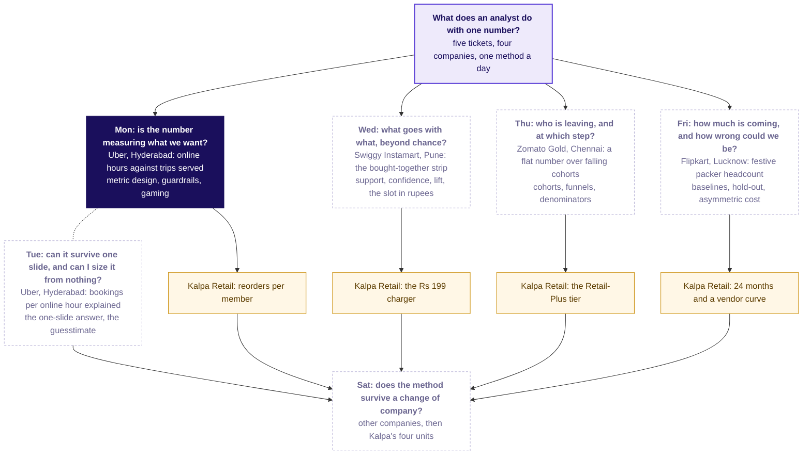

# Week 4, Analyst craft: the spine (revised 12 October 2026, afternoon)

Revised on the requester's redirection of 12 October 2026 (REVISION_BRIEF.md). On approval this page
becomes `docs/detailing/W04_analyst_craft_spine.md`, and every Week 4 session builds from it without
stopping at a spine of its own. Where this page and a curriculum row differ, this page wins; what it
leaves unchanged, the row still carries: the Kalpa plants, the interview anchors, the references and
the Kahoot plans. Where this page and `the-standard.md` differ, this page wins for Week 4 (section 13
gives the wording that makes that so). Its companion is `W04_case_file.md`, which holds every case in
full; this page says how the week is shaped and the case file says what each day is about.
Revised again on 13 October 2026 after the requester read every Week 4 deck: section 2.0 adds the
concept block that opens every day, each day section gains "The concept block" with the row's
subtopics verbatim, and the acceptance test gains its coverage line (decision
`concept-first-case-second`). Where this page and a curriculum row's Subtopics column differ, the row
wins: every subtopic is taught in a chapter that carries its name. Once the five days were built
concept first, each day's envelope, concept block, notebook names, deck sizes and styles, and the
explorer's scenes in section 11, were set to the built packs, so those parts record what was built.

What changed from the morning draft, in one list: every day now opens on an engineering case at a
real company the learners use, written as an analyst's ticket, and no stakeholder quote opens a day;
a six-level competency ladder replaces the four rungs; each day's twelve-row case table replaces the
Kalpa desk card; Kalpa moves to second position, in the TA lab, one unguided exercise and the Saturday
bank; a single offline HTML explorer carries the week's visual teaching and is specified scene by
scene in section 11; each day session writes its own deterministic generator and facts file, so there
is no central v5 session; and building starts today with no pilot gate. Everything else stands: the
envelopes, the faculty handoffs and fallbacks, the Saturday shape, the Diwali dates and item 41, the
visual system, the sizes and the method changes.

Every number on this page is one of four things: a repository fact, with its file named; a figure the
row or the item bank already prints; a public fact from `docs/detailing/W04_research_cases.md` with its
id; or a target the day's generator sets and asserts, marked "target". Toy numbers from R1 are marked
"toy" and ship labelled invented. No other number appears here, and none may appear in a pack.

## 1. The week in one line, the collision, and the map that grows

An analyst at a product company gets a ticket, never a speech. Week 4 is five tickets at four
companies the room uses every day (Uber twice), one question each: is the number we pay for measuring what we
want (Uber, Hyderabad, Monday); can that answer survive one slide in front of the people who lose
under it, and can a number be sized from nothing (the same case, Tuesday); what goes with what beyond
chance, and what is a shelf slot worth (Swiggy Instamart, Pune, Wednesday); who is leaving and at
which step (Zomato Gold, Chennai, Thursday); how much is coming and how wrong could we be (Flipkart's
Lucknow fulfilment centre, Friday); and does the method survive a change of company (Saturday). Each
day climbs one ladder from a hand count on twelve rows to the question an Uber, Swiggy, Google or
AI-startup screen would ask, and each day's TA lab re-runs the method on Kalpa Retail, so the client
thread of Weeks 1 to 3 continues into Week 5 and the Saturday bank.

**The collision, named.** `data/programme/facts.yaml` decision `four-domains` says Kalpa stays the
case and a real company appears as a likeness; `the-standard.md` says every day is one Kalpa case.
The requester's instruction of 12 October says the case is the real company's, in the engineer's
register, and Kalpa follows. The requester's words outrank both (CLAUDE.md, ground truth order 1),
so Week 4 resolves it this way: the real company carries the case in first position, in every deck,
notebook, exercise and transcript; Kalpa carries the transfer in second position, in the TA lab, in
one unguided exercise per day, in the Saturday paper's Kalpa parts and in Week 5's handover. Section
13 proposes decision `w4-case-led` so the resolution is recorded, and the four-domains decision is
left as it is for every other week.

**The label every case carries, in its first lines:** "Illustrative case: the company is real, the
situation and the data are synthetic, built for this class." A public fact about the company comes
only from R2 with its id, or from a source the builder fetched and dated; nothing in a case says the
company did or suffered the situation.

**The map that grows.** The home screen of the explorer (section 11) and slide two of every deck is
one mental map in the ByteByteGo manner: the week's question in the middle, five spokes, each spoke a
company, a city, a metric and a method, with Kalpa's unit beneath each as the transfer. The day's node
is lit, earlier days' nodes carry the number the room produced on them, and later days stay dashed.
The mermaid version below is the deck's; the explorer draws the same map in SVG and lights it with a
day control.

On Monday the Monday node is lit and every other node is dashed. On Wednesday the Monday node reads
`known` with "trips per online hour 1.9 to 1.6, pay for trips" (target), the Tuesday node reads
`known` with the slide's title, the Wednesday node is lit. By Saturday every node is `known` and the
Saturday deck redraws the map with another company's words in the boxes, then Kalpa's.

## 2. The rule every Week 4 day follows: the ticket, then the ladder

### 2.0 The concept block, the opening of every day

Every day opens on its topic, as the row's Day focus words it, the week map with today lit (section
1), the topics slide (every bullet of the row's Subtopics column verbatim and in the row's order, each
with the chapter that teaches it, its minutes and its notebook) and the concept map: a mermaid map of
the same bullets, today's nodes lit, each node joined to the earlier idea it rests on and the later
one it feeds, and the day's case as a node beneath them labelled "applied to". Slide five is the
ticket of section 2.1 in one slide, as the destination. Then the concept block runs, 60 to 120
minutes: one chapter per subtopic of about 8 to 25 minutes, its opener written
`## SECTION n: <subtopic>: <short question>?`. The subtopic is the row's bullet verbatim, shortened
only where one subtopic spans several chapters, as Wednesday's first does, and then never losing a
word that names an idea; the opener prints it on its own line in a size that steps down to fit, and
the pills print only the short question, which starts lower-case and runs to about 24 characters; the
italic promise beneath says what the chapter delivers. The chapters run in the row's order unless the
day's section records a reason to teach them in another (Thursday's does), and they fill the morning,
except that a chapter the day's section moves to the afternoon opens `half2`, still before the case
chapter that applies it. A concept chapter teaches from zero on one simple, complete, relatable
educational example with invented numbers labelled invented, in the order teaching-styles.md gives
for a concept chapter: the broken default, the misconception and a prediction, the hand count on the
tiny numbers, the picture, the formula or rule named last, a glimpse of code, a faded second example,
the rules and the map node naming the case chapter that applies it. Each pairs with one notebook of 8
to 18 cells carrying the same name, which loads the example's table from `data/`, where the day's
seeded generator writes it and the facts file records it under `toy_` ids, and prints it in full,
labelled invented. The case chapters of sections 5 to 9 follow, the first of them opening on the full
ticket read where the day plan moves it there, each opener gaining the line "Applies: ..." that names
the concept chapters it uses, and each case beat that once introduced an idea mid-climb now recalls it
by name in one line and goes to the data; each day's "The concept block" table says which beat moved
where and which minutes it freed. SECTION numbers run in deck order, `half1` then `half2`, and each
notebook carries its chapter's SECTION number, so the morning's concept notebooks come first and the
lab notebook takes the number after the day's last SECTION. The tables give each opener in full; its
short question is cut from the day plan's own chapter question, and a day session may reword it
within about 24 characters while the subtopic stays as the row words it. Each day's plan in
`docs/detailing/W04_concept_first/` holds its chapters slide by slide and its notebooks cell by cell.

### 2.1 The case ticket, the register of every opening

Every day's case opens on a ticket, in an analyst's register and nothing more dramatic. The ticket
has, in this order and on one page: the company, the city or region and the product surface; the
metric at stake with its value before and after, each dated; the data the analyst has, as tables with
their columns; the ask, as a deliverable with its date; the known caveats; and the label line of
section 1. The ticket is slide five of `half1`, in one slide, as the destination (section 2.0); it is
read in full where the case chapters open, and it opens the first case notebook and the notes' first
case section, word for word, from the case file. The numbers on it are the targets the day's
generator asserts.

### 2.2 The competency ladder, L1 to L6

The ladder is the progression principle of every day and the structure of every case. Each day's
case breaks into five to seven sub-problems, each one level up, and the case file gives every
sub-problem its concept, its everyday analogy, its worked micro-example, the number to target, the
trap, what an interviewer listens for and the common wrong answer. A learner who cannot do L1 is not
yet in the room; a learner who does L6 is ready for the screens the requester named.

| Level | What the learner does | Who can do it | The concept arrives | What the interviewer listens for |
|---|---|---|---|---|
| L1 Understand and count | Reads the ticket, says what the metric stands for, counts the number by hand on twelve rows of the case's own data | A weak learner, in ten minutes with a pen | Already taught on its educational example in the day's concept chapter, recalled here by name in one line | Whether the candidate restates the question and names the unit |
| L2 Compute on the full data | The same count on the full case data in the smallest code that works, and once more a second way | An intermediate learner who did Weeks 1 and 2 | The formula appears as the shorthand for what L1 counted | Whether the code answers the stated question and nothing else |
| L3 Find the trap | The plausible wrong number, the denominator that made it, the segment that drives it | An intermediate learner, guided | The denominator, the mix, the segment | Whether the candidate checks the denominator before trusting the number |
| L4 Name the caveats | The nuances an engineer must say aloud: data quality, mix, seasonality, interference, selection, causality | A strong learner | One caveat at a time, each with the fact that would settle it | Whether the candidate names what the data cannot show and how to find out |
| L5 Decide and cost it | The recommendation, its cost in rupees, the stakeholder's objection and the answer | A strong learner, in the war game or the studio | Expected value, asymmetric cost, what would change the call | Whether the number is tied to a decision and a cost |
| L6 Interview depth | The question as an Uber, Swiggy, Google or AI-startup screen asks it, plus the AI-company variant of the same idea | A hire-grade candidate | The transfer of the idea to a system the learner has not met | Structure before the number, assumptions stated, the trap seen, the decision named |

The levels map onto the day's case minutes: L1 to L3 fill the morning after the concept block; L4 and
L5 fill the afternoon's case minutes, within its first 60 on a faculty day and its 180 on Tuesday; L6
is the transcript read before the handoff, or in the lab where the day's section moves it; the TA lab
re-runs L1 to L3 on Kalpa and the unguided exercise re-runs L5 on Kalpa. A case chapter is one level,
or two adjacent levels where the case file folds them, and every case chapter still carries its exact
trap.

### 2.3 What stays mandatory on every day

From the house rules: the topics open the day and the ticket follows as the destination (section
2.0), and the ticket opens the case chapters, the first case notebook and every case brief; the
thinking is drawn before any tool opens; a planted Kalpa value is never printed in a learner file
before the room has found it in the lab (section 13, decision `w4-finding-once-found`); every trap is
a plausible wrong number and never a syntax error; durations only; role labels only, with the case's
people named by role (the city head, the driver-operations lead, the category manager, the membership
lead, the FC planner) and Kalpa's fictional people the one exception; every URL dated the day it
entered; notebooks run cold and ship executed; one environment; verify.py; one session per day pack
on its own branch.

Three Week 4 rules replace the-standard.md's grid for this week:

- **Code follows the ponytail principle.** The smallest code that fully works, pandas and the standard
  library first, matplotlib for every picture, no helper layer a learner must decode. A notebook
  defines its own three-line `check(name, ok)` that prints PASS or FAIL, or imports `c2kit` for
  `check` and `check_summary` alone. A pairs table is `Counter` over `itertools.combinations`; a cohort
  table is one `pivot_table`; a seasonal naive is `shift(52)` on weeks or `shift(12)` on months.
- **Every number in a learner file is in the day's facts file.** The day's drafting session writes
  `content/W04/D{d}/internal/C2_W04_D0{d}_facts_INTERNAL.yaml` with every figure a learner sees, case
  and Kalpa alike, how it was computed in one line and where it is used. A public company fact is in
  the case file with its R2 id and check date, or is labelled a hypothetical in the sentence that
  carries it. A toy is labelled invented. An assumption is labelled with its range. Nothing else.
- **The question ladder stays at the day and chapter level, and the chapter title carries the topic.**
  The day asks the ticket's question; each chapter's opener is written
  `## SECTION n: <topic>: <short question>?`, its topic the row's subtopic for a concept chapter and
  the case step with the subtopics it applies for a case chapter, and its italic promise says what the
  chapter delivers, with **Who needs the answer.** and **The questions on the way.** beneath on the
  chapter's map slide; a step heading inside a chapter is a plain question with nothing under it. The
  headings-only read tells the day's topics in the row's order and then the case's story.

### 2.4 Teaching styles: which style carries which move, and where it lands

The requester asked for the week to be taught in the manner of 3Blue1Brown, Veritasium, Krish Naik
and ByteByteGo, and in any other style that is strong. The styles below are the week's toolbox; the
research note `.claude/skills/day-pack-builder/references/teaching-styles.md` (copied into the repository beside this spine)
carries each style's concrete moves and verified links, and a day session reads it before drafting.
A style is a move, never a costume: a day uses a style where its move answers that day's sub-problem,
and each day section below carries a "Styles on this day" table naming the artefact and the move.
The twelve styles and the move each contributes:

| Style | The move, in one line | The artefact that carries it in Week 4 |
|---|---|---|
| 3Blue1Brown | Start from a question the eye can see, animate the mechanism, and let the formula appear last as the shorthand for what was just seen | The explorer's mechanism scenes (section 11); the deck's concept board built region by region; the notes' "the maths, made intuitive" paragraph of each level |
| Veritasium | Put the misconception first, make the viewer commit to a prediction, then reveal, so the surprise does the teaching | Every L3 trap: the deck's predict slide before its reveal slide; the notebook's predict-before-you-run cell with lettered options; the explorer's predict-then-reveal buttons |
| Krish Naik | A line-by-line code-along on a real dataset, end to end, that finishes with a working result and names the interview question it answers | The case notebooks, each cell narrated in one line, each ending in the number the ticket asked for; the concept notebooks' count by code beside the count by hand; the Kalpa lab notebook; the "what the interviewer asks about this cell" note |
| ByteByteGo | One connected map that shows how today's concept joins the ones before and after it, drawn as a system rather than a list | The week map (section 1) on slide two and the explorer's home screen; each chapter's close, which adds today's node to the map; the Saturday re-rooting |
| StatQuest | Tiny numbers pushed through the method step by step, with the step said aloud and the running total shown | L1 on the twelve rows, counted aloud; the cheat sheet's worked micro-example beside each formula; the lab's printed counts |
| Striver, takeUforward A2Z | A ladder of problems from easy to interview grade, each tagged with its pattern and the company that asks it, solved in order | The ladder L1 to L6 itself; the exercise set ordered by level with the company tag on each item; the Saturday transfer drill's grid |
| Brilliant | The problem comes before the explanation: the learner answers a small question, then reads why | The first slide of every chapter is a question with lettered options, answered by the room before the chapter explains; the explorer's scene openings |
| Explorable explanations (Nicky Case, distill.pub) | The reader moves the model and reads the explanation in the interaction; play first, then read | The explorer: every scene has a slider or toggle whose readout is the lesson; the notes link each level to its scene |
| The Feynman technique | Explain it in plain words to someone outside the field, find the gap, go back to the source | The notes' "say it to a hostel warden" line under each level; the take-home's self-check, which asks for the plain-words version before any number; the studio on Tuesday |
| Worked, then faded (Sweller) | A fully worked example, then the same shape with a step missing, then the bare problem | A concept notebook's faded second example as its your-turn cell; a case notebook's your-turn cell after the worked cell before it; the guided exercise before the unguided; the TA lab's completion problems for weak learners |
| Top-down, whole result first (fast.ai) | Show the finished working result in the first minutes, then unpack how it was built | The ticket's answer shown once as "where today ends" before the case chapters climb to it, then earned level by level; the day's last case notebook opens on the finished chart it will rebuild |
| The case method with role cards | A decision forced by a stakeholder who is partly right, argued from the evidence | L5 on every day: the war game, the studio, the category manager, the app team's dispute, Finance against the vendor; the Saturday mock round |

Two more moves run under every style: retrieval practice (the Kahoot's return question from the
day before and Saturday's crux lines from memory), and Parsons problems in the TA lab for the
learners who stall (the day's smallest code with its lines scrambled, to be put in order before any
line is written), which is the weak learner's entry to L2.

## 3. The envelope: minutes, blocks and fallbacks (unchanged)

The campus day is two blocks of 180 minutes with lunch between and a TA-led practice lab after the
second block; Saturday is 300 minutes (`data/programme/facts.yaml`, `campus_day`). An IITGN block is
120 minutes and runs after the day's applied core, in the last 120 minutes of the afternoon, so on a
faculty day the trainer holds the morning's 180 and the afternoon's first 60 (`facts.yaml`, `faculty`,
and the Week 2 faculty-day paragraph of `docs/detailing/W01_W02_spine.md`). Every block is tentative
until IIT Gandhinagar confirms it, so every faculty day ships a handoff line and a 120-minute fallback.

| Day | Trainer minutes | The row's agenda sums to | IITGN block (tentative, `docs/faculty/Sessions.md`) | Fallback if the block slips |
|---|---|---|---|---|
| Mon 26 Oct | 240 (180 + 60) | 230 | W4-1, A/B testing: unit, metric, guardrail, duration, peeking | The metric clinic (section 5) |
| Tue 27 Oct | 360 (180 + 180) | 240 | none | 120 minutes planned in full (section 6) |
| Wed 28 Oct | 240 (180 + 60) | 230 | W4-2, association rules as probability, Apriori pruning | The watch-list hour and the Pop-Tarts bridge (section 7) |
| Thu 29 Oct | 240 (180 + 60) | 225 | W4-3, survival curves, censoring, log-rank | The weaned-users hour (section 8) |
| Fri 30 Oct | 240 (180 + 60) | 220 | W4-4, time series foundations, smoothing, ARIMA | The rolling-origin hour (section 9) |
| Sat 31 Oct | 300 | the row's 90-minute paper is superseded by `facts.yaml` | none | none |

Dates are from `docs/programme/calendar.md`. A faculty day's trainer material stops where the block
starts; the trainer day sheet carries the block through `sync:faculty-day:W04/D{d}` and the module
through `sync:module:W04/D{d}`, and a STUDENT file names the block only with the word tentative beside
it. The handoff line on each faculty day now hands over the case's own next question (Monday: the A/B
test of the redesigned scheme; Wednesday: lift as independence made visible; Thursday: the member who
has not left yet; Friday: why the festival-aligned baseline is hard to beat), so the faculty block
continues the ticket rather than opening a new topic.

## 4. The twelve-row case tables, one per day

The printed desk card of Kalpa customers is replaced by a twelve-row table from each day's own case,
printed as panel two of the day's cheat sheet, shown on one slide and loaded as the first data cell
of the first case notebook (07 on Monday and Wednesday, 04 on Tuesday, 05 on Thursday and Friday).
The rows are real rows of the case data, chosen by the generator so the day's mechanism shows in
miniature and asserted by its contract, and every value sits in the facts file
under `twelve_rows`. The hand count on the twelve rows differs from the full-data case value by at
least 0.05 on any ratio and five points on any percentage, so the room still has a reason to compute
L2 (a shared starting value may match, as Monday's 1.90 before does, when the after value and the
change differ), and from every Kalpa planted value of the same quantity by the same margin, so no case number is a plant in disguise.

| Day | The twelve rows | The hand count | What the room sees without being told |
|---|---|---|---|
| Mon | Six drivers, one week before the scheme and one week after: peak online hours, requests, accepted, trips | Hours, trips and trips per online hour, before and after, over the six | Hours up about a quarter, trips down about a quarter, and two drivers whose hours rose by about half while their trips fell to almost nothing |
| Tue | The same twelve rows plus gross bookings | Bookings per online hour, per driver-week and per trip | The same rupees read three ways change by three different amounts on the six (and point three ways on the full data); the slide must say which denominator it uses |
| Wed | Twelve Instamart carts with their items | Support, confidence and lift for two pairs | The item in most carts has high confidence toward everything and lift near one; one pair beats chance; one pair is a one-off |
| Thu | Twelve Gold members from three signup months, with an order flag per month | Each cohort's rate month by month and the blend over all twelve | Each cohort falls with age while the blend barely moves; one sale-month cohort is large and weak |
| Fri | Twelve weeks of shipments: the six around Diwali 2024 and the six around Diwali 2025 | Naive, same-week-last-year and festival-aligned forecasts for one week | The same-week-last-year copy lands the spike a week late in 2025 and two weeks early for 2026 |

The Kalpa transfer has its own small table for the lab (the "Kalpa transfer" paragraph of each day
below), never printed in a STUDENT file before the lab, because it carries the plant.

## 5. Monday, 26 October: is the number we pay for measuring what we want?

**The ticket (the case file holds it in full).** Uber, Hyderabad, the driver app. On Monday 31 August
2026 the city team launched a peak-hour earnings guarantee: a driver who is online for the whole of a
peak window, two a day on every day of the week, is guaranteed a floor per online hour, and Uber tops up the gap between the
driver's trip earnings and the floor. Six weeks later, against the six weeks before: peak online hours
are up 24 percent, completed peak trips are up 3 percent, and trips per peak online hour fell from 1.9
to 1.6 (targets). Data: `drivers` (driver, home zone, joined month, enrolled), `driver_weeks` (driver,
week, zone where most online time was, peak online hours, requests, accepted, driver cancellations,
trips, gross bookings, top-up), `zone_weeks` (zone, week, requests, fulfilled, median rider wait). The
ask, due Friday: is the scheme working, which metric should it pay for, and is anyone gaming it?
Caveats on the ticket: the monsoon ended inside the window; 140 drivers joined after the launch; the
app logs a driver as online whenever the app is open; the three outer zones get few requests at any
hour. Illustrative case: the company is real, the situation and the data are synthetic, built for
this class. The launch date is one day later than the brief's example so that the weeks are whole.

**The thread.** Growth, with Trust as the skeptic in the room: a number rose, and the city wants to
know whether riders are better served.

### The envelope

| Block | Minutes | Level | What runs |
|---|---|---|---|
| Morning | 7 | | The topic, the week map, the topics slide and the concept map, the ticket as the destination; the board's four questions |
| | 63 | concept | The concept block: one chapter per row subtopic, each on its educational example, each with its notebook (the table below) |
| | 10 | | Break |
| | 32 | L1 | SECTION 7 (what does an hour count?): the full ticket read; the war game's round 1, the three city-team roles stating their numbers from role cards and the room attacking each with the proxy test now in hand; where today ends; the twelve driver-weeks counted by hand (applies the proxy test and the four definition lines) |
| | 30 | L2, L3 | SECTION 8 (where did the fall sit?): the full `driver_weeks` in code; the trap found in the your-turn cell; the idle tail and the dead zones (applies the definition lines and gaming) |
| | 38 | L3, L4 | SECTION 9 (what should it pay for?): the vote, the wrong memo and the cost; the Uber page filled line by line with the room (guided); the caveats named one by one with the fact that would settle each (applies the north star and guardrails, the leading inputs, the resistant lines and the artifact) |
| Afternoon, first 60 | 25 | L5 | SECTION 10 (does it survive the roles?): war game round 3, unguided: each group writes the redesigned scheme's metric with two guardrails and the gaming note, prices the top-up paid to idle hours, and answers the three roles |
| | 15 | L6 | SECTION 11 (what wins the interview?): the interview transcript read in pairs and scored; the AI-company variant |
| | 20 | | Kahoot, the handoff line, and the close with the six ideas on one strip |
| IITGN block | 120 | | W4-1 (tentative): designing the A/B test of the redesigned scheme |
| Lab | the lab's length | L1 to L3 on Kalpa | The Kalpa transfer below, TA-led |

### The concept block

| # | Subtopic (verbatim from the row) | Chapter title (`SECTION n:`) | The educational example (invented, labelled) | Minutes | Notebook | The case beat it absorbs |
|---|---|---|---|---|---|---|
| 1 | What to measure and why; the proxy test | SECTION 1: What to measure and why; the proxy test: what is a number for? | A school canteen pays its servers per token: plates stay at 200 a day for ten days while tokens go from 200 to 400 a day once pay follows tokens, so tokens per plate rise from 1.0 to 2.0 and rice cooked from tokens doubles; a principal's three numbers for judging teachers open the chapter as the instinct round | 13 | `C2_W04_D01_01_proxy_test_STUDENT.ipynb` | The canteen (S8) and Wells Fargo (S12) leave case chapter 1, now SECTION 7; round 1 gives up three minutes because the instinct round opens this chapter |
| 2 | North-star and guardrail metrics | SECTION 2: North-star and guardrail metrics: which number to chase? | A driving school of 100 enrolled learners: in 2025 all 100 take the licence test and 60 pass; in 2026 only 40 take it and 36 pass, so the hoarding's pass rate rises from 60 to 90 percent while licences per enrolled learner fall from 0.60 to 0.36 | 10 | `C2_W04_D01_02_north_star_guardrails_STUDENT.ipynb` | The tree (S30) leaves case chapter 3, now SECTION 9, and returns there as the Uber instance in one slide; Maxxsaver and Eternal (`half2` S43) move here and leave a one-line callback |
| 3 | Leading against lagging indicators | SECTION 3: Leading against lagging indicators: which number warns? | A T20 chase of 160: 60 for 3 after ten overs puts the required rate at 10.0 an over, ten overs before the scoreboard confirms the loss by 12; eight Kalpa metric names, with no values, classified as the row's drill | 10 | `C2_W04_D01_03_leading_lagging_STUDENT.ipynb` | Leading against lagging (S31) and its picture leave case chapter 3 |
| 4 | Definitions: numerator, denominator, window, exclusions | SECTION 4: Definitions: numerator, denominator, window, exclusions: which four lines? | One student's 60-day register (50 working days; present 40, absent 8, medical 2) reads 80.0, 66.7, 83.3, 84.0 and 70.0 percent as each line changes | 10 | `C2_W04_D01_04_numerator_denominator_window_exclusions_STUDENT.ipynb` | Swiggy's glossary (S20) and Delhi Metro (S21) leave case chapter 2, now SECTION 8, as one-line callbacks |
| 5 | Gaming, and definitions that resist it | SECTION 5: Gaming, and definitions that resist it: how is a number gamed? | A kirana shop's month: 50 deliveries marked done and 40 confirmed by the customer's OTP, so pay reads Rs 1,000 against Rs 800; on-time reads 100 percent on the delivery boy's typed clock and 70 percent from the shop's bill time | 10 | `C2_W04_D01_05_gaming_resistant_definitions_STUDENT.ipynb` | The VA clock (S33) leaves case chapter 3 |
| 6 | The metric definition artifact | SECTION 6: The metric definition artifact: what does the page hold? | The seven-line skeleton with placeholders, filled for the same kirana delivery, beside the weak page "Deliveries, monthly, plus 20 percent" | 10 | `C2_W04_D01_06_metric_definition_artifact_STUDENT.ipynb` | The skeleton leaves S32, which becomes the Uber instance the room fills; S37 (the afternoon's running order) is cut, since the topics slide carries it |

The block runs after slide five and before the first case chapter; its minutes come from the case
beats named in the last column, and the day's total stays at the envelope's trainer minutes. Every
notebook carries its chapter's SECTION number. Notebook 04 is the plan's `04_definition_lines`, renamed
so its file name carries the Name's words; the case notebooks are `07_proxy_test_on_twelve_rows`,
`08_denominators_on_full_data` and `09_north_star_guardrails_cost`, then `10_gaming_page_three_roles`
for SECTION 10 and `11_new_feature_definition_page` for SECTION 11; and the lab is `12_kalpa_lab`,
after the day's last SECTION.

**Handoff line, said by the trainer.** "You have a number the scheme should pay for and two
guardrails that catch the ways of hitting it that hurt riders. You have not tested whether the
redesign moves it. The next 120 minutes design that test on this city: the unit you randomise, the
metric, the guardrail and how long you run it before you look." The trainer names the block as
tentative and parks any "is the fall real" question for it.

**Fallback, 120 minutes, if the block slips: the metric clinic.** (1) The Wells Fargo dissection, 35
minutes: groups read the SEC order's five facts (M8: the ratio with no usage condition, debit cards
counted up to four years unused, the silent 2013 addition of remittance accounts, simulated funding,
contact details changed to dodge surveys) and name which line of a complete definition each one
breaches; (2) the second definition round, 40 minutes: the city's three proposed numbers (online
hours, completed trips, acceptance share) each written as a complete definition and attacked by its
owner; (3) the leading and lagging drill on eight city metrics and the guardrail for three north
stars, 30 minutes; (4) the second transcript ([D] three teams want their own target), 15 minutes. No
A/B content, which stays with the block whenever it runs.

### The shape: a war game in three rounds

Monday is a war game. The three roles are the city team's driver-operations lead (proposes peak online
hours; wants supply), the marketing lead (proposes enrolled drivers and the guarantee as the
acquisition story) and the finance partner (proposes top-up per trip; wants the budget). Each role
card holds the number the role proposes, the honest reason, how their own team could hit it while
riders waited longer, the objection they will raise against the room's definition (partly right) and
what they lose under it; the cards argue from real numbers where R2 has them (M5 for Uber's own trip
and consumer definitions). Round 1 opens the case block after the concept block and the break (the
roles propose, the room attacks with the proxy test now in hand); round 2 is the case's three morning
chapters, SECTION 7 to 9 (the room attacks with the method on the data); round 3 closes the trainer's
time (the room's definition is attacked by the roles and has to survive). The same three objections
return on Tuesday as the objections to the slide.

**Run sheet outline (TRAINER, `trainer/C2_W04_D01_war_game_TRAINER.md`).** Roles: the trainer voices
the three roles from the cards, or three learners read them; the room sits in its nine groups
(`facts.yaml`, `cohort`); one scorer per group holds the proxy-test card ("could a team hit this while
riders waited longer? who controls the count? what does the definition deliberately not reward?").
Minutes: round 1, 12, after the break; round 3, 25. Materials: the three role cards, the proxy-test
card, the twelve-row table, the definition template (numerator, denominator, window, exclusions, what
it does not reward, two guardrails, the gaming note). What to say: the trainer reads the ticket, then
each role's number and reason, and asks each group for one way to game it, with the proxy test now in
hand. When it stalls: recall the canteen's tokens from SECTION 1 (who controls the count?), then the
two drivers on the twelve rows whose hours rose by about half while their trips fell to almost
nothing. Round 3 scoring: a definition survives when every role's attack is answered by a line of the
definition or a guardrail; a definition that survives only by dropping the guarantee has lost the
driver-operations lead, which Tuesday takes up.

### The ladder

| Level | The sub-problem | The concept, with its analogy | The step and its numbers | The trap, exactly | The real case (R2) |
|---|---|---|---|---|---|
| L1 | What does "peak online hours up 24 percent" stand for, and what happened to the six drivers on the twelve rows? | A proxy: the canteen pays servers per token, tokens double while plates stay flat because each plate now gets two tokens (toy, R1) | Hours, trips and trips per hour over the six, before and after: hours up about 23 percent, trips down about 23 percent, trips per hour 1.90 to 1.19 (computed from the rows; the six fall further than the city because two of them are in the idle tail); two drivers' hours rose by about half while their trips fell to 3 and 2 with most offers declined | None yet; the paradox is the point | Wells Fargo (M8): a cross-sell ratio with no usage condition, USD 185 million in 2016 penalties and a USD 3 billion settlement in 2020, sales goals eliminated |
| L2 | What are the city totals, and what is trips per online hour this week against six weeks ago? | The rate as a ratio of two sums, never a mean of ratios (Week 1's lesson restated) | `groupby` on `driver_weeks`: hours 118,000 to 146,300, trips 224,200 to 230,900, trips per hour 1.90 to 1.58, acceptance 0.86 to 0.73, driver cancellations 0.04 to 0.09, share of online hours with no trip 0.22 to 0.38 (targets); the same totals once more in SQL | "Trips per hour fell because demand fell": the check is `zone_weeks` requests, flat to up (target) | Swiggy's glossary (M1): a company that writes numerator, denominator and window down |
| L3 | Which drivers and which zones drive the fall, and what is the number the city team should not have celebrated? | The denominator and the segment: the mix behind a rate | The your-turn cell: 180 drivers whose hours rose 2.1 times while their trips fell 12 percent, 70 percent of their new hours in the three outer zones; 61 percent of the top-up went to driver-weeks with acceptance under 0.5 (targets) | "Peak online hours up 24 percent: supply target met, extend the scheme to two more cities" (the decision it misleads). The check: trips per online hour and rider wait, 4.8 to 4.6 minutes (target). The fix: pay for completed peak trips with an acceptance guardrail | Delhi Metro (M6): the same crowd counted three ways; a definition changes the number without changing the crowd |
| L4 | What can the data not show, and what would settle each doubt? | Six caveats, one at a time: data quality (online means the app is open), mix (140 new drivers), seasonality (the monsoon ended), interference (drivers moving between apps), selection (who enrolled), causality (the scheme or the season) | Each caveat as one check in the notebook: the fall restated for drivers present in both windows (target), for weekday peaks only, for zones with request density above the median; what remains of the fall after each cut | "The new drivers explain it": the fall survives their removal (target) | US Veterans Affairs (M8): the start of the window controlled by the people measured |
| L5 | Which metric should the scheme pay for, what did the gamed version cost, and what do the three roles say? | North star, guardrails, leading inputs; a cost in rupees | The definition below; the top-up paid to idle hours, Rs 1.9 crore over six weeks times the 61 percent share (targets), against the saving under the redesign with a labelled uptake assumption and its range; the three objections answered | "Pay per completed trip" alone: drivers cherry-pick short trips; the second guardrail (acceptance share) catches it | Swiggy's Maxxsaver (M9): orders per month would have read a success as a fall; Eternal (M2) dropped GOV for NOV |
| L6 | How would you measure the success of a new feature, and how would you measure an AI coding assistant without rewarding accepted-but-deleted suggestions? | The transfer: the same structure on a system the learner has not met | The transcript ([S]) and the AI-company variant: acceptance rate as the gamed proxy, suggestion text retained at the next commit as the outcome, build failures and revert rate as guardrails (programme-written, no company figure) | The candidate names acceptance rate and stops | Aced's rubric (T2); Evan Miller (interview table) for the handoff |

**The definition the redesign adopts (fixed here so Tuesday defends it).** North star: completed
peak trips per enrolled driver per week. Numerator: trips completed inside the peak windows, counted
per paying rider as Uber counts them (M5). Denominator: drivers enrolled in the scheme who were online
at least one peak hour that week, with the count printed beside the rate. Window: the calendar week.
Exclusions: trips cancelled by either side, test accounts, trips outside the window. What it does not
reward: hours online, requests declined, a shrinking enrolled base. Guardrail 1: acceptance share
(accepted over requests) at or above a floor the city sets. Guardrail 2: median rider wait at peak.
Guardrail 3: top-up per completed trip. Leading inputs: enrolled drivers online in the first peak
hour; requests per online hour by zone. Gaming note: each guardrail names the way of hitting the
number it catches. The facts file carries each value for the six weeks after the launch (targets).

### The Kalpa transfer (the lab and one unguided exercise)

The lab re-runs L1 to L3 on Kalpa Retail's version: the head of Retail-Plus's "reorders per member",
which the app can inflate by auto-reordering (the row). The lab reads Thursday's membership table,
`kalpa_memberships` (120 Retail-Plus members, copied byte for byte into Monday's `kalpa_members`), and
the Monday generator writes `kalpa_app_reorders` (`reorder_id`, `customer_id`, `placed_ts`,
`value_rs`, `auto`, `status`: delivered, returned, cancelled, merged into a basket the member already
had open, or pending; and `order_id`, the v4 warehouse order a placement became, blank if none): 89
placements by the 120 members, the auto-reorder window fixed at 10 to 30 September 2026 and the
comparison at 20 August to 9 September 2026, both divided by the same 107 members, those in the tier
by 19 August 2026, the monsoon sale's last day (`CAMPAIGN_MASTER`). The lab's twelve rows are seven of
the 107 with placements in both windows (TRAINER sheet until the lab counts them), whose hand count
(1.33 and 0.84) leans the way the full table does and sits at least 0.10 from each ratio. The lab's L2
finds the row's plant in an empty your-turn cell: reorders placed per member in the window over the
comparison at 1.22 (44 placements against 36), while booked value per member, over placements of any
status, reads 0.96. Its L3 names the cause: every placement in the window is an auto-reorder that was
cancelled (22), merged (16) or is pending (6), so none became an order and v4's orders stay frozen.
The ten comparison-window placements that became orders are v4 orders with the same customer, date,
amount and status, and the seven Retail-Plus app orders v4 holds for 10 to 30 September sit outside
the log by design. The unguided exercise re-runs L5 on Kalpa: the growth plan's north star (delivered
orders per active customer per month) with revenue per active customer, discount share of booked
revenue and the return rate as guardrails, and add-to-cart events per active app member and new
Retail-Plus sign-ups as leading inputs (the bank's item 25 keys both as leading), written to the same
template as Uber's, so the Saturday bank's items 1, 2, 8, 9, 15, 16, 17 and 25 still have their Kalpa
ground. The plant is named in no STUDENT file before the lab.

### Styles on this day

| Style | Artefact | The move |
|---|---|---|
| Veritasium | SECTION 8; notebook 08 | The predict slide asks the room to commit, in writing, to what trips per online hour did while hours rose 24 percent, with lettered options, before the your-turn cell runs |
| 3Blue1Brown | Explorer scene M1; the concept board | Drivers as dots drift from driving to idling online as the guarantee slider rises; trips per online hour is read off the picture before the ratio is written |
| StatQuest | SECTION 7; cheat sheet panel two | The six drivers' hours and trips summed aloud, the ratio taken once, the two gamers circled |
| Krish Naik | Notebooks 07 to 09 | One `groupby`, one line of narration per cell, ending on the number the ticket asked for; the SQL twin in notebook 09 |
| Brilliant | The first slide of each chapter | "Which of these four numbers can a driver raise without driving?" answered before the chapter |
| The case method | The war game | Three roles with partly-right objections, a definition that must survive them |
| ByteByteGo | Slide two; chapter closes | The city's metric tree joins the week map: Tuesday's slide, Thursday's funnel and Friday's forecast hang off today's north star |
| Striver's ladder | The exercise file | Items ordered L1 to L6, each tagged with the company that asks it |
| Feynman | The notes; the take-home | "Say to a driver in one sentence what the new number rewards" before any formula |

### The interview room

- **Transcript (extras, STUDENT; scorecard in TRAINER).** [S] "How would you measure the success of a
  new feature?" asked of the earnings guarantee: clarifying questions (what the scheme is for, who it
  serves, what would count as harm), the structure (goal, user, one primary metric with numerator,
  denominator and window, two guardrails, one leading indicator, how it would be tested), the trap the
  interviewer fishes for (the candidate names online hours and stops), a weak and a hire-grade answer
  side by side, the scorecard, three follow-ups ("online hours rose 24 percent; what do you check
  before you celebrate", "which guardrail would driver operations argue against, and why are they
  partly right", "the measured drivers control when they log in; what happens to your number").
- **The AI-company variant (extras, STUDENT).** Measuring an AI coding assistant: the gamed proxy
  (suggestions accepted), the outcome (suggested text still present at the next commit), the
  guardrails (build failures, revert rate, time to merge), the window, and the gaming (short
  suggestions accepted and deleted). Programme-written; it names no company figure.
- **Scorecard criteria (TRAINER).** Clarified scope; named the denominator and window; saw the
  paradox; sized it with a unit; said what would change their mind; tied it to a decision and its
  cost; gave the structure before the number (Aced, T2). Each 0 to 2.
- **Pain points (notes, STUDENT), each anchored.** A target with no usage condition (Wells Fargo,
  M8); the start of a window controlled by the measured (VA, M8); a definition changed silently (the
  2013 remittance accounts, M8); a gross figure mistaken for money (Eternal, M2); a count that goes
  negative when cancellations are netted (Airbnb, M4, notes only); an app that counts an open screen as
  activity (Spotify's zero-millisecond MAU, M5).
- **No guesstimate on Monday.** The daily guesstimate starts on Tuesday.

### The visuals

| Device | What it makes visible | Built as |
|---|---|---|
| The week map, Monday lit | Where today sits | Mermaid, section 1; the explorer's home screen |
| Concept board: "What makes a number safe to pay for?" | Anchor: the canteen token. Three questions: what is it for, how could it be hit while riders waited longer, what stops that. Sketches: the tree, the seesaw, the window with its start. Pitfalls flagged: no usage condition, silent definition change, the measured control the window | Mermaid, built one region per slide; the finished board is the cheat sheet's panel one |
| Explorer scenes M1 to M4 | Drivers as dots; the seesaw; the definition built line by line; leading before lagging | Section 11 |
| The drift chart | Online hours rising while trips per hour falls, week by week across twelve weeks | Matplotlib twin lines from the facts file; a GIF that draws the two lines one week at a time, with first and last frames as PNG |
| The idle tail | 180 drivers' hours against trips, before and after, with the outer zones marked | Matplotlib scatter |
| Swiggy's glossary as a table | A company that writes its denominators down | A deck table from the case file (M1) |

### The artefacts, with honest sizes

| Family | What Monday ships |
|---|---|
| Decks | `half1` of 93 slides: the topic cover, the week map, the topics slide, the concept map and the ticket (S1 to S5), the six concept chapters of eight slides each (S6 to S53), then the case chapters, SECTION 7 to 9 (S54 to S84); `half2` of 16 (SECTION 10, round 3, S85 to S90; SECTION 11, the transcript and the AI variant, S91 to S95; the Kahoot, the handoff and the close, S96 to S98); `fallback` of 14. Every body slide carries a notes fence with LIVE minutes |
| Notebooks | One per chapter: six concept notebooks named by the row's subtopics (8 to 18 cells each, each loading its educational example from `data/` and printing it in full, labelled invented), then the three case notebooks, each building on the last: the twelve rows counted (12 to 15 cells); the full `driver_weeks`, the trap and the your-turn cell, the idle tail (18 to 22); the definition computed with its guardrails in pandas and once more in SQL (15 to 18); then `10_gaming_page_three_roles`, the tests of each line and the saving for round 3, and `11_new_feature_definition_page`, the numbers behind the interview room's page. Plus the lab notebook `12_kalpa_lab` with its empty your-turn cell (10 to 12) |
| Activity | The war game: three role cards, the proxy-test card, the definition template, the run sheet (all TRAINER except the template) |
| Exercises | Guided: the definition built together. Unguided: the redesigned scheme's guardrails and gaming note, swapped and attacked; the Kalpa north star on the same template. Mid-session: eight city metrics classified leading or lagging and two defended; the guardrail for three proposed north stars. About 14 items ordered by level, at least five design items |
| Take-home | One metric definition with a gaming note for a product the learner uses daily, plus the one number they will carry to Tuesday's slide; the self-check lists the seven lines a complete definition has, plain words first |
| Kahoot | Eight items: the row's five with the city's numbers, the return question from Week 2 Friday, two more; the trap item uses values other than 24 and 3 |
| Reading | Study notes of 2,000 to 3,000 words on the six levels, the transcript, the AI variant and the pain points, each level linked to its explorer scene; one cheat sheet (panel one the finished concept board; panel two the twelve rows; the definition template; the proxy test); the pre-read for Tuesday (the city head's one-slide terms and the vocabulary: claim, evidence, caveat, action) |
| Trainer | The day sheet with the sync blocks, the ladder, the envelope, every trap with its number, the Kalpa plant table with what to do if nobody finds it, the interview answers in one breath; the war-game run sheet; the role cards; the scorecard; the fallback note; the lab note with the Kalpa twelve rows |
| Internal | The generator and its contract output, the facts file, the sources list (at most one page), the figure script |

**The TA lab's job.** L1 to L3 on Kalpa as above, then the practice set: the eight metrics classified
with reasons, the three guardrails, one definition for a product the learner uses, and a combining
problem: a city dashboard of nine metrics cut to one north star, two guardrails and two inputs, with
the cut defended. Parsons problem for the weak learner: notebook 08's `groupby` cell scrambled. The
TA note says where learners stall (a guardrail that is another growth count) and the one hint ("what
would the guardrail catch?").

**Cut first.** The GIF, then the fallback's leading-and-lagging drill. Never cut a concept chapter, round
3, the twelve-row count or the Kalpa lab.

## 6. Tuesday, 27 October: can the answer survive one slide, and can a number be sized from nothing?

**The ticket.** Uber, Hyderabad, the same case, one day on. The city head has asked for the redesign
on one slide at the Thursday city review, five minutes, with the driver-operations lead, the
marketing lead and the finance partner in the room, each losing something under it. The number the
slide must explain: gross bookings per peak online hour fell from Rs 314 to Rs 260 over the six weeks
while the average peak fare stayed at Rs 165 and online hours rose (targets; the arithmetic is Monday's
1.9 and 1.6 trips per hour times the fare). In the afternoon a smaller and odder ask arrives from the
same city head: before the review, roughly how many drivers must be online at the evening peak on a
weekday to keep rider wait under five minutes, in fifteen minutes, without a dataset. Illustrative
case, as Monday's label says.

**The thread.** Trust, in the sense of a number a loser can repeat accurately.

### The envelope: 360 trainer minutes, no block

| Block | Minutes | Level | What runs |
|---|---|---|---|
| Morning | 5 | | The topic, the week map, the topics slide and the concept map, the ticket as the destination |
| | 72 | concept | The concept block's morning part: SECTIONs 1 to 3, each on its educational example, each with its notebook (the table below) |
| | 10 | | Break |
| | 40 | L1, L2 | SECTION 4 (which number carries it?): what each of the three Uber roles loses under Monday's definition; slide A rebuilt with the room, B and C by groups; the twelve rows read three ways (per online hour, per driver-week, per trip); the trap; the second route (applies the one-slide answer and what to leave out) |
| | 53 | L3 to L5 | SECTION 5 (which objection holds?): the prediction, the true parts, the modelled defence, round one in threes with the three role cards, rotating; then the appendix drawer with one page per role and the cut-to-two drill (applies defending under challenge and what to leave out) |
| Afternoon | 20 | L5 | Studio round two: two turns of seven minutes, six to rebuild |
| | 40 | concept | The concept block's afternoon part: SECTIONs 6 and 7, the guesstimate and the written business case (the table below) |
| | 25 | L2, L3 | SECTION 8 (how many at the peak?): clarify, map the chain from the city's people to drivers online, calculate, the swing, validate like for like against the case's driver-hours per completed trip, the trap (applies the guesstimate) |
| | 12 | L5 | SECTION 8 continued: UPI in pairs, seven minutes on the clock, checked against 802 million a day (T3), with the sanity check required |
| | 10 | | Break |
| | 35 | L5 | SECTION 9 (what goes on one page?): the AI-free written business case, by hand, handed in (applies the written business case) |
| | 12 | L6 | SECTION 10 (what does it sound like?): transcript 1 read in pairs with its follow-ups; transcripts 2 and 3 and the AI-company variant assigned with the scorecard as the evening's reading |
| | 20 | | The close: the Kahoot's eight items, the pain points in one line each, the day's sentence, the handoff; Wednesday's pre-read ships tonight |
| | 6 | | Slack: three handed-in pages read aloud if the clock allows |
| Lab | the lab's length | Kalpa | Every learner presents the Kalpa north-star slide to a TA playing one head; Anand's store sized against DMart (T3) in notebook 11 |

The row's agenda sums to 240 minutes, and the rebuilt day spends 112 of its 360 on the five concept
chapters. The day pays for them with its own cuts, 118 minutes in all, 6 of which return as slack: the
opening falls from 15 to 5 minutes, Uber's slide from 45 to 40, its objections with the drawer from 70
to 53, round two from 40 to 20, the drivers estimate with UPI from 65 to 37, the page to the city head
from 40 to the row's 35, the interview room from 25 to 12, and the close, with the gallery cut, from 40
to the row's 20.

### The concept block

| # | Subtopic (verbatim from the row) | Chapter title (`SECTION n:`) | The educational example (invented, labelled) | Minutes | Notebook | The case beat it absorbs |
|---|---|---|---|---|---|---|
| 1 | The one-slide answer: claim, evidence, caveat, action | SECTION 1: The one-slide answer: claim, evidence, caveat, action: what does a slide carry? | Ramesh's kirana shop opens two more hours a day from October: sales per day rise 8.3 percent (Rs 12,000 to Rs 13,000) while sales per hour fall 9.7 percent; two notices on a hostel board open the chapter as the prediction | 35 | `C2_W04_D02_01_one_slide_answer_STUDENT.ipynb` | The notice board, the four-part anatomy and the auto driver's denominator leave Uber's slide chapter, now SECTION 4, which falls from 45 to 40 minutes |
| 2 | What to leave out, and the appendix | SECTION 2: What to leave out, and the appendix: where does the rest go? | The kirana draft sorted three ways: the per-hour chart and the per-customer line stay, the son's page and the accounts page take what each reader asks, and the rain days leave | 12 | `C2_W04_D02_02_leave_out_and_appendix_STUDENT.ipynb` | The appendix teaching leaves the drawer, which now runs inside SECTION 5 |
| 3 | Defending under challenge: restate, answer, concede, what would change your mind | SECTION 3: Defending under challenge: restate, answer, concede, what would change your mind: how do you hold a claim? | A secondary school's eight weeks of attendance against the same weeks last year: the exam weeks' true part is conceded, and weeks 3 to 5 answer the rest | 25 | `C2_W04_D02_03_defending_under_challenge_STUDENT.ipynb`, holding the chapter's example as data | The four moves leave Uber's defence, now SECTION 5, which with the drawer falls from 70 to 53 minutes |
| 4 | The guesstimate: clarify, map, calculate, validate | SECTION 6: The guesstimate: clarify, map, calculate, validate: how big is an unknown? | Cups of tea the campus canteen sells on a weekday, worked through the four steps; a town's households and a 28-day phone pack for two of the sanity tests | 30 | `C2_W04_D02_06_guesstimate_clarify_map_calculate_validate_STUDENT.ipynb` | The canteen's tea (S35), the four steps and the three sanity tests leave the dojo, which falls from 65 to 37 minutes (SECTION 8 and the UPI pairs) |
| 5 | The AI-free written business case | SECTION 7: The AI-free written business case: what must a page carry? | Ramesh's one-page case for his extra hours, its four parts written as sentences | 10 | `C2_W04_D02_07_written_business_case_STUDENT.ipynb`, holding the chapter's example as data | Amazon's memo moves here from the drawer; the brief stays with SECTION 9, whose writing keeps the row's 35 minutes |

The block's morning part runs after slide five and before the first case chapter; its afternoon
part, SECTIONs 6 and 7, follows studio round two and comes before SECTION 8 and SECTION 9, which apply
it, because the day plan keeps each toy beside the case step that applies it and the role-played studio
inside one block. Its minutes come from the case beats named in the last column, and the day's total
stays at the envelope's trainer minutes. Every notebook carries its chapter's SECTION number: notebook 06 is the plan's `04_guesstimate`, renamed so its file name carries the Name's words, and notebook
07 is the plan's `05_written_business_case`; the case notebooks are
`04_case_one_slide_answer_three_denominators`, `05_case_defending_under_challenge_evidence`,
`08_case_guesstimate_drivers_at_peak`, `09_case_written_business_case_page` and
`10_case_interview_room`; and the lab is `11_kalpa_store_guesstimate`, after the day's last SECTION.

### The shape: a studio and a dojo

The morning is a studio: build, present, take the objection, get scored, rebuild. The afternoon is a
dojo: a number estimated aloud from nothing, under a clock, then checked against something known. The
written case between them is the memo form of the morning's slide.

**Run sheet outline (TRAINER, `trainer/C2_W04_D02_studio_TRAINER.md`).** Roles in threes: the
presenter (five minutes, one slide), the objector (reads one of Monday's three role cards; every
objection is partly right by design), the scorer (holds the four-move card: restate until the owner
agrees, answer from the evidence, concede what is true, say what would change your mind). Rotation:
three rounds of seven minutes in round one, three in round two. Materials: Monday's role cards, the
scorer's card, three cluttered slides prepared in the deck (each carrying nine numbers from the Monday
facts file), the one-slide template (claim as the title, one piece of evidence with its denominator or
one chart, the caveat in plain sight, the action with its cost in rupees and weeks). What to say: the
trainer models one full defence first, conceding on purpose. When it stalls: a presenter who retreats
at the first objection is asked "which line of your evidence did the objection touch?"; one who
overclaims is asked "what would change your mind?". The gallery: slides pinned, the room votes on
which titles are claims a city head could act on (the SWD Big Idea test, R1).

**Dojo run sheet (same file).** The four steps on the board as imperative headings (clarify, map,
calculate, validate). The canteen's tea now runs first in SECTION 6, the guesstimate's concept
chapter, so the dojo opens on drivers at the evening peak, worked together: the city's people, weekday Uber
trips per 100 people and the share of them in the three evening hours give trips to serve an hour;
trips a busy driver fits in an hour and the share of online drivers idle at any moment give trips per
online driver-hour; a buffer covers the busiest half hour; each leaf is said aloud with its range. The
validate step compares like for like with the case's own driver-hours per completed trip (synthetic,
labelled) and names the published figure it would want, which R2 does not hold, so the slot reads "to
be found". Then pairs, against a seven-minute clock, size UPI transactions a day and validate
against the published monthly volume divided by days (T3). The scorer marks structure and the sanity
check and never the final number (Aced, T2).

### The ladder

| Level | The sub-problem | The concept, with its analogy | The step and its numbers | The trap, exactly | The real case (R2) |
|---|---|---|---|---|---|
| L1 | What is the one claim, and which of the twelve rows' numbers carries it? | The title is the claim: "Breakfast survey results" rewritten as a sentence a hostel warden could act on (toy, R1); the notice board as the anchor | The twelve rows' bookings read per online hour, per driver-week and per trip: the first falls by more than a third, the second by about a quarter, the third holds at Rs 165 (computed from the rows) | A slide headlined "online hours up 24 percent" (Monday's trap resold as a claim) | Storytelling with Data's makeovers (T1); Minto's answer first (T1) |
| L2 | Which denominator does the slide use, and what does each of the other two say? | The denominator is a choice and the slide must say which | Rs 314 to Rs 260 per online hour; per driver-week up slightly, Rs 5,817 to Rs 5,861 (Monday's data); per trip Rs 165 flat; the same series drawn cluttered, then clear | Reading the per-driver-week rise as the scheme working | Delhi Metro (M6): boardings against journeys |
| L3 | Which objection is partly right, and which part? | Defence has a shape: restate, answer, concede, what would change your mind | Driver operations: "drivers will log off" (true for the idle tail, false for the honest majority, target shares); marketing: "the guarantee is the acquisition story" (true, which is why the redesign keeps it for drivers who accept); finance: "the fall is the monsoon's end" (partly, which the L4 cuts on Monday bound) | Conceding nothing (the Kahoot's false statement); conceding everything | Amazon's 2017 letter (T1): the memo read in silence, a week to write |
| L4 | What leaves the slide, and where does it go? | The appendix kept for a named question | Nine numbers cut to two; one appendix page per role with the question it answers | A caveat moved to the appendix, where its owner finds it and calls the slide dishonest | |
| L5 | How many drivers must be online at the evening peak, and how do I know my number is sane? | A guesstimate is the same discipline without data: clarify, map, calculate, validate; a Fermi walk from a crowd to a count | 1 crore people x 1 weekday trip per 100 people x a quarter in the evening, over 3 hours, is about 8,330 trips an hour; over 2.4 x (1 - 0.30) = 1.68 trips per online driver-hour, times a buffer of 1.15, about 5,700 drivers, from 2,900 to 8,600 as trips per 100 people run across their range; like for like, about 5,000 at the case's 1.90; the UPI pair: active users times payments a day, validated against 802 million (T3), with the 30-day against 31-day catch | A city of two million people given eight million households, as Tuesday's deck and Kahoot print it; a validation in the wrong unit (M6); a decimal slip: Flipkart's 6.3 million concurrent users beside a URL that says 63 million (T3) | DMRC (M6), Flipkart (T3), NPCI through Outlook Money (T3) |
| L6 | Present the redesign to a non-technical leader in two minutes; present an AI assistant's metric change to a head of product who quotes acceptance rate in the sales deck | Structure before the number; the loser can repeat it | The two transcripts; the AI-company variant: the objection "acceptance rate is what the sales deck quotes" is partly right (it is what customers see) and the answer keeps it as a leading input under the retained-text north star | The candidate opens on method and nine numbers | Aced (T2); Minto (T1) |

### The Kalpa transfer (the lab)

The lab is the studio once more on Kalpa: every learner presents Monday's Kalpa north star
(delivered orders per active customer per month) on one slide to a TA playing one Kalpa head, in
three minutes, and gets the scorer's card back; then Anand's store question (how many customers a
new store could sign up to Retail-Plus in its first year, from the row) is sized against DMart's
revenue per store (T3: Rs 66,968 crore over 500 stores, about Rs 134 crore a store on the year-end
count, about Rs 146 crore on the average count, our arithmetic in R2), with the catch that a first-year
store sells less. No plant today (the row).

### Styles on this day

| Style | Artefact | The move |
|---|---|---|
| Storytelling with Data and Minto (the case method's communication half) | SECTIONs 1, 2 and 4; the studio | The three-minute story aloud, the one-sentence Big Idea, then the slide; the appendix drawer |
| Veritasium | SECTION 5 | The room predicts which of the three objections the city head will side with, then the role cards reveal that each is partly right |
| Feynman | The written case; the take-home | One page to the city head in plain words; the self-check asks for the claim in one sentence a driver would understand |
| Brilliant | SECTION 6's opening | "Which of these four numbers would you check your estimate against?" before the method |
| Krish Naik | Notebooks 04 and 08 | The cluttered chart and its makeover built line by line in matplotlib from the Monday facts file; the guesstimate ledger as a small table whose product and ratio to the anchor are computed |
| StatQuest | SECTION 6 | The canteen's tea walked with round numbers aloud, the running product shown |
| Explorable explanations | Explorer scenes T1 to T3 | The slide declutters as elements are unticked; the denominator picker; the guesstimate tree with sliders and the anchor ratio |
| ByteByteGo | Slide two | Monday's node now reads "trips per online hour, 1.9 to 1.6, pay for trips"; Tuesday's node lights |

### The interview room

- **Transcripts, two.** [S] "Present this recommendation to a non-technical leader in two minutes",
  with the weak answer opening on method and nine numbers and the hire-grade answer opening on the
  claim, one number with its denominator, the caveat and the action with its cost. [S] The guesstimate
  "how many drivers must be online at the evening peak in a city", with the trap (the candidate
  multiplies without clarifying the unit, the window or the idle share) and three follow-ups ("your
  idle share is a guess; which number in the case data would catch it", "the window is three hours;
  what does a four-hour window do", "give a range, and say which factor drives it").
- **The AI-company variant (extras, STUDENT).** The two-minute presentation of the coding assistant's
  metric change, with the objection above.
- **Guesstimate of the day and its anchor.** Drivers at the evening peak: no published anchor in R2;
  the slot reads "to be found" unless the finishing session fetches and dates one. The paired one: UPI
  transactions a day, anchored to 802 million a day in September 2026 (T3, Outlook Money citing NPCI),
  with the 30-day against 31-day catch.
- **Pain points, each anchored.** First slides carry every number; first defences retreat or
  overclaim (the row); a validation in a different unit (M6); a decimal slip in a published figure
  (T3); the memo nobody could write in an hour (T1).

### The visuals

| Device | What it makes visible | Built as |
|---|---|---|
| The week map, Tuesday lit, Monday's node carrying its number | | Mermaid; the explorer |
| Concept board: "What lets one slide carry a decision?" | Anchor: a hostel notice board. Questions: what is the claim, what is the one piece of evidence and its denominator, what is the action and its cost. Sketches: the pyramid, the slide anatomy, the appendix drawer. Pitfalls: nine numbers, a title that is a topic, a caveat out of sight | Mermaid, region by region |
| Before and after | The same twelve weeks from the Monday facts file drawn cluttered, then clear | Matplotlib, two PNGs |
| The guesstimate tree | Drivers at peak as multiplied factors with values on the nodes | Mermaid flowchart TD; explorer scene T3 |
| The four moves | Restate, answer, concede, what would change my mind | Deck timeline fence |
| Explorer scenes T1 to T3 | The declutter, the denominator picker, the guesstimate tree | Section 11 |

No GIF on Tuesday; the makeover stills carry the lesson.

### The artefacts, with honest sizes

| Family | What Tuesday ships |
|---|---|
| Decks | `half1` of 59 slides: the opening five, concept chapters 1 to 3 (S6 to S27), then the studio's SECTION 4 and 5 (S28 to S54); `half2` of 44: round two (S55), SECTIONs 6 and 7 (S56 to S69), the dojo's SECTION 8 (S70 to S82), the written case brief's SECTION 9 (S83 to S85), the interview room's SECTION 10 with two D slides (S86 to S90), and the close (S91 to S93) |
| Notebooks | One per chapter, numbered as its SECTION: five concept notebooks named by the row's subtopics, 01 to 03 in the morning and 06 and 07 in the afternoon (11 to 17 cells each, each loading its educational example from `data/` and printing it in full, labelled invented; the spoken and written chapters' notebooks hold their examples as data), then the case notebooks: 04 the twelve rows read three ways and the makeover; 05 the defence's evidence lines computed; 08 the drivers' chain, its swing and its like-for-like check; 09 the numbers on the page to the city head, opened after hand-in; 10 the interview room's numbers. Plus the lab notebook `11_kalpa_store_guesstimate`; the lab's Kalpa slide template lives in `exercises/guided/` |
| Activity | The studio and the dojo with their run sheet, the scorer's card, the one-slide template; the three cluttered slides live in the deck |
| Exercises | Guided: one cluttered slide rebuilt together; one guesstimate worked aloud. Unguided: the redesign slide; two rounds of defence; the paired guesstimate; the written case; the Kalpa slide in the lab. Mid-session: cut five slide elements to two; for four estimates, name the known number to check each against. About 12 items by level, at least four design items |
| Take-home | The one-slide answer for the learner's Build 1 finding, and one guesstimate spoken aloud and recorded in under five minutes; the self-check lists the four parts and the four steps, plain words first |
| Kahoot | Eight items: the row's five, the return question from Monday (the guardrail for a scheme that pays per trip), two more |
| Reading | Notes of about 2,000 words; one cheat sheet (panel one the slide anatomy; panel two the twelve rows read three ways; the four moves; the four steps; the sanity-check list: unit, period, definition); the pre-read for Wednesday (the Instamart ticket's first lines and the terms support, confidence and lift, terms only) |
| Trainer | The day sheet; the studio and dojo run sheet; Monday's role cards reused; the scorer's card; both scorecards; the lab note |
| Internal | The facts file (Tuesday's three denominators and the twelve-week series, copied from Monday's by id), the sources list, the figure script |

**The TA lab's job.** As the Kalpa transfer above; the TA's note says the two failures to watch for
and the line that fixes each.

**Cut first.** The slack, then the paired UPI guesstimate (the row's own cut), then round two's
rebuild minutes, then the transcripts' live minutes; the gallery is already cut. Never cut a concept
chapter, the role-played defence or the written case.

## 7. Wednesday, 28 October: what goes with what beyond chance, and what is a slot worth?

**The ticket.** Swiggy Instamart, Pune, the cart page's "frequently bought together" strip of three
slots. On Monday 7 September 2026 the strip's ranking changed from a curated list to the items most
often found in the same cart as the anchor item. Toned milk sits in 71 percent of Pune carts and now
appears beside nearly everything; the strip's click-through fell from 6.1 percent in the three weeks
before the change to 3.8 percent in the three weeks after (targets). Data: `carts` (cart, customer,
date, zone, time band, value), `cart_items` (cart, item, quantity, price, margin), `strip_log` (date,
slot, anchor item, suggested item, impressions, clicks, adds), 40,000 carts over 1 to 28 September
2026 (target). The ask, due Friday: rank the pairs the strip should show, say why the click-through
fell, and put a rupee value on a slot. Caveats on the ticket: a curd stock-out in two zones in week
three; the top tenth of customers place 38 percent of carts (target); the strip itself causes some of
the co-occurrence it measures. Illustrative case: the company is real, the situation and the data are
synthetic, built for this class.

**The thread.** Growth, with Cost and risk pricing the slot.

### The envelope

| Block | Minutes | Level | What runs |
|---|---|---|---|
| Morning | 10 | | The topic, the week map, the topics slide and the concept map, the ticket as the destination; the room's first answer to "in most carts" |
| | 60 | concept | The concept block's first part: SECTIONs 1 to 4 on the canteen's twelve lunch orders (the table below) |
| | 10 | | Break |
| | 27 | concept | The concept block's second part: SECTIONs 5 and 6 |
| | 38 | L1 | SECTION 7 (what do twelve carts say?): where the case ends; the twelve-cart drill on the cards, bread to milk at 1.00 predicted as the trap, the one-cart lift, the pair found most often (applies support, confidence and lift, the confidence trap and the support floor) |
| | 35 | L2, L3 | SECTION 8 (what do 40,000 carts say?): the same five lines on every cart; twelve carts said 1.50 and 40,000 say 1.04; milk's lift near one; Amazon's own account of the trap (W1); the second route; the fall in click-through split in the your-turn cell (applies support, confidence and lift, the confidence trap, basket analysis and the support floor) |
| Afternoon, first 60 | 18 | concept | SECTION 9, the concept block's last chapter: cross-sell and upsell, and expected value in rupees, on the kirana's month |
| | 14 | L4, L5 | SECTION 10 (what is a slot worth?): the strip ranked and priced: the action map and the watch list, the re-ranking cascade, the Rs 80,197 sales trap; the three doubts and the heavy tenth become D slides for self-study (applies the support floor and expected value) |
| | 15 | L5 | Unguided: one re-ranked strip with its rupee value per group; the category manager's role card answered |
| | 3 | L6 | The interview room's [S] answer on case numbers; the transcript, its follow-ups and the AI-company variant are read in pairs in the lab |
| | 10 | | The handoff line, the Kahoot and the sentence for Friday |
| IITGN block | 120 | | W4-2 (tentative): association rules as probability; independence; the Apriori principle |
| Lab | the lab's length | Kalpa | The transcript read in pairs; the Rs 199 charger (the row's plants), TA-led, in notebook 11 |

### The concept block

| # | Subtopic (verbatim from the row) | Chapter title (`SECTION n:`) | The educational example (invented, labelled) | Minutes | Notebook | The case beat it absorbs |
|---|---|---|---|---|---|---|
| 1 | Support, confidence and lift, derived by counting | SECTION 1: Support: how often together?; SECTION 2: Confidence: how reliably together?; SECTION 3: Chance and lift: more often than chance? | A hostel canteen's twelve lunch orders, 33 order lines: roti and sabzi sit in 4 orders each and together in 3, so support 0.25, confidence 0.75 both ways, expected 1.33 and lift 2.25; dal rice and papad share that support with confidence 0.50 one way and 0.60 the other; roti and chaas read lift exactly 1.00 | 12, 12 and 18 | `C2_W04_D03_01_support_by_counting_STUDENT.ipynb`; `C2_W04_D03_02_confidence_direction_STUDENT.ipynb`; `C2_W04_D03_03_chance_and_lift_STUDENT.ipynb` | The three-counts timeline, the tea stall's ten dots and the carry bag (S4 to S7) retire; the twelve-cart hand count becomes a drill inside SECTION 7 |
| 2 | The confidence trap; lift near one | SECTION 4: The confidence trap; lift near one: does 1.00 mean a bundle? | Chaas sits in 9 of the 12 orders, so every item's confidence toward chaas reads 0.60 to 1.00 while every lift with chaas sits between 0.80 and 1.33 | 18 | `C2_W04_D03_04_confidence_trap_lift_near_one_STUDENT.ipynb` | The milk trap stays in the case as the data's reveal, bread to milk at 1.00 in SECTION 7 and milk's lift near one in SECTION 8, which the room now predicts |
| 3 | Basket analysis on the order items | SECTION 5: Basket analysis on the order items: how do lines make pairs? | The canteen's 33 order lines become 30 pairs, each counted once per basket with sorted keys, in five lines of code | 15 | `C2_W04_D03_05_basket_analysis_pairs_table_STUDENT.ipynb` | The five lines of pandas (S17) are built here; SECTION 8 runs the same lines on 40,000 carts, so its code-along shortens |
| 4 | The support floor and the watch list | SECTION 6: The support floor and the watch list: when is a pair too thin? | Gulab jamun and curd read lift 6.0 on one order; a month of 600 invented orders in which no item depends on another shows gulab jamun and jalebi at 8.57 on 2 orders and the ten pairs on thirty or more orders at 0.90 to 1.00, so the month's floor sits at 8 orders | 12 | `C2_W04_D03_06_support_floor_watch_list_STUDENT.ipynb` | The watch-list teaching (S30) moves here; the action map and the watch list stay in SECTION 10 as the application |
| 5 | Cross-sell and upsell reasoning; expected value in rupees | SECTION 9: Cross-sell and upsell reasoning; expected value in rupees: what is a combo worth? | Sharma Kirana's month: 1,000 bills, tea in 600, rusk in 200, both in 150; a Rs 1-off combo card brings 18 incremental packs at Rs 12 margin, less Rs 168 of discount handed back and Rs 20 of printing, so Rs 28 a month | 18 | `C2_W04_D03_09_cross_sell_expected_value_STUDENT.ipynb` | The slot's value arithmetic (S31 to S33) is derived here first, so SECTION 10's re-ranking cascade runs shorter; upsell gets one definition, as the row's CUT FIRST allows |

Subtopic 1 spans three chapters, so its Name is "Support, confidence and lift" and each of the three
titles carries part of it (`.claude/skills/day-pack-builder/references/coverage-matrix.md`). SECTION 9
opens `half2`, before SECTION 10 that applies it, so the morning keeps to four new ideas per two hours
(`docs/detailing/W04_concept_first/README.md`). The morning's case runs in SECTION 7, the twelve carts
and the three measures, and SECTION 8, the pairs table and the confidence trap on 40,000 carts, which
share the 73 minutes of the plan's variant (`D3_plan.md`, section 7) as its beats fall, 38 and 35,
the twelve-cart drill keeping 20 and the fall 15. Every notebook carries its chapter's SECTION number:
the plan's `07` becomes `09_cross_sell_expected_value`; the case notebooks are
`07_case_three_measures_twelve_carts` for SECTION 7, `08_case_pairs_table_confidence_trap` for SECTION
8 and `10_case_floor_watchlist_expected_value` for SECTION 10; and the lab is
`11_kalpa_basket_analysis_order_items`, after the day's last SECTION (`D3_plan.md`, section 4,
renumbered). The block's minutes come from the case beats named in the last column, and the day's
total stays at the envelope's trainer minutes.

**Handoff line.** "You counted lift on twelve carts and on forty thousand. The next 120 minutes show
the same three numbers as probabilities: a lift near one is independence made visible, which is what
milk showed you, and the support floor you set is what lets an algorithm skip counting every
combination."

**Fallback, 120 minutes: the watch-list hour and the Pop-Tarts bridge.** (1) The watch-list
protocol, 35 minutes: for the thin-support pair, what a two-week trial in two zones would have to show
before it is promoted, with the sample-size question parked by name for the faculty; (2) the rerun for
one zone and one time band, 40 minutes, the row's after-class task done in class; (3) the Pop-Tarts
bridge, 20 minutes: Walmart shipped strawberry Pop-Tarts ahead of Hurricane Frances because sales rose
about sevenfold before Charley (W3), event-conditioned demand and a forecast, so the room says why it
is no pair rule and what Friday will ask of it; (4) the second transcript ([D] the category manager is
sure), 25 minutes.

### The shape: receipts on the table, four counts

Wednesday is a counting day and looks like one: the canteen's twelve lunch orders as cards and twelve
printed carts on each table, and a two-axis board (lift up, support across) on the wall. The day
climbs four counts: how often (support), how reliably (confidence), against chance (lift), and in
rupees (the slot's value). The first three are each done three times: on the canteen's twelve lunch
orders, on the carts, in code; the rupees are counted on the kirana's month and then on the strip.

**Run sheet outline (TRAINER, `trainer/C2_W04_D03_receipts_TRAINER.md`).** Materials: the canteen's
twelve lunch orders printed as cards for each group (SECTIONs 1 to 4), a pack of twelve cart cards per
group (the twelve rows, items printed), the 2 by 2 grid card (both, A only, B only, neither), the
action-map board with four regions and pair cards to place, the category manager's role card (proposes
milk in every slot because it is the top seller; partly right, since milk anchors the cart). Minutes:
the canteen cards through SECTIONs 1 to 4, the cart drill 20 inside SECTION 7, the sort inside
SECTION 10. What to say: "a cart is a basket; sort the pack by whether it has A, then count how many of those
have B; now count how many have B at all". Counts are called out and written on the board before any
formula is named. When it stalls: a group that computes a confidence and calls it the answer is asked
"how many carts have B whether or not they have A?". The sort: each pair card carries its lift and
support from the full data, after the room has computed them; groups place cards and defend one
placement.

### The ladder

| Level | The sub-problem | The concept, with its analogy | The step and its numbers | The trap, exactly | The real case (R2) |
|---|---|---|---|---|---|
| L1 | Which items go together on the twelve carts, and what does "together" mean? | Support is counting; confidence shrinks the world to the carts that hold A; lift compares with chance; lift is symmetric. Taught first on a hostel canteen's twelve lunch orders in SECTIONs 1 to 3, and the popular item's trap on chaas in SECTION 4, so this level recalls each by name | On the twelve carts: milk in 8; bread in 4, all four with milk, so bread to milk confidence 1.00 and lift 1.50; chips and cold drink in 3 carts each, together in 2, lift 2.67; one pair in a single cart, lift 12 (targets on the rows, the facts file's values, which move the case file's 0.75 because it sat 0.01 from the full data's 0.74) | Confidence read as the answer: bread to milk at 1.00 looks like a bundle | Amazon (W1): counting how often buyers of A also bought B would make Harry Potter and trash bags the top recommendation for everyone |
| L2 | What are the three numbers for every pair across 40,000 carts? | The formula appears as the shorthand of L1 | `Counter` over `itertools.combinations` of each cart's items; the pairs table: milk in 71 percent; bread to milk confidence 0.74, lift 1.04; eggs to milk 0.73 and 1.03; chips with cold drink support 5.0 percent, lift 3.4; ice cream with chocolate sauce support 0.25 percent, lift 4.6 (targets); the second route: lift as observed over expected, recomputed from confidence and the base rate, asserted equal and symmetric | "The pairs table is the ranking": it is the same count the strip already uses | Beer and diapers told accurately (W2): 1992, Osco Drug, about 1.2 million transactions, an early-evening pattern, no documented shelf move |
| L3 | Why did the click-through fall, and which slots drive it? | The popularity trap; the segment behind a blended rate | The your-turn cell: milk slots at 1.2 percent click-through against 6.4 percent for every other suggestion (targets); the blended 3.8 percent is the mix of the two | "Click-through fell because shoppers changed": the fall sits entirely in the milk slots | Amazon's second trap (W1): heavy buyers inflate everything, so the base rate is measured per purchase |
| L4 | What can the counts not tell us? | Six caveats: co-occurrence is no proof of cause (party shoppers buy chips and cold drink together; a chips promotion sells no cold drink to anyone else); the heavy-buyer denominator (the top tenth, 38 percent of carts); the stock-out (curd pairs vanish in two zones in week three); time-band mix; the strip's own feedback (position bias); the base rate per cart against per customer | Each caveat as one check: lift recomputed per customer rather than per cart; the stock-out weeks removed; morning carts only | "Lift 3.4 means promoting chips raises cold-drink sales": it means the two are found together more than chance, nothing more | Uber's cross-use (W4): users of both rides and delivery generate over three times the bookings, an outcome and no proof of cause |
| L5 | Which three pairs fill the strip, where is the support floor, and what is a slot worth? | The action map; the support floor; expected value in rupees with its cost line | Rank by lift above a support floor of 1 percent of carts; the value of a slot: 60,000 cart views a day times click-through times an add rate of 0.5 times Rs 9 margin per add, labelled assumptions with ranges: Rs 17,280 a day at 6.4 percent against Rs 3,240 a day at 1.2 percent, about Rs 4.2 lakh a month per slot (targets); the thin pair on the watch list with the reason; the category manager answered | Acting on lift alone: the lift-4.6 pair promoted on 100 carts a month; gross sales booked as the benefit with the discount's margin forgotten | Swiggy's Maxxsaver (W4): over 28 percent of MTUs, AOV up 16 percent to Rs 612, order counts down as carts consolidated, the discount described as margin returned to the user, which is the cost line |
| L6 | Which measure cannot be fooled by popularity; and how do you evaluate an LLM shopping assistant's add-on suggestions? | The transfer | The transcript ([S]); the AI-company variant: an assistant that suggests milk is "accepted" often because milk is popular, so it is scored by lift over a popularity baseline on held-out carts, then by a holdout in production (programme-written) | The candidate picks confidence, or names lift without the base rate | Amazon (W1) |

### The Kalpa transfer (the lab and one unguided exercise)

The lab re-runs L1 to L3 on Kalpa Retail's order items: the Wednesday generator writes `products`
(the Rs 199 phone charger among them, with `unit_cost`) and `order_items` for v4's 1,000 orders, every
line summing to `orders.amount`, consumer orders of one to about eight lines, Business orders one
product in bulk, with the row's plants: the charger in 84 to 85 percent of consumer baskets, confidence
0.82 toward it from the partner the facts file names and lift 0.97; the strongest pair above a 5
percent floor at lift 3.1 and support 6 percent, mostly Retail-Plus; one pair in two or three baskets
at lift 4.0 and support between 0.2 and 0.4 percent. The lab's twelve rows are twelve Kalpa baskets
(TRAINER sheet until the lab counts them, values kept at least 0.05 from the plants). The unguided
exercise re-runs L5 on Kalpa: merchandising's charger proposal costed and refused, which is what the
Saturday bank's items 3, 4, 10, 11, 18, 19, 26, 30 to 32, 39 and 40 test. No plant in a STUDENT file
before the lab.

### Styles on this day

| Style | Artefact | The move |
|---|---|---|
| 3Blue1Brown | Explorer scenes W1 to W3; the concept board | P(A) times P(B) as the area of a rectangle beside the observed overlap, so lift is a ratio of two areas; confidence as the universe shrinking to the carts with A; the formula written only after the areas are read |
| StatQuest | SECTIONs 1 to 3 and SECTION 7; cheat sheet panel two | The canteen's twelve orders counted into the 2 by 2 table, then the twelve carts, the running counts on the board |
| Veritasium | SECTION 8 | The room commits to the pair it expects at the top of the strip before the pairs table runs, then sees milk's lift near one |
| Krish Naik | Notebooks 08 and 10 | `Counter` over combinations line by line on 40,000 carts, the pairs table, the second route asserted equal, the rupee value computed, ending in the re-ranked strip |
| Brilliant | SECTION 10's opening | "Which of these four pairs would you promote?" with lift and support shown, answered before the action map |
| Explorable explanations | Explorer scenes W4 and W5 | The strip simulator takes milk out of the strip and prices each slot; the support floor slider counts the pairs that qualify, on the canteen's orders and on the case's carts |
| The case method | The category manager's role card | Milk is the top seller and anchors the cart: partly right, answered with the click-through by slot |
| ByteByteGo | Chapter closes | Lift joins the map as "beyond chance", the idea Thursday reuses as "beyond the blend" and Friday as "beyond the baseline" |
| Feynman | The notes | "Say to a shopkeeper why the item in every bag is the worst bundle partner" |

### The interview room

- **Transcript.** [S] "Support, confidence, lift: which one cannot be fooled by popularity, and why?"
  with the trap, the weak and hire-grade answers, and three follow-ups ("a pair has lift 4.6 and
  support 0.25 percent; act?", "heavy buyers buy everything; what does that do to lift and what is the
  fix" (W1), "turn it into a rupee recommendation; what is the cost line most people forget" (W4)).
- **The AI-company variant (extras, STUDENT).** Evaluating an LLM shopping assistant's add-on
  suggestions against a popularity baseline: offline on held-out carts by lift over the base rate, then
  online by a holdout; the base-rate trap restated for a model.
- **Guesstimate of the day.** Orders a dark store handles in a day, anchored to Swiggy Instamart's
  1,089 orders per dark store per day in the quarter to June 2026 across 1,171 stores (T3), with the
  catch that Swiggy counts per active store-day.
- **Pain points, each anchored.** The popularity trap (W1); the heavy-buyer denominator (W1); a legend
  repeated as fact (W2); cross-sell outcomes read as causes (W4); the cost line that returns margin to
  the customer (W4).

### The visuals

| Device | What it makes visible | Built as |
|---|---|---|
| The week map, Wednesday lit | | Mermaid; the explorer |
| Concept board: "Which pairs beat chance?" | Anchor: the hostel canteen's roti and sabzi. Questions: how often, how reliably, against chance. Sketches: dots in two circles beside the 2 by 2 table; the shrinking universe; actual against expected bars. Pitfalls: the popular partner, thin support | Mermaid, region by region |
| Countable Venn beside its 2 by 2 table | Support, confidence and lift as counts of dots | Matplotlib, the canteen's twelve orders as dots |
| The shrinking universe | Confidence as a smaller denominator: all twelve carts, then only those with A, then those with A and B | GIF from the twelve carts, with first and last frames as PNG; explorer scene W2 |
| Actual against expected | Lift as a ratio of two bars | Matplotlib |
| The action map | Promote, watch, ignore, trap on lift against support | Mermaid quadrantChart for the dots; matplotlib scatter of every pair from the facts file, after the room has computed them; explorer scene W5 |
| The click-through by slot | The blended fall as a mix of two rates | Matplotlib bars |
| The rupee waterfall | Margin gained, less margin returned, less the slot's opportunity cost | Matplotlib |

### The artefacts, with honest sizes

| Family | What Wednesday ships |
|---|---|
| Decks | `half1` of 63 slides: the opening five, concept chapters 1 to 6 (S6 to S35), then SECTION 7 and 8, the case on twelve carts and on 40,000 (S36 to S55, with D54 for self-study); `half2` of 21: SECTION 9 (S56 to S60), SECTION 10 (S61 to S67), the six doubts and the heavy tenth as D68 and D69, the unguided strip, the interview room's answer and the close (S70 to S74); `fallback` of 17 |
| Notebooks | One per chapter, numbered as its SECTION: seven concept notebooks named by the row's subtopics, subtopic 1 across three of them, 01 to 06 in the morning and 09 in the afternoon (14 to 16 cells each, each loading its educational example from `data/` and printing it in full, labelled invented), then the case notebooks: 07 the twelve carts (about 11 cells) for SECTION 7, 08 every cart, the pairs table, the trap and the your-turn cell (18 to 22) for SECTION 8, and 10 the action map, the slot's value and the second route (15 to 18) for SECTION 10. Plus the lab notebook `11_kalpa_basket_analysis_order_items` with its empty your-turn cells (10 to 12) |
| Activity | The carts and the action-map board with their run sheet; the pair cards; the category manager's role card (TRAINER) |
| Exercises | Guided: the three measures for two pairs on the carts. Unguided: all pairs ranked with a support floor, the trap pair named, the strip re-ranked and valued; the Kalpa charger proposal costed and refused. Mid-session: one pair's three measures on paper; four pairs ranked for action from lift and support together. About 14 items by level, at least five design items |
| Take-home | Rerun the analysis for one zone or one time band and say what changed; the self-check lists the numbers to reach, from the facts file, and the pairs that should move, plain words first |
| Kahoot | Eight items: the row's five with the case's numbers, the return question from Tuesday (the four moves), two more; the trap item uses values other than 0.74 and 1.04 and never 0.82 and 0.97 |
| Reading | Notes of 2,000 to 3,000 words; one cheat sheet (panel one the Venn beside the 2 by 2 table with the three formulas; panel two the twelve carts; the action map; the slot's value line); the pre-read for Thursday (the Gold ticket's first lines and the terms cohort, funnel, retention, blended, terms only). The row's Practical Business Python walkthrough is the student reference, its lift section (R1 section 3.2) |
| Trainer | The day sheet; the receipts run sheet; the role card; the scorecard; the fallback note; the lab note with the Kalpa twelve baskets; a trainer-only audit item on IBM's Apriori page, whose lift arithmetic divides by the antecedent's support (R1 section 3.2), re-checked on the day |
| Internal | The generator (case and Kalpa) with its contract output, the facts file, the sources list, the figure script |

**The TA lab's job.** L1 to L3 on the Kalpa baskets, then the practice set: three pairs' measures by
hand from printed counts; a four-pair ranking; the value of a slot with a margin-returned line; a
combining problem: a merchandiser's three bundles judged with the three measures and the rupees.
Parsons problem: the `Counter` cell scrambled. The TA note: learners stall on which support the floor
refers to (the pair's, over all carts), and the hint is "how many carts would the slot touch?".

**Cut first.** Upsell, already one definition as the row's cut allows, then notebook 10's waterfall.
Never cut a concept chapter, the hand count on the carts, the milk trap or the Kalpa lab.

## 8. Thursday, 29 October: who is leaving, and at which step?

**The ticket.** Zomato Gold, Chennai, the membership and the app's order flow. The membership
dashboard reports month-two retention for the city as flat at 38 percent for the reporting months
June to September 2026, while every signup cohort's own curve falls with age and each successive
cohort's month-one rate is lower than the one before: the January 2026 cohort kept 58 percent of its
members in month one, the July cohort 49 percent, and the August cohort, grown by a sale week and
2.6 times the 5,000 a month of January to July, 31 percent. On Monday 14 September 2026 a new checkout
flow shipped on Android; since then members' add-to-cart to order conversion on Android fell from 58
to 44 percent while iOS stayed at 57 and non-members on Android stayed at 52 (targets). Data: `members`
(member, signup date, cohort month, signup channel, zone), `member_months` (member, month, orders),
`events` (user, member flag, session, timestamp, stage: open, search, menu view, add to cart,
checkout start, order placed; platform; checkout version), 53,089 members. The ask, due Friday: is it a
cohort problem or an everyone problem, which funnel stage owns the loss, and what should be fixed
first. Caveats on the ticket: the home carousel lets a member reach a menu without searching; sessions
and members are different units; the sale cohort was acquired on a discount. Illustrative case: the
company is real, the situation and the data are synthetic, built for this class. The case's flat
number is 38 and never 41, so Kalpa's plant stays Kalpa's.

**The thread.** Trust: a flat number hiding a collapse.

### The envelope

| Block | Minutes | Level | What runs |
|---|---|---|---|
| Morning | 10 | | The topic, the week map, the topics slide and the concept map, the ticket as the destination; the hypothesis board opens: causes listed and ordered, with the test each needs, before any data (the Yammer habit, R1) |
| | 85 | concept | The concept block's morning part: SECTIONs 1 to 4 on the gym and the college, in the order the table below gives |
| | 10 | | Break, the seam between the concepts and the case |
| | 15 | L1 | SECTION 5 (who entered when?): the groups' hypothesis boards; the twelve-member card counted by hand (applies cohort construction) |
| | 30 | L2, L3 | SECTION 6 (what is the 38 made of?): the cohort table on 53,089 members; the curves; the 38 rebuilt in the your-turn cell; the sale cohort found (applies cohort construction, retention curves and the blend) |
| | 30 | L3, L4 | SECTION 7 (which stage owns the loss?): the funnel by stage with the right denominator; the 118 percent artefact; members against sessions; the Android checkout drop by release; three checks read aloud (applies the funnel's stages, drop-off and denominators) |
| Afternoon, first 60 | 10 | concept | SECTION 8, the concept block's last chapter: the fix-first decision and its evidence, on the college |
| | 25 | L5 | SECTION 9 (what is fixed first?): unguided, the fix-first call with its evidence and its cost; the app team's role card answered (applies the fix-first decision) |
| | 10 | L6 | SECTION 9 continued: the interview walk from S79's table in pairs; the AI-company variant read aloud; the handoff line |
| | 15 | | SECTION 9 continued: the Kahoot and the close |
| IITGN block | 120 | | W4-3 (tentative): survival curves, censoring and hazard |
| Lab | the lab's length | Kalpa | The Retail-Plus tier (the row's plants), TA-led, in notebook 10; the Kaapi and Co. funnel drill joins the practice set |

### The concept block

| # | Subtopic (verbatim from the row) | Chapter title (`SECTION n:`) | The educational example (invented, labelled) | Minutes | Notebook | The case beat it absorbs |
|---|---|---|---|---|---|---|
| 1 | Cohort construction | SECTION 1: Cohort construction: who joined when? | One branch of a neighbourhood gym: ten joiners in each of January, February and March 2026, counted by age into a triangle (January 8, 6, 5, 5, 5 of 10 at ages one to five), while April's calendar column reads 16 of 30, which names no batch | 25 | `C2_W04_D04_01_cohort_construction_STUDENT.ipynb` | The two coaching batches (S6) leave case SECTION 5 as a one-line analogy; Swiggy's cohort card (S14) moves here |
| 2 | Funnel stages, drop-off, denominators | SECTION 4: Funnel stages, drop-off, denominators: which step owns a loss? | A college's admissions to one programme: step rates of 80, 50, 75 and 80 percent give 240 joined of 1,000 applications, 24 percent against 28.8 last cycle; a sister programme's optional test reads 107 percent from test to shortlist, an artefact | 25 | `C2_W04_D04_04_funnel_denominators_STUDENT.ipynb` | S29 ("a low step is not a loss until it moves") moves here as the chapter's prediction; the Kaapi and Co. drill moves to the lab's practice set, the row's own cut-first |
| 3 | Retention curves: shape and floor | SECTION 2: Retention curves: shape and floor: where is the floor? | The same gym roster read as curves: January's 80, 60, 50, 50, 50 falls for two months and then holds at a floor of 50, February's floor is 30, and March has no floor yet | 15 | `C2_W04_D04_02_retention_curves_STUDENT.ipynb` | New teaching, since the merged deck never names the floor; Blinkit's cohort card (S14) moves here, and SECTION 6's curves recall it |
| 4 | Blended numbers against cohort truth | SECTION 3: Blended numbers against cohort truth: what is a blend made of? | The whole gym: 100 older members fall from 50 to 40 percent while 400 January joiners stand at 52.5 percent, so the dashboard still reads 250 of 500, 50 percent | 20 | `C2_W04_D04_03_blended_vs_cohort_STUDENT.ipynb` | The blend toy (S12, S13) leaves case SECTION 5; the 38.2 to 37.8 reveal stays in SECTION 6 |
| 5 | The fix-first decision and its evidence | SECTION 8: The fix-first decision and its evidence: what does a call carry? | The same college: other-state acceptance falls from 87 to 50 percent after the fee deadline shrinks from 21 to 7 days while in-state holds at 92 to 90, about 60 students and Rs 60 to 90 lakh of fee income a year at an assumed fee of Rs 1 to 1.5 lakh | 10 | `C2_W04_D04_08_fix_first_evidence_STUDENT.ipynb` | The hypothesis board (S4) stays as the opening of the case block; the fix-first call (S38 to S42) stays in SECTION 9, its wrong fix becoming the chapter's anti-pattern slide |

Thursday teaches the row's subtopics in the order 1, 3, 4, 2, 5 because cohort construction, retention
curves and the blend share one invented gym and one cohort table that the room builds once and reads
three ways, the funnel brings a second world in a college's admissions, and the fix-first decision, a
decision pattern where the other four are techniques, opens `half2` right before the Zomato Gold call
that applies it. The block's minutes come from the case beats named in the last column, and the day's
total stays at the envelope's trainer minutes. Every notebook carries its chapter's SECTION number:
the concept notebooks are 01 to 04 in the teaching order and `08_fix_first_evidence`; the case notebooks
are `05_case_cohort_construction`, `06_case_retention_and_blend`, `07_case_funnel_denominators` and
`09_case_fix_first_decision`; and the lab is `10_kalpa_lab_cohort_and_funnel`, after the day's last
SECTION.

**Handoff line (S81).** "Your table leaves a young cohort's later ages empty, and a member who has not
left yet has no end date. Treat her as retained for ever and every curve looks better than it is.
After the close, the faculty session (tentative) gives that member a name, censored, and shows when
two curves really differ by more than chance."

**Fallback, 120 minutes: the weaned-users hour.** (1) Swiggy's weaned users, 35 minutes: a hand table
showing how removing weak users lifts every later column of a cohort chart, then the denominator
question on Swiggy's own triangle (Th2: per acquired, per retained or the cohort total); (2) the
monthly against weekly rerun, 40 minutes, the row's after-class task done in class; (3) Zomato Gold's
60 percent frequency rise after joining (Th4), 25 minutes: does the tier cause it, and what comparison
would you want (self-selection, matched non-joiners, pre-trends), kept descriptive; (4) the second
transcript ([D] the app team says the stage is fine), 20 minutes. No survival content.

### The shape: a case file with three reveals

Thursday is a detective's day. The hypothesis board opens before any data: each group writes its
ordered causes (a cohort problem; an everyone problem; a funnel stage; a tracking change; the release)
with the test each needs. Three reveals follow, and after each the group strikes or confirms a line.
The last reveal is a dispute: the app team's lead (a TRAINER role card) says the stage the room blamed
is fine, and the room brings the evidence that settles it, by cohort, platform and date. The answer
key is a separate page the trainer turns to at the close.

**Run sheet outline (TRAINER, `trainer/C2_W04_D04_case_file_TRAINER.md`).** Materials: the
hypothesis board template (cause, test, evidence for, evidence against, verdict), the three reveal
sheets (the cohort table, the blend decomposition, the funnel with the release date), the app team's
role card (what the lead claims, the chart they bring, what is true in it, the evidence that answers
it), the answer-key page. What to say at the dispute: "they are partly right; find the part." When it
stalls: a group that blames a stage from the overall rate is asked to split it by platform and by
week; a group that cannot see how a flat blend hides a decline is handed the toy and asked to add one
more month.

### The ladder

| Level | The sub-problem | The concept, with its analogy | The step and its numbers | The trap, exactly | The real case (R2) |
|---|---|---|---|---|---|
| L1 | Who entered when on the twelve rows, and what happens to each group month by month? | Fix the entry moment; the triangle; the blend hides the decline. Taught first on a neighbourhood gym's joiners in SECTION 1 (the triangle) and SECTION 3 (the blend), so this level recalls each by name | Twelve members from three signup months (May, June and the August sale), with an order flag per month: each cohort's rate falls with age (as built: May 3 of 4 in month one and 2 of 4 in month two, June 2 of 3 and 1 of 3, August 0 of 5), while the dashboard's way holds at 2 of 7 from August to September and the twelve in September read 2 of 12, far from 38 and from 41 | None yet; the paradox is counted | Blinkit (Th1): Q4 retention averaged 46 percent across cohorts while NOV retention ran 150 percent; survivors spend more. Swiggy's triangle (Th2) with the denominator question |
| L2 | What is every cohort's curve on 53,089 members, and what is the blend made of? | A cohort table is one `pivot_table`; the blend is a size-weighted average of cohort rates | Signup month against months since; retention curves; the blend as the size-weighted average, asserted equal to the direct count; month-one rates 58 to 49 to 31 | "Retention is 38 percent and flat, so nothing changed" (the decision it misleads: the sale cohort gets no action). The check: decompose | Swiggy's blend (Th3): MTU up 27.4 percent while platform frequency fell 6.3 percent, and the blend cannot say which |
| L3 | Which stage owns the loss, on which denominator, and for whom? | Stages and their denominators; the artefact; the unit. Taught first on a college's admissions in SECTION 4, so this level recalls it by name | The funnel on `events` with one denominator per step; search to menu view at 118 percent per session because the carousel skips search (target, the artefact); menu view to add-to-cart 34 percent per session and 61 percent per member (targets); add-to-cart to order for members on Android 58 to 44 after 14 September, iOS flat, non-members flat (targets) | "The drop is at add-to-cart to order for everyone": it sits in members on Android after one date, so the app team is partly right that the stage is fine elsewhere | Amplitude's 7 percent day-7 line (Th5) as what "good retention" means, with its vendor caveat |
| L4 | What can the table not show? | Six caveats: the sale cohort was bought on a discount (selection); the latest cohorts are young (censoring, named for the block); seasonality (exam months in a student-heavy zone, labelled hypothetical); the tracking change with the new checkout; sessions against members; before-and-after is not cause | Each caveat as one check: the sale cohort's curve beside an organic cohort of the same month; the order records set against the event log, and the cut moved a week either way to date the fall, since the renamed event shipped with the release | "Gold causes the rise in frequency": members choose to join when they expect to order more | Zomato Gold (Th4): frequency rose about 60 percent after joining, a self-selection question |
| L5 | What is fixed first, what is the evidence, and what does the sale cohort cost? | The fix-first call with its cost; the dispute answered | The Android checkout first (the fall's size in orders a week, target, times the average member order value, a labelled assumption with a range); the sale cohort's lifetime orders against an organic cohort's; the app team's chart answered with the split by platform and date | Fixing the "loss" at the skippable stage; fixing retention by acquiring more sale members | Swiggy weaned away over 4 million unprofitable users and one-month retention rose to 61 percent from 55 (Th3): part of such a rise comes from the changed mix of who remains, separate from any change in how each cohort behaves |
| L6 | Retention dropped; walk me through it. And how do you separate novelty from habit in an AI app's cohorts? | The transfer | The transcript ([S]) in the hypothesis board's order: the definition, then a data issue ruled out, then segments, then fewer users against less use per user, then the funnel stage; the AI-company variant: a launch-week cohort whose day-1 numbers are novelty, judged on week-4 retention per cohort rather than a blended MAU (programme-written) | The candidate jumps to a cause | Aced (T2); Swiggy (Th3) |

**Definitions fixed here (so the generator, the paper and the day agree).** A cohort is the set of
members whose membership started in the same calendar month. A member is retained in month k when she
placed at least one order in the k-th calendar month after her signup month. Month-two retention, the
dashboard's number, for a reporting month is the share of members two or more months past their
signup month who placed at least one order in it; the everyone blend counts every member who signed
up before the month. A funnel step's rate divides those who reached the step by those who reached the step before,
in one unit, sessions or members, named on the chart. The Kalpa transfer uses the everyone blend on
Retail-Plus members with app activity (at least one app session in the month), the fallback, since 37
of the 120 Retail-Plus customers ordered in September in v4; the facts file records it.

### The Kalpa transfer (the lab and one unguided exercise)

The lab re-runs L1 to L3 on Kalpa Retail's Retail-Plus tier: the Thursday generator writes
`kalpa_memberships` (120 Retail-Plus members, `member_since` in January to August 2026, the August monsoon
cohort the largest) and `kalpa_events` (visits, searches, add-to-cart, checkout for Retail-Plus members over
July to September 2026, every app-channel order with exactly one checkout event, some sessions without
search), with the row's plants: blended retention 41 percent for July, August and September; every
cohort falling with age; the August cohort worst in month one; add-to-cart to checkout for members at
least 15 points lower in Monday's fixed window (10 to 30 September) than in the three weeks before and
within 5 points outside it; at least 20 percent of sessions skipping search; checkout per session and
per member at least 10 points apart. The lab's twelve rows are seven members from two cohorts and one
member's week of events (TRAINER until the lab). The unguided exercise re-runs L5 on Kalpa: the head of
Retail-Plus's fix-first call, which is what the Saturday bank's items 5, 12, 13, 20 to 22, 27, 33 to
35 and 42 test. No plant in a STUDENT file before the lab.

### Styles on this day

| Style | Artefact | The move |
|---|---|---|
| Veritasium | SECTION 3 with explorer scene Th2; SECTION 6 with Th1 | The room predicts what the blend does when a large young group joins, then watches the gym's stacks hold at 50 percent, and later Gold's triangle fill while the dashboard's line stays flat |
| 3Blue1Brown | Explorer scenes Th1 to Th3; the concept board | The triangle filling month by month; the blend as stacked areas; a funnel whose bar widths are the denominators |
| StatQuest | SECTIONs 1 and 5; cheat sheet panel two | The gym's thirty joiners counted by age, then the twelve members, the blend summed aloud |
| Krish Naik | Notebooks 06 and 07 | One `pivot_table` to the triangle, the curves drawn, the blend asserted equal to the weighted average; the funnel built stage by stage on `events` with its unit named per step |
| The case method | The hypothesis board; the app team's role card | Hypotheses with tests before the data opens; the dispute answered by cohort, platform and date |
| Brilliant | SECTION 4's opening | "Which of these four stages owns the loss?" with the four rates shown, answered before the denominators are named |
| Explorable explanations | Explorer scenes Th3 and Th4 | Toggle per session against per member and watch one stage pass 100 percent; a launch cohort against an organic one |
| ByteByteGo | Chapter closes | The cohort axis joins the map as the time axis Friday forecasts on |
| Feynman | The notes | "Say to a gym owner why the average over all members can stay flat while every month's joiners fall away" |

### The interview room

- **Transcript.** [S] "Retention dropped; walk me through your investigation", in the hypothesis
  board's order (Aced's sample answer for its first steps), the trap, the weak and hire-grade answers, three follow-ups ("retention is flat while every
  cohort declines; how?", "the app team says your stage is fine; what do you bring?", "what denominator
  do you ask for before trusting a company's cohort chart?" (Th2)).
- **The AI-company variant (extras, STUDENT).** Novelty against habit in an AI app's cohorts: the
  launch-week cohort, the organic cohorts, week-4 retention per cohort, the blended MAU that hides the
  decay; programme-written.
- **Guesstimate of the day.** Riders on the Delhi Metro on a weekday, anchored to 64.06 lakh journeys on
  an average day in 2026 and the record of 82,44,903 boardings on 17 September 2026, a bus-strike day
  (M6), with the catch that both count each line a rider uses (our reading for boardings), so a trip
  estimate is checked against line uses only after the share who change lines.
- **Pain points, each anchored.** A blend that cannot separate fewer users from less use per user
  (Th3); a cohort chart with a moving denominator (Th2); before-and-after read as cause (Th4); a stage
  counted in sessions beside a stage counted in members (the case); a universal "good retention"
  number (Th5).

### The visuals

| Device | What it makes visible | Built as |
|---|---|---|
| The week map, Thursday lit | | Mermaid; the explorer |
| Concept board: "Where are we losing people?" | Anchor: a neighbourhood gym's joiners. Questions: who entered when, who is still here, where in the funnel. Sketches: the panel grid, the triangle, the staircase of stages. Pitfalls: blending, the wrong denominator, survivors mistaken for growth | Mermaid, region by region |
| The cohort triangle | Retention by signup month and age | Matplotlib heatmap; a GIF that fills one diagonal per month and then draws the flat blend over the falling curves, with first and last frames as PNG; explorer scene Th1 |
| The blend decomposition | Stacked cohort sizes under a flat line | Matplotlib; explorer scene Th2 |
| The funnel | Where the loss sits, on which denominator | Mermaid sankey for the toy; matplotlib bars for the data, two units side by side; explorer scene Th3 |
| The release split | Add-to-cart to order by platform and week, the release date marked | Matplotlib |
| The hypothesis ladder | Causes ordered with their tests | Mermaid flowchart TD |

### The artefacts, with honest sizes

| Family | What Thursday ships |
|---|---|
| Decks | `half1` of 73 slides: the opening five, concept chapters 1 to 4 (S6 to S34), then SECTION 5 to 7 (S35 to S65, with one D slide, October's dashboard worked); `half2` of 21: SECTION 8 (S66 to S72) and SECTION 9, the call, the interview walk, the AI variant, the Kahoot and the close (S73 to S84); `fallback` of 14 |
| Notebooks | One per chapter, numbered as its SECTION: five concept notebooks named by the row's subtopics, 01 to 04 in the morning in the teaching order and 08 in the afternoon (about 14 to 16 cells each, each loading its educational example from `data/` and printing it in full, labelled invented), then the case notebooks: 05 the twelve members (at most 15 cells, its toy cells gone to notebooks 01 and 03); 06 the cohort table, curves and the blend decomposed, with the your-turn cell and the second route (18 to 22); 07 the funnel with its denominators, the artefact and the release split (15 to 18); 09 the fix-first call on Zomato Gold with its evidence and cost. Plus the lab notebook `10_kalpa_lab_cohort_and_funnel` with its empty your-turn cell (10 to 12) |
| Activity | The hypothesis board and the three reveals with their run sheet; the app team's role card; the answer-key page |
| Exercises | Guided: one cohort's row built together; the funnel's first two stages with denominators. Unguided: the full cohort table, the full funnel, the fix-first call with evidence and cost; the Kalpa fix-first call in the lab. Mid-session: three retention curves read and the cohorts ranked; the denominator artefact found in a four-stage funnel. About 14 items by level, at least five design items |
| Take-home | Rerun the cohort table weekly instead of monthly and say which story survives; the self-check names the cohorts and stages to compare, from the facts file, plain words first |
| Kahoot | Eight items: the row's five with the case's numbers, the return question from Wednesday (milk's lift near one, the verdict in one breath), two more; the trap item uses a blend other than 38 and never 41 |
| Reading | Notes of 2,000 to 3,000 words; one cheat sheet (panel one the triangle beside the panel grid; panel two the twelve members; the retention and funnel formulas with their denominators; the hypothesis ladder); the pre-read for Friday (the Flipkart ticket's first lines and the terms baseline, trend, seasonality, hold-out, error, terms only) |
| Trainer | The day sheet; the case-file run sheet; the role card; the answer key; the scorecard; the fallback note; the lab note with the Kalpa twelve rows |
| Internal | The generator (case and Kalpa) with its contract output, the facts file, the sources list, the figure script |

**The TA lab's job.** L1 to L3 on Kalpa, then the practice set: a cohort table from a printed list of
twenty members; three curves ranked; a four-stage funnel with the artefact found; a one-paragraph
dispute from a product team answered with the two charts that settle it. Parsons problem: the
`pivot_table` cell scrambled. The TA note: learners stall on month numbering (the signup month is
month zero) and the hint is "when did she enter?".

**Cut first.** The release split's weekly view; the third funnel example, the row's own cut, already
runs in the lab's practice set. Never cut a concept chapter, the blend decomposition or the Kalpa lab.

## 9. Friday, 30 October: how much is coming, and how wrong could we be?

**The ticket.** Flipkart, the Lucknow fulfilment centre, festive packer headcount. The centre has 104
weeks of outbound shipments, the weeks beginning Monday 30 September 2024 to Monday 21 September 2026,
with the festive peak in the weeks before Diwali each year (Diwali fell on 31 October 2024 and 20
October 2025 and falls on 8 November 2026; F5 and `facts.yaml`). A packer packs about 120 shipments a
shift (target). The planner must book packer shifts for the eight festive weeks from 12 October to 6
December 2026 by Friday. A vendor's demand model, fitted to the 104 weeks, promises the festive window
22 percent above last year's; finance's rule is last year's window plus 4 percent (targets, eighteen
points apart). Data: `weekly_shipments` (week, shipments, packer shifts worked, overtime shifts),
`vendor_forecast` (week, vendor shipments, fitted and forecast), `calendar` (week, festival flag,
sale flag), `costs` (an idle packer-shift at Rs 650, a late shipment at Rs 25, both labelled
assumptions with ranges). The ask: which forecast goes to the staffing plan, how wrong could it be in
shipments and in rupees, and how many packers per week. Caveats on the ticket: the festival moves by
weeks each year; the sale weeks precede the festival; a late shipment costs more than an idle shift.
Illustrative case: the company is real, the situation and the data are synthetic, built for this
class; Flipkart's own festive-capacity statements (F6) are the only public facts used.

**The thread.** Cost and risk: how wrong, in rupees, and in which direction.

### The envelope

| Block | Minutes | Level | What runs |
|---|---|---|---|
| Morning | 8 | | The topic, the week map, the topics slide and the concept map, and the ticket in one slide as the destination |
| | 75 | concept | The concept block's first part: chapters 1 to 3 on the gate chai stall (the table below) |
| | 10 | | Break |
| | 20 | concept | The concept block's second part: chapter 4, which carries subtopics 4 and 5 |
| | 37 | L1, L2 | SECTION 5 (where is the peak?): the ticket read in full, two forecasts eighteen points apart, the tournament's rule and where today ends; the twelve weeks around the two Diwalis by hand, the three rules for one week, the calendar trap (applies trend and seasonality and the three baselines) |
| | 30 | L2, L3 | SECTION 6 (which rule wins?): the thirteen hidden weeks, the scoreboard by MAE in shipments, the vendor's fit against its forecast, the misses priced (applies holding out and beating the baseline) |
| Afternoon, first 60 | 2 | | The morning on one map: the five topics with the case's numbers on them |
| | 33 | L3 to L5 | SECTION 7 (how many shifts?): the festival placed, the 2025 back-test, the two windows, the cushion for asymmetric costs, the plan; finance and the vendor's sponsor object in one exchange each (applies the good-enough call and the forecast note) |
| | 15 | L5 | The staffing note's lettered items decided in groups; the prose is written in the lab |
| | 10 | | The handoff line, the Kahoot and the close; Saturday's preview |
| IITGN block | 120 | | W4-4 (tentative): autocorrelation, stationarity, smoothing, ARIMA at recognition depth |
| Lab | the lab's length | Kalpa | The interview room in pairs, run by the TA from the transcripts and scorecards (15); the four concept sets (20); the 24 months and the vendor curve (the row's plants) in notebook 08; the Kalpa board set; the practice set; the staffing note's prose |

### The concept block

| # | Subtopic (verbatim from the row) | Chapter title (`SECTION n:`) | The educational example (invented, labelled) | Minutes | Notebook | The case beat it absorbs |
|---|---|---|---|---|---|---|
| 1 | Trend and seasonality, read before modelling | SECTION 1: Trend and seasonality, read before modelling: what does a series tell? | A chai stall at a hostel gate: about 100 cups on a weekday and 60 on a Sunday, about 140 a day in exam fortnights and 40 in Diwali week, the level growing about 10 percent a year under a wobble of a few cups | 22 | `C2_W04_D05_01_trend_and_seasonality_STUDENT.ipynb` | "Four shapes at once" (S7) leaves case part 1, now SECTION 5 |
| 2 | Naive, seasonal naive and drift baselines | SECTION 2: Naive, seasonal naive and drift baselines: when does a copy fail? | The same stall: tomorrow's cups by the naive copy, next Sunday's by the seasonal naive, and the drift line, each run by hand | 23 | `C2_W04_D05_02_naive_seasonal_naive_drift_STUDENT.ipynb` | Most of S8, the rules as lines of copying, leaves case part 1; case notebook 05 loses its toy cells |
| 3 | Holding out; MAE and MAPE in the business's units | SECTION 3: Holding out; MAE and MAPE in the business's units: how is a forecast scored? | The stall's latest days hidden and scored in cups and in rupees, a cup unsold wasting about Rs 6 of milk and a cup short losing about Rs 12 of margin | 30 | `C2_W04_D05_03_holdout_mae_mape_STUDENT.ipynb` | S16's definitions and S17's toy leave case part 2, now SECTION 6, whose notebook's toy MAE cell shrinks to one sentence |
| 4 | Beating the baseline; the vendor curve tested | SECTION 4: Beating the baseline; the vendor curve tested; the good-enough call and the forecast note: when does it earn trust? | A curve a nephew bends through every past day of the stall fits the seen days closely and misses the hidden ones | 20, shared with subtopic 5 | `C2_W04_D05_04_beating_the_baseline_good_enough_STUDENT.ipynb`, shared with subtopic 5 | The vendor's fit against its forecast stays in SECTION 6 as the data |
| 5 | The good-enough call and the forecast note | SECTION 4, shared with subtopic 4 | The stall's forecast note: the method, the typical error in cups, what would make it wrong, and whether that error changes the evening's milk order | in chapter 4's 20 | the same notebook | Case part 3, now SECTION 7, falls from 75 to 35 minutes as S35's table and three of S36's doubts go and the role-card objections shorten to one exchange each |

Subtopics 4 and 5 share chapter 4 because both rest on one decision: a forecast earns trust by beating
the baseline on hidden periods, and it is good enough when a better one would change no decision; the
shared title carries both subtopics as the row words them
(`.claude/skills/day-pack-builder/references/coverage-matrix.md`). The interview room moves to the
lab's first fifteen minutes, run by the TA, and the staffing note's prose finishes there too. The
block's minutes come from the case beats named in the last column, and the day's total stays at the
envelope's trainer minutes. Every notebook carries its chapter's SECTION number: the case notebooks
are `05_case_shape_and_baselines`, `06_case_holdout_scoreboard` and
`07_case_good_enough_forecast_note`, and the lab is `08_kalpa_lab_forecast_note`, after the day's last
SECTION (`D5_plan.md`, section 4).

**Handoff line.** "Your baseline is hard to beat, and you now know what any model must beat and on
which weeks. The next 120 minutes show how a series remembers itself, autocorrelation, and what a
smoothing or ARIMA model would have to do to earn its place above the festival-aligned baseline on
the thirteen held-out weeks."

**Fallback, 120 minutes: the rolling-origin hour.** (1) The rerun with four weeks held out, 35
minutes, with what changed and why a test shorter than the horizon misleads; (2) the rolling origin by
hand on the twelve rows, 30 minutes (FPP3's diagram, R1): forecast one week ahead from each of six
origins and read the errors; (3) Zillow and Target Canada dissected, 30 minutes: which guardrail
failed at Zillow (F3) and what history Target's buyers had (F4), each group naming the Lucknow
equivalent; (4) the second transcript ([D] finance and the vendor's sponsor each want theirs), 25
minutes. No smoothing or ARIMA.

### The shape: a forecast tournament with a house bot

Friday is a tournament. The entrants are finance (last year's window plus 4 percent), the vendor
curve and every group's own hand method; the house bot is the same-week-last-year naive, and the rule
is that nothing goes to the staffing plan unless it beats the bot on the same thirteen held-out weeks
on the same error measure, fixed before anyone scores. The scoreboard is on the wall in shipments and
in rupees. The twist comes in round three: the house bot itself is wrong about which week Diwali
falls in, and the group that notices wins the plan.

**Run sheet outline (TRAINER, `trainer/C2_W04_D05_tournament_TRAINER.md`).** Materials: the twelve
rows, the scoreboard (method, the thirteen errors, MAE in shipments, cost in Rs lakh), finance's and
the vendor sponsor's role cards (what each argues, what is true in it: finance's rule is a festival
window naive with drift, and the vendor's curve fits the past closely), the festival calendar card
(the three Diwali dates with F5 and `facts.yaml` beside them). What to say at the start: "the error
measure is fixed now, before anyone scores: mean absolute error in shipments on the thirteen held-out
weeks, then the same errors priced". When it stalls: a group with a method that cannot be written in
one line is sent back to the bot; a group that trusts a curve because it fits is asked to score it on
the weeks it did not see. Round three's reveal: "which week does the bot put Diwali in this year?"

### The ladder

| Level | The sub-problem | The concept, with its analogy | The step and its numbers | The trap, exactly | The real case (R2) |
|---|---|---|---|---|---|
| L1 | What shape do the 104 weeks have, and what would three simple rules say for one week? | Read the shape first; naive, same-week-last-year, drift, festival-aligned. Taught first on the gate chai stall in SECTIONs 1 and 2, so this level recalls each by name | The twelve rows: the six weeks around Diwali 2024 and the six around Diwali 2025; the same-week-last-year copy lands the 2025 peak one week late (Diwali moved from the week of 28 October to the week of 20 October) and lands the 2026 peak two weeks early (the week of 19 October against Diwali's week of 2 November); the festival-aligned copy lands it on the festival both times (targets on the rows) | A curve drawn through every past point called a forecast | The M competitions (F1, F2): on Walmart data the seasonal naive scored 0.847 against 1.752 for the naive and ahead of the perceptron and random-forest benchmarks; the winner reached 0.520 |
| L2 | How does each method score on the thirteen weeks it never saw? | Hold out; MAE in the business's unit; the scoreboard. Taught first on the stall in SECTION 3, so this level recalls it by name | The last thirteen weeks held out: naive, same-week-last-year, drift, festival-aligned, finance's rule and the vendor curve scored; the vendor's MAE above the festival-aligned baseline's by at least 30 percent, its fitted history within 2 percent of the actual (targets); the second route: MAE recomputed from the printed error table | "The vendor curve fits the last two years almost exactly and promises 22 percent": fit mistaken for forecast | PLOS ONE (F1): better fit to the past did not mean better forecasts; Naive 2 beat half the machine-learning methods |
| L3 | Which weeks drive each method's error, and which direction is the vendor wrong in? | The error's sign; the segment of weeks | The error table by week: the vendor's misses concentrated in the two weeks after the 2025 festival, where it extrapolated the spike (target); the bot's misses on the misaligned festival weeks | "MAE 14,800 is the vendor's error": its over-forecasts and under-forecasts cost different amounts | Zillow (F3): a public guardrail of plus or minus 200 basis points, a swing of about 1,200, a USD 304 million write-down |
| L4 | What can two years of weeks not tell us? | Six caveats: the festival moves (and the sale moves with it); one spike a year is two observations; the GST cut that coincided with the 2025 festival (FADA, F5) as confounding; a new vendor model with no Lucknow history is an assumption (Target Canada, F4); the hold-out holds no festival, so the festival error is judged on 2025 alone; capacity itself caps shipments, so the series is demand clipped by supply | Each caveat as one check: the 2025 festival window re-forecast from data to September 2025 by both baselines, the errors priced | "Two Diwalis make a seasonal pattern" | FADA (F5): October 2025 two-wheeler retail 31,49,846 against 12,87,735 in September, part of it credited to GST cuts; Target Canada (F4) |
| L5 | Which forecast goes to the plan, how many packers per week, and what does being wrong cost in each direction? | Asymmetric cost: an idle shift at Rs 650 is about Rs 5.4 per over-forecast shipment, a late shipment Rs 25 per under-forecast shipment (labelled assumptions with ranges), so plan above the middle of the error bar; the plan quantile as the ratio 25 over 25 plus 5.4, about 0.82 | The festival-aligned baseline with drift for the eight weeks, its hold-out MAE as the error bar, shifts per week as shipments over 120, the plan raised toward the 0.82 quantile; finance's 4 and the vendor's 22 answered; the cost of the bot's two-week miss in idle shifts then late shipments (targets) | A plan at the median when a late shipment costs five times an idle shift; a board number with the festival in the wrong week | Flipkart (F6): 14 million cubic feet of warehouse space and more than 2.5 lakh festive jobs decided weeks ahead of The Big Billion Days, which is what a forecast is for |
| L6 | How do you evaluate a forecast; and how do you forecast inference demand for an AI product launch? | The transfer | The transcript ([S], with the [D] version for the fallback); the AI-company variant: requests per minute around a launch, the launch spike as the festival, a hold-out that spans the horizon, asymmetric cost (over-provisioned capacity against timeouts), the baseline a capacity model must beat (programme-written) | The candidate judges by in-sample fit, or splits the difference between two forecasts | PLOS ONE (F1); Amazon's bestseller list beating a deep model (W1) |

### The Kalpa transfer (the lab and one unguided exercise)

The lab re-runs L1 to L3 on Kalpa Retail's 24 months: the Friday generator writes `monthly_revenue`
(October 2024 to September 2026; April to September 2026 equal the monthly sums of `orders.amount`, so
April to June sum to Rs 10.00 crore and July to September to Rs 9.84 crore, `V4_Q1_TOTAL` and
`V4_Q2_TOTAL`), `vendor_forecast` and `plan_line_next` (15 percent above the same month a year
earlier), with the row's plants: the two Diwali months each 1.4 to 1.7 times the mean of their
neighbours; the twelve months to September 2025 three to five percent below the twelve to September
2026; the vendor's fitted values within 2 percent of actuals and its MAE on the six held-out months
April to September 2026 at least 30 percent above the seasonal naive's; the vendor's October 2026 to
March 2027 total 22 percent above the actual year before, finance's 4 percent by construction; the
month-aligned seasonal naive copying October 2025 into October 2026 while Diwali 2026 falls on 8
November, and the festival-aligned baseline moving the spike to November. The lab's twelve rows are
the two years' October to March (TRAINER until the lab). The unguided exercise re-runs L5 on Kalpa:
Anand's board number with its error bar, which is what the Saturday bank's items 6, 7, 14, 23, 24,
28, 36 to 38, 41 and 43 test. No plant in a STUDENT file before the lab.

### Styles on this day

| Style | Artefact | The move |
|---|---|---|
| 3Blue1Brown | Explorer scenes F1 to F3, and F4 in the fallback session; the concept board | A series multiplied from trend, season and wobble sliders; the hold-out window sliding; the festival marker moving from October to November while the bot's spike stays put; in the fallback session, the cost curve's minimum moving as the under-cost rises |
| Veritasium | SECTION 7 | The room commits to which week the house bot puts Diwali in this year, then the calendar card reveals it two weeks early |
| StatQuest | SECTION 5; cheat sheet panel two | Twelve weeks, three rules, one week forecast by hand, the errors written beside |
| Krish Naik | Notebooks 06 and 07 | `shift(52)` and the festival-aligned shift line by line, the hold-out split, the MAE table, the costed errors, ending in the staffing note's number |
| Tufte's small multiples (FPP3's habit) | SECTION 6 | One baseline per panel on the same axes, then the scoreboard |
| Brilliant | SECTION 6's opening | "Which of these four methods will have the lowest error on the hidden weeks?" answered before the scoreboard |
| The case method | The tournament; the two role cards | Finance's rule and the vendor's sponsor, each partly right |
| Explorable explanations | Explorer scenes F2 and F3, and F4 in the fallback session | The split slider and the Diwali slider in the day; in the fallback deck's part 3, F4's sliders for the two unit costs, with the plan quantile read off the curve |
| ByteByteGo | Chapter closes | The forecast joins the map as the promise the plan is held to; Thursday's time axis feeds it; Monday's guardrails bound it |
| Feynman | The notes | "Say to a shift supervisor why the computer's forecast put Diwali in the wrong week" |

### The interview room

- **Transcript.** [S] "How do you evaluate a forecast?" with the structure (hold out the latest
  periods, as many as the horizon; error in the business's unit; compare with the naive and the
  seasonal naive; fix the measure before scoring), the trap (the candidate judges by fit), the weak and
  hire-grade answers, three follow-ups ("MAE in shipments or MAPE in percent, and when" (interview
  table item 39), "the festival moves by three weeks this year; what breaks" (item 37), "what did
  forecast error cost Zillow, and which guardrail failed" (item 38)). The fallback's second transcript
  is the [D] "finance and the vendor's sponsor each want theirs in front of the plan".
- **The AI-company variant (extras, STUDENT).** Forecasting inference demand around a launch:
  the spike, the hold-out, the asymmetric cost, the baseline; programme-written.
- **Guesstimate of the day.** Two-wheelers sold in India in a year, anchored to 2.17 crore domestic
  sales in FY 2025-26 (SIAM, T3), with the catch that October 2025's retail alone was 31.5 lakh (FADA,
  F5), so a festive month must never be annualised.
- **Pain points, each anchored.** Fit mistaken for forecast (F1); a forecast with no history (F4); a
  guardrail breached by the forecast it was meant to bound (F3); a calendar week mistaken for a
  festival (F5); a model never compared with the simplest baseline (F1, W1).

### The visuals

| Device | What it makes visible | Built as |
|---|---|---|
| The week map, Friday lit, with Monday's, Wednesday's and Thursday's numbers on their nodes | | Mermaid; the explorer |
| Concept board: "Which forecast earns the plan's trust?" | Anchor: a chai stall's Sunday. Questions: what shape does the past have, what must any forecast beat, how wrong could it be and in which direction. Sketches: the four-pattern panel, one baseline per panel, the fan, the cost curve. Pitfalls: fit is not forecast, the calendar week is not the festival, the spike extrapolated, the median plan | Mermaid, region by region |
| The four-pattern panel | Trend, seasonality, cycle, noise | Matplotlib small multiples, toy series; explorer scene F1 |
| The festival plot | The two years overlaid on weeks from Diwali rather than calendar weeks | Matplotlib |
| One baseline per panel, then the scoreboard | What each baseline assumes and how it scores | Matplotlib small multiples and a deck table |
| The hold-out | Which weeks are hidden and why the test spans the horizon | Matplotlib shading; a GIF that slides the hold-out window and reveals the hidden weeks one at a time while the vendor's and the bot's errors accumulate, with first and last frames as PNG; explorer scene F2 |
| The festival calendar strip | Diwali's week in 2024, 2025 and 2026 against the week numbers | Matplotlib strip; explorer scene F3 |
| The cost curve and the fan | The error bar on the plan, and the asymmetric cost of each side | Matplotlib; explorer scene F4 |

### The artefacts, with honest sizes

| Family | What Friday ships |
|---|---|
| Decks | `half1` of 65 slides: the opening five, concept chapters 1 to 4 (S6 to S37), then SECTION 5 and 6 (S38 to S59); `half2` of 23: the morning on one map (S1), SECTION 7 (S2 to S11), the staffing note (S12 to S15), the handoff, the Kahoot and the close (S16 to S18), and the interview room's four D slides for the lab; `fallback` of 18 |
| Notebooks | One per chapter: four concept notebooks named by the row's subtopics, chapter 4's carrying two (16 to 18 cells each, notebook 03 kept to 18, each loading its educational example from `data/` and printing it in full, labelled invented), then the case notebooks: 05 the shape and the rules by hand on the twelve weeks (12 to 15 cells); 06 the hold-out and the scoreboard, with the your-turn cell for the vendor's score and the second route (18 to 22); 07 the festive window, the error bar, the festival alignment and the costed plan (15 to 18). Plus the lab notebook `08_kalpa_lab_forecast_note` with its empty your-turn cell (10 to 12) |
| Activity | The tournament with its run sheet, scoreboard, the two role cards and the festival calendar card |
| Exercises | Guided: the same-week-last-year rule built by hand, then held out and scored. Unguided: the vendor curve scored against the baselines, the pick, the staffing note with its error bar in rupees; the Kalpa board number in the lab. Mid-session: trend and seasonality read off three series; good enough or not on three baseline-against-model error pairs. About 14 items by level, at least five design items |
| Take-home | Rescore with the last four weeks held out instead of thirteen and say what changed; the self-check gives the numbers to reach from the facts file, plain words first |
| Kahoot | Eight items: the row's five (its Q1 reworded so the same-week-last-year rule for the next festival week names the festival week), the return question from Thursday (the blend's mechanism in one sentence), two more |
| Reading | Notes of 2,000 to 3,000 words; one cheat sheet (panel one the festival plot beside the scoreboard; panel two the twelve weeks; the four rules as one-line formulas; the hold-out rule; the festival alignment; the cost ratio); Saturday's preview in place of a pre-read. The row's FPP3 links resolve to the restructured addresses (R1 section 7), which the pack cites |
| Trainer | The day sheet; the tournament run sheet; the two role cards; the festival calendar card; the scorecard; the fallback note; the lab note with the Kalpa twelve rows |
| Internal | The generator (case and Kalpa) with its contract output, the facts file, the sources list, the figure script |

**The TA lab's job.** L1 to L3 on Kalpa's 24 months (the month-aligned trap found there a second
time), then the practice set: three series read for trend and seasonality; the rules for a printed
twelve-week series; MAE on a printed error table; a one-paragraph vendor pitch judged with a hold-out
plan, an error measure and the question the room would ask about the festival. Parsons problem: the
`shift(52)` cell scrambled. The TA note: learners stall on which weeks to hide (the last ones, as many
as the horizon) and the hint is "what will the plan hold you to?".

**Cut first.** Drift, then MAPE (keep MAE), as the row cuts, from the case chapters only: each is part of
a row subtopic, so concept chapters 2 and 3 teach both in their own minutes; then the fan. Never cut a
concept chapter, the hold-out, the vendor-against-baseline comparison, the festival trap or the Kalpa
lab.

## 10. Saturday, 31 October: does the method survive a change of company, and the paper

`facts.yaml` locks the Saturday at 300 minutes: a two-hour pen-and-paper paper, a break, the marking,
the solution discussion led by the Academic TA, and a paired mock-interview round. That shape outranks
the row's 90-minute paper. The row's cross-domain transfer drill is folded in twice: as the paper's
last part and as a 30-minute spoken round, and the drill now re-poses the week's methods first at
other companies the room uses and then at Kalpa's four units.

| Part | Minutes | What runs |
|---|---|---|
| The recap paper | 120 | Pen and paper, AI-free, from the Word file |
| Break | 20 | |
| Marking | 20 | Papers swapped and marked against the key, read out by the Academic TA |
| The solution discussion | 60 | The most-missed items first, then the week's anchors answered aloud as interview answers, with random call-outs |
| The spoken transfer drill | 30 | Eight one-paragraph briefs, one per group pair: four at other companies (Monday's method at Ola or Rapido, Wednesday's at Blinkit or Zepto, Thursday's at Swiggy One, Friday's at Amazon India, every fact from R2 or labelled hypothetical) and four at Kalpa's units; each answer names the metric, the constraint and the error cost that changed; the map redrawn with the unit's words |
| The mock-interview round | 30 | In pairs, on the week's transcripts and AI-company variants: each learner asks the other one anchor and one follow-up, scores on the scorecard, then they swap |
| Doubts and the bridge | 20 | Week 5: the customer table becomes a model, and Rohan Desai's lending question arrives |

**The eight briefs (the Saturday session writes them, one paragraph each).** The four Kalpa seeds
stand from the morning draft: Kalpa Financial Services, Rohan Desai, which customers to nudge toward a
second product first, where a wrong nudge in lending costs twenty times a wrongful rejection
(`docs/07_Client_Zero.md`, Build 2 seeds); Kalpa Logistics, the head of operations named by role, an
on-time delivery rate as the north star, how re-dating the promised date games it, and Diwali parcel
volumes to forecast; Kalpa Health, Dr Priya Menon, patient cohorts by first-visit month and the
booking-to-visit funnel in dollars across US metro areas (addendum `health-us-facing`); Kalpa
Connect, Ananya Bose, subscriber cohorts and a blended churn rate that stays flat while cohorts
worsen. The four company briefs re-pose each day's ticket at a rival with the numbers changed and
labelled hypothetical. Every answer says what stays (the method) and what changes (the metric, the
constraint, the cost of an error), and what would change back on the Retail tables.

**The paper.** The bank's 43 items fill 89 minutes (`docs/curriculum/Saturday_papers.md`, W4) and the
paper runs 120, so the week's source file adds about 31 minutes of timed items. The paper is interview
grade (decision `saturday-interview-grade`): about 60 percent of timed items hard, every part opening
on a scenario with a visual, set in Kalpa where it continues the week's Kalpa thread or at the week's
named company where that is more relatable (decision `saturday-real-cases`), blanks from word banks,
pairs from match tables, statements judged with their reasons. Six parts:

| Part | Bank items | Additions the source file writes |
|---|---|---|
| 1. Which number should the plan chase, and which should a scheme pay for? (Monday) | 1, 2, 8, 9, 15, 16, 17, 25 | Items 1 and 2 from a word bank; 8 and 9 judged with reasons; one hard item on a definition's silent change at Wells Fargo (M8); one hard item on the Uber case's idle tail with its twelve rows as the exhibit |
| 2. Can the number survive the room, and can you size a city from nothing? (Tuesday) | none in the bank; decision `papers-to-build` leaves these to the content team | About eight items: the four parts of the slide in order; keep or cut on six elements; the defence that concedes nothing, judged with reason; the four steps in order; the city of two million with nine million households; a validation in the wrong unit on Delhi Metro's journeys and boardings (M6); the decimal slip on Flipkart's 6.3 million (T3); the memo against the slide, judged with reason. The key lists them as waiting for the tracker |
| 3. Which pairs beat chance, and what is a slot worth? (Wednesday) | 3, 4, 10, 11, 18, 19, 26, 30 to 32, 39, 40 | Set 1 keeps its exhibit of counts; one hard item on the margin-returned cost line; one hard item on the Instamart strip's click-through by slot |
| 4. Where is the tier losing people? (Thursday) | 5, 12, 13, 20, 21, 22, 27, 33 to 35, 42 | Set 2 keeps its arithmetic; one hard item on a cohort chart's denominator (Swiggy's weaned users, Th2); one hard item on the Gold case's Android release split |
| 5. Which forecast earns the plan's trust? (Friday) | 6, 7, 14, 23, 24, 28, 36 to 38, 41 (stem reworded, below), 43 | One hard item on the calendar trap: the same-period-last-year rule that copies a festival period into a period with no festival, with the festival dates on the page; one item on fit against forecast set on the M5 scoreboard (F2); one hard item on the asymmetric cost of a staffing error |
| 6. What changes when the method moves company? (the transfer drill, on paper) | 29 | Three or four items on the eight briefs, each asking what stays and what changes, one of them a match table of technique to unit |

Bank item 41 as the tracker prints it keys last October's Diwali revenue as this October's seasonal
naive, and Diwali 2026 falls on 8 November, so the paper sits on 31 October with a wrong calendar on
it. `data/programme/paper_edits.yaml` can reword a stem and never a key, so the fix is a `stem` edit,
status proposed, that keeps the key and the arithmetic: "Last year's Diwali month booked Rs 3.2 crore.
This year the month before the Diwali month booked Rs 2.1 crore. Give the naive forecast and the
seasonal naive forecast for this year's Diwali month." The calendar trap then becomes a new hard item
in Part 5.

The paper may name a Kalpa plant the room found in the lab (decision `plants-once-found`, extended by
`w4-finding-once-found` to count the TA lab as class): item 15's 22 and 4, item 18's 0.82, item 11's
lift 4 at 0.3 percent and Set 2's 41 percent all qualify, since the Monday, Wednesday and Thursday labs
find them; the Saturday session confirms each against the lab notes before printing. The source file's
`notes` give every item its label, its reasons and the interview answer in one breath;
`scripts/build_saturday_paper.py W04 --docx` writes the paper, the key and the item-analysis workbook.
`facts.yaml` needs `saturday_papers.paper_minutes` to carry `W04: 120` (section 13).

**Artefacts.** The paper source (INTERNAL), the paper (STUDENT, markdown and Word), the key (TRAINER,
markdown and Word), the item-analysis workbook (TRAINER), the discussion guide (TRAINER) with the
most-missed procedure, the anchors answered aloud, the eight briefs with their answer grids, the
mock-interview round sheet (pairs, the transcripts' and variants' questions and follow-ups, the
scorecard, 30 minutes), the Week 5 bridge, and the sources list (INTERNAL).

## 11. The explorer: one connected, growing HTML file for the week

**What it is.** One offline HTML file, no network, no build step, no external script or font, that
the trainer projects and a learner reopens at home: a ByteByteGo-style mental map of the week on its
home screen that lights day by day and carries each day's row subtopics, and one section per day built in the spirit of 3Blue1Brown and
Veritasium: start from a question the eye can see, animate the mechanism, let the viewer move a
slider and predict before revealing, then show the formula as the shorthand for what was just seen.
It uses only the toy numbers and the case numbers this spine fixes, read from the five facts files by
id and listed in a comment at the top of the file, so it never reveals a Kalpa plant.

**Where it lives.** `content/W04/D1/demos/C2_W04_D01_week_explorer_STUDENT.html`, audience STUDENT,
built by the explorer session of the build workflow (docs/detailing/W04_build_workflow.md, session EXP) on the Opus 5.5
model after the five drafting sessions have written their facts files, on its own branch
`w04-explorer`, which touches only that file and `content/W04/D1/internal/C2_W04_D01_explorer_notes_INTERNAL.md`.
Every day's deck names the scene it uses by its id (M1, T2, W3 and so on) in the slide's notes fence,
every day's notes link each level to its scene, and the Saturday deck reopens the home screen.

**Technical rules it is built to, so it passes `scripts/html_sweep.py`.** Every drawing is inline
SVG, so a change of state changes the page's content signature; a canvas may be used only beside a
text readout that changes with it. Every control changes at least one on-page readout in text (the
sweep nudges a slider by one step and expects the page to change, so each slider's step moves at
least one printed digit of its readout, and the raw slider value is printed beside the readout).
Every predict button reveals something visible. Day navigation uses buttons, never anchors, and sets
`location.hash` so a trainer can bookmark a day; the file reads no `localStorage` or
`sessionStorage`. The console is clean; no control carries an id nothing refers to; no select sits
under anything. The home screen's day buttons come first in the DOM, so the sweep opens each day
before it reaches that day's controls. The file stays under 400 KB; the numbers it uses sit in one
constants block at the top with their facts ids.

**The home screen.** The map of section 1 drawn in SVG: the week's question in the centre, five
spokes, each spoke's node carrying the day's question, its company and city, and the row's subtopics
as numbered lines in the row's own words and order, with Kalpa's unit beneath each and a legend that
says what each line means. A day control (buttons Mon to Sat) lights the chosen day's node and every earlier
node, prints the earlier days' numbers on their nodes, dashes the later ones, and opens that day's
section beneath. A "connections" toggle draws the arrows that show how each day's idea feeds the
next (the north star bounds the forecast; the cohort axis feeds the forecast; lift's "beyond chance"
returns as "beyond the blend" and "beyond the baseline"), with one line of text per arrow. Saturday's
node says its topics are the row's nine interview anchors, which open, verbatim with their tags, in a
list under the map.

**The scenes.** Each scene has a title that is a question, an opening prediction, the drawing, its
controls, and a reveal that prints the number and then the formula. Until a prediction is made, every
control puts itself back and asks for it, and the reveal stays shut. A scene a deck calls from both a
concept chapter and a case chapter carries two sets, chosen by a select at its top: the day's invented
example, labelled invented, for the concept chapter, and the case for the case chapter. Every number
comes from a day's facts file or data table, or is derived from them on the page.

| Id | Question the eye can see | What is drawn and what moves | Controls | What the viewer predicts | The number, then the formula |
|---|---|---|---|---|---|
| M1 | Can online hours rise while riders wait as long? | A city as a 4 by 3 grid of zones, three outer cells shaded as low-request; 60 driver dots, each driving (moving between cells, green), idle online (still, amber) or offline (grey); as the guarantee rises, offline dots come online and a growing share of the new ones sit still in the outer cells | A slider, guarantee floor in Rs per hour, 0 to 400 in steps of 20; a toggle, show the rider wait | Before passing Rs 250: what trips per online hour will do | Online hours, trips, trips per online hour (1.9 to 1.6 at the case's floor), the idle share and the top-up; then "trips per online hour = trips / online hours" |
| M2 | Which number should the scheme pay for? | A seesaw: the chosen north star on one side, the guardrails on the other; the same 60 dots re-behave under each choice | A select: online hours, completed trips, trips with an acceptance floor, accepted share, the first three in the order of Monday's S75 | Which choice makes the most dots drive, in S75's letters with key c | Rider wait, top-up per trip, idle share under each choice; then the definition's lines in S80's and S81's words |
| M3 | What does one line of a definition change? | The twelve driver-weeks as a table; the metric recomputes as each line is chosen | Four selects: numerator, denominator, window, exclusions | What happens to the move from the week before to the week after when the denominator changes from online hours to enrolled drivers online at least one peak hour | The metric under each choice, printed once the prediction is in, and S81's 35.76 to 35.89 on the full data; then "a definition names numerator, denominator, window, exclusions, what it does not reward" |
| M4 | Which number moved first? | Two lines over twelve weeks: acceptance share and bookings per online hour, each week's ratio of totals from Monday's facts | A week slider, 1 to 12 | In which week the bookings line will turn | Both turn in the launch week, acceptance 0.862 to 0.729 and bookings per online hour Rs 310.3 to Rs 271.0, on to Rs 259.1 by the third week; then "a leading input is a number you can read, and act on, before the outcome is reported" |
| T1 | What is left when the slide says one thing? | Slide A as Tuesday's S33 shows it, nine tiles under a topic title; each unticked tile fades; a counter shows numbers left; with only the claim's two numbers left, the slide rebuilds in S35's four parts | Nine checkboxes; a "warden test" button | S34's vote: which two numbers carry the claim, key b | "The scheme is paying for online hours that carry no trips"; then the four parts: claim, evidence, caveat, action |
| T2 | Which denominator is the slide using? | The same rupees over three denominators drawn as three bars | A select: per online hour, per driver-week, per trip | Which bar rises while the other falls | Rs 314 to 260, per driver-week up, per trip flat; then "the denominator is a choice and the slide names it" |
| T3 | How big is a number nobody has measured? | Tuesday's chapter 8 tree for drivers online at Uber's evening peak in Hyderabad (people, weekday trips per 100 people and the evening share give trips to serve an hour; trips a busy driver fits and the idle share give trips per online driver-hour; then the buffer), or the UPI drill's tree | A set select for the question; a slider per leaf across the range said aloud with its guess | Which leaf moves the drivers' answer most; where NPCI's daily average lands against the chain's 700 million | About 5,700 drivers, from 2,900 to 8,600 as trips per 100 people run across their range, about 5,000 like for like; 802 million UPI payments a day, the chain 13 percent below; then "clarify, map, calculate, validate" |
| W1 | Why is lift a ratio of two areas? | A unit square; P(A) as a vertical band, P(B) as a horizontal band, their overlap shaded as the expected co-occurrence; the observed overlap drawn beside it | Two sets: the canteen's twelve orders, counted in orders, and the case's carts, in shares; three sliders for A, B and both | Where lift lands when B widens at a fixed overlap | Canteen: roti and sabzi 2.25, and 1.00 when B widens to chaas; case: 10,064 carts against 9,656 by chance, lift 1.04; then "lift = P(A and B) / (P(A) P(B))" |
| W2 | What does confidence throw away? | The canteen's twelve orders, or the case's twelve carts, as cards; a button greys every card without A, a second every card without B among those | Two sets; two buttons; a reset | How many cards will be left after the first button | Canteen: papad to dal rice 0.60 one way and 0.50 the other; case: bread to milk 1.00 and lift 1.50 on twelve carts; then "confidence(A to B) = P(A and B) / P(A)" |
| W3 | Why does the item in every order look like the best partner? | The square of W1 with B as the popular item's share; confidence toward it rises with the share while lift holds | Two sets; a slider, the popular item's share | Whether confidence or lift will move as the share rises | Canteen: roti to chaas 0.75 and 1.00, no partner past 1.33; case: bread to milk 0.74 and 1.04, the 50 common items 0.70 to 0.74 and 0.99 to 1.04; then "confidence follows popularity; lift divides it out" |
| W4 | What does a strip slot earn? | The three-slot strip with milk's share of each slot's views, its click-through and its rupees a day | A toggle, rank by lift against rank by count, which takes milk out of the strip; three sliders across their stated ranges: cart views a day, add rate, margin per add | What taking milk out recovers in a month | Rs 17,280 against Rs 3,240 a day per slot, about Rs 4.2 lakh a slot a month, about Rs 6.3 lakh for milk's 1.5 slots; then "value = views x click-through x add rate x margin" |
| W5 | Where should the support floor sit? | Lift against support for the canteen's thirteen pairs or the case's nine; the floor as a line; pairs to its right counted | Two sets; a guess slider and a lock; a slider, the floor | How many pairs survive the floor | Canteen: 6 of 13 at 3 orders, gulab jamun and curd watched; case: 8 of 9 at 1 percent, the thin pair at 0.25 percent watched; then "act above the floor, watch below it" |
| Th1 | How can every batch shrink while the average stays flat? | The cohort triangle filling one month per step: a new row appears, every older row extends one cell, cells coloured by retention; a blended line drawn across the top stays flat | A "next month" button; a slider, the size of the new cohort | What the blend will do when a cohort 2.6 times the normal size joins | Each row's rate falling, the blend at the case's flat value; then "blend = sum of (cohort size x cohort rate) / sum of sizes" |
| Th2 | What is the flat number made of? | Thursday's chapter 3 gym: 100 older members at 50 percent in January, then 40 percent in February beside 400 January joiners at 52.5; stacked bars of size times rate | A slider, the joiners in February's count; a slider, the older members' rate | Whether the blend rises, falls or holds | 250 of 500 still 50 percent; then the weighted average written out |
| Th3 | Which stage owns the loss? | A funnel whose bar widths are the denominators; the skippable stage's rate passes 100 percent when counted per session | A toggle, per session against per member; a toggle, include carousel entries | Which stage will show a rate above 100 percent | Search to menu view at 118 percent per session and 101 per member; then "each step's rate divides by the step before, in one unit" |
| Th4 | Is it novelty or habit? | Two cohort curves, a launch-week cohort and an organic cohort, over eight weeks | A week slider; a toggle, blended MAU | Where the launch cohort sits at week four | Week-4 retention per cohort; then "judge a cohort at the age where habit shows, never the blend" |
| F1 | What is a series made of? | Friday's chai stall over eight weeks: a trend in cups, each day's share of a weekday and a wobble factor in three panels, multiplied into one line beneath | Three sliders: growth in percent a year, a Sunday's share of a weekday, the wobble in cups on a weekday | What the line does when the Sunday dip is doubled, a Sunday from 0.6 of a weekday to 0.2 | Each Sunday drops from about 60 to about 20 cups while the weekdays stay; then "series = trend x season x wobble", as S10 reads the stall |
| F2 | How wrong on what it never saw? | Two sets: the stall's fourteen days with the hidden days shaded and each miss, or the 104 weeks with the hold-out window and each rule's misses on one scale | Stall: a slider, the last day naive may see; case: a slider, the split week, and a select, the rule | The stall's MAE on its three hidden days; which rule misses least on the hidden weeks, in S51's letters with key d | Stall: MAE 5.0 cups, a lean of 1.7 short, Rs 150; case: MAE in shipments for each rule and the misses priced; then "MAE = mean of absolute errors on held-out periods" |
| F3 | Where does a yearly copy put Diwali? | Two sets: the stall's three weeks around Diwali 2025 against a copy some weeks back, or the 2025 and 2026 festive weeks with the bot's and festival-aligned's forecasts | Stall: a slider, how many weeks back the copy reaches; case: a slider, Diwali's 2026 week | Where the yearly copy puts the dip; which week of 2026 the bot books the most for, in half2 S3's letters with key a | Stall: a week late, 41.1 cups a day against 6.5 counted from the festival; case: the bot's 5 October two weeks before festival-aligned's 19 October, drawn only after the prediction; then "festival-aligned: copy at the same distance from the festival" |
| F4 | Where should the plan sit when being short costs more? Beyond Friday's five topics, for the fallback session | A cost curve against the plan's distance above the forecast for the week of 19 October: idle shifts rising to the right, late shipments to the left, their sum with its lowest point ringed, the thirteen hidden-week misses beneath | Two sliders: an idle packer-shift in rupees, a late shipment in rupees | Which way the plan moves when the late cost rises | The 0.82 point, 2.6 percent above the forecast, 20,275 shifts over eight weeks; the curve's own low at 2.7; then "plan quantile = under-cost / (under-cost + over-cost)" |
| S1 | Does the method survive a change of company? | The home map with its node labels | A select: Ola or Rapido, Blinkit or Zepto, Swiggy One, Amazon India, Kalpa Financial Services, Logistics, Health, Connect; a textarea for the learner's own line | What changes on the map for the chosen unit | The metric, the constraint and the error cost for the unit; then "what stays is the method" |

**Acceptance for the explorer.** `python3 scripts/html_sweep.py content/W04/D1/demos/C2_W04_D01_week_explorer_STUDENT.html`
passes with every control clicked, none inert and no console error; every number on the page is in a
facts file or labelled a toy; no Kalpa planted value appears (the explorer session greps the five
`plants` blocks against its constants); every scene has the six parts of the table above; the file
opens from disk with no network; the trainer's notes say which scene each deck slide calls; a
fresh-graduate agent walks every scene and lists anything it could not predict or read.

## 12. The acceptance test for "better"

A reviewer applies every line to any Week 4 pack, from the STUDENT files alone unless a line names a
TRAINER file, and a line that fails is named with the file and the place. The pack passes when every
line passes.

0. **Every row subtopic has a home a trainer can find.** The coverage matrix exists in `internal/`, in
   the shape `.claude/skills/day-pack-builder/references/coverage-matrix.md` sets, every bullet of the
   row's Subtopics column is in it verbatim, each has a `## SECTION` chapter whose title carries its
   name and a notebook whose file name and first heading carry its name, with slides, exercise items
   and Kahoot items that exist, and every case chapter applies at least one subtopic;
   `python3 scripts/coverage_check.py content/W04/D{d}` passes and its output is in the report.
1. **The first minutes are the topics, then the ticket.** The cover names the day's topic as the row's
   Day focus words it and asks the day's question; slide two is the week map with today lit and the
   earlier days' numbers on their nodes; slide three is the topics slide and slide four the concept
   map, which name every row subtopic verbatim in the row's order, each with the chapter that teaches
   it; slide five is the case ticket in the register of section 2.1 (company, city, surface, metric
   before and after with dates, data as tables and columns, the ask, the caveats, the label line), as
   the destination; no quote and no drama anywhere in the opening.
2. **The first number is counted by hand.** Each concept chapter counts its invented example by hand
   before any code, and the first case chapter counts the twelve-row case table before any code; the
   case's hand values sit at least 0.05 on a ratio and five points on a percentage from the full-data
   case value (a shared starting value may match when the after value and the change differ) and from
   every Kalpa plant.
3. **The ladder is climbed in order.** L1 to L6, each a case chapter or part of one, each recalling by
   name the concept chapter that taught its idea on an educational example, the maths made intuitive
   before the formula, what an interviewer listens for and the common wrong answer; every business
   word defined on the slide or in the cell where it first appears.
4. **Every trap is exact.** The wrong number as a hurried analyst would get it, the decision it would
   have misled, the check, the fix, in both the deck and the notebook, with a predict step before the
   reveal; no trap is a syntax error.
5. **Every number has a home.** Every number in a learner file is in the day's facts file under the id
   it uses (an educational example's numbers under `toy_` ids, labelled invented where they appear),
   or is a public fact in the case file with its R2 id and check date, or is labelled an assumption
   with a range. The reviewer samples twenty numbers and finds twenty homes; a number with no home
   fails the pack.
6. **The company is real and the case says so.** The label line appears in the ticket and in the first
   cell of the first case notebook; no sentence says the company did or suffered the situation; every
   public fact about the company carries its R2 id or a fresh dated check; every other named company
   appears with a decision and what it cost, from the case file, or as a labelled hypothetical.
7. **Kalpa is in second position and the plant is hidden.** The lab notebook and one unguided exercise
   re-run the method on Kalpa; the Kalpa twelve rows and the plant sit in TRAINER files until the lab;
   no STUDENT file names a plant before the lab, and afterwards only as `w4-finding-once-found` allows.
8. **Interview material is worked.** At least one transcript per day in the shape (the question as
   spoken, the clarifying questions, the structure, the trap fished for, a weak and a hire-grade answer
   side by side, three follow-ups), the AI-company variant, the scorecard in a TRAINER file, the
   guesstimate with its anchor and its catch (or "to be found" where R2 has none), and the pain points
   each anchored to a case.
9. **The signature activity can be run by a stranger.** Its TRAINER run sheet names the roles, the
   minutes, the materials, what to say at each turn and what to do when it stalls, and every material
   exists in the pack.
10. **The faculty seam is handled.** The handoff line continues the ticket and sits in the day sheet
    and `half2`; the fallback deck and note exist and teach nothing the block owns; the day sheet
    carries the module and faculty sync blocks; a STUDENT file says tentative beside any mention of the
    block. Tuesday's 360 minutes are filled with practice and no new technique.
11. **The visuals are the system, and the explorer is wired in.** The week map, a concept board per
    big idea, the twelve rows on the sheet, data pictures from the facts file in code, a GIF where this
    page names one with its two stills, and every deck slide that uses an explorer scene names it in
    its notes fence; every label legible at nine points on a slide and five on a sheet; no picture
    pasted from elsewhere.
12. **The styles are moves, visibly.** The day's "Styles on this day" table can be ticked against the
    pack: the predict-then-reveal pair exists for every trap, the code-along narrates every cell in one
    line, the problem-first slide opens every chapter, the map node is added at every chapter close.
13. **Notebooks are small, plain and proven.** Each runs cold, ships executed, carries at least three
    rendered pictures and five passing checks, builds on the one before it, uses pandas, the standard
    library and matplotlib, and defines or imports only `check`; the plant is found in an empty
    your-turn cell of the lab notebook.
14. **The cold reads happened and were answered.** The fresh-graduate read lists every word, step and
    output it could not picture, and every item was fixed or has a reason in the sources list; the
    interviewer read scores each transcript's hire-grade answer at 2 on the first three criteria and
    names nothing a strong interviewer would reject.
15. **The style is the house's.** Humanizer in file mode and the tic scanner run on every prose file;
    verify.py passes; no em-dashes, no banned words, none of the antithesis constructions CLAUDE.md
    bans; Rs and never the glyph; durations only; role labels only outside Kalpa's fictional people.
16. **The sizes are honest.** No deck half exceeds the slide count its day's artefact row gives; no
    concept notebook runs outside 8 to 18 cells and no case notebook exceeds 22; notes stay under 3,000
    words; the exercise set has at least a third design items; a pack that exceeds a size is cut,
    never excused.
17. **The headings tell the topics and then the story.** Read only the chapter openers and the headings
    of every learner file in order: the openers name the row's subtopics in the row's order, or in the
    order the day's section records with its reason, and then the case's steps; the openers' short
    questions, the promises and the step headings ask the day's questions as a chain, each
    understandable alone, and the last one is answered with a number.

## 13. The method changes this spine needs

**Applied on 12 October 2026.** The orchestrating session applied these changes in its own words: the
requester asked the same day that the approach govern every week, so CLAUDE.md and the standard's section
"The teaching approach" carry it for all weeks from Week 4 on, and data/programme/facts.yaml records
decisions `teaching-approach`, `w4-case-led`, `w4-finding-once-found` (with the TA lab counting as class),
`w4-visuals` and `saturday-w4-shape`, with the Week 4 paper at 120 minutes. The scripts place image lines.
Where the wording below differs from those files, the files are authoritative.

**CLAUDE.md, the hard rules: four bullets replaced.**

Replace the bullet that begins "The business scenario leads" with:

> - The business scenario leads. Every day opens on a situation a stakeholder has brought, the
>   thinking that breaks it down is drawn before any tool opens, and the technique comes third because
>   it exists to answer the question. In a week with no approved spine of its own the situation is in a
>   stakeholder's words; in a week whose approved spine in docs/detailing/ says so, it is an engineering
>   case at a named real company the learners use, written as an analyst's ticket (the company, the
>   city, the surface, the metric before and after with dates, the data as tables, the ask, the
>   caveats) and labelled "Illustrative case: the company is real, the situation and the data are
>   synthetic, built for this class", with Kalpa carrying the method's transfer in the TA lab, one
>   unguided exercise and the Saturday paper. A pack whose deck opens on a topic title was not built
>   from the row.

Replace the bullet that begins "Mental model first, spiral always" with:

> - Mental model first, spiral always; at most four new ideas per two hours of teaching; application
>   before theory. Every day is one case climbed in chapters of rising difficulty, each chapter one
>   deck chapter paired with one notebook that builds on the notebook before it. A week with no
>   approved spine of its own runs about six Kalpa chapters a day and names a real company in every
>   chapter, as `the-standard.md` sets out. A week whose approved spine in docs/detailing/ sets its own
>   day shapes runs each day in the shape, ladder, artefact list and sizes that spine gives it, and
>   for that week the spine replaces the six-chapter day, the volume table and the depth loop of
>   `the-standard.md`; a real company then appears only where it brings a decision and what it cost.
>   Every chapter stages a trap: a plausible wrong number or output, shown exactly, with the decision
>   it would have misled, the check that catches it and the fix. A syntax or runtime error gets two
>   minutes when it happens and never a trap slot, a chapter or an exercise item. The day runs two
>   180-minute blocks and a TA-led practice lab (data/programme/facts.yaml); `the-standard.md`, or the
>   week's spine where it sets its own shapes, says what fills them.

Replace the bullet that begins "Every heading in a learner file is a plain, specific question" with:

> - Every heading in a learner file is a plain, specific question the section answers (the question
>   ladder), and every deck, notebook, exercise file, case brief, take-home and Saturday paper is
>   understood with nothing else open; `the-standard.md` sets both. A chapter heading, and a section
>   heading in the notes or a dossier, carries **Who needs the answer.** and **The questions on the way.**
>   beneath it once; in a week whose approved spine says so, a step heading inside a chapter carries no
>   paragraph under it, since the chapter's two paragraphs already name the asker and the steps.

Replace the bullet that begins "Every diagram is a mermaid fence" with:

> - Every diagram of a mechanism (a flow, a tree, a ladder, a map, a concept board) is a mermaid fence
>   rendered through the shared theme. Every data picture (a chart drawn from case or Kalpa data or
>   from a toy labelled invented) is drawn by matplotlib in a code cell that ships executed, saved as a
>   PNG under the day's `whiteboards/` folder by a script in `internal/`, and placed in a deck, a sheet
>   or the notes by its path; an animated GIF made the same way ships beside its first and last frames
>   as PNGs. A week whose approved spine specifies one may ship a single offline HTML explorer under a
>   day's `demos/` folder, built to that spine's scene list and passing `scripts/html_sweep.py`, which
>   is the one exception to the rule that a mechanism is drawn in mermaid. No picture is pasted in from
>   anywhere else. Every picture is measured before it ships: a label that would print under about
>   five points on a sheet or nine on a slide means the drawing gets reshaped shorter or narrower,
>   never that the page shrinks it.

**`.claude/skills/day-pack-builder/references/the-standard.md`: the opening paragraph's last two
sentences replaced.**

> Where a week has an approved spine in `docs/detailing/`, that spine sets each day's case, chapters and
> traps. Where the spine also sets its own day shapes, as Week 4's does, it replaces this page's sections
> "The day", "Volume per teaching day", the per-step paragraphs of "The question ladder" and "The depth
> loop" for that week, and this page then sets only the form of each family the spine names: the deck
> syntax, the notebook's executed outputs and checks, the exercise devices and the audit, the sheet's
> panels, the day sheet's sync blocks. The spine says what stays mandatory on every day: the scenario
> first, the hidden plants, the exact-number traps, executed notebooks that run cold, the facts-file rule
> and verify.py. Week 4's review runs one cold read by a fresh-graduate agent, one read by a
> hiring-interviewer agent, one fix pass and verify.py, and its provenance is a one-page sources list.

**`data/programme/facts.yaml`, decisions to add, each closed by the requester on approval.**

- `w4-case-led`: "Week 4 opens every day on an engineering case at a named real company the learners use (Uber in Hyderabad, Swiggy Instamart in Pune, Zomato Gold in Chennai, Flipkart's Lucknow fulfilment centre), written as an analyst's ticket and labelled illustrative, with the company's public facts taken only from the week's research ledger or a fresh dated check; Kalpa Retail carries the method's transfer in second position, in the TA lab, one unguided exercise a day, the Saturday paper and the Week 5 handover. This is the requester's instruction of 12 October 2026 and applies to Week 4 only; decision four-domains stands for every other week."
- `w4-spine-shapes`: "Week 4 runs on its approved spine's day shapes (docs/detailing/W04_analyst_craft_spine.md): the six-level competency ladder from a hand count on twelve rows to interview depth with an AI-company variant, three to four chapters a day, the artefact list and sizes the spine gives, one cold read and one interviewer read in place of the five-pass loop, and a one-page sources list in place of the provenance. The six-chapter day, the volume table and the per-step boilerplate of the-standard.md do not apply to Week 4."
- `w4-finding-once-found`: "In Week 4 the TA lab counts as class for decision plants-once-found. A day's learner files used after the lab in which the room finds a Kalpa planted feature may state that finding with its numbers, each on its own page; a later day's files may restate it the same way; the Saturday paper may name it once the lab note records that the room found it. The pre-read, the day's chapters and every earlier day's files never name it, and the lab step that finds a plant always runs in an empty your-turn cell. This extends decision tuesday-finding-once-found to Week 4."
- `w4-visuals`: "Code-made data pictures and animated GIFs drawn from case or Kalpa data ship in Week 4 under the amended visuals rule; scripts/build_deck.py places an image line, scripts/deck_md_check.py counts one toward the diagram share, and scripts/build_cheatsheet.py places one in a panel. One offline HTML explorer ships at content/W04/D1/demos/C2_W04_D01_week_explorer_STUDENT.html, built to the spine's scene list and passing scripts/html_sweep.py; no other HTML companion ships in Week 4."
- `teaching-approach`: "Week 4 teaches in the moves of named styles listed in .claude/skills/day-pack-builder/references/teaching-styles.md (3Blue1Brown, Veritasium, Krish Naik, ByteByteGo, StatQuest, Striver's ladder, Brilliant, explorable explanations, the Feynman technique, worked-then-faded examples, top-down whole-result-first, the case method), each day's spine section naming the artefact and the move; a style is used where its move answers a sub-problem and never as a costume."
- `saturday-w4-shape`: "The Week 4 Saturday runs the locked 300-minute shape with a 120-minute paper (saturday_papers.paper_minutes W04: 120). The row's cross-domain transfer drill runs as the paper's last part and as a 30-minute spoken round on eight briefs, four at other companies and four at Kalpa's units, and the paired mock-interview round runs on the week's transcripts and AI-company variants."
- `papers-to-build`: its text gains "the Week 4 Tuesday items are written as additions in content/W04/SAT/internal and wait for the tracker".

**`data/programme/facts.yaml`, `saturday_papers.paper_minutes`:** add `W04: 120`.

**`data/programme/paper_edits.yaml`, a new `W4:` block, item 41, a `stem` edit, status proposed**, with
the text in section 10 and this reason: "Diwali fell on 20 October 2025 and falls on 8 November 2026, so
a stem that says this October keys a festival month's revenue to a month with no festival; the reworded
stem keeps the key and the arithmetic and asks in festival months, which is what Friday teaches; the
week's source file adds the calendar trap as its own item."

**Scripts, three small changes, made in the method session before any pack is built.** `build_deck.py`
reads an image line `` and places the picture as it
places a rendered mermaid fence, the caption as a small line beneath; `deck_md_check.py` counts an image
line as a diagram for the one-per-four-body-slides share; `build_cheatsheet.py` places an image line in
a panel. A one-slide test deck with a PNG and a GIF is built, rendered through LibreOffice and looked at,
since the GIF's still frame is what the render shows and PowerPoint plays the motion only in slideshow
mode; the method session confirms both and records it. `html_sweep.py` needs no change: the explorer is
built to pass it as it stands.

**Applied on 13 October 2026.** The requester read every Week 4 deck on 13 October 2026 and found the
row's subtopics taught without their names, without a chapter per topic and without a notebook per
chapter. CLAUDE.md, the standard, the styles note, the day-pack-builder skill and its references, the
two generation prompts, the doctrine, the schema, the memory update and the Project instructions now
carry decision `concept-first-case-second`; `scripts/coverage_check.py` runs inside `verify.py`; this
spine gained section 2.0, a concept block per day and acceptance line 0. The five day plans and their
index sit in `docs/detailing/W04_concept_first/`.

## 14. Checked on 12 October 2026, and what stays as the rows have it

In the repository today: the row's agendas sum to 230, 240, 230, 225 and 220 trainer minutes; v4 holds
340 customers (150 Retail-Core, 120 Retail-Plus, 40 Business and 30 Student, `V4_CUSTOMERS`) and 1,000
orders summing to Rs 10.00 crore for April to June 2026 and Rs 9.84 crore for July to September
(`V4_Q1_TOTAL`, `V4_Q2_TOTAL`), with the monsoon sale from 5 to 19 August 2026 (`CAMPAIGN_MASTER`);
Week 2's packs name `customers.joined_date` only as a column and in one `max(joined_date)`, so the Kalpa
transfer tables can leave it untouched; the W4 bank's arithmetic keys (items 30, 31, 33, 34, 36 and 39
to 43) recompute correctly, and item 41's stem names "this October"; `facts.yaml` locks 9 November 2026
as the Monday after Diwali; `build_deck.py` and `build_cheatsheet.py` render mermaid fences and carry no
image line; `paper_edits.yaml` rewords stems, situations and options and never a key; `nb_check.py`
counts PNG and SVG outputs as pictures and accepts a bare PASS token; `html_sweep.py` judges a control
by a change in the page's content signature, refuses browser storage and clicks only controls visible
when their turn comes; `content/README.md` places a live HTML activity under `demos/`; mermaid-cli is
on the PATH, and `setup.sh` installs matplotlib, Pillow and python-pptx. In R2: Diwali fell on 31
October 2024 and 20 October 2025 and falls on 8 November 2026 (F5); R2 holds no figure for drivers
online in Hyderabad, so that guesstimate's anchor reads "to be found".

What stays as the rows have it: the Kalpa plants and what the room is meant to find in the lab, the
interview anchors and their tags, the Kahoot plans with the case's numbers substituted, the references
with their verified dates, and the Saturday bank's 43 items as what is tested. Each day's interview
material adds the transcript's follow-ups and the AI-company variant to the row's anchors, and every
answer is written in the day pack and never in the row.
