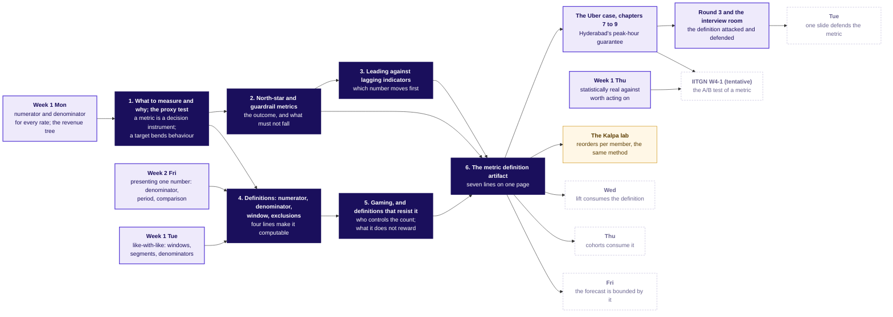

# Week 4 Monday, rebuilt concept-first: the plan

Written 13 October 2026 from the Monday row (`docs/curriculum/W4_Analyst_craft.md`, lines 3 to 108), `docs/05_Curriculum_Map_Schema.md`, the calendar line for W04/D1 (Mon 26 Oct 2026, teaching, M2, block W4-1 tentative), the decisions `chapter-standard`, `teaching-approach`, `w4-case-led`, `faculty-blocks`, `four-domains` and the `cohort` and `campus_day` blocks of `data/programme/facts.yaml`, the merged pack in `content/W04/D1`, the Monday sections of `docs/detailing/W04_analyst_craft_spine.md` and `docs/detailing/W04_case_file.md`, the Week 1 to 3 rows, `content/W01/D1`, and the skills lesson-strategy, lesson-architecture, curriculum-detailing, concept-packaging, training-deck-builder, notebook-builder and day-pack-builder with `the-standard.md` and `teaching-styles.md`.

**What the requester asked for on 13 October 2026, and what this plan does with it.** The Uber case stays, because the requester called the cases good. Concept chapters named by the row's six subtopics come first, in about the first hour, each with a simple, complete, relatable teaching example and its own notebook, from scratch. The case chapters follow as applications, and the case notebooks move to the end of the numbering with the Kalpa lab last. A trainer reading the slides or the notebook names sees the topics of the day. This supersedes, for Monday and the rest of Week 4, the three-or-four-chapter shape and the deck sizes of decision `w4-case-led` and the spine's section 5, by ground truth order 1; it changes no target number, no plant, no date and no faculty fact.

**What this plan does not touch.** A separate session is rebuilding the Kalpa lab (notebook 04, `exercises/unguided/C2_W04_D01_kalpa_north_star_STUDENT.md`, `trainer/C2_W04_D01_lab_note_TRAINER.md`) on branch `w04-d1`, on Thursday's table per the requester's 13 October lab-rebuild message. This plan leaves those three files alone, keeps the lab last, and applies the one rename it needs (notebook 04 to 10) and the cross-reference lines in the index and day sheet only after that branch has merged. Section 8 carries the sequencing guard.

**Why the pack came out as it did, in one paragraph, so the fix is aimed right.** The 12 October redirection asked for an engineering case in first position, climbed in sub-problems, and the spine translated that into "the concept arrives just in time, inside the sub-problem that needs it" (spine section 2.2, "The concept arrives: just in time, with an everyday analogy"). The build obeyed that line, so every concept now lives inside a case step: the proxy is defined on slide S7 inside the war game, the tree on S30 fourteen minutes into chapter 3, leading against lagging on one slide, S31. The row's subtopic list was read as a checklist of things to touch rather than as the chapter list. The fix is structural: the subtopics become the chapters, each taught on a clean toy before the case, and the case chapters are retitled so each says which concept it applies.

---

## 1. Coverage now

The row's day focus: **Business metric design. The number the growth plan chases, and what stops it being gamed.** The six subtopics, verbatim, then the concepts the agenda, outcomes, interview angle and exercises need that the list leaves implicit.

| Subtopic, verbatim from the row | Where the built pack touches it now | The gap |
|---|---|---|
| What to measure and why; the proxy test | `half1` S4 (the board's "what is it for?"), S5 (the proxy test as three questions inside war game round 1), S7 (a proxy defined, after the vote), S8 (the canteen token), S13 (close); notebook 01 cells 1 to 2 (the canteen, invented) and 13; notes "What is a proxy?"; cheat sheet panel 4; Kahoot Q5; Saturday bank item 16 | Buried inside the case and the war game. No chapter is named for it, so a trainer cannot find it. "Why measure at all" and "a metric is a decision instrument" (the row's thinking column, agenda item 2, the UNDERSTANDS line) appear only as the board's question "what is it for?"; nowhere does a slide say what a metric is, what a target is, and which decision the number feeds. No from-scratch entry. |
| North-star and guardrail metrics | S25 to S26 (which number would you pay for), S30 (the tree: north star, guardrails, inputs), S36 (close), `half2` S40 to S41, S43 (Maxxsaver, Eternal); notebook 03 cells 6 to 7; notes "What are a north star, a guardrail and an input?"; guided Q1 and Q4; lead-lag Q3; Kalpa set Q3; lab set Q2 to Q3; Kahoot Q1; bank items 1, 17 | Covered on Uber only, and in the wrong order: the room votes on a north star at S25 before the terms are defined at S30. The seesaw is asserted in a sentence, never derived on small numbers. No everyday example, no statement of why a north star without a guardrail fails. |
| Leading against lagging indicators | S31 (one slide, 4 minutes); notebook 03 cells 8 to 9; one paragraph inside the notes' north star section; `unguided/lead_lag` (sat in the lab or the fallback clinic only); fallback S6 to S7; Kahoot Q2; bank items 9, 25 | One slide and one picture. The row's mid-session drill, "classify eight Kalpa metrics as leading or lagging and defend two", never runs in the trainer's time; the existing drill uses Uber's eight numbers. No simple example of a number that moves first while a team can still act. |
| Definitions: numerator, denominator, window, exclusions | S17 to S19 (one `groupby`; the mean-of-ratios trap), S20 (Swiggy's glossary), S21 (Delhi Metro), S32 (the seven lines on Uber), S34 to S35; notebook 02 cells 2 to 9, notebook 03 cells 6 to 7 and 12 to 13 (SQL); notes "How is a rate added up?"; guided Q2 to Q3; Kahoot Q4, Q6; bank item 2 | Numerator and denominator are strong, as a Week 1 revisit. Window and exclusions appear only as two rows of the S32 table; no example shows the number moving when the window or an exclusion changes (explorer scene M3 does it, the deck does not). |
| Gaming, and definitions that resist it | S5 to S8, S12 (Wells Fargo), S22 to S23 (the idle tail), S26 to S27, the "does not reward" and "gaming note" rows of S32, S33 (VA); notebook 02 cells 10 to 17; Kahoot Q3, Q7; redesign Q3 to Q4; bank items 8, 15 | Spread across all three chapters and never a chapter of its own. The four mechanisms the pack already shows (the measured control the count; no usage condition; the measured set the clock's start; a silent definition change) are never listed together with the definition line that resists each. The fallback deck's S2 to S3 does that matching, and it runs only if the faculty block slips. |
| The metric definition artifact | S3 ("where today ends: one sentence and seven lines"), S32, the guided exercise's template, round 3, the take-home and its self-check, cheat sheet panel 3 | The template is only ever shown filled with Uber's values. No skeleton with placeholders first, no worked everyday instance, no weak artifact beside a strong one. A learner cannot tell which lines are the computable core and which make it safe to pay for, except from one crux line on the sheet. |

| Implicit concept the row needs | Where the row needs it | Where the pack touches it | The gap |
|---|---|---|---|
| A metric is a decision instrument | Thinking column; agenda item 2; UNDERSTANDS | S4 "what is it for?", S13 | Never said. A from-scratch learner does not know what a metric is for. |
| Any target bends behaviour toward itself | Thinking column; UNDERSTANDS; bank item 8 | S8 (the canteen), S12 (Wells Fargo) as mechanisms | Shown twice, never stated as the rule in the row's words. (Goodhart's wording is on the case file's do-not-use list, so the row's words are the only form.) |
| A rate is a ratio of two sums, never a mean of ratios | Trainer notes START FROM (Weeks 1 and 2) | S18 to S19, notebook 02 cells 8 to 9, Kahoot Q6 | Covered; a Week 1 revisit at the right depth. Stays in the case chapter. |
| Kalpa's tree (agenda item 3: "on Kalpa's tree") | Agenda item 3 | The tree on S30 is Uber's; Kalpa's revenue tree from Week 1 Monday is never drawn on Monday | The backward hook to Week 1 is missing; the concept map draws it (section 2). |
| What the definition deliberately does not reward | Thinking column; CAN DEFEND | One row of S32 | Named once, never taught as the line that resists gaming. |
| The interview structure for "how would you measure the success of a new feature" | Interview angle [S]; the faculty column's CONNECTS TO KALPA | `half2` S44 to S47, the transcript | Covered. Stays in the interview room. |
| Three departments to one number | Interview angle [D]; the scenario | Round 3; fallback S9 | Covered at L5. The artifact chapter now says why one written definition is how three teams reach one number. |
| The return question from Week 2 Friday (a pivot's total disagrees with the warehouse) | Kahoot plan | Kahoot Q8 | Covered. |

---

## 2. The concept map

Six concepts in a chain. The first three decide what to count; the last three decide how it is written so it cannot be gamed. Everything today's chapters use from before is on the left, and everything in the week that consumes today's definition is on the right.

The map is the day's picture: it is slide 2 of the concepts deck, repeated at every section boundary with the current chapter lit (the one permitted divider, per training-deck-builder "Cohesion from one repeated connection diagram"), the first cell's MAP picture in each concept notebook in a reduced form (the six boxes and the arrows, drawn in matplotlib), panel one of the new concepts cheat sheet, and the first drawing in the board work. The week map (the spine's section 1, currently S2) moves to slide 3 of the concepts deck so the room sees the week first and the day's concepts second; both stay.

**The agenda slide a trainer reads the day from (slide 1 of the concepts deck, after the cover).** It is the lesson-architecture map slide: numbered sections named for the task, each with a one-sentence capability promise and its minutes, and the row's subtopic words printed verbatim beside each number so the trainer can match the slide to the row. Built as a `timeline` block, one entry per section, durations only.

| Section | The row's words | The promise, as the slide prints it | Minutes |
|---|---|---|---|
| 1 | What to measure and why; the proxy test | Say what a number is for, and test whether a team could hit it while the goal got worse | 13 |
| 2 | North-star and guardrail metrics | Pick the one number a plan chases, and the numbers that must not fall while it rises | 10 |
| 3 | Leading against lagging indicators | Tell a number that warns early from one that confirms late | 10 |
| 4 | Definitions: numerator, denominator, window, exclusions | Write the four lines that make a number computable, and watch each line move it | 10 |
| 5 | Gaming, and definitions that resist it | Name the four ways a paid number is gamed, and the line that stops each | 10 |
| 6 | The metric definition artifact | Fill the seven-line page a company can adopt | 10 |
| 7 to 9 | The Uber case: the ticket, the hand count, the full data, the number to pay for | Apply chapters 1 to 6 to Uber Hyderabad's peak-hour guarantee | 100 |
| 10 to 11 | Round 3; the interview room | Defend the definition against three roles; answer the interview question cold | 40 |
| Close | Kahoot and the handoff | Eight calls in seconds; what the next 120 minutes add (tentative faculty block) | 20 |
| Lab | The Kalpa transfer, TA-led | The same method on Kalpa's reorders per member | the lab's length |

---

## 3. Concept chapters, first, 70 minutes with the opening

Six chapters, one per subtopic, in the row's order. Each is a lesson-architecture unit of 8 to 12 teaching minutes with the nine slots compressed to six slides: the question with lettered options (Brilliant; the misconception stated in the learner's likely words, Veritasium), the answer with the from-scratch definition, the toy worked on tiny numbers with its picture (StatQuest, 3Blue1Brown), the rule named last with a check question, where the Uber case and the Kalpa lab will apply it with the map node lit (ByteByteGo), and a rules slide of four bullets. The treatment varies by what each concept is, per training-deck-builder section 3, so the block does not read as one loop. Every toy is invented, labelled invented on the slide and in the cell, and written to the facts file under `toys` by the day's generator so every number has a home (spine acceptance line 5).

**The idea count against the cap.** Four new ideas in the 70 minutes, counted as decision sentences: is this number safe to pay for (the proxy test); which number is the outcome and which must not fall (north star and guardrail, one paired idea); which number do I watch this week (leading against lagging); which line stops which gaming (resistant definitions). Chapter 4 is a Week 1 Monday revisit rising a level (window and exclusions join numerator and denominator), and chapter 6 is a procedure assembling the five before it. The case block adds no new idea; it applies these. That is within curriculum-detailing's four-per-two-hours cap.

### Chapter 1. What to measure and why; the proxy test (13 minutes, 7 slides)

- **Treatment.** A hidden failure mode: the symptom first (a number rose, nothing improved), then the mechanism, then how it is detected.
- **From-scratch entry.** A metric is a number a person watches in order to decide something: how much rice to cook, whom to pay, whether to continue a scheme. A target is a metric with a value somebody is asked to hit. Every metric has an owner who decides on it and a cost when it is wrong. These three sentences open the chapter, since most of the room has never been paid on a number.
- **Misconception and prediction.** "If the number we track goes up, the thing we want has improved." The opening slide (3 minutes, folding in the row's agenda item 1 as an instinct round): a school principal proposes three numbers to judge teachers by, attendance marked, homework collected and the term exam's class average. Lettered options: which of the three could a teacher raise while children learned less? The room commits before anything is taught. The reveal: all three can, and the exercise of saying how is the proxy test.
- **The teaching example, carried through the chapter (invented, labelled).** A school canteen pays its servers per token handed out, because tokens are easy to count and plates are not. The owner also reads tokens to decide tomorrow's rice. Ten days: plates 200 every day; tokens 200 a day on days 1 to 5, 400 a day on days 6 to 10 after servers start being paid per token. This is the pack's existing canteen toy (S8, notebook 01 cell 1), moved here and given its decision.
- **Derived on tiny numbers.** Tokens per plate: 200 / 200 = 1.0, then 400 / 200 = 2.0. The thing wanted (plates) did not move; the number paid for (tokens) doubled. The decision the number fed: rice to cook at 150 g a plate reads 30 kg from plates and 60 kg from tokens, so the owner who reads tokens wastes 30 kg a day, Rs 1,500 a day at Rs 50 a kg, about Rs 45,000 a month (all invented). The rule, named last: a **proxy** is a number that stands in for the thing wanted; the **proxy test** asks whether a team could hit the number while the thing it stands for got worse or stayed the same. Second sentence of the rule, in the row's words: any target bends behaviour toward itself.
- **Real case with a number (M8, checked 12 October 2026, to be re-checked on the build day).** Wells Fargo paid staff on accounts opened with no usage condition; the CFPB's USD 185 million penalties in 2016 and the SEC's USD 3 billion settlement in 2020 followed. Moved here from S12, where it closed case chapter 1.
- **Check question (letters called aloud).** A library pays its staff per book issued. Which reading passes the proxy test: (a) books issued, (b) books issued and returned on time, (c) members who borrowed at least once this month, (d) books bought. Key: c, with the reason that a and b can be raised by issuing and returning without a reader.
- **How the Uber case applies it (chapter 7).** Peak online hours stand in for "riders picked up faster"; the app counts an open screen as online, so a driver controls the count. The room will find on twelve rows that hours rose 23 percent while trips fell 23 percent. The Kalpa lab applies it to reorders per member.
- **Explorer scene.** M1, named in the notes fence.
- **Interview line (question only).** [S] How would you measure the success of a new feature?

### Chapter 2. North-star and guardrail metrics (10 minutes, 6 slides)

- **Treatment.** A distinction people conflate: the two numbers side by side with real values, then where each fails alone.
- **From-scratch entry.** When a plan has many numbers, a team needs one it chases and a few it watches so the chase does no harm. The one it chases is the north star; the ones that must not get worse are the guardrails. Without a guardrail, a north star rewards every way of reaching it, including the harmful ones chapter 1 found.
- **Misconception and prediction.** "A rising pass percentage means the coaching centre teaches better." Predict: a centre's pass percentage goes from 60 to 90 percent in a year; what else could have happened? Lettered options: better teaching; easier paper; fewer students allowed to sit; more students enrolled.
- **The teaching example (invented, labelled).** A coaching centre with 100 enrolled students in four batches of 25. Year 1: all 100 sit, 60 pass, pass percentage 60. Year 2: the centre lets only 40 sit (batches A and B, 20 each), 36 pass, pass percentage 90; the hoarding says 90 percent. The parents' goal was their child passing.
- **Derived on tiny numbers.** North star as the centre defines it: passes / students who sat, 60 / 100 = 60 percent then 36 / 40 = 90 percent. The guardrail the parents need: students who sat / students enrolled, 100 / 100 then 40 / 100. Drawn as a seesaw: the north star rose because the denominator shrank, and the guardrail fell by the same mechanism. The honest north star: passes / enrolled, 60 then 36 percent. The rule, named last: a **north star** names the outcome the plan exists for; a **guardrail** catches a way of hitting it that hurts the people the plan serves; a guardrail is chosen by the gaming it catches, and a second growth count catches nothing. A shrinking denominator raises a rate with no extra outcome, which the Uber definition's line "does not reward a shrinking enrolled base" will reuse.
- **Real case with a number (M9, M2, checked 12 October 2026).** Swiggy Instamart's Maxxsaver: AOV up 16 percent to Rs 612 with slightly fewer orders per user, so "orders per user" as a north star would have read a success as a fall; Eternal replaced GOV with NOV, GOV less discounts, so the number stops rewarding discounting. Moved here from `half2` S43, which keeps a one-line callback.
- **Check question.** A food app's north star is orders per active user per month. Which guardrail catches frequency bought with Rs 49 coupons: (a) app opens per user, (b) revenue per active user, (c) campaigns sent, (d) orders per active user tracked weekly. Key: b. (This is the Saturday bank's item 17 pattern on a different surface, with a different key letter, so the paper's item is not spent.)
- **How the Uber case applies it (chapter 9).** Completed peak trips per enrolled driver online at peak as the north star; acceptance share and median rider wait as rider guardrails; top-up per completed trip as the budget guardrail. The room votes on this at the chapter 9 opener after meeting the terms here.
- **Explorer scene.** M2, the seesaw.
- **Interview line.** [F] North star against guardrail, with one example pair.

### Chapter 3. Leading against lagging indicators (10 minutes, 6 slides)

- **Treatment.** A distinction, taught as two lines over time: the one that turns first beside the one that confirms.
- **From-scratch entry.** Numbers arrive at different times. Some can be read while a team can still act; others arrive after the result is fixed. A number that moves before the north star and can be acted on is leading; one that confirms the north star after the fact is lagging. Leading says when a number moves; it is a separate question from the job a number does, so one number can be a guardrail and a leading number at once.
- **Misconception and prediction.** "You know a chase is lost when the last over ends." Predict: chasing 160 in 20 overs, a team is 60 for 3 after 10 overs; which number already tells the captain to act, and at which over?
- **The teaching example (invented, labelled).** A T20 chase of 160. Overs 1 to 10: 6 runs an over, wickets in overs 3, 7 and 10, so 60 for 3 at the halfway mark. Overs 11 to 20: 7, 8, 9, 10, 8, 9, 10, 11, 9, 7 runs, 148 all told, lost by 12.
- **Derived on tiny numbers.** Required run rate at the start: 160 / 20 = 8.0 an over. After 10 overs: 100 needed from 10 overs, 10.0 an over. The required rate crossed 10 at over 10, ten overs before the scoreboard confirmed the loss; the captain could promote a hitter at over 11. The required run rate is the leading number; the final margin is the lagging number; wickets in hand is the guardrail the leading number must be read with. The rule, named last: a **leading indicator** moves before the north star while the team can still act; a **lagging indicator** confirms it later; a dashboard needs at least one of each.
- **Connected example from the case data (facts ids `acceptance_2026_08_31` and the next two, `rs_per_hour_2026_08_31` and the next two).** On Uber's twelve weeks, the share of offers accepted fell to its new level in the launch week (0.729) while bookings per online hour fell from Rs 271.0 that week to Rs 259.1 by the third week; a team watching acceptance would have seen the problem in week one. This is slide S31 moved here, with its picture `whiteboards/C2_W04_D01_lead_STUDENT.png`.
- **Check question, the row's mid-session drill in its Kalpa form.** Eight Kalpa Retail numbers classified leading or lagging, letters called: add-to-cart events this week; new Retail-Plus sign-ups this month; last quarter's audited revenue; the share of members who reordered within 30 days; delivered orders this month; the discount share of booked revenue; app sessions this week; the return rate last quarter. (These are the vocabulary of Week 1's tree and of the Kalpa north star exercise; none is a planted value.) Two of the calls are defended aloud by two learners, as the row asks.
- **How the Uber case applies it (chapter 9).** Enrolled drivers online in the first peak hour and requests per online hour by zone as the leading inputs under the north star.
- **Explorer scene.** M4.
- **Interview line.** [F] North star against guardrail, with one example pair (the leading input is the third part of the pair).

### Chapter 4. Definitions: numerator, denominator, window, exclusions (10 minutes, 6 slides)

- **Treatment.** A structure with parts: the picture of the whole first (four lines around one number), then one slide per line, each line moving the same number.
- **From-scratch entry.** Backward hook, said in four words: Week 1 Monday taught numerator and denominator for every rate. Today adds the two lines Week 1 left implicit: the stretch of time the count covers, and what is left out of both counts. A number with these four lines can be computed by two people and come out the same; a number without them cannot.
- **Misconception and prediction.** "Attendance is one number; everyone computes it the same way." Predict: one student, one term, four honest people compute the attendance percentage; how many different numbers come out? Options: 1, 2, 4, cannot be told.
- **The teaching example (invented, labelled).** A school register for one student over a 60-calendar-day term: 50 working days and 10 holidays; of the 50 working days, present 40, absent 8, on medical leave 2. (The school is invented; the programme's own attendance rule is not used, since the way it counts a day is not in `facts.yaml`.)
- **Derived on tiny numbers, one line per slide.** Numerator and denominator: 40 / 50 = 80.0 percent. Change the denominator to calendar days: 40 / 60 = 66.7 percent. Change the exclusions so medical leave leaves both counts: 40 / 48 = 83.3 percent; count medical leave as present instead: 42 / 50 = 84.0 percent. Change the window to the second month alone (20 working days, 14 present): 70.0 percent. Four lines, five numbers from one register. The rule, named last: a **complete definition** names its numerator, its denominator, its window and its exclusions, and the first four lines make a number computable.
- **Real cases with a number (M1, M6, checked 12 October 2026).** Swiggy's glossary writes each denominator down: platform frequency is completed orders per transacting user per month, 4.53 in the quarter to 30 September 2024. Delhi Metro's four numbers for one network, from about 27 lakh riders a day to 82,44,903 boardings on the record day, differ by unit and by kind of day; a definition changes the number without changing the crowd. Moved here from S20 and S21, which chapter 8 keeps as one-line callbacks.
- **Check question.** Two analysts report a canteen's plates per server: 10.0 and 8.0. Which line most likely differs: (a) the numerator, (b) the denominator (servers on the roster against servers who worked), (c) the font, (d) the currency. Key: b.
- **How the Uber case applies it (chapter 8).** Trips per peak online hour is a ratio of two sums over the window of six weeks, never the mean of each driver-week's rate (1.58 against 1.71); the denominator is hours the app was open, which the driver controls; cancelled trips and off-window trips are the exclusions.
- **Explorer scene.** M3, one line of a definition changed.
- **Interview line.** [F] What makes a metric gameable, and how do you write one that is not?

### Chapter 5. Gaming, and definitions that resist it (10 minutes, 6 slides)

- **Treatment.** An anti-pattern slide per mechanism: what a team does to a number, beside the line that stops it.
- **From-scratch entry.** Gaming is raising a number without doing what it stands for. It needs no dishonesty: a paid number is a pull on behaviour, and people move toward it. A definition resists gaming when the count belongs to the person served rather than the person paid, when the window's start is set by the system rather than the measured, when the lines are dated so a change is visible, and when the page says what the number deliberately does not reward.
- **Misconception and prediction.** "If we pay per delivery, we get more deliveries." Predict: a kirana shop pays its delivery boy Rs 20 per delivery marked done in the shop's app; what can rise without a parcel changing hands?
- **The teaching example (invented, labelled).** A kirana shop's month: 50 orders dispatched; the delivery boy marks 50 done; 40 were confirmed by the customer's OTP; 10 were marked done at the gate and never handed over, and 6 complaints followed. The boy also types the dispatch time himself, so "delivered within 30 minutes" reads 100 percent; measured from the shop's bill time it reads 70 percent.
- **Derived on tiny numbers.** Pay per marked done: 50 x Rs 20 = Rs 1,000. Pay per OTP-confirmed: 40 x Rs 20 = Rs 800. The Rs 200 gap is the gaming. The four mechanisms, each with its everyday instance and the Uber or public parallel, on one anti-pattern grid: the measured control the count (marked done; an open app counts as online); no usage or receipt condition (a delivery with no OTP; Wells Fargo's unused accounts, M8); the measured set the clock's start (the boy's dispatch time; VA's "desired date", M8, moved here from S33); a silent definition change (the shop quietly starts counting attempts; the 2013 remittance accounts in the SEC order, M8). The resisting definition for the shop: numerator OTP-confirmed deliveries; denominator orders dispatched that day, set by the shop; window the day; exclusions customer-cancelled orders; does not reward attempts or self-reported times; guardrail complaints per 100 deliveries. The rule, named last: a definition **resists gaming** when its numerator carries a receipt condition, its denominator is set by something other than the people paid and its count is printed, its window's start is the system's, its exclusions are dated, and the page says what it does not reward.
- **Check question.** Which single line change stops the delivery boy's gate-marking: (a) pay Rs 25 instead of Rs 20, (b) count a delivery only when the customer's OTP is entered, (c) count deliveries per week instead of per day, (d) add a second delivery boy. Key: b.
- **How the Uber case applies it (chapters 8 and 9).** 180 drivers whose hours rose 2.1 times while their trips fell 12 percent, 72 percent of the new hours in the three outer zones; 61 percent of the Rs 1.9 crore top-up went to driver-weeks that accepted under half their offers; the redesign pays for completed trips with an acceptance floor. The Kalpa lab applies it to reorders the app placed on its own.
- **Interview line.** [F] What makes a metric gameable, and how do you write one that is not?

### Chapter 6. The metric definition artifact (10 minutes, 6 slides)

- **Treatment.** A procedure with a grammar: the skeleton with placeholders first, its seven parts numbered, then one worked instance, then the weak page beside the strong one.
- **From-scratch entry.** The artifact is one page a company adopts so three teams argue about one written thing instead of three remembered ones. Its first four lines (chapter 4) make the number computable; its last three (chapters 2 and 5) make it safe to pay for. When departments disagree, the page is what they sign.
- **Misconception and prediction.** "A metric is defined when it has a name and a target." Predict: a growth plan's page says "Deliveries, monthly, target plus 20 percent". Which of the seven lines is present? Options: 1, 2, 4, 7.
- **The skeleton, with placeholders.** `<what is counted> per <what it is divided by, count printed> over <window>, leaving out <exclusions>; it does not reward <behaviour>; its guardrails are <two or three numbers>, and the gaming note says which way of hitting it each catches.` The seven parts numbered down the side.
- **The worked instance, on the kirana delivery (invented, from chapter 5).** All seven lines filled: OTP-confirmed deliveries; per order dispatched that day, count printed; the calendar day; customer-cancelled orders left out; does not reward attempts, self-typed times or a shrinking order count; guardrails complaints per 100 deliveries and minutes from bill to OTP, measured by the system; the gaming note names gate-marking, self-set clocks and a boy who declines far orders.
- **The weak page beside the strong one.** "Deliveries, monthly, plus 20 percent" against the seven lines, with a row per missing line and the gaming each absence invites.
- **Real case with a number (M5, checked 12 October 2026).** Uber's annual report defines Monthly Active Platform Consumers as unique consumers who completed a ride or received a delivery at least once in a month, averaged over the quarter: a published numerator, denominator and window, with a receipt condition.
- **Check question.** Which line of the artifact answers a department head who says "your number punishes us for a quiet month": (a) the window, (b) the guardrail, (c) the denominator with its printed count, (d) the gaming note. Key: c, since the count beside the rate shows a quiet month as fewer units rather than a worse rate; a is the plausible second reading and the solution says why it is weaker.
- **How the Uber case applies it (chapter 9) and the lab.** The room fills the same seven lines for the redesign with the trainer (the existing guided exercise, now the instance after the skeleton), reads 35.76 and 35.89 trips per online driver-week on the data, and round 3 attacks it; the lab's unguided exercise fills the page for Kalpa's growth plan.
- **Explorer scene.** M3.
- **Interview line.** [D] Three departments each want their own target; how do you get to one, and what do you say to the two who lose?

---

## 4. Concept notebooks

One per concept chapter, named by its topic, 12 to 16 cells each, in notebook-builder's MAP, DO, SEE, CHECK, SUM rhythm and under the Week 4 rule (pandas, the standard library, matplotlib, a three-line `check`, no helper layer). Each loads its toy from `../data/`, written by `internal/C2_W04_D01_generate_INTERNAL.py` with the day's seed and recorded in the facts file under `toys`, labelled invented; no record is pasted into a cell. Each carries a title cell with the chapter's question, **Who needs the answer.** and **The questions on the way.**, a MAP picture (the six-concept chain with this one lit, drawn in matplotlib so it saves), predict cells with lettered options, at least five checks and three pictures, a trap where the concept has one, and a SUM cell that answers each question with its number and names what the next notebook adds. Nothing in a concept notebook names a Kalpa plant.

### 01 `C2_W04_D01_01_proxy_test_STUDENT.ipynb`, data `C2_W04_D01_canteen_days_STUDENT.csv` (10 rows: day, tokens, plates)

1. MD title: What is a number for, and how do we tell a goal from a stand-in? Who needs the answer (the canteen owner deciding rice and pay; after the break, the city head). The questions on the way.
2. CODE MAP: imports, `check`, the six-box chain with box 1 lit.
3. MD: what a metric, a target and a proxy are, in three sentences; the canteen described; the invented label. **Predict before you run.** What does tokens per plate do from day 6: a) stays 1.0, b) rises to 2.0, c) falls to 0.5, d) cannot be told.
4. CODE DO: load the ten days; print the table.
5. CODE SEE: tokens and plates by day as paired bars (picture 1).
6. CODE: tokens per plate by day; line with the pay change marked (picture 2). **What happened.** b.
7. MD: the decision the number feeds. **Predict.** Rice cooked from tokens on day 6: a) 30 kg, b) 60 kg, c) 15 kg.
8. CODE: rice from plates against rice from tokens; the wasted kilos and rupees as a bar (picture 3). **What happened.** b, 30 kg wasted a day, Rs 1,500.
9. MD: the proxy test written as a function of two series; **Predict.** Does "plates served" pass the test? Does "tokens"?
10. CODE: `proxy_test(paid, wanted)` returns whether the paid number rose while the wanted one did not; applied to both; prints the verdicts.
11. CODE CHECK: tokens per plate equals [1.0] x 5 then [2.0] x 5; plates are 200 every day; rice from tokens on day 10 is twice rice from plates; the proxy test fails tokens and passes plates; the facts file's `toys.canteen` values match the CSV.
12. MD trap: the owner reads "tokens up 100 percent" as "demand up 100 percent" and orders double rice; the check that catches it is the plates column; the fix is to pay and plan on plates.
13. MD SUM: answers with numbers; the rule; what notebook 02 adds (the second number that must not fall).

### 02 `C2_W04_D01_02_north_star_guardrails_STUDENT.ipynb`, data `C2_W04_D01_coaching_batches_STUDENT.csv` (8 rows: year, batch, enrolled, sat, passed)

1. MD title: Which number should a plan chase, and which must not fall while it rises? Who needs the answer (parents; the city head). The questions on the way.
2. CODE MAP: chain with box 2 lit.
3. MD: the centre described, invented. **Predict.** Pass percentage from 60 to 90: a) better teaching, b) easier paper, c) fewer allowed to sit, d) more enrolled.
4. CODE DO: load; per-year sums of enrolled, sat, passed.
5. CODE SEE: the centre's north star, passes / sat, by year; bars (picture 1). **What happened.** 60 then 90.
6. MD: the guardrail the parents need. **Predict.** Share of enrolled who sat in year 2: a) 100, b) 60, c) 40 percent.
7. CODE: sat / enrolled by year; the seesaw picture, north star up on one side and guardrail down on the other (picture 2). **What happened.** c.
8. MD trap: the hoarding's 90 percent, the decision it misleads (parents enrol), the check (the guardrail), the fix (passes per enrolled).
9. CODE: passes / enrolled by year, 60 then 36 percent; both definitions on one chart (picture 3).
10. CODE: a second route: per-batch passes summed over per-batch enrolled gives the same 36 percent; a mean of batch pass rates gives a different number, the Week 1 lesson restated.
11. CODE CHECK: year-1 and year-2 pass percentages as computed; sat share 1.0 then 0.4; passes per enrolled 0.60 then 0.36; the second route agrees with the first; a guardrail that is itself a pass count is flagged by a `guardrail_is_growth_count` test.
12. MD SUM: north star, guardrail, the seesaw; what notebook 03 adds (which number moves first).

### 03 `C2_W04_D01_03_leading_lagging_STUDENT.ipynb`, data `C2_W04_D01_chase_overs_STUDENT.csv` (20 rows: over, runs, wickets_lost)

1. MD title: Which number warns while the team can still act, and which only confirms? Who needs the answer (the captain; the city team in week one). The questions on the way.
2. CODE MAP: chain with box 3 lit.
3. MD: the chase, invented. **Predict.** At which over does the required rate first pass 10: a) 5, b) 10, c) 15, d) never.
4. CODE DO: load; cumulative runs; runs still needed; overs left; required run rate per over.
5. CODE SEE: cumulative runs against the 8-an-over line (picture 1).
6. CODE: required run rate by over with the "act here" marker at over 10 (picture 2). **What happened.** b.
7. MD: wickets in hand as the guardrail the leading number is read with. **Predict.** Final margin: a) won by 12, b) lost by 12, c) tied.
8. CODE: the final total and margin; the lagging number arrives at over 20 (picture 3, the margin bar beside the over the leading number turned).
9. MD: the case's connected example: acceptance share turned in the launch week, bookings per online hour followed; the three weeks' values from the facts file, restated in a sentence.
10. CODE: load `driver_weeks`, weekly acceptance share and bookings per online hour over the twelve weeks; the week each first fell below its pre-launch level; the lead in weeks (the pack's existing picture, redrawn here so this notebook stands alone).
11. CODE CHECK: required rate at the start 8.0; at over 10, 10.0; final total 148; margin minus 12; acceptance share's turning week precedes bookings per hour's turning week on the case data.
12. MD: the eight Kalpa numbers classified, as a table the learner fills before reading the SUM.
13. MD SUM: leading, lagging, the guardrail read alongside; what notebook 04 adds (the four lines).

### 04 `C2_W04_D01_04_definition_lines_STUDENT.ipynb`, data `C2_W04_D01_attendance_register_STUDENT.csv` (60 rows: day, month, status in present, absent, holiday, medical)

1. MD title: Which four lines make a number computable, and how does each one move it? Who needs the answer (the principal; two analysts who must agree). The questions on the way; the Week 1 Monday hook in one sentence.
2. CODE MAP: chain with box 4 lit.
3. MD: the register, invented. **Predict.** Four honest people, how many numbers: a) 1, b) 2, c) 4, d) cannot be told.
4. CODE DO: load; counts by status; the register as a 60-day strip coloured by status (picture 1).
5. CODE: numerator and denominator as the school defines them: 40 / 50 = 80.0 percent.
6. MD: the denominator line. **Predict.** Over calendar days: a) 80.0, b) 66.7, c) 83.3.
7. CODE: 40 / 60 = 66.7. **What happened.** b.
8. MD: the exclusions line, two readings. CODE: 40 / 48 = 83.3 and 42 / 50 = 84.0.
9. MD: the window line. CODE: the second month alone, 14 / 20 = 70.0.
10. CODE SEE: the five numbers from one register as bars, each labelled by the line that changed (picture 2).
11. MD trap: a transfer certificate printed with 66.7 percent, the decision it misleads (a seat refused), the check (the denominator line), the fix (print the definition beside the number).
12. CODE: a definition as a small function with four arguments, applied to the register to reproduce all five numbers; a second route by filtering the frame directly agrees (picture 3, the function's five outputs against the direct counts).
13. CODE CHECK: 80.0, 66.7, 83.3, 84.0, 70.0 to one decimal; the function and the filter agree on all five; the register holds 60 days with 10 holidays.
14. MD SUM: the four lines; the Swiggy and Delhi Metro sentences as the published form; what notebook 05 adds (what the lines must resist).

### 05 `C2_W04_D01_05_gaming_resistant_definitions_STUDENT.ipynb`, data `C2_W04_D01_kirana_deliveries_STUDENT.csv` (50 rows: order_id, day, bill_time, dispatch_time_typed, done_time_typed, otp_confirmed, complaint)

1. MD title: How is a paid number gamed, and which line stops each way? Who needs the answer (the shop owner; the city head and finance). The questions on the way.
2. CODE MAP: chain with box 5 lit.
3. MD: the shop, invented. **Predict.** Deliveries marked done against OTP-confirmed: a) 50 and 50, b) 50 and 40, c) 40 and 50.
4. CODE DO: load; counts; pay under each definition, Rs 1,000 and Rs 800 (picture 1, the two pays). **What happened.** b.
5. MD: the clock's start. **Predict.** Share delivered within 30 minutes from the boy's typed dispatch time against the shop's bill time: a) both 100, b) 100 and 70, c) 70 and 100.
6. CODE: both shares; the picture of the two clocks (picture 2). **What happened.** b.
7. MD: the four mechanisms as a table with the everyday instance, the line that resists each, and the public parallel named (Wells Fargo, VA, the 2013 remittance accounts, all M8, checked 12 October 2026, re-checked on the build day).
8. CODE: the resisting definition applied: OTP-confirmed per dispatched order per day, complaints per 100 deliveries as the guardrail; by day (picture 3).
9. MD trap: the owner raises the rate to Rs 25 per marked delivery to "motivate"; the number rises, parcels do not; the check is the OTP column; the fix is the numerator's receipt condition.
10. CODE: a second route, complaints matched to the gate-marked orders: 6 of the 10 unconfirmed orders carry a complaint, 0 of the 40 confirmed.
11. CODE CHECK: 50 marked, 40 confirmed; pay Rs 1,000 and Rs 800; on-time 1.00 and 0.70; complaints concentrate in the unconfirmed set; the guardrail is computed from the customer's record and never from the boy's.
12. MD SUM: the four mechanisms, the five resisting lines; what notebook 06 adds (the page that holds them).

### 06 `C2_W04_D01_06_metric_definition_artifact_STUDENT.ipynb`, data: reuses `C2_W04_D01_kirana_deliveries_STUDENT.csv`

1. MD title: What does the one page a company adopts hold, line by line? Who needs the answer (three teams that must sign one page; the city head on Friday). The questions on the way.
2. CODE MAP: chain with box 6 lit.
3. MD: the skeleton with placeholders and its seven numbered parts. **Predict.** "Deliveries, monthly, plus 20 percent" has how many of the seven lines: a) 1, b) 2, c) 4, d) 7.
4. CODE DO: the artifact as a seven-key dictionary for the kirana shop; rendered as a table figure (picture 1).
5. CODE: the metric under the weak page (marked deliveries, monthly) and under the strong page, over the month, on one chart (picture 2). **What happened.** b, two lines.
6. MD: the three lines that make it safe to pay for, named back to chapters 2 and 5.
7. CODE: each line removed in turn and the gaming it reopens, as a seven-row table with a tick grid (picture 3, the matrix of lines against mechanisms).
8. MD trap: a page with a guardrail that is another growth count; the check (`guardrail_is_growth_count` from notebook 02); the fix.
9. CODE: a validator `artifact_complete(page)` that reports which of the seven lines is missing; run on the weak page and the strong page.
10. CODE CHECK: the strong page passes all seven; the weak page fails five named lines; the two metrics differ on the month; the validator flags the growth-count guardrail; the skeleton's placeholder count is seven.
11. MD: how the same page will be filled for Uber in notebook 09 and for Kalpa in the lab, in two sentences, with no values.
12. MD SUM: the seven lines; the rule; what notebook 07 adds (the Uber ticket counted by hand).

### The case notebooks, renamed and renumbered

| Now | Becomes | The topic the name carries |
|---|---|---|
| `C2_W04_D01_01_twelve_rows_STUDENT.ipynb` | `C2_W04_D01_07_proxy_test_on_twelve_rows_STUDENT.ipynb` | Chapter 1 applied: the hand count of six drivers |
| `C2_W04_D01_02_full_data_trap_STUDENT.ipynb` | `C2_W04_D01_08_denominators_on_full_data_STUDENT.ipynb` | Chapter 4 applied, with chapter 5's "who controls the count": the ratio of sums, the demand check, the idle tail |
| `C2_W04_D01_03_definition_and_cost_STUDENT.ipynb` | `C2_W04_D01_09_north_star_guardrails_cost_STUDENT.ipynb` | Chapters 2, 3, 5 and 6 applied: the Uber page filled, its cost, the caveats, SQL |
| `C2_W04_D01_04_kalpa_lab_STUDENT.ipynb` | `C2_W04_D01_10_kalpa_lab_STUDENT.ipynb` | The transfer, last; renamed only after branch `w04-d1` merges |

Each case notebook's title cell gains one sentence naming the concept chapters it applies ("applies chapters 1 and 4") and the canteen cells leave notebook 07 (cells 1 to 2 and the canteen checks in cell 12), since chapter 1 now owns the toy; notebook 07 opens on the ticket and the twelve rows. Nothing else in the case notebooks changes.

---

## 5. The case chapters

The Uber material keeps every target, trap and slide the concept block did not absorb. The section numbers continue from the concept chapters so the day reads as one ladder, and each case chapter's opener names the concepts it applies in its promise line and on the map slide after it, so a trainer sees the topic.

| Now | Becomes | Applies | What moves out or trims | Minutes |
|---|---|---|---|---|
| `half1` S1 to S5: the ticket, the week map, where today ends, the board, round 1 | The ticket and round 1 open the case block after the break: S1 (ticket), S5 (round 1, the three roles attacked with the proxy test now in hand), S3 (where today ends) | Chapter 1 | S2 (the week map) and S4 (the board) move to the concepts deck as slides 3 and 4; round 1 shortens, since the instinct round ran in chapter 1 | 12 (was 15) |
| SECTION 1: What does an hour count? (S6 to S13) | SECTION 7: What does an hour count? Promise: "Applies the proxy test (chapter 1) and the four lines (chapter 4) to six drivers counted by hand" | 1, 4 | S8 (canteen) and S12 (Wells Fargo) move to chapter 1; S6 to S7 become a one-minute callback; keep S9 to S11 and S13 | 20 (was 40) |
| SECTION 2: Where did the fall sit? (S14 to S24) | SECTION 8: Where did the fall sit? Promise: "Applies the denominator and the window (chapter 4) and who controls the count (chapter 5) to 12,860 driver-weeks" | 4, 5 | S20 (Swiggy's glossary) and S21 (Delhi Metro) move to chapter 4 and stay as one-line callbacks; keep S14 to S19, S22 to S24 | 30 (was 50) |
| SECTION 3: What should it pay for? (S25 to S37) | SECTION 9: What should it pay for? Promise: "Applies the north star and guardrails (2), the leading inputs (3), resistant lines (5) and the artifact (6) to the redesign" | 2, 3, 5, 6 | S30 (the tree) moves to chapter 2 and returns as the Uber instance in one slide; S31 moves to chapter 3; S33 (VA) moves to chapter 5; the skeleton moves to chapter 6 and S32 becomes the Uber instance filled with the room; S37 (the afternoon's running order) is cut, since the agenda slide carries it; keep S25 to S29, S32, S34 to S36 | 38 (was 65) |
| `half2` SECTION 4: Does it survive the roles? (S38 to S43) | SECTION 10, unchanged in content | 5, 6 | S43 (Maxxsaver, Eternal) moves to chapter 2 and stays as a one-line callback | 25 (was 30) |
| SECTION 5: What does the interviewer hear? (S44 to S47) | SECTION 11, unchanged | 1 to 6 | nothing | 15 |
| S48 to S50: Kahoot, handoff, close | Unchanged, with the close slide adding the six concepts in one row as the recall strip | all | nothing | 20 |
| `fallback` SECTION 6 to 9 | SECTION 12 to 15, content unchanged | 2 to 6 | nothing | 120 if the block slips |

Slide numbering continues across the three STUDENT decks so a trainer can cite a slide without naming the file: `concepts` S1 to about S42 (SECTION 1 to 6), `half1` from the next number (the ticket, SECTION 7 to 9, about 30 slides), `half2` after that (SECTION 10 to 11 and the close, about 14), `fallback` keeping its own numbering as now. `deck_md_check.py` requires `S<n>.` or `D<n>.` titles, the 54-character title guard, an answer slide after every question slide, one diagram per four body slides and a notes fence on every body slide; it does not enforce a sequence, so continuing the count across files is a convention the day sheet states.

---

## 6. Trainer and learner artefacts

### The day sheet's topic list, mapped to the row's trainer agenda

| The row's agenda item | Its minutes | What delivers it in the rebuilt day | Minutes |
|---|---|---|---|
| 1. Three proposed targets; the room says how each could be hit while the business got worse | 15 | Chapter 1's opening instinct round on the principal's three numbers (3); the ticket and round 1 on the city team's three numbers (12) | 15 |
| 2. Metric as decision instrument; the proxy test; gaming and definitions that resist it | 40 | Chapter 1 (13); chapter 5 (10); case chapter 7 (20) | 43 |
| 3. North-star against guardrails; leading against lagging, on Kalpa's tree | 50 | Chapter 2 (10); chapter 3 with the eight Kalpa numbers (10); case chapter 9's first half, the vote, the wrong memo and the cost (15); the concept map's Week 1 tree hook (2) | 37, with the remaining 13 reaching the lab's Kalpa set |
| 4. Definitions: numerator, denominator, window, exclusions; computed on the customer table | 45 | Chapter 4 (10); case chapter 8 (30); the computation on Kalpa's customer table runs in the lab notebook, which stays TA-led | 40 |
| 5. Guided then unguided: the metric definition artifact for the growth plan, with guardrails and a gaming note | 60 | Chapter 6 (10); the Uber page filled with the room in case chapter 9's second half (23); round 3 (25); the Kalpa page in the lab's unguided exercise | 58 before the lab |
| 6. Kahoot and close | 20 | The interview room (15) and the Kahoot with the handoff (20) | 35, since the row's agenda sums to 230 against 240 trainer minutes |

The day sheet prints this table under its question ladder, which gains six rows for the concept chapters, and its part tables gain the concept block with slides, the notebook beside each, what must land and what to cut.

### The deck's agenda slide and concept-map slide

Slide 1 of `concepts` (after the cover) is the agenda table of section 2, as a `timeline` with the row's subtopic words verbatim and durations only. Slide 2 is the concept map of section 2 as a mermaid fence. Slide 3 is the week map moved from `half1` S2, Monday lit. Slide 4 is the board (the old S4) with its four questions. The map returns at each SECTION opener's following slide with the current chapter lit, and the afternoon close shows it with every box filled by the number the room produced on it.

### Exercise items per concept

One scenario set per concept chapter in `unguided/`, three items each, the first called aloud as the chapter's check (2 minutes) and the other two sat in the practice lab; solutions in `solutions/`, opening at the lab's end. Every stem is a question; the distractor audit runs on each.

| Chapter | File | Items | Design items |
|---|---|---|---|
| 1 | `unguided/C2_W04_D01_proxy_test_set_STUDENT.md` | Q1 the library's four readings; Q2 design: a hospital pays per patient seen; which guardrail and why; Q3 a phone plan's "active users" counted on an open app, what passes the test | 2 |
| 2 | `unguided/C2_W04_D01_north_star_guardrails_set_STUDENT.md` | Q1 the coupon guardrail; Q2 design: choose the north star for a school bus service from four and defend; Q3 the coaching centre's honest definition from three | 2 |
| 3 | `unguided/C2_W04_D01_leading_lagging_set_STUDENT.md` | Q1 the eight Kalpa numbers, which list holds every leading one; Q2 which reason defends two of the calls; Q3 design: a kirana owner can watch one number daily, which and why | 1 |
| 4 | `unguided/C2_W04_D01_definition_lines_set_STUDENT.md` | Q1 the two canteen analysts, which line differs; Q2 the attendance number a transfer certificate should print, and the definition beside it; Q3 design: a phone plan's "average data a day", which window and exclusions, and the fact that would change the call | 1 |
| 5 | `unguided/C2_W04_D01_gaming_set_STUDENT.md` | Q1 the single line that stops gate-marking; Q2 match four gaming mechanisms to the line that resists each, one line left over; Q3 design: a tuition app pays teachers per "doubt resolved", write the resisting numerator and denominator | 2 |
| 6 | `unguided/C2_W04_D01_artifact_set_STUDENT.md` | Q1 how many lines the weak page has; Q2 which line answers "your number punishes a quiet month"; Q3 design: order the seven lines by which to write first when three teams disagree, and say why | 2 |

That adds 18 items with 10 design items to the existing 21 with 11, so the day carries 39 items of which 21 are design items, above the one-third rule. The index gains a "which chapter does each set test" table, and its ladder table tags the new items L1 to L3 with the company surface each uses, in the takeUforward manner.

### Kahoot items per concept

Eight items stay. Seven are as built; Q7 is rewritten so chapter 6 has an item and the AI-company variant stays in the interview room.

| Item | Concept | Change |
|---|---|---|
| Q1 north star and guardrail, one job each | 2 | none |
| Q2 five city numbers, which lead | 3 | none |
| Q3 the idle tail's hours 2.1 times while trips fell 12 percent | 1 and 5 | none; the values differ from the Kalpa plant |
| Q4 the four lines that make a number computable | 4 | none |
| Q5 the proxy test in one line | 1 | none |
| Q6 1.71 against 1.58, which goes on the slide | 4 (the Week 1 revisit) | none |
| Q7 an AI coding assistant's team reports suggestions accepted; which line of its one-page definition is missing that would catch accepted-then-deleted | 6 and 5 | rewritten; key: the gaming note or what it does not reward, with "the receipt condition in the numerator" as the plausible second option the solution explains |
| Q8 the return question, the pivot's grain | Week 2 Friday | none |

### Study-note and cheat-sheet sections named by topic

The study notes gain a first part, "The six ideas of the day", one section per subtopic in the row's words, each with the plain explanation a newcomer could repeat, the toy derived, the rule, the public case, the check question with its answer and the sentence that says where the Uber chapters apply it; then the existing case sections follow with their titles prefixed by the chapter number (7 to 9), and the glossary gains metric, target, decision instrument, receipt condition and the artifact. The notes stay under 3,000 words by moving the canteen, the tree, leading against lagging and the VA paragraph from the case sections into the concept sections rather than duplicating them.

Two cheat sheets, since the day now earns two topics (README: one sheet per major topic the day earns). `cheatsheets/C2_W04_D01_six_ideas_STUDENT.md` and its PDF: panel one the concept map (the day's picture); panel two the six ideas as a table of term, plain words, the one-line test and the toy; panel three the seven-line skeleton with the kirana instance; panel four the four gaming mechanisms against the line that resists each. The existing `C2_W04_D01_safe_to_pay_STUDENT.md` keeps its panels two to five (the twelve rows, Uber's seven lines, the proxy test on the three numbers, the cost), and its panel one becomes the finished board with the chapter numbers 7 to 9 on its regions. Both are built with `scripts/build_cheatsheet.py` and measured for print size.

---

## 7. Minutes

The campus day is 360 minutes (`facts.yaml`, `campus_day`): two blocks of 180 with lunch between, then the TA-led lab. On Monday the IITGN block W4-1 (tentative, 120 minutes, `faculty-blocks` open) runs in the last 120 minutes of the afternoon, so the trainer holds 240: the morning's 180 and the afternoon's first 60, per the faculty ruling of 29 September 2026. The requester's 13 October remark that time is not a problem is read as: the concept block is added rather than traded for the case. The arithmetic below shows that it fits only with the trims of section 5, which are the slides the concept block absorbs, so no teaching is lost; what moves is listed beneath.

| Block | Minutes | What runs | Slides and files |
|---|---|---|---|
| Morning | 7 | The agenda slide, the concept map, the week map, the board | `concepts` S1 to S4 |
| | 13 | Chapter 1. What to measure and why; the proxy test | `concepts` SECTION 1; notebook 01 |
| | 10 | Chapter 2. North-star and guardrail metrics | SECTION 2; notebook 02 |
| | 10 | Chapter 3. Leading against lagging indicators | SECTION 3; notebook 03 |
| | 10 | Chapter 4. Definitions: numerator, denominator, window, exclusions | SECTION 4; notebook 04 |
| | 10 | Chapter 5. Gaming, and definitions that resist it | SECTION 5; notebook 05 |
| | 10 | Chapter 6. The metric definition artifact | SECTION 6; notebook 06 |
| | 10 | Break | |
| | 12 | The ticket read, round 1 of the war game with the proxy test in hand, where today ends | `half1` opening; role cards; run sheet |
| | 20 | Chapter 7. What does an hour count? | SECTION 7; notebook 07 |
| | 30 | Chapter 8. Where did the fall sit? | SECTION 8; notebook 08 |
| | 38 | Chapter 9. What should it pay for? (the vote, the wrong memo, the cost; the Uber page filled with the room; the caveats) | SECTION 9; notebook 09; the guided exercise |
| Afternoon, first 60 | 25 | Round 3 of the war game | `half2` SECTION 10; the redesign exercise |
| | 15 | The interview room and the AI-company variant | SECTION 11; the transcript |
| | 20 | Kahoot, the handoff line (the block named tentative), the close with the six ideas on one strip | S48 to S50 |
| IITGN block | 120 | W4-1 (tentative): the A/B test of the redesigned scheme; if it slips, the metric clinic from the fallback deck, SECTION 12 to 15 | `fallback` |
| Lab | the lab's length | The Kalpa lab notebook (10), the Kalpa north star page, the Uber lead-and-lag drill where the clinic did not run it, the lab set, the concept sets' Q2 and Q3 | the lab note (rebuilt on `w04-d1`) |

Morning total 180; afternoon 60; trainer 240. The concept block with its opening is 70 minutes, inside the requested 60 to 120.

**What moves.** The canteen (S8), Wells Fargo (S12), Swiggy's glossary (S20), Delhi Metro (S21), the tree (S30), leading against lagging (S31), the VA clock (S33), the seven-line skeleton (from S32) and Maxxsaver with Eternal (S43) move into chapters 1 to 6, each leaving a one-line callback where it stood. Round 1 shortens by three minutes because the instinct round opens chapter 1. Round 3 gives up five minutes (the day sheet's "if short" line already took S43 to Maxxsaver only). The week map and the board move to the concepts deck's slides 3 and 4. S37 is cut, since the agenda slide carries the afternoon's order. The GIF stays first on the cut list and the twelve-row count, round 3 and the Kalpa lab stay off it. Nothing else moves, and no target number changes.

---

## 8. Guards

### Facts the build must not invent

- Dates and slot: Mon 26 Oct 2026, teaching, module from `sync:module:W04/D1`, block W4-1 tentative, all from `docs/programme/calendar.md` and the sync blocks; no clock time anywhere in lesson material.
- The faculty member: "to be confirmed by IIT Gandhinagar"; `publish_names` is false. A STUDENT file names the block only with the word tentative beside it.
- Every Uber number from `internal/C2_W04_D01_facts_INTERNAL.yaml` under its existing id; no new case figure. The toys' numbers are new, labelled invented, and are added to the facts file under `toys` by the generator, never typed into a cell or a slide without that home.
- The Kalpa plants (the lab's two ratios and the fate of the window's placements, TRAINER files only) appear in no concept chapter, no concept notebook, no new exercise, no Kahoot item and no study-note concept section; chapter 3's eight Kalpa numbers are metric names from Week 1's tree and carry no values. The requester's 13 October lab-rebuild message moves the lab onto Thursday's table, so this plan assumes nothing about the lab notebook's data.
- Public facts only from the case file's Monday table (M1, M2, M4, M5, M6, M8, M9, T2 and the Evan Miller handoff line) with the 12 October 2026 check date, each URL re-fetched and re-dated on the build day, and "not verified on <date>" when a fetch fails; Goodhart's wording, Wells Fargo firing counts and the NHS examples stay off every page per the case file's do-not-use list; "any target bends behaviour" is said in the row's words.
- No new URL from memory; the row's three trainer resources and one student reference carry their verified dates.
- The programme's own attendance rule is not used as the chapter 4 example; the school is invented and labelled.
- Marks, weights and rubrics: none; the Kahoot is ungraded; the Saturday paper is not graded material a Monday file may describe.
- Role labels only in STUDENT files (the city head, the driver-operations lead, the marketing lead, the finance partner, the principal, the canteen owner, the kirana owner); Kalpa's fictional people stay named.
- Writing rules: no em-dashes, Rs never the glyph, the banned-word list, no "not X, but Y", every heading a question, humanizer in file mode on every prose file, `verify.py` before the pack is called done.

### Sequencing guards

- The lab files (`notebooks/C2_W04_D01_04_kalpa_lab_STUDENT.ipynb`, `exercises/unguided/C2_W04_D01_kalpa_north_star_STUDENT.md`, `trainer/C2_W04_D01_lab_note_TRAINER.md`) are not edited by this rebuild. The rename of notebook 04 to 10 and the reference lines to it in the exercise index, the day sheet and the notes are the last commit, made after `w04-d1` has merged, or the rebuild starts from `w04-d1` once that session has pushed, since one day runs on one branch.
- Every cross-reference moves with the slides and notebooks: a grep of the pack for `notebook 0`, `S[0-9]+`, `SECTION [0-9]` and the four old notebook file names must return only the new numbers before verify runs; the explorer notes' slide-to-scene table is updated for Monday; the war-game run sheet, the board work, the transcript, the cold reads and the day sheet all cite slide numbers.
- Build order, one family per pass: the generator and facts file (the five toys), the concepts deck, the six concept notebooks executed cold, the case deck trims and renames, the exercises and solutions, the Kahoot rewrite, the notes and the two cheat sheets, the day sheet, then `python3 scripts/verify.py content/W04/D1`, `python3 scripts/sync_programme.py --check`, the distractor audit on the six new sets, and the fresh-graduate and interviewer reads logged in the cold-reads file.

### The coverage matrix the finished pack must satisfy

| Subtopic, verbatim | Chapter title | Slides | Notebook | Exercise items | Kahoot items |
|---|---|---|---|---|---|
| What to measure and why; the proxy test | SECTION 1: What to measure, and why? The proxy test; applied in SECTION 7 | `concepts` 7 slides; `half1` S6 to S7 callback, S9 to S13 | 01 `proxy_test`; 07 `proxy_test_on_twelve_rows` | proxy_test_set Q1 to Q3 (2 design); lab set Q1; take-home's proxy test line | Q3, Q5 |
| North-star and guardrail metrics | SECTION 2: North star or guardrail?; applied in SECTION 9 and 10 | `concepts` 6 slides; `half1` S25 to S26, S30 instance, S36; `half2` S40 to S43 | 02 `north_star_guardrails`; 09 `north_star_guardrails_cost` | north_star_guardrails_set Q1 to Q3 (2 design); guided Q1, Q4; lead_lag Q3; Kalpa set Q3; lab set Q2 to Q3 | Q1 |
| Leading against lagging indicators | SECTION 3: Leading or lagging?; applied in SECTION 9 | `concepts` 6 slides with the lead picture; `half1` S30 instance's inputs | 03 `leading_lagging`; 09 cells on which number moved first | leading_lagging_set Q1 to Q3 (1 design) with the eight Kalpa numbers; lead_lag Q1 to Q2 (lab or clinic); Kalpa set Q4 | Q2 |
| Definitions: numerator, denominator, window, exclusions | SECTION 4: Which four lines define a number?; applied in SECTION 8 | `concepts` 6 slides; `half1` S17 to S19, S20 to S21 callbacks, S32 instance, S34 to S35 | 04 `definition_lines`; 08 `denominators_on_full_data` | definition_lines_set Q1 to Q3 (1 design); guided Q2 to Q3; lab set Q1 | Q4, Q6 |
| Gaming, and definitions that resist it | SECTION 5: What makes a number gameable?; applied in SECTION 8, 9 and 10 | `concepts` 6 slides with the anti-pattern grid; `half1` S22 to S23, S26 to S27, S32's last three lines; `half2` S38 to S42 | 05 `gaming_resistant_definitions`; 08 idle-tail cells; 09 cost cells | gaming_set Q1 to Q3 (2 design); redesign Q1 to Q4; Kalpa set Q1 to Q2, Q5 | Q3, Q7 |
| The metric definition artifact | SECTION 6: What does the artifact hold?; applied in SECTION 9, 10 and the lab | `concepts` 6 slides with the skeleton; `half1` S32 filled with the room; `half2` S38 to S39, S50 | 06 `metric_definition_artifact`; 09 the page computed; 10 the Kalpa page (lab) | artifact_set Q1 to Q3 (2 design); guided Q1 to Q4; redesign Q2 to Q3; Kalpa set Q1 to Q5; take-home and self-check | Q7 |
| Implicit: a metric is a decision instrument; any target bends behaviour | SECTION 1's from-scratch entry and rule | `concepts` SECTION 1 slides 2 and 4 | 01 cells 3 and 7 to 8 (the rice decision) | proxy_test_set Q2 | Q5 |
| Implicit: the Week 1 tree and the ratio of sums | The concept map's left side; SECTION 8 | `concepts` slide 2; `half1` S18 to S19 | 02 second route; 08 cells 8 to 9 | lab set Q1 | Q6 |
| Interview angle, questions only with tags | One line per concept chapter; SECTION 11 | `concepts` the close of each chapter; `half2` S44 to S47 | 09 and the transcript | the index's ladder table | Q7 (the AI variant) |

A finished pack passes when every cell of this matrix names a file and a place that exists, when `verify.py` and the distractor audit pass on all six new sets, when the headings-only read of the concepts deck and the six notebooks tells the six ideas in the row's order, and when a trainer who opens only the agenda slide can say which of the row's six subtopics each chapter teaches and how many minutes it has.
