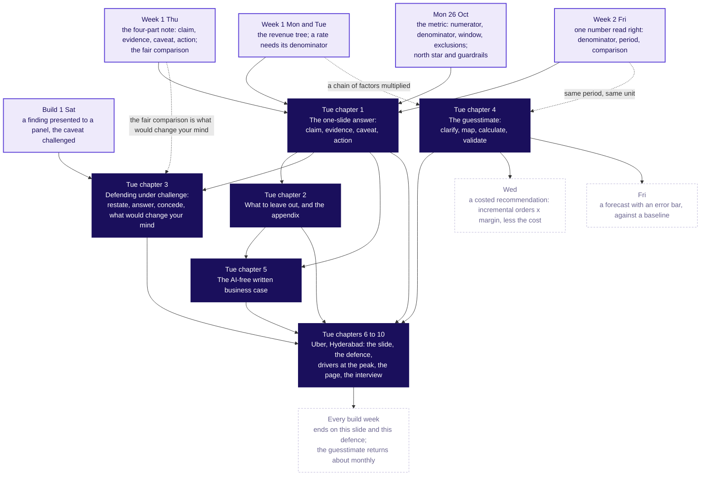

# Week 4 Tuesday (27 October 2026), rebuilt concept-first: the plan

**What this plan is.** A plan only. It edits no repository file. It says how the merged Tuesday pack
(`content/W04/D2`, the Uber Hyderabad case one day on) is reshaped so that the row's five subtopics are
taught first as their own chapters, each from scratch on a simple invented example with its own
notebook, and the Uber chapters that the requester called good follow as the application. The row
(`docs/curriculum/W4_Analyst_craft.md`, lines 109 to 209), the approved spine (`docs/detailing/
W04_analyst_craft_spine.md`, section 6) and the case file (`docs/detailing/W04_case_file.md`, Tuesday)
were read in full, with the Week 1 to 3 rows, `content/W01/D1`, and the seven skills the brief names.

**What stays.** Every Uber number, slide, trap, transcript, role card, exercise and the written case
stay as built; they move later in the day and gain the topic each applies in its title. The ticket
stays on slide one, because the case still leads the day: it poses the question in two minutes, the
day's map then names the five topics a learner needs to answer it, the concept chapters teach those
topics on toys, and the case chapters answer the ticket. That order satisfies the hard rule (a deck
that opens on a topic title was not built from the row) and the requester's ask (the concepts before
the examples).

**What this plan decides, and what it leaves to the requester.** It decides the chapter list, the
toys, the notebook outlines, the minutes and the coverage matrix. It leaves three things to the
requester, listed under section 8: the spine's section 6 sizes (35 and 30 slides, one notebook) no
longer fit and need re-approval; the Kahoot's households item prints eight million where the row says
nine; and the row places the written case "on a short Kalpa brief" where the spine placed it with the
Uber city head.

---

## 1. Coverage now

The row's day focus is **Stakeholder communication**, "One slide, five minutes, three people paid to
disagree; then the first guesstimate". Its subtopics, verbatim, and where the merged pack touches each:

| The row's subtopic, verbatim | Where the merged pack touches it now | The gap |
|---|---|---|
| The one-slide answer: claim, evidence, caveat, action | Half one, SECTION 1 "What is the one claim?": S5 (predict four titles), S6 (the hostel notice board, invented), S7 (the four parts as a mermaid board), then S8 to S18 on Uber's slides A, B and C. Notebook cells 2 to 10 compute the three reads on Uber's rows. | Buried inside the case. The claim gets a toy (the notice board) and the denominator gets one (the auto driver, S14), both after Uber's numbers are on screen. The caveat and the action get no from-scratch entry of their own: the caveat first appears as a trap in chapter 3 and the action only as part of the rebuilt Uber slide. No chapter is named by the topic. |
| What to leave out, and the appendix | Half one, SECTION 3 "What leaves the slide?": S26 (predict), S27 (the appendix drawer), S28 (Amazon's memo), S29 (cut five to two), S30 (close). Exercise `mid_cut_to_two`. | Buried inside the case: the rule (an element supports the claim, or answers a named person's question, or leaves; the caveat never leaves) is stated on Uber's slide with no simple example first. The word appendix is never explained. Amazon's memo sits here though it belongs to the written case. |
| Defending under challenge: restate, answer, concede, what would change your mind | Half one, SECTION 2 "Which objection holds?": S19 to S20 (Uber's three objections), S21 (the four moves as a timeline), S22 (the trap), S23 (the modelled monsoon defence), S24 and S31 (the studio rounds), S25. Exercise `studio_brief`; the role cards. | Covered, case first. The four moves arrive after Uber's objections, with no everyday example (the referee line sits only in the notes). No learner file explains what an objection is, why most are partly right, or why conceding is not losing. |
| The guesstimate: clarify, map, calculate, validate | Half two, SECTION 4 "How big is the unknown?": S33 to S34 (which number checks it; unit, period, definition), S35 (the canteen's tea, invented), S36 (the four steps), S37 to S46 on Uber's drivers at the peak and UPI. Notebook cells 11 to 15. Exercises `mid_check_against`, `paired_estimate`, `kalpa_store`. | The closest to covered: the canteen toy exists and the four steps are named before the case. Still, the chapter opens on Uber (S33 asks about the drivers estimate before any method), the range and its driving factor are taught only on Uber's chain (S39, S40), and the three sanity tests are taught on real published numbers (DMRC, Flipkart) with no toy first. The notebook has no canteen ledger. |
| The AI-free written business case | Half two, SECTION 5 "What goes on one page?": S47 (the four parts in sentences), S48 (the rules). Exercise `written_case` and its model page. | Thin. What a business case is, why it is written in sentences, why one page, why AI-free, and who reads it are stated in two slides with no example page shown before the learner writes one. The Amazon memo, the one piece of evidence for sentences over bullets, sits in chapter 3. No notebook. |

Concepts the agenda, the outcomes, the interview angle or the exercises need that the list leaves
implicit:

| Implicit concept | Where it comes from | Where the pack touches it | The gap |
|---|---|---|---|
| The loser test: a recommendation is communicated when the person who loses under it can repeat it accurately | Column 4, first sentence; the [D] interview line | S3 "a slide its losers can repeat", S4 what each role loses, the day sheet's one-breath answer | Buried: named once on a Uber slide, never taught as the test a learner applies to any slide |
| Answer-first communication (established: Minto's Pyramid Principle) | Column 4 | S6, one sentence | Buried; fine as a one-line attribution once the claim-as-title idea is taught |
| The evidence carries its denominator; the same rupees read three ways | Weeks 1 and 2 (a rate without a denominator is a rumour; a front-page number needs its denominator, period and comparison); Monday's definition line | S13 to S17 on Uber, the auto driver toy on S14 | Covered on the case; needs the toy first |
| The sanity check in the same unit, period and definition | Column 2 ("how an estimate is checked for sanity"); the outcomes ("an estimate that comes out absurd") | S34, S44, S45 | Covered on published numbers; needs a toy per test first |
| The range and the factor that sets it | The outcomes ("size an unknown from stated assumptions"); the interview follow-ups | S39, S40, notebook cell 12 | Covered on Uber only |
| Interviewers score the structure and the sanity check, hardly ever the number | Column 4 | S36, S52 | Covered |
| The two-minute spoken presentation to a non-technical stakeholder | Interview [S] | S49, the interview room, the scorecards | Covered |
| Getting a metric adopted when its loser controls the meeting | Interview [D] | The day sheet's one-breath answer; the notes' table | Thin in learner files; gets one slide in the defence chapter |
| The return question from Monday | Column 15 | Kahoot Q7 (the per-trip scheme's guardrail, the spine's substitution) | Covered |

---

## 2. The concept map

The communication craft and the guesstimate method are two crafts with one root: a number is only
communicated when the person it judges can repeat it, and a number is only trusted when it is checked
against something counted the same way. Both crafts rest on the denominator the room learned in
Week 1, and the guesstimate's map step is the revenue tree's shape (a chain of factors multiplied)
with guesses in place of columns.

The deck's version of this map keeps to nine boxes (the ByteByteGo rule in teaching-styles.md): the
five concept chapters, the Uber application, "Weeks 1 and 2: the denominator and the four-part note",
"Monday: the metric", and "the build weeks and the monthly guesstimate". It is the slide after each
SECTION opener, redrawn with the current chapter lit, so the room always sees which topic it is in.

**The slide a trainer reads the day from (S2, right after the ticket).** Its title is an action title
("Five topics first, then Uber applies them"), its italic subtitle asks "What does Tuesday teach, in
what order, and for how long?", and its body is this table. It avoids the words the meta-content
scanner flags (agenda, learning objectives, how this session runs) and carries only what the standard
already allows: the day's question and its chapters in order, with durations.

| Part | Topic, in the row's words | Minutes | The simple example | Where Uber applies it |
|---|---|---|---|---|
| 1 | The one-slide answer: claim, evidence, caveat, action | 35 | Ramesh's kirana shop and its longer hours (invented) | Chapter 6: slides A, B and C rebuilt; Rs 314 to Rs 260 per peak online hour |
| 2 | What to leave out, and the appendix | 12 | The kirana slide's eight elements and its cluttered chart | Chapter 7: nine numbers to two; one appendix page per role |
| 3 | Defending under challenge: restate, answer, concede, what would change your mind | 25 | A school's attendance claim against the exam objection (invented) | Chapter 7: three objections, each partly right; two studio rounds |
| 4 | The guesstimate: clarify, map, calculate, validate | 30 | The canteen's tea; a town's households; a 28-day phone pack; a pass rate (all invented) | Chapter 8: drivers at the evening peak; UPI in pairs |
| 5 | The AI-free written business case | 10 | Ramesh's one page, four sentences | Chapter 9: one page to the city head, by hand, handed in |
| 6 to 10 | Uber, Hyderabad, one day on (illustrative case) | 200 with the rounds, the drill, the page and the transcripts | | |

---

## 3. Concept chapters, first, about 112 minutes

**The grouping, and why.** One chapter per subtopic, five in all, in the row's order. Chapters 1 to 3
(the communication craft) run in the morning before the Uber slide and defence; chapters 4 and 5
(the guesstimate and the written case) open the afternoon before the Uber estimate and the written
page. Splitting the concept block in two keeps each toy fresh beside the case step that applies it and
keeps the role-played studio inside one block rather than across lunch. The first hour of the morning
is concept teaching, as the requester asked, and the concept minutes total 112, inside the 60 to 120
band.

**The three toys, shared across chapters so the room learns three worlds and not five.** Ramesh's
kirana shop (chapters 1, 2 and 5), a secondary school's attendance (chapter 3, and its pass rate in
chapter 4), and the campus canteen's tea (chapter 4), with a town's households and a 28-day phone pack
for two sanity tests. Every toy is labelled invented where it appears, carries no real company,
school or operator name, sits in the facts file under `toys`, and is written to `data/` by the day's
seeded `make_data_INTERNAL.py` so that the notebooks load it rather than paste it. No toy number
echoes a Uber case number or Monday's Kalpa plant (the kirana shop's per-hour fall is 9.7 percent,
never 17; its per-day rise is 8.3 percent, never 0.8 or 22).

**The slide form every concept chapter follows** (lesson-strategy's grounded unit and the
lesson-architecture unit anatomy, inside the question ladder): the SECTION opener names the topic in
the row's words on its promise line; the chapter map lights the chapter on the nine-box concept map;
the broken default (what goes wrong without the idea); a prediction slide with lettered options and
its answer slide; the skeleton with placeholders; the toy worked through the skeleton with its
numbers; the trap as a plausible wrong number; a rules slide of four complete sentences, no closing
paragraph; and the chapter's check question with its answer. Each SECTION title is a question that
names the topic; its pill stays under 50 characters so the chapter strip on the openers prints
whole.

### Chapter 1. The one-slide answer: claim, evidence, caveat, action

**Deck title.** `SECTION 1: What is the one-slide answer made of?` Promise line: *The one-slide
answer: claim, evidence, caveat, action. One page a decision-maker reads in five minutes, and the
person who loses under it can repeat it.*

**From-scratch entry.** A slide, in a company, is one page shown to people who decide something, for
a few minutes, with other people in the room who gain or lose by the decision (the stakeholders). A
claim is a sentence with a verb that tells the reader what is true and what to do. Evidence is the
number that makes the claim true, written as a numerator over a denominator with its window (Week 1:
a rate without its denominator is a rumour). A caveat is the one thing the evidence cannot show yet.
The action is what to do, what it costs in rupees and weeks, and who signs. The loser test: the slide
has worked when the person who loses under it can repeat it accurately, even while disagreeing.

**The misconception, and the prediction.** "More numbers make a slide more convincing, and a neutral
title keeps the reader fair." Prediction slide: two notices on a hostel board (the pack's own toy,
invented): "Breakfast survey results" against "Rotis replace rice at Monday breakfast, so two staff
move to the roti line." Which one does the warden act on? Then the second prediction, on the kirana
shop: the son says sales rose Rs 1,000 a day; the father says each hour earns less; who is right?
Letters on paper, then the reveal: both are right, and the denominator decides which sentence the
slide carries.

**The teaching example, carried through the chapter (invented).** Ramesh's kirana shop opened two
more hours a day from the start of October. September: ten hours a day, Rs 12,000 of sales a day, 120
customers a day. October: twelve hours a day, Rs 13,000 a day, 130 customers a day. The same rupees
read three ways: per day up 8.3 percent (Rs 12,000 to Rs 13,000); per hour down 9.7 percent (Rs
1,200 to Rs 1,083); per customer flat at Rs 100. The caveat: a festival fortnight fell inside October,
so part of the extra Rs 1,000 a day may be the season. The action: keep the hours one more month,
write the evening's own sales in a separate column, and decide after thirty days; the helper's two
extra hours cost Rs 150 a day; Ramesh signs. The loser: Ramesh's son, who argued for the longer hours
and reads "per day up".

**The structure built from the tiny case, and the worked example.** The skeleton with placeholders,
four lines: [Claim: a sentence with a verb, as the title] / [Evidence: one number = numerator /
denominator, window named, or one chart] / [Caveat: what the evidence cannot show yet, beside the
evidence] / [Action: what, its cost in Rs and weeks, who signs]. Worked for Ramesh: title "The longer
hours add Rs 1,000 a day and earn less per hour, so keep them only if the evening pays for itself";
evidence "sales per hour Rs 1,200 to Rs 1,083, September against October"; caveat "the festival
fortnight fell inside October"; action as above. Then the chart: the shop's 56 days drawn with six
series, a legend and gridlines, then as one line of sales per hour with the change marked and a
sentence as its title (the declutter moves Storytelling with Data describes, T1 in the sources list).
The trap: "sales per day are up Rs 1,000, so the longer hours work" is true to the rupee and would
keep paying two hours of the helper for Rs 1,000 of sales; the check is the per-hour read; the fix is
to name the denominator the decision is priced in.

**Check question (predict, then answer).** Four titles for Ramesh's slide: (a) "Shop sales, October";
(b) "Sales Rs 13,000 a day, up Rs 1,000, 130 customers, 12 hours"; (c) "Longer hours add Rs 1,000 a
day but earn less per hour, so count the evening on its own before deciding"; (d) "Hours update". Which
one acts? Then the design call: the question on the table is whether the two extra hours pay; which
denominator must the evidence name?

**How Uber applies it (chapter 6).** Slide A rebuilt with the room, slides B and C by groups; the
twelve rows read per peak online hour, per driver-week and per trip (Rs 313.5 to Rs 196.2, Rs 3,135
to Rs 2,420, Rs 165 flat); the city's three reads (Rs 314 to Rs 260, Rs 5,817 to Rs 5,861, Rs 165);
the per-driver-week trap; the second route (fare times trips per hour).

**Size.** 12 slides, 35 minutes: opener, map, broken default, two prediction pairs (4), skeleton,
the kirana three reads, the chart pair, the trap, the rules, the check pair (2). Explorer scene T2
(the denominator picker) runs beside the Uber application, never here, since it holds Uber numbers.

### Chapter 2. What to leave out, and the appendix

**Deck title.** `SECTION 2: What to leave out, and where does it go?` Promise line: *What to leave
out, and the appendix: every element either supports the claim, or answers a named person's question
on a page behind the slide, or leaves; the caveat never leaves.*

**From-scratch entry.** An appendix is the set of pages behind the slide that are shown only when
someone asks. Choosing what to leave off the slide is the skill (column 4), and the choice has a
rule: ask of each element, does the claim need it? If yes, it stays. If no, who in the room will ask
about it? It goes to that person's page, headed by their question. If nobody will, it leaves. The
caveat is not an element to route: it stays beside the evidence by rule, because its owner will find
it in the drawer and call the slide dishonest.

**The misconception, and the prediction.** "Put everything in the appendix to be safe, and move the
caveat there because it is a detail." Prediction: the kirana slide's draft carries eight elements
(the sales-per-hour chart, total sales a month, customers a day, rain days, the son's hours worked,
the helper's wage, the festival fortnight, the per-customer line). How many stay? (a) 1, (b) 2,
(c) 4, (d) 8.

**The teaching example (the kirana draft and its chart).** Two stay (the per-hour chart and the
per-customer line, which together say the fall is hours and not customers). The son's page ("did my
extra hours bring customers?") takes customers a day and his hours; the accounts page ("what did the
hours cost?") takes the helper's wage and total sales; rain days leave. The festival fortnight is the
caveat and stays on the slide. The same rule on the chart: five of the six series, the legend, the
gridlines and the border leave; one line and two labels stay.

**The structure.** A three-way sort drawn as a small decision flow: supports the claim, stays; answers
a named question, that person's page; neither, cut; and the caveat's bypass arrow straight to the
slide. Worked on the eight elements as a table with a destination column.

**Check question.** Match four leaving elements to the son's page, the accounts page or cut, with one
spare page; then true or false with its reason: the slide is still crowded after the cut, so the
festival caveat moves to the appendix.

**How Uber applies it (chapter 7).** Nine numbers to two; one appendix page per role headed by the
role's question; the monsoon caveat stays; the cut-to-two drill (`mid_cut_to_two`). Explorer scene
T1 (the declutter) runs there.

**Size.** 6 slides, 12 minutes: opener, map, prediction pair (2), the sort with the kirana table, the
rules with the check question folded in as its last line and answered on the opener of chapter 3's
notes. Amazon's memo moves out of this chapter to chapter 5.

### Chapter 3. Defending under challenge: restate, answer, concede, what would change your mind

**Deck title.** `SECTION 3: How do you defend under challenge?` Promise line: *Defending under
challenge: restate, answer, concede, what would change your mind. An objection is partly right by
nature, and a defence that concedes its true part keeps the claim.*

**From-scratch entry.** An objection is the reason a listener gives for not accepting the claim, and
it usually comes from a number the objector can see. Most objections are partly right, which is why
repeating the claim louder fails. To concede is to say the true part out loud; it is not losing,
because the claim rests on the evidence and survives the objector being right about one part. "What would change your
mind" is the fact that would make you drop the claim, and naming it tells the room the claim can be
tested (Week 1 Thursday's fair comparison, said aloud).

**The misconception, and the prediction.** "A strong presenter never concedes" (the row's Kahoot
trap). Prediction: at a staff meeting a teacher claims the new timetable raised attendance; the sports
teacher objects that attendance rose because the exams began. Which reply wins the headmaster: (a)
the numbers again, louder; (b) withdraw the claim; (c) agree that exam weeks are higher, show that
the rise began three weeks before the exams, and name what would change your mind; (d) ask for
another term of data. Vote, two minutes with a neighbour, revote.

**The teaching example (invented).** A secondary school, eight weeks of attendance this year against
the same eight weeks last year. This year: 82, 83, 86, 88, 89, 93, 94, 95 percent; the timetable
changed from week 3; exams ran in weeks 6 to 8. Last year: 82, 82, 83, 83, 84, 91, 92, 93. The true
part of the objection: exam weeks run about 8 points higher in both years. The evidence that answers
the rest: weeks 3 to 5 this year (86, 88, 89) sit 3 to 5 points above last year's same weeks (83, 83,
84), before any exam. What would change the presenter's mind: a school with the same exam calendar
and no timetable change showing the same rise in weeks 3 to 5.

**The structure, and the worked defence.** The four moves as a strip, each with the sentence it opens
on: "You are saying that..." / "The evidence on line two says..." / "You are right that..." / "I would
change my mind if...". Worked in full for the sports teacher, with the numbers above. Then the two
failures beside it: retreat (the claim withdrawn at the first push) and overclaim (nothing conceded),
with what each costs the school. One more slide for the [D] interview line: when the objector controls
the meeting, concede the true part first, keep their visible number as a leading input, and agree the
test and its deciding result before the meeting.

**Check question.** Which of four replies to the sports teacher is a complete defence (one lacks the
concession, one lacks the evidence line, one retreats)? Then the design call: which of four facts
would rightly change the presenter's mind (only one is measurable and decisive)?

**How Uber applies it (chapter 7).** The three role objections and their true parts (S20), the
modelled monsoon defence (S23), round one and round two of the studio, the scorer's card, the
`studio_brief` exercise.

**Size.** 9 slides, 25 minutes: opener, map, broken default, prediction pair (2), the school's two
lines, the four moves worked, the two failures, the adoption slide, the rules with the check pair
folded (2). The predict slides are quick; the worked defence and the two failures take the minutes.

### Chapter 4. The guesstimate: clarify, map, calculate, validate

**Deck title.** `SECTION 4: How does a guesstimate run?` Promise line: *The guesstimate: clarify, map,
calculate, validate. A number nobody has measured, built from guesses you can defend, given as a
range, and checked against something counted the same way.*

**From-scratch entry.** A guesstimate is a rough count of something nobody has measured, needed
because a decision will not wait for data, and asked in interviews because it shows how a person
thinks. Its words: a factor is one guess in the chain; an assumption is a guess said aloud with its
range; the range is the low and high answer you would still defend; the sanity check is a comparison
with a number someone counted, in the same unit (cups, not litres), the same period (a day, not a
month) and the same definition (who was counted). Interviewers score the structure and the check, and
hardly ever the final number.

**The misconception, and the prediction.** "The answer is what matters." Before any method, the
Rosling move: everyone writes a number for the cups of tea the campus canteen sells on a weekday.
Then the prediction: two candidates answer; one says 2,400 with a chain and a check, the other says
2,150 with no chain; the till says 2,100. Who scores higher? Vote, then the reveal.

**The teaching example, carried through the chapter (the pack's own toy, extended).** Clarify: one
canteen, one weekday, cups and not litres, tea and not coffee. Map: students on campus x the share
who buy tea x cups each. Calculate: 2,000 x 0.6 x 2 = 2,400, the running product said aloud. Validate:
the canteen's till averaged 2,100 cups over five weekdays (invented), so the chain runs 14 percent
high and the share is the factor to revisit (0.52 lands on 2,080). The range, one factor at a time:
students 1,800 to 2,200 give 2,160 to 2,640; the share 0.4 to 0.8 gives 1,600 to 3,200; cups 1.5 to
2.5 give 1,800 to 3,000; the share sets the range, so it is the first guess to replace with a count.
Then the three sanity tests, one toy each: unit (a town of 20,000 people has about 5,000 households,
people divided by about four; the slip multiplies and prints 80,000); period (a 28-day phone pack of
1.5 GB a day is 42 GB, a 30-day month is 45 GB, and the fair comparison is per day, where both read
1.5); definition (the school's pass rate is 80 percent over the 50 who sat and 67 percent over the 60
enrolled, the same 40 passes under two definitions).

**The structure.** The four steps as a strip; the map as a small tree whose root is the product; the
range as a swing chart (each factor's low and high moving the answer); the check as the three-gate
flow (same unit, same period, same definition) the pack already draws on S34.

**Check question.** A candidate says "20,000 people in the town, so 80,000 households; 60 percent buy
tea; so 48,000 cups"; which step was skipped, and what catches it? Then the design call: which known
number checks the canteen's weekday estimate: the till for one weekday, the month's total takings,
the coffee count, or the campus headcount?

**How Uber applies it (chapter 8).** Drivers at the evening peak: clarify (S37), map (S38), calculate
(S39), the swing (S40), validate like for like against the case's 0.53 driver-hours per trip (S41),
the day-over-hour trap (S42), then UPI in pairs against NPCI's 802 million a day (S43, S44) and the
three published traps (S45). Explorer scene T3 runs there.

**Size.** 12 slides, 30 minutes: opener, map, broken default, the Rosling guess and the prediction
pair (3), the four steps on the canteen (2), the range and swing, the till check, the three sanity
toys (1), the trap, the rules with the check pair (2).

### Chapter 5. The AI-free written business case

**Deck title.** `SECTION 5: What goes in the written business case?` Promise line: *The AI-free
written business case: the slide's four parts as four sentences on one page, read in two minutes by
someone who was not in the room, in your own words.*

**From-scratch entry.** A business case is a written argument for a decision: what to do, why, what
it costs, what it returns and what could go wrong. It is written because the people who decide read
it when the presenter is not there, and because a sentence has to carry its reasoning where a bullet
can hide it. Amazon's 2017 letter to shareholders says its meetings use no slides: a six-page memo is
read in silence at the start, and a great memo takes a week or more to write (T1, filed 18 April
2018, checked 12 October 2026). The page is one page because the reader has two minutes. It is
AI-free and by hand because the page is the learner's own thinking, handed in and read by the
trainer, with a five-question checklist and no marks.

**The misconception, and the prediction.** "A business case needs a spreadsheet and ten pages."
Prediction: two openings for Ramesh's page, a bullet list of nine numbers against one claim sentence;
which does the reader act on in two minutes?

**The teaching example (Ramesh's page, four sentences, invented).** "Keep the longer hours for one
more month and count the evening's own sales, because the extra two hours have brought Rs 1,000 a day
while each hour of the day now earns less." / "Sales per hour fell from Rs 1,200 in September to Rs
1,083 in October, and sales per customer held at Rs 100." / "A festival fortnight fell inside October,
so part of the extra Rs 1,000 a day may be the season." / "Keep the hours through the next month,
write the evening's sales in a separate column each day, and decide after thirty days; the helper's
extra two hours cost Rs 150 a day; Ramesh signs."

**The structure.** The page's four parts in order, as sentences; the method words that stay off the
page (denominator, index, guardrail, north star) with the plain words that replace them (divided by;
compared with the weeks before; a number that must not get worse; the one number the team is judged
on); the five-question checklist the written case brief already carries.

**Check question.** Spot the method word in three sentences and pick the rewrite that keeps the
meaning; then the design call: a spreadsheet is attached, so which one thing must still be on the
page itself?

**How Uber applies it (chapter 9).** The page to the city head, 35 minutes, by hand, handed in; the
checklist; three pages read aloud at the close if time allows.

**Size.** 5 slides, 10 minutes: opener, map, the prediction pair (2), Ramesh's page beside the
checklist and the method words, with the rules on the same slide's foot.

---

## 4. Concept notebooks

**The rules every notebook follows.** One notebook per chapter, numbered and titled as the deck's
chapter, the topic in the row's words first in the file name and the title cell; the Week 4 code
rule (pandas, the standard library and matplotlib, a three-line `check(name, ok)` that prints PASS or
FAIL); every toy loaded from `../data/`, written by the seeded `make_data_INTERNAL.py` and listed in
the facts file under `toys`; the MAP, DO, SEE, CHECK, SUM rhythm per section; a MAP cell drawn by
matplotlib as a strip of the chapter's steps with the current one lit, so it renders and counts as a
picture; a **Predict before you run.** cell with lettered options before each code cell that produces a
number; a **What happened.** cell after; at least five passing checks and three pictures; one trap as
a plausible wrong number; a SUM table and `check_summary()` last; executed cold and shipped with
outputs. Every heading is a question.

### 01. `C2_W04_D02_01_one_slide_answer_STUDENT.ipynb` (about 17 cells)

Data: `../data/C2_W04_D02_kirana_days_STUDENT.csv`, 56 rows (day, month, hours_open, customers,
sales_rs, rain_day, festival_day), invented.

| Cell | Kind | What it carries |
|---|---|---|
| 1 | MD | Title: "The one-slide answer: claim, evidence, caveat, action. What makes a slide a reader can act on?" Week 4 Tuesday, concept chapter 1 of 5, before the case. **Who needs the answer.** Ramesh, deciding whether the longer hours stay; his son, who loses if they go. **The questions on the way.** What do the month's totals say and hide? Which chart carries the claim? What do the four parts say for Ramesh? Which read is the trap? The toy introduced and labelled invented. |
| 2 | MD | Setup note: the next cell imports pandas and matplotlib, defines `check`, and loads the 56 days. |
| 3 | CODE | Setup; prints the first rows. |
| 4 | CODE | MAP: the four parts as a strip, claim lit (picture 1). |
| 5 | MD | "What does the month's total say, and what does it hide?" Two to five sentences on the son's claim. **Predict before you run.** By how much did sales a day rise: a) Rs 500, b) Rs 1,000, c) Rs 2,000, d) they fell. |
| 6 | CODE | Group by month: sales, hours and customers a day; the three reads: per day, per hour, per customer; printed as a table. |
| 7 | MD | **What happened.** b. Per day Rs 12,000 to Rs 13,000 (up 8.3 percent); per hour Rs 1,200 to Rs 1,083 (down 9.7 percent); per customer Rs 100 flat. The denominator decides the direction (Week 1's rule restated). |
| 8 | CODE | CHECK: per day rose; per hour fell; per customer equal to the rupee (checks 1 to 3). |
| 9 | MD | "Which chart carries the claim?" **Predict.** Which lets a reader say the claim in five seconds: a) six series with a legend, b) one line with the change marked, c) a table of all 56 days, d) a pie of sales by month. |
| 10 | CODE | The cluttered chart (six series, legend, gridlines, border) and the clear one (sales per hour, one line, the change marked, a sentence title) side by side (pictures 2 and 3). |
| 11 | MD | **What happened.** b. The declutter moves named (fewer series, direct labels, the title as the claim), with the Storytelling with Data page cited and dated. |
| 12 | MD | "What do the four parts say for Ramesh?" The skeleton with placeholders as a table. **Predict.** Which of four titles is a claim (the chapter's check question). |
| 13 | CODE | The four parts assembled as a small table (part, text, what it must carry); CHECK: the title holds an action word from the page's own list; the evidence holds "per" and two rupee figures; the caveat is present; the action names Rs and a signer (checks 4 to 7). |
| 14 | MD | **What happened.** c. The loser test: could the son repeat the title accurately while disagreeing? Yes, because it states his number (Rs 1,000 a day) beside the father's. |
| 15 | MD | "Which read is the trap?" **The plausible wrong answer.** "Sales per day are up Rs 1,000, so the longer hours work." **Why it is wrong.** The rise was bought with two hours of the helper's time; per hour the shop earns 9.7 percent less. |
| 16 | CODE | The trap computed beside its check: the per-day rise and the per-hour fall printed together; CHECK: a claim that rests only on the per-day read is flagged (check 8). |
| 17 | MD + CODE | SUM: a table of what the notebook established (three reads, the chart, the four parts, the loser test), then `check_summary()` and one line: notebook 02 asks what leaves the slide. |

### 02. `C2_W04_D02_02_leave_out_and_appendix_STUDENT.ipynb` (about 12 cells)

Data: `../data/C2_W04_D02_kirana_slide_elements_STUDENT.csv`, 8 rows (element, what_it_shows,
supports_claim, whose_question, is_caveat), and the 56-day file for the chart.

| Cell | Kind | What it carries |
|---|---|---|
| 1 | MD | Title: "What to leave out, and the appendix. Which elements stay on the slide, and where does each of the others go?" Who needs the answer (Ramesh, who reads in five minutes; the son and the accounts, who each look for their own question). The questions on the way. The rule in one sentence. |
| 2, 3 | MD, CODE | Setup; loads both files. |
| 4 | CODE | MAP strip: supports the claim, answers a named question, leaves (picture 1). |
| 5 | MD | "How many of the eight elements stay?" **Predict.** a) 1, b) 2, c) 4, d) 8. |
| 6 | CODE | The routing: a destination column computed from the two flags (stays; the son's page; the accounts page; cut), the caveat bypassed to the slide by rule; printed; a bar of elements per destination (picture 2). |
| 7 | MD | **What happened.** b, two stay. Each page is headed by its owner's question. |
| 8 | CODE | CHECK: exactly two stay; the caveat is on the slide; every leaving element has a page or a cut reason; no page carries more than one question (checks 1 to 4). |
| 9 | MD | "What does leaving out look like on a chart?" **Predict.** How many kinds of ink leave the cluttered chart: a) none, b) the legend only, c) the legend, the gridlines, the border and five series, d) everything. |
| 10 | CODE | The two charts redrawn; a count of lines, text labels and gridlines on each (picture 3); CHECK: the clear chart has one line and under four text labels (check 5). |
| 11 | MD + CODE | "What goes wrong when the caveat goes to the drawer?" **The plausible wrong answer.** The slide with the festival line removed to make room. **Why it is wrong.** The son finds it on the accounts page and says the slide hid the season. CHECK: the caveat flag is on the slide (check 6). |
| 12 | MD + CODE | SUM table; `check_summary()`; notebook 03 defends the slide. |

### 03. `C2_W04_D02_03_defending_under_challenge_STUDENT.ipynb` (about 14 cells)

Data: `../data/C2_W04_D02_school_attendance_STUDENT.csv`, 16 rows (year, week, attendance_pct,
exam_week, timetable_changed), invented.

| Cell | Kind | What it carries |
|---|---|---|
| 1 | MD | Title: "Defending under challenge: restate, answer, concede, what would change your mind. How do you answer an objection that is partly right?" Who needs the answer (the teacher whose claim is challenged; the headmaster who decides whether the timetable stays). The questions on the way. |
| 2, 3 | MD, CODE | Setup; loads the file. |
| 4 | CODE | MAP strip: restate, answer, concede, change my mind (picture 1). |
| 5 | MD | "How much of the rise do the exam weeks explain?" **Predict.** a) all, b) most, c) some, d) none. |
| 6 | CODE | Means for weeks 1 to 2, 3 to 5 and 6 to 8 in each year; the exam lift in each year; the pre-exam rise over last year; the two lines by week with the change and the exams marked (picture 2). |
| 7 | MD | **What happened.** c, some: exam weeks lift about 8 points in both years (the true part); weeks 3 to 5 sit 3 to 5 points above last year's before any exam (the evidence for the rest). |
| 8 | CODE | CHECK: last year's exam lift about 8; this year's about 8; the pre-exam rise above zero; the rise starts in the week the timetable changed (checks 1 to 4). |
| 9 | MD | "How big would the exam effect have to be to explain the whole rise?" **Predict.** a) about 8 points, as it is, b) about 12, c) about 20, d) it already does. |
| 10 | CODE | The rise split into the part exams explain and the remainder as the exam lift varies; a line chart of the remainder (picture 3); CHECK: at the observed lift the remainder is positive (check 5). |
| 11 | CODE | The four moves composed as text from the numbers; CHECK: the concession carries the exam-lift figure; the "change my mind" line names a measurable fact from the data (checks 6 and 7). |
| 12 | MD | "What do the two failing defences cost?" **The plausible wrong answer.** "Exams are irrelevant; the timetable did it" (concedes nothing) and "You may be right; let us wait a term" (concedes everything). **Why each is wrong,** with the cost to the school. The check: the defence names the true part and the evidence line, in that order. |
| 13 | MD + CODE | SUM table; `check_summary()`; notebook 04 sizes a number from nothing. |

### 04. `C2_W04_D02_04_guesstimate_STUDENT.ipynb` (about 17 cells)

Data: `../data/C2_W04_D02_canteen_ledger_STUDENT.csv` (factor, central, low, high, unit, why) and
`../data/C2_W04_D02_canteen_till_STUDENT.csv` (five weekdays of cups sold), both invented.

| Cell | Kind | What it carries |
|---|---|---|
| 1 | MD | Title: "The guesstimate: clarify, map, calculate, validate. How do you size a number nobody has measured, and know it is sane?" Who needs the answer (the canteen head ordering milk for a weekday; an interviewer). The questions on the way. |
| 2, 3 | MD, CODE | Setup; loads both files. |
| 4 | CODE | MAP strip: the four steps, clarify lit (picture 1). |
| 5 | MD | "What exactly is being counted?" The clarify table (one canteen, one weekday, cups, tea). **Predict.** The product: a) 1,200, b) 2,400, c) 4,000, d) 24,000. |
| 6 | CODE | Calculate: the running product printed step by step and drawn as bars (picture 2). |
| 7 | MD | **What happened.** b, 2,400 cups; the units chain (students x share x cups = cups). |
| 8 | CODE | CHECK: the product is 2,400; the unit column multiplies out to cups (checks 1 and 2). |
| 9 | MD | "Which factor sets the range?" **Predict.** a) students, b) the share who buy, c) cups each, d) all equally. |
| 10 | CODE | One factor at a time; the swing chart (picture 3); CHECK: the share gives the widest range (check 3). |
| 11 | MD | "Is 2,400 sane against the till?" **Predict.** The till's weekday average: a) under 1,500, b) about 2,100, c) about 2,400, d) over 3,000. |
| 12 | CODE | The till's mean, the gap in percent, the share that would land on it; CHECK: the gap is about 14 percent; the revisited share is about 0.52 (checks 4 and 5). |
| 13 | MD | "Which three tests does a check have to pass?" The unit, period and definition toys stated. |
| 14 | CODE | Households from 20,000 people; GB per day under a 28-day pack and a 30-day month; the pass rate under two definitions; CHECK: households are people divided by about four and never exceed people; per-day data is equal under both periods; the two pass rates differ and the right one is the one whose denominator the question names (checks 6 to 8). |
| 15 | MD | "What does the plausible wrong number look like?" **The plausible wrong answer.** 20,000 x 4 = 80,000 households, a market sixteen times too large. **Why it is wrong.** The unit was multiplied where it should have been divided; the check is that households never exceed people. |
| 16 | MD | How the same four steps size Uber's drivers at the peak in notebook 08, in two sentences, with no Uber number printed here. |
| 17 | MD + CODE | SUM table; `check_summary()`; notebook 05 turns four parts into one page. |

### 05. `C2_W04_D02_05_written_business_case_STUDENT.ipynb` (about 11 cells)

Data: `../data/C2_W04_D02_kirana_page_STUDENT.txt`, two versions of Ramesh's page (the bullet draft
of nine numbers; the four-sentence page), separated by a marker line, invented.

| Cell | Kind | What it carries |
|---|---|---|
| 1 | MD | Title: "The AI-free written business case. What must one page carry so a reader acts on it in two minutes?" Who needs the answer (Ramesh, reading alone; the trainer reading thirty-five pages). The questions on the way. |
| 2, 3 | MD, CODE | Setup; loads both versions. |
| 4 | CODE | MAP strip: claim, number, caveat, action as sentences (picture 1). |
| 5 | MD | "Which version does the reader act on?" **Predict.** a) the bullets, since they carry more numbers, b) the sentences, c) neither without a chart, d) both equally. |
| 6 | CODE | Sentences, words and numbers per version; the method-word scan (denominator, index, guardrail, north star, numerator) on each; a bar of numbers and method words per version (picture 2). |
| 7 | MD | **What happened.** b: four sentences, one number with its denominator, zero method words, against nine numbers and no claim. |
| 8 | CODE | CHECK: the first sentence holds an action word; the second holds "per" and two rupee figures; the caveat sits before the action; the action names Rs and a signer; zero method words; under the pack's own ceiling of 250 words, labelled as the pack's rule (checks 1 to 6). |
| 9 | MD + CODE | "What goes wrong when the caveat is a bracket at the end?" **The plausible wrong page.** The caveat as "(festival month)" after the action. **Why it is wrong.** The reader meets the action before the doubt. A strip of where each part sits on the page (picture 3); CHECK: the caveat precedes the action (check 7). |
| 10 | MD + CODE | "Does your own page pass?" The lines to type: paste your four sentences into `my_page` and run the checker. The code cell ships empty, so the learner's page is the first thing it ever checks. |
| 11 | MD + CODE | SUM table; `check_summary()`; notebooks 06 to 08 apply the five topics to Uber, Hyderabad. |

### The case notebooks, renamed and numbered after the concept notebooks

| New file | What it holds | Pairs with | Change from the merged pack |
|---|---|---|---|
| `C2_W04_D02_06_uber_slide_three_denominators_STUDENT.ipynb` | The merged notebook's cells 1 to 10: the twelve rows read three ways, the city's three reads and the hours per driver-week, the joiners, the cluttered chart and its makeover | SECTION 6 | A new title cell naming the topics it applies (the one-slide answer; what to leave out) and the ticket; one picture added (the twelve rows' three reads as paired bars), since this half carries ten checks and two pictures; the cell that said "the day's one notebook (chapters 1 and 4)" rewritten |
| `C2_W04_D02_07_uber_defence_evidence_STUDENT.ipynb` (new, about 12 cells) | Each objection's true part and the evidence line that answers the rest, computed: weekly rider requests from `twelve_weeks` (the last three after weeks, 41,161 to 42,602, inside the before range 41,155 to 42,719) with trips per hour still 1.56; the drivers there before the launch against the 140 joiners from `driver_groups` (1.90 trips an hour both windows; Rs 4,314 a driver-week); the idle tail's hours, 20,000 to 42,000, from a row `make_data_INTERNAL.py` adds to `driver_groups`. Three pictures (requests by week with the before range as a band; trips per hour by week; idle-tail hours against the rest); six checks | SECTION 7 | New, so that the chapter with the studio also has the code-along that proves its evidence lines (Krish Naik's move); every number already sits in the facts file |
| `C2_W04_D02_08_uber_drivers_at_peak_STUDENT.ipynb` | The merged notebook's cells 11 to 15: the ledger, the chain on every version of the ledger, the swing, the like-for-like check and the per-day check | SECTION 8 | A new title cell naming the topic it applies (the guesstimate: clarify, map, calculate, validate); two pictures added (the running product as bars; the like-for-like check as paired bars), since this half carries five checks and one picture |
| `C2_W04_D02_09_kalpa_store_estimate_STUDENT.ipynb` (the lab, about 10 cells) | Anand's new-store chain with its ranges, the swing, and the DMart check from `kalpa_dmart_anchor` (about Rs 146 crore a store on the average count), the first-year catch | The TA lab | New, built from the lab set's solution, which already prints the worked chain; no plant today; the v2.3 proposal is named only in TRAINER and INTERNAL files |

The lab set's Parsons problem, which names "the notebook's second code cell", points at notebook 06.
The Wednesday pre-read's "run Tuesday's notebook" line names notebooks 01 to 08.

---

## 5. The case chapters

The Uber material keeps every slide and number. Each case chapter is retitled so a trainer sees the
topic it applies, each case step is tagged with the concept chapter it draws on, and the trims below
are the slides that moved into the concept chapters, where they now teach on a toy.

### SECTION 6: Which number carries Uber's slide? (35 minutes; applies chapters 1 and 2)

Promise line: *The one-slide answer applied: Uber's slides A, B and C rebuilt to one claim, one
number with its denominator, the caveat in sight and the action with its cost.*

| Case step, as built | Applies | Keep, move or trim |
|---|---|---|
| S4, each role loses one thing it can point to (the groups list the losses) | Chapter 1, the loser test | Keep, as the case's opening slide after the break (6 minutes, down from 10, since the loser test is now taught) |
| S5, predict which of four titles acts; S6, the hostel notice board | Chapter 1 | Move into chapter 1 as its first prediction pair |
| S7, one slide carries four parts | Chapter 1 | Move into chapter 1 as the skeleton slide |
| S8 to S10, slide A rebuilt with the room | Chapter 1 (the four parts), chapter 2 (nine numbers to two) | Keep |
| S11, S12, slides B and C rebuilt by groups (half worked, then blank) | Chapter 1 | Keep |
| S13, the twelve rows read three ways | Chapter 1 (the denominator) | Keep; its title gains the topic: "Three denominators, three verdicts on twelve rows" |
| S14, S15, predict and answer why the city's per-driver-week rises; the auto driver toy | Chapter 1 | Keep the Uber prediction; the auto driver toy moves to chapter 1's notes as a second example, since the kirana shop now carries the lesson |
| S16, the trap: "per driver-week is up, so it works" | Chapter 1's trap, on the case | Keep |
| S17, the second route: fare times trips per hour | Chapter 1 | Keep |
| S18, chapter close | | Keep; its map now lights "the one-slide answer, applied" |

### SECTION 7: Which Uber objection is partly right? (40 minutes, then 12 for the drawer, then round two's 20 after lunch; applies chapters 3 and 2)

Promise line: *Defending under challenge applied: three roles, each partly right; the four moves in
two studio rounds; the appendix drawer with one page per role.*

| Case step, as built | Applies | Keep, move or trim |
|---|---|---|
| S19, S20, predict which role the city head sides with; each objection is partly right | Chapter 3 | Keep |
| S21, a defence runs in four moves; S22, the trap: conceding nothing or everything | Chapter 3 | Move into chapter 3, where the school carries them; S21's timeline returns in SECTION 7 as the scorer's card slide (one slide, half a minute) |
| S23, the monsoon objection answered in four moves | Chapter 3 | Keep, the trainer's modelled defence |
| S24, round one; S25, retreat and overclaim | Chapter 3 | Keep round one (23 minutes); S25 becomes one line in S24's notes, since the two failures are taught in chapter 3 |
| S26, S27, predict what belongs in the appendix; the drawer | Chapter 2 | Keep (the drawer, 12 minutes with the drill); title gains the topic: "What leaves Uber's slide, and whose page takes it" |
| S28, Amazon's six-page memo | Chapter 5 | Move to chapter 5 |
| S29, cut five elements to two (the mid-session drill) | Chapter 2 | Keep |
| S30, chapter close | | Keep |
| S31, round two with the seats swapped | Chapter 3 | Keep, at 20 minutes after lunch: two turns of seven and six to rebuild; the two groups presenting to the room move to the close if the slack allows |
| S32, where the morning ends | | Keep, retitled "Three topics applied: the claim, the drawer, the four moves" |

### SECTION 8: How many drivers does Uber's peak need? (25 minutes, then UPI in pairs 12; applies chapter 4)

Promise line: *The guesstimate applied: drivers online at the weekday evening peak, clarified,
mapped, calculated, given as a range and checked like for like against the case's own data.*

| Case step, as built | Applies | Keep, move or trim |
|---|---|---|
| S33, S34, which number would check this estimate; unit, period, definition | Chapter 4, validate | Keep S33 as the chapter's prediction (the Uber version of chapter 4's check question); S34's three-gate flow moves to chapter 4 and S34 keeps its answer in one line |
| S35, the canteen's tea; S36, the four steps | Chapter 4 | Move into chapter 4, where they are the chapter's spine |
| S37 to S41, clarify, map, calculate aloud, the swing, validate like for like | Chapter 4, all four steps | Keep; titles gain the step and the topic ("Map: drivers at the peak as a chain of factors") |
| S42, the trap: a day's trips divided by an hour's | Chapter 4's trap on the case | Keep |
| S43, S44, UPI in pairs and the NPCI check | Chapter 4, validate (period) | Keep at 12 minutes: three to set up, seven on the clock, two to read three pairs' sheets against 802 million |
| S45, three traps a sanity check catches (DMRC, Flipkart, the households) | Chapter 4, the three tests | Keep as the published versions of chapter 4's three toys; the households line prints the row's nine million (see section 8) |
| S46, chapter close | | Keep |

### SECTION 9: What goes on the page to the city head? (35 minutes; applies chapter 5)

S47 and S48 stay as the brief and the rules, retitled "The written business case applied: one page to
the city head". The writing runs 35 minutes, the row's own figure, by hand, handed in.

### SECTION 10: What does it sound like in an interview? (12 minutes; L6)

S49 (transcript 1) runs in pairs with its three follow-ups; S50 (the drivers estimate) and S51 (the AI
variant) are read from `extras/` with the scorecard as the evening's reading, since the day now carries
112 minutes of concept teaching; S52 (the scorecard) stays. S53 (pain points) folds into the close as
one line each.

---

## 6. Trainer and learner artefacts

### The day sheet's topic list, mapped to the row's trainer agenda

The day sheet's ladder table is replaced by a topic table a trainer can read in one glance. Every
row's agenda item keeps its minutes or grows them; nothing in the row is dropped.

| The row's agenda item (its minutes) | Where it runs in the rebuilt day | Minutes | Slides | Notebook | Exercise |
|---|---|---|---|---|---|
| 1. Meera's terms for Thursday; what each head loses (15) | S1 to S3 (the ticket, the day's topics, the concept map) and S4 (the losses, after the break); the loser test taught in chapter 1 | 5 + 6 | S1 to S4 | | |
| 2. The one-slide answer; three cluttered slides rebuilt (45) | SECTION 1 (the kirana shop) then SECTION 6 (Uber's slides A, B, C) | 35 + 35 | 12 + 10 | 01, 06 | ch1 set; `guided/slide_and_estimate` Q1 and Q2 |
| 3. Defending under challenge; two rounds in threes (60) | SECTION 3 (the school) then SECTION 7 (Uber's three roles, round one) and round two after lunch | 25 + 40 + 20 | 9 + 9 | 03, 07 | ch3 set; `studio_brief` |
| 4. What to leave out; the appendix (20) | SECTION 2 (the kirana draft) then the drawer and the cut-to-two drill inside SECTION 7 | 12 + 12 | 6 + 3 | 02 | ch2 set; `mid_cut_to_two` |
| 5. The first guesstimate; a second in pairs with the sanity check required (45) | SECTION 4 (the canteen and the three tests) then SECTION 8 (drivers at the peak; UPI in pairs) | 30 + 25 + 12 | 12 + 11 | 04, 08 | ch4 set; `guided/slide_and_estimate` Q3; `paired_estimate`; `mid_check_against` |
| 6. The AI-free business case, individual and written (35) | SECTION 5 (Ramesh's page) then SECTION 9 (the page to the city head) | 10 + 35 | 5 + 2 | 05 | ch5 set; `written_case` |
| 7. Kahoot and close; Wednesday's pre-read ships tonight (20) | SECTION 10 (the interview room, the spine's addition) and the close | 12 + 20 | 4 + 3 | | `interview_rungs`; the Kahoot pack |
| The TA lab (the row's lab) | The Kalpa north-star slide to a TA; Anand's store sized against DMart; the ladder P1 to P5 | the lab's length | | 09 | `kalpa_slide_template`, `kalpa_store`, `lab_set` |

### The deck's two opening slides after the ticket

**S2, the day's topics (the table in section 2).** Action title "Five topics first, then Uber applies
them"; subtitle "What does Tuesday teach, in what order, and for how long?"; the six-row table; notes:
read the five topics aloud, say that each gets a simple example and its own notebook before Uber,
and that the Uber slides the room builds at the end are the same ones the city head will take to the
review.

**S3, the concept map.** Action title "Two crafts, one root: a number the loser can repeat"; subtitle
"How do today's five topics connect to Weeks 1 to 3, to Monday and to the rest of Week 4?"; the
nine-box mermaid; notes: point at the Week 1 four-part note (today puts it on one slide), the
denominator (today's evidence), Monday's metric (today's slide carries it), and the revenue tree
(today's guesstimate map has its shape). This slide returns after every SECTION opener with the
current chapter lit.

The deck header line becomes `WEEK 4 · DAY 2 · STAKEHOLDER COMMUNICATION · UBER, HYDERABAD, AN
ILLUSTRATIVE CASE`, so every slide names the day's topic and keeps the case's label.

### Exercise items per concept

One short set per concept chapter, sat on the toy right after the chapter and before the case,
answered as one letter string; the existing Uber sets stay and are re-indexed under the case chapters.
Devices rotate across the five sets (the exercise-builder wheel): multiple choice, a match with a
spare, a reorder, a true-or-false with its reason, arithmetic on the artefact, spot the skipped step.
Of the 20 new items, 9 are design items; with the 14 existing items (8 design), the day holds 34 items
and 17 design items, half the day.

| Set and file | Items | Design items | The items |
|---|---|---|---|
| ch1, `unguided/C2_W04_D02_ch1_one_slide_answer_STUDENT.md` | 5 | 3 | Q1 which of four kirana titles acts (L1). Q2 design: the question is whether the two extra hours pay; which denominator must the evidence name (per day, per hour, per customer, per helper-rupee). Q3 which of four sentences is the caveat. Q4 design: which of four action lines could Ramesh sign (only one carries cost, duration and signer). Q5 design, the loser test: which claim sentence could the son repeat accurately while disagreeing. |
| ch2, `unguided/C2_W04_D02_ch2_leave_out_appendix_STUDENT.md` | 3 | 2 | Q1 which two of six elements stay. Q2 design: match four leaving elements to the son's page, the accounts page or cut, with one spare page. Q3 design, judged with its reason: the slide is still crowded after the cut, so the festival caveat moves to the appendix (false, with the reason). |
| ch3, `unguided/C2_W04_D02_ch3_defending_STUDENT.md` | 4 | 1 | Q1 which of four replies to the sports teacher is a complete defence. Q2 arithmetic: by how many points did weeks 3 to 5 rise over last year's same weeks before any exam. Q3 design: which of four facts would rightly change the presenter's mind. Q4 reorder the four moves from a scrambled transcript. |
| ch4, `unguided/C2_W04_D02_ch4_guesstimate_STUDENT.md` | 5 | 2 | Q1 spot the skipped step in a candidate's chain. Q2 arithmetic: the canteen's cups when the share moves to 0.8. Q3 design: which factor would you replace with a count first, and with which count. Q4 design: which known number checks the canteen's weekday estimate (the till for one weekday; the month's takings; the coffee count; the headcount). Q5 a town of 20,000 people given 80,000 households: what went wrong. |
| ch5, `unguided/C2_W04_D02_ch5_written_case_STUDENT.md` | 3 | 1 | Q1 which of four openings is the claim. Q2 which sentence holds a method word, and which plain rewrite keeps its meaning. Q3 design: a spreadsheet is attached; which one thing must still be on the page itself. |
| The existing Uber and Kalpa sets | 14 | 8 | `guided/slide_and_estimate` (SECTIONS 6 and 8), `mid_cut_to_two` (SECTION 7's drawer), `studio_brief` (SECTION 7), `mid_check_against` (SECTION 8 or the lab), `paired_estimate` (SECTION 8), `written_case` (SECTION 9), `interview_rungs` (SECTION 10), `kalpa_store`, `kalpa_slide_template`, `lab_set` (the lab) |

The index file gains a column naming the concept chapter each set practises, and the Kahoot's old Q8
(the month's total over the wrong number of days) becomes ch4's sixth item if the set has the minutes,
or stays in the lab set.

### Kahoot items per concept (eight items, the row's five kept)

| Item | Concept | Source |
|---|---|---|
| Q1 the four parts of the one-slide answer, in order | Chapter 1 | The row's Q1, as built |
| Q2 keep or cut: six slide elements | Chapter 2 | The row's Q2, as built |
| Q3 trap: the best defence never concedes anything, true or false | Chapter 3 | The row's Q3, as built |
| Q4 the four steps of a guesstimate, in order | Chapter 4 | The row's Q4, as built |
| Q5 a city of two million people given nine million households; what went wrong and what would have caught it | Chapter 4, the unit test | The row's Q5; the number returns to the row's nine million (see section 8) |
| Q6 a day's trips divided by an hour's rate (invented numbers) | Chapter 4's trap, applied in chapter 8 | As built |
| Q7 the return question from Monday: the guardrail for a scheme that pays per trip | Monday | As built (the spine's substitution of the row's cross-sell wording, approved on 12 October 2026) |
| Q8 which of four openings of a one-page case is the claim | Chapter 5 | New; replaces the built Q8 (the 31-day month), which moves to the ch4 exercise set |

### Study-note and cheat-sheet sections named by topic

**Study notes** (`study-notes/C2_W04_D02_notes_STUDENT.md`), section headings in order, each a question
that names its topic, each opening on **Who needs the answer.** and **The questions on the way.**:
What can you do now that you could not this morning? / Where does Tuesday sit (the concept map)? /
The one-slide answer: what are claim, evidence, caveat and action, and why in that order? (Ramesh's
shop, then Uber's Rs 314 to Rs 260) / What to leave out, and the appendix: where does each element
go? / Defending under challenge: how do restate, answer, concede and what would change your mind
answer an objection that is partly right? (the school, then the monsoon) / The guesstimate: how do
clarify, map, calculate and validate size a number nobody measured? (the canteen, then drivers at the
peak) / The AI-free written business case: what must one page carry? / Where does this show up in the
work? / Can you answer these without writing? / Where does this get tested (the interview table)? /
Which words did today use? / Where next, in what order? The notes grow from about 2,000 words to
about 3,000.

**Cheat sheet** (`cheatsheets/C2_W04_D02_one_slide_STUDENT.md`, rebuilt by `build_cheatsheet.py`), one
panel per topic, each with the toy's worked micro-example beside the rule and the Uber numbers in one
line beneath: Panel 1, the day's picture, the four-part skeleton with its placeholders (the same
drawing the deck's skeleton slide and notebook 01's MAP use), crux "A slide carries one claim, one
number with its denominator, the caveat in sight and the action with its cost"; Panel 2, the one-slide
answer, the kirana shop's three reads (per day up 8.3, per hour down 9.7, per customer flat) beside
Uber's three; Panel 3, what to leave out and the appendix, the three-way sort; Panel 4, defending
under challenge, the four moves with the school's sentences; Panel 5, the guesstimate, the canteen's
chain, its range and the till check; Panel 6, the sanity check's three tests with the three toys and
the three published traps. The word strip at the foot keeps the notes' term table.

---

## 7. Minutes

**The envelope.** Tuesday 27 October 2026 is a teaching day posting to Module 2 with no IITGN faculty
block (`docs/programme/calendar.md`, W04/D2), so the trainer holds both 180-minute blocks and the TA
lab follows (`facts.yaml`, `campus_day`). The row's agenda sums to 240 minutes; the spine filled the
other 120 with round two, the memo discussion, the transcripts, the gallery and a longer written
case. The rebuilt day spends 112 of its 360 minutes on the five concept chapters.

| Block | Minutes | What runs |
|---|---|---|
| Morning | 5 | S1 the ticket, S2 the day's topics, S3 the concept map |
| | 35 | SECTION 1, the one-slide answer (Ramesh's kirana shop) |
| | 12 | SECTION 2, what to leave out, and the appendix (the kirana draft and its chart) |
| | 25 | SECTION 3, defending under challenge (the school's attendance) |
| | 10 | Break |
| | 6 | S4, what each Uber role loses |
| | 35 | SECTION 6, Uber's slide: A rebuilt with the room, B and C by groups, the twelve rows three ways, the trap, the second route |
| | 40 | SECTION 7, Uber's defence: the prediction, the true parts, the modelled defence, round one (23) |
| | 12 | SECTION 7 continued: the appendix drawer and the cut-to-two drill |
| Afternoon | 20 | Round two of the studio: two turns of seven, six to rebuild |
| | 30 | SECTION 4, the guesstimate (the canteen's tea; the town, the phone pack, the pass rate) |
| | 10 | SECTION 5, the AI-free written business case (Ramesh's page; Amazon's memo) |
| | 25 | SECTION 8, Uber's drivers at the peak: clarify, map, calculate, the swing, validate, the trap |
| | 12 | UPI in pairs: seven on the clock, the check against 802 million |
| | 10 | Break |
| | 35 | SECTION 9, the written case to the city head, by hand, handed in |
| | 12 | SECTION 10, transcript 1 in pairs; transcripts 2 and 3 assigned with the scorecard |
| | 20 | The close: the Kahoot's eight items, the pain points in one line each, the day's sentence, the handoff; Wednesday's pre-read ships tonight |
| | 6 | Slack: three handed-in pages read aloud if the clock allows |
| Lab | the lab's length | The Kalpa north-star slide to a TA playing one head; Anand's store sized against DMart (notebook 09); the ladder P1 to P5 and the Parsons problem |

**What moves, against the merged pack.** The gallery (15 minutes) is cut, the spine's own first cut.
Round two falls from 40 to 20 minutes (two turns in place of three, the day sheet's own fallback).
The transcripts fall from 25 to 12, with two of the three read in the evening from `extras/`. The
paired UPI drill falls from 25 to 12 (the row's own cut-first item kept in a shorter form). Uber's
slide chapter falls from 45 to 35 and its defence chapter from 50 to 40, because the four parts, the
denominator and the four moves are taught before the case; the drawer falls from 20 to 12 as Amazon's
memo moves to chapter 5; the dojo falls from 65 to 37 as the canteen, the four steps and the three
tests move to chapter 4. The written case returns to the row's 35 minutes and the Kahoot and close to
the row's 20. The opening falls from 15 to 11, since the losses are listed faster once the loser test
has been taught. Those savings (about 130 minutes) pay for the 112 concept minutes and six minutes of
slack. Deck sizes grow: half one from 35 to about 48 slides, half two from 30 to about 38, which the
spine's section 6 sizes do not allow and section 8 flags. If the day runs long, the cut order is the
slack, then round two's rebuild minutes, then the UPI drill, then the transcripts; never a concept
chapter, the role-played defence or the written case.

---

## 8. Guards

### Facts the build must not invent

- **Dates and slots** come from `docs/programme/calendar.md` (Tue 27 Oct 2026, teaching, Module 2,
  no faculty block) and Monday's case (the launch on 31 August 2026; the windows 20 July to 30 August
  and 31 August to 11 October). No clock time anywhere in lesson material; durations only.
- **Every Uber number** stays as the facts file (`internal/C2_W04_D02_facts_INTERNAL.yaml`) and
  `make_data_INTERNAL.py` have it; a notebook value that disagrees with the facts file stops the
  build. No published count of Uber drivers online at Hyderabad's evening peak exists in the sources
  list; that slot reads "to be found" in every file.
- **Public facts** come only from the sources list with their check dates, re-checked on the build
  day: NPCI through Outlook Money (802 million a day; 24.07 billion in September 2026), Flipkart (6.3
  million concurrent users, the 63 in the web address), DMart (Rs 66,968 crore; 500 stores; 85 added;
  10.8 percent), DMRC (64.06 lakh a day; 82,44,903 on 17 September 2026; the 2018 line-utilisation
  count), Amazon's 2017 letter (no slides, a six-page memo read in silence, a week or more to write,
  and nothing about fifteen minutes), Barbara Minto's page (a pyramid under a single point),
  Storytelling with Data's declutter and Big Idea pages, Aced's line on the estimation framework, and
  the Copilot study (arXiv 2205.06537). Think Insights, Management Consulted and IGotAnOffer are not
  used (403 or not fetched on 12 October 2026); the four steps stay as the row's method with no
  attribution beyond the row.
- **The toys are invented and say so** wherever they appear: Ramesh's kirana shop, the secondary
  school, the campus canteen's tea and its till, the town of 20,000 people, the 28-day phone pack,
  the hostel notice board. No real shop, school, operator or canteen is named. Every toy number sits
  in the facts file under `toys` and in `data/` from the seeded script, with no randomness or a fixed
  seed. No toy value echoes a Uber case value (17 percent, 0.8 percent, Rs 165, 5,700) or a Kalpa
  plant (Monday's 22 percent and 4 percent). The households toy (20,000 people) differs from the
  Kahoot's (two million), so the Kahoot still tests.
- **No reading-speed figure** is stated; "one page" and "two minutes" come from the row and the
  spine. The 250-word ceiling in notebook 05 is labelled the pack's own rule.
- **Kalpa:** no plant today (the row's client-zero column, v4 as on Monday). Anand's new-store question
  and the three Kalpa role cards are proposed for client zero v2.3 (the row, 21 September 2026, not
  locked), so TRAINER and INTERNAL files say "proposed" and STUDENT files state neither the question's
  status nor any v2.3 fact. Monday's Kalpa plant (the auto-reorders) stays unnamed in every Tuesday
  file. Kalpa's fictional stakeholders (Meera Raghavan, Anand Iyer) are named; every other person is a
  role label.
- **Marks and rubrics:** the written case is handed in and read against a five-question checklist;
  no mark, weight or grade appears, and no rubric is stated (`facts.yaml`, `evaluation`).
- **Interview tags** print with the calibration line wherever they appear, as questions only; the
  answers live in the day sheet and the notes and are never copied into the row.
- **The deck must still pass `deck_md_check.py`:** every `## ` heading is `S{n}.`, `D{n}.` or a SECTION
  opener; every question slide has its answer slide next; titles stay under 54 characters; every body
  slide carries a notes fence and an italic subtitle; no slide uses the meta words (agenda, learning
  objectives, how this session runs, this deck, the previous slide). The topics slide and the concept
  map are therefore titled as action titles with question subtitles.
- **Three items for the requester.** (1) The spine's section 6 sets half one at 35 slides, half two at
  30 and one notebook of 12 to 15 cells; the rebuilt day runs about 48 and 38 slides and nine
  notebooks, so the orchestrating session needs the requester's yes to amend section 6 and the
  artefacts table, and to record the concept-first instruction as a decision in `facts.yaml`. (2) The
  row's Kahoot Q5 says nine million households and the spine's ladder says nine; the merged deck (S45)
  and Kahoot print eight; the rebuild should return to nine, and the Saturday paper's Q13 (eight
  million, its own item) stays as merged. (3) The row places the written case "on a short Kalpa brief";
  the approved spine placed it with the Uber city head, and the spine outranks the row where they
  differ, so the plan keeps the city head and names the Kalpa brief as a lab option only.
- **The build session edits no detailing document, opens no pull request and never pushes to main;**
  it works on `w04-d2`, runs `python3 scripts/verify.py content/W04/D2` with `--execute`, and reports.

### The coverage matrix

Each row proves the day covers its subtopic: the row's words, the chapter that teaches it, the slides,
the notebook, the exercise items and the Kahoot items.

| Subtopic, verbatim from the row | Chapter title (deck SECTION) | Slides | Notebook | Exercise items | Kahoot items |
|---|---|---|---|---|---|
| The one-slide answer: claim, evidence, caveat, action | SECTION 1: What is the one-slide answer made of? Applied in SECTION 6: Which number carries Uber's slide? | 12 concept slides (the notice board, the kirana shop's three reads, the skeleton, the chart pair, the trap, the rules) + 10 case slides (S4, S8 to S18) | 01 one_slide_answer; 06 uber_slide_three_denominators | ch1 Q1 to Q5 (3 design); `guided/slide_and_estimate` Q1, Q2; `kalpa_slide_template`; lab P1, P2, P5 | Q1 |
| What to leave out, and the appendix | SECTION 2: What to leave out, and where does it go? Applied in SECTION 7's drawer | 6 concept slides + 3 case slides (S26, S27, S29) | 02 leave_out_and_appendix | ch2 Q1 to Q3 (2 design); `mid_cut_to_two` Q1, Q2; lab P4 | Q2 |
| Defending under challenge: restate, answer, concede, what would change your mind | SECTION 3: How do you defend under challenge? Applied in SECTION 7: Which Uber objection is partly right? | 9 concept slides + 9 case slides (S19, S20, S21 as the scorer's card, S23, S24, S30, S31, S32) and two studio rounds | 03 defending_under_challenge; 07 uber_defence_evidence | ch3 Q1 to Q4 (1 design); `studio_brief` Q1; lab P3 | Q3 |
| The guesstimate: clarify, map, calculate, validate | SECTION 4: How does a guesstimate run? Applied in SECTION 8: How many drivers does Uber's peak need? | 12 concept slides + 11 case slides (S33, S34, S37 to S46) | 04 guesstimate; 08 uber_drivers_at_peak; 09 kalpa_store_estimate | ch4 Q1 to Q5 (2 design); `guided/slide_and_estimate` Q3; `mid_check_against` Q1 to Q4; `paired_estimate`; `kalpa_store` Q1, Q2; lab P5 | Q4, Q5, Q6 |
| The AI-free written business case | SECTION 5: What goes in the written business case? Applied in SECTION 9: What goes on the page to the city head? | 5 concept slides + 2 case slides (S47, S48) | 05 written_business_case | ch5 Q1 to Q3 (1 design); `written_case` (the handed-in page) | Q8 |
| Implicit: the loser test; answer-first; the denominator | SECTION 1, and S4 | S4 plus chapter 1's rules slide | 01 (cell 14), 06 | ch1 Q2, Q5 | Q1 |
| Implicit: the sanity check in the same unit, period and definition; the range and its driving factor | SECTION 4, applied in SECTION 8 | The three toys slide, the swing slide, S34, S40, S41, S45 | 04 (cells 9 to 15), 08 | ch4 Q3 to Q5; `mid_check_against` | Q5, Q6 |
| Implicit: the two-minute spoken presentation; adoption when the loser controls the meeting | SECTION 3's adoption slide; SECTION 10 | 1 + 4 | 07 | `interview_rungs` Q1, Q2 | |
| The return question from Monday | The close | S55 | | | Q7 |
