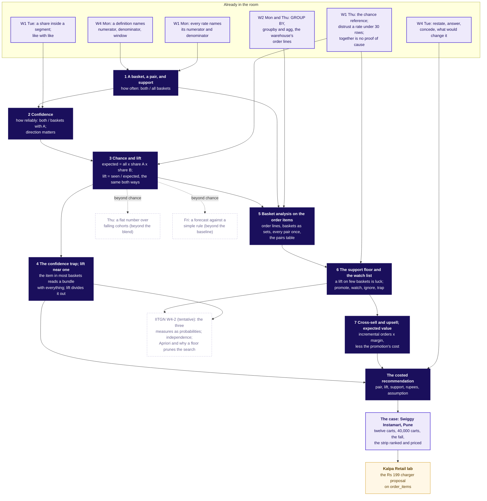

# Week 4 Wednesday, rebuilt concept-first: the plan

Wednesday 28 October 2026 (docs/programme/calendar.md, W04/D3, teaching day, Module 2, IITGN block W4-2 tentative). Row: docs/curriculum/W4_Analyst_craft.md lines 210 to 313, "Market basket, lift and cross-sell: which pairs lift frequency, and what each is worth". This plan edits no repository file. It says what the rebuild session builds, in what order, against which minutes, and which rows of the curriculum each piece proves.

**What the requester asked, and how this plan reads it.** The concepts come first, chapter by chapter, named by the row's subtopics, each from scratch on one simple invented example with its own notebook; the Swiggy Instamart case stays and follows as the application, with its notebooks renamed and numbered after the concept notebooks; the Kalpa lab stays last; the trainer can read the day's topics off the slides. The one hard rule this touches is "the case leads". The plan keeps the ticket as the first slide, because the case is the question the day answers, and gives it ten minutes together with the agenda slide and the concept map; the concept chapters answer the ticket's question piece by piece; the case chapters then apply them. The requester's words outrank the spine's Wednesday shape (CLAUDE.md ground truth order 1 over 2), so the orchestrating session records an amendment to docs/detailing/W04_analyst_craft_spine.md section 7 (the envelope, the shape, the sizes) and acceptance lines 1, 3 and 16 of section 12 before the day session starts. Everything else in the spine, the case file and the hard rules stands.

**Skills read for this plan.** lesson-strategy (the learner's question, the anchor, the grounded unit), lesson-architecture (the shared world, the witness rule, the map, the nine-slot unit, two examples per concept, concepts never mixed with messy data), curriculum-detailing (the idea cap counted as decision sentences, depth targets, the continuity block), concept-packaging (the four beats, the sticky handle, beat three), training-deck-builder (the map slide, the broken default before the definition, one rung per slide, the four rules, concept slide then applied slide), notebook-builder (MAP, DO, SEE, CHECK, SUM; three pictures and five checks), day-pack-builder with the-standard.md and teaching-styles.md (the question ladder, the chapter blend, the executed-file devices).

---

## 1. Coverage now

The day's topic, from the row's day heading: **Market basket, lift and cross-sell · Which pairs lift frequency, and what each is worth.** The five subtopics are quoted verbatim in bold. The rows below them are the ideas the agenda, the outcomes, the interview angle, the exercises and the Saturday bank need that the list leaves implicit. "Buried" means the idea is taught somewhere inside the Instamart case, with no chapter, slide title or notebook name that carries it, so a trainer cannot find it and a learner meets it already dressed in the case's numbers.

| Concept | Where the row asks for it | Where the built pack touches it now | Gap |
|---|---|---|---|
| **Support, confidence and lift, derived by counting** | Subtopic 1; agenda 2 (60 min); UNDERSTANDS; CAN DO; Kahoot Q1, Q2; bank items 3, 26, 40 | half1 S4 to S13 (chapter 1, "What does together mean?"); notebook 01 cells 2 to 5 (the tea stall, 10 receipts); guided set three_counts | Buried. All three measures arrive on one slide (S4) and in one cell (notebook 01 c2) at once, and the first question (S5) asks a learner to judge four sentences about support, confidence, lift and cause before any of the three has been counted alone. The fresh-graduate read (finding 8) flagged the lift rule being used before it was derived. No slide or file title names support, confidence or lift as a topic. |
| Support, as its own idea (how often; a basket; a pair; the 2 by 2 count; an item's own share) | Subtopic 1; CAN DO "compute the three measures by hand" | S4 timeline row 1; notebook 01 c2 one sentence; notebook 02 c2 "an item's support on its own is its share of carts" | Buried. What a basket is, what "together" means and the 2 by 2 count are said in the trainer's notes (receipts run sheet) rather than taught on a slide. |
| Confidence, as its own idea (how reliably; direction; the shrinking world) | Subtopic 1 | S9 to S11 (bread to milk 1.00 on twelve carts); S22 confidence both ways; whiteboards shrink GIF | Buried. Direction is shown once (S22 table) without a slide that teaches it; the case file's "common wrong answer" ("confidence is the probability they go together") is never put to the room. |
| Chance, the expected count and lift as seen over expected; lift symmetric; the second route | Subtopic 1; Kahoot Q2; bank item 4 ("about as often as chance alone would predict") | S6 (the dots), S10, S12, S18 (areas), S22 (second route); notebook 01 c3, c9, c11; notebook 02 c9, c19 | Buried. The proportion argument ("if the two ignored each other, the roti orders would hold chaas at the same rate as all orders") is in the trainer's notes for S6 and nowhere on a slide; the fresh-graduate read (finding 12) could not see why both x n / (A x B) equals seen over expected. |
| **The confidence trap; lift near one** | Subtopic 2; agenda 3 (35 min); CAN HANDLE "a high-confidence pair with lift below one"; interview [S]; Kahoot Q3; bank items 3, 10, 18, 30 to 32 | S7 (carry bag, one slide), S11, S16, S19 to S21 (milk), S26 (title line); notebook 01 c4 and c5; notebook 02 c10 to c12 (the base rate defined at c12) | Buried. The trap is taught well on the case (milk), and nowhere as a topic with a chapter of its own; "lift near one means chance" is said in passing (S20, S29 notes); the base rate is defined after it is used (fresh-graduate finding 16). |
| **Basket analysis on the order items** | Subtopic 3; agenda 5 (60 min); CAN DO "in code on the order items"; the row's client-zero column names v5 order_items | S17 (five lines of pandas); notebook 02 c4 to c7; notebook 04 (Kalpa order_items, the lab); lab set Q5 (the scrambled lines) | Partly covered. The code runs on the case and on Kalpa, and the from-scratch steps (order lines become baskets, a basket of three items adds three pairs, why the pair key is sorted, what a pairs table is) are one sentence in notebook 02 c4 and the S17 comments. No notebook name carries the topic. |
| **The support floor and the watch list** | Subtopic 4; agenda 4 (45 min); CAN HANDLE "a high-lift pair with thin support"; interview [F] lift 4 at 0.3 percent; Kahoot Q4; bank item 11 | S12 (lift 12 on one cart), S28 to S30; notebook 03 c2 to c7; unguided set ch3_four_pairs; receipts run sheet (the action-map sort) | Buried. The decision rule is taught on the case; the mechanism behind the floor (a lift on one or two baskets swings by luck; the playbook's "seeded independent carts show lift wandering at tiny support") is never shown; the floor's value is given, never reasoned from a count. |
| **Cross-sell and upsell reasoning; expected value in rupees** | Subtopic 5; agenda 4; UNDERSTANDS "a recommendation carries an expected value"; CAN DO "cost one recommendation"; interview [F] "a recommendation with a number"; Kahoot Q5; bank items 19, 39 | S31 to S33 (the slot's value, Rs 17,280 against Rs 3,240, the Rs 80,197 sales trap); S37 (upsell named in one line); notebook 03 c8 to c11; unguided kalpa_charger; lab set Q4, Q6 | Buried, and the formula the row states ("incremental orders times margin, less the cost of the promotion") is never derived; the pack prices a slot (views x click-through x add rate x margin) and leaves the row's shape to Kahoot Q5 and the Kalpa set. Margin, incremental and the cost line are defined late (fresh-graduate findings 27, 49). Cross-sell is never defined beside upsell. |
| A basket as the unit; what counts as a basket (the basket base) | Implicit in subtopics 1 and 3; the lab's first trap (69.6 against 84.5 percent, trainer only) | S1 caveat "a cart is one order, a customer places many"; notebook 04 c2 | Missing as a taught idea; it is the lab's trap with no concept behind it. |
| The costed recommendation as an artefact (pair, lift, support, expected value with its assumption) | "how a lift table becomes one costed recommendation"; CAN DEFEND | S38, S39 (the one-page strip); strip set | Covered on the case; no concept slide says what the four fields are and why. |
| A stakeholder anchored on the best-seller (Tuesday's four moves applied) | CAN HANDLE; interview [D] | half2 S40; role card; strip set Q3; Kalpa set Q2 and Q3 | Covered. Stays as it is. |
| A blended rate as a mix of two rates (why the click-through fell) | The case's L3 trap only; Thursday's subtopic "Blended numbers against cohort truth" owns the idea | S23 to S25; notebook 02 c13 to c18; Kahoot Q7; cheat sheet panel 3 | Covered inside the case, which is where it belongs: it is Thursday's idea in preview and gets no concept chapter on Wednesday. |
| Heavy buyers and the per-customer count; the stock-out; the strip's own feedback (the L4 caveats) | The case's L4 only; Week 1 Thursday's "correlation against causation" is the callback | S34 to S36; notebook 03 c12 to c15; Kahoot Q8; strip set Q2 | Covered inside the case. Two of the six doubts stay live, the rest move to self-study slides (section 5). |
| The pairs method evaluated for an AI assistant (the AI-company variant) | The-standard L6 | half2 S43; extras interview file; strip set Q4 | Covered. Moves to self-study and the lab's opening read (section 7). |

Three things the trainer cannot see today, and which drove the requester's note: half1 has no slide that lists the topics (S2 is the week map and S4, S14, S27 list chapter questions without a topic word); no notebook name carries a topic except `02_pairs_table`; and the study notes' chapter headings are the case's questions, so a learner looking for "the confidence trap" finds "What do 40,000 carts say?".

---

## 2. The concept map, and the agenda slide the trainer reads the day from

### 2.1 The concept map

Today's seven ideas in the order they are taught, what each one feeds, where each one came from in Weeks 1 to 3, and where it goes in the rest of Week 4. The map is slide S3 of half1, is redrawn at each chapter close with the finished nodes filled, and is panel one's companion on the cheat sheet. The explorer's Wednesday scenes (W1 to W5 in content/W04/D1/demos) sit on the nodes they animate.



The map has eight lit nodes, one per concept chapter plus the recommendation they build, which is under the ByteByteGo limit of nine boxes on the part a learner reads at a glance; the "already in the room" band and the three forward nodes are drawn lighter. At the close of each concept chapter the trainer fills that node's number from the canteen (support 0.25, confidence 0.75, lift 2.25, the chaas band 0.80 to 1.33, 30 pairs from 33 lines, the floor at 3 orders, Rs 28), so the map is also the running summary.

### 2.2 The agenda slide

Slide S2 of half1, right after the ticket. It is the day's question-ladder slide in the house form (the model is content/W01/D1 half1 S1, "Nine questions climb to Meera's answer") with the row's topic words and the minutes added, which is what a trainer who did not write the day reads the running order from. Durations are allowed on a learner slide; clock times are never. The words "agenda" and "learning objectives" stay off the slide because deck_md_check fails them as programme framing; the slide is titled as what it is.

```
## S2. Seven ideas, then the case, then Kalpa's baskets
*Which topics does Wednesday teach, in what order, and how long does each take?*

| Order | Topic, in the row's words | The question it answers | Minutes | Notebook |
|---|---|---|---|---|
| 1 | Support, derived by counting | How often do two items share a basket? | 12 | 01 |
| 2 | Confidence, derived by counting | How reliably does one item bring the other? | 12 | 02 |
| 3 | Lift, derived by counting | Do they meet more often than chance would put them together? | 18 | 03 |
| 4 | The confidence trap; lift near one | Why is the item in most baskets the worst bundle partner? | 18 | 04 |
| 5 | Basket analysis on the order items | How does a table of order lines become every pair's three numbers? | 15 | 05 |
| 6 | The support floor and the watch list | When is a strong pair too thin to act on? | 12 | 06 |
| 7 | Cross-sell and upsell; expected value in rupees | What is a promotion worth before the money is spent? | 18 | 07 |
| 8 | The case: twelve Instamart carts, then 40,000 | Which pairs beat chance, and why did the click-through fall? | 55 | 08, 09 |
| 9 | The case: the strip ranked, priced and defended | Which three pairs, at what floor, worth how much? | 45 | 10 |
| 10 | Kalpa lab: basket analysis on Kalpa's order items | Should every product be bundled with the Rs 199 charger? | the lab | 11 |

Every number on this slide is counted in the room before it is believed: the first seven rows on a hostel canteen's twelve lunch orders (invented), rows 8 and 9 on Swiggy Instamart's Pune carts (illustrative case), row 10 on Kalpa Retail's own order lines.
```

The notes fence under it says: LIVE, 2 minutes; read the topics down the second column once; say that each topic ends on a number from the canteen and that the case then asks the same questions of 40,000 carts; a break of 10 minutes follows topic 4; the IITGN faculty session (tentative) takes the afternoon's last 120 minutes; answer nothing yet. The same ten rows, with slides and files, are the day sheet's first table (section 6.1).

---

## 3. The concept chapters: first, 105 teaching minutes plus a 10-minute break

### 3.0 The world the seven chapters share

Lesson-architecture asks for one named world set up once, small enough to verify by eye, with a witness planted for every teaching point. The world is **a hostel canteen's twelve lunch orders**, invented and labelled so on every slide, cell and page that shows it. It replaces the tea stall (chai, biscuit, carry bag), which was three slides of counts with no listed orders; the ten-dots and carry-bag figures are redrawn for the canteen by the day's figure script, so nothing is pasted in. The twelve orders ship as `data/C2_W04_D03_canteen_order_lines_STUDENT.csv` in the order-lines shape (`order_id, item`, one row per item in an order, 33 rows), written by the day's seeded generator, because the same shape is Instamart's `cart_items` and Kalpa's `order_items`, which is what lets chapter 5 teach the pairs table on it and the case and the lab reuse the code unchanged.

| Order | Items |
|---|---|
| T01 | dal rice, papad, chaas |
| T02 | dal rice, papad, chaas |
| T03 | dal rice, papad, chaas |
| T04 | dal rice, sabzi, chaas |
| T05 | dal rice, chaas |
| T06 | dal rice, curd, chaas |
| T07 | roti, papad, pickle |
| T08 | papad, pickle |
| T09 | roti, sabzi, chaas |
| T10 | roti, sabzi, chaas |
| T11 | roti, sabzi, chaas |
| T12 | gulab jamun, curd |

Eight items, 33 order lines, 30 pair occurrences. Item counts: chaas 9, dal rice 6, papad 5, roti 4, sabzi 4, curd 2, pickle 2, gulab jamun 1. The witnesses, each the one feature that makes a chapter's output differ from the chapter before it:

| Witness | Counts | What it shows, and in which chapter |
|---|---|---|
| Roti and sabzi | 4 and 4, both in 3 | Support 0.25, confidence 0.75 both ways, expected 1.33, lift 2.25: the real pair (chapters 1, 2, 3) |
| Dal rice and papad | 6 and 5, both in 3 | The same support 0.25 as roti and sabzi; confidence 0.50 one way and 0.60 the other; expected 2.5, lift 1.20: direction matters, and equal supports hide different stories (chapters 1, 2, 3) |
| Roti and chaas | 4 and 9, both in 3 | Confidence 0.75, expected 3.0, seen 3, lift exactly 1.00: chance itself (chapter 3) |
| Chaas, in 9 of 12 orders | share 0.75 | Dal rice to chaas 1.00 and lift 1.33; sabzi to chaas 1.00 and 1.33; roti to chaas 0.75 and 1.00; papad to chaas 0.60 and 0.80: confidences from 0.60 to 1.00 that all read like bundles, lifts from 0.80 to 1.33 that all sit near one (chapter 4) |
| Dal rice and chaas | both in 6 | The most frequent pair holds the popular item and reads lift 1.33: a count ranks it first, lift does not (chapters 1, 4, 5) |
| Papad and pickle | 5 and 2, both in 2 | Lift 2.40 on two orders, above roti and sabzi's 2.25 on three: which to trust (chapters 5, 6) |
| Gulab jamun and curd | 1 and 2, both in 1 | Lift 6.0 on one order: a number with nothing under it (chapters 3, 6) |
| T05, T08, T12 | two-line orders | Each adds one pair, so 33 lines give 30 pairs, never 33 (chapter 5) |

Distance from the numbers a learner must never meet by accident: every canteen value sits at least 0.05 from the Kalpa plants 0.82 and 3.1 and 4.0 and from the case's full-data 0.74, 1.04, 3.39 and 4.60, differs from the case's twelve-cart values (1.00 with 1.50, 2.67, 12) and from the Kalpa lab's twelve-basket hand values (0.67 with 0.89, 2.67), and shares no value with the kirana practice set (0.75 and 1.25 for tea and rusk, the exact 1.00 for sugar and tea). The one exception is roti and chaas at lift exactly 1.00, which is 0.03 from the Kalpa plant 0.97. The plan keeps it: 1.00 is the definition of chance and is the number chapter 3 exists to show, the practice set already prints an exact 1.00, and 0.97 reaches no STUDENT file before the lab. If the orchestrator wants the spine's 0.05 margin applied to the toy as well, the generator can move chaas to T07 (roti, papad, pickle, chaas), which makes roti to chaas 1.00 and lift 1.20 and loses the exact one; the plan's recommendation is to keep the exact one and record the exception in the facts file.

Chapter 7 uses a second small world because expected value needs rupees and a month of bills rather than twelve orders: **Sharma Kirana, a Pune corner shop, one invented month**: 1,000 bills; tea in 600; rusk in 200; both in 150 (confidence tea to rusk 0.25, rusk's share 0.20, lift 1.25). The two worlds never mix: the canteen carries counting, the kirana carries rupees, and the Instamart case carries both at scale.

The cognitive load, counted as decision sentences for the morning block: (1) support is the share of all baskets with both items; (2) confidence is the share of A's baskets that hold B, and it changes with direction; (3) lift compares the seen count with the count chance alone gives, and reads the same from both sides; (4) an item in most baskets earns high confidence toward everything and lift near one, so only lift can rank pairs; (5) every pair's three numbers come from one pairs table built from the order-lines table; (6) a floor on support guards against luck, and a strong pair below it is watched; (7) a promotion is worth incremental orders times margin, less what it costs. Seven in 180 minutes, against the cap of six for a 180-minute block (CLAUDE.md: four per two hours). The plan holds the cap by making sentence (1) the only new idea of chapter 1 and treating "a basket" and "a pair" as vocabulary inside it, and by moving the afternoon's case chapter B (which adds no idea) into the block count: the morning carries ideas 1 to 7 across 170 teaching minutes, which is one idea per 24 minutes, the same density as the standard's four per 120. The orchestrator can instead push chapter 7 to the afternoon's first 20 minutes (section 7 shows the variant); the plan prefers all seven concepts before the case, because the case's slot pricing (chapter B) depends on chapter 7.

Every concept chapter runs the blend in this order (teaching-styles.md, "How a chapter blends them"): the question on screen first; the misconception said aloud with a vote; the hand count on the canteen cards; the picture, with the formula named last; a glimpse of the code; the trap with its exact wrong number; the map node filled; the chapter's practice rung; the one-sentence explanation a learner could repeat. Each SECTION title leads with the row's words and ends in the chapter's question, so the headings-only read tells the day's story and the trainer sees the topic. Each chapter's "Who needs the answer." names the canteen manager deciding what to print on the combo board, a shop's merchandiser, and the learner before any interview that asks about "frequently bought together". Each chapter's slides name the explorer scene they use in the notes fence.

### 3.1 Chapter 1. Support, derived by counting: how often do two items share a basket?

- **SECTION title.** `SECTION 1: Support: how often do two items share a basket?` Pill: Support.
- **From scratch.** A basket is everything one customer pays for in one go: a bill at a kirana, an order at the canteen, a cart on an app. One customer fills many baskets in a month, so the basket, never the customer, is the unit of today's counting. "Together" means in the same basket. A canteen, a shop and an app all count this for the same reason: to decide what to place beside what, on a shelf, a combo board or a strip of three suggestions under a cart. The count is a 2 by 2 table, which the room builds from the twelve cards: both, roti only, sabzi only, neither, which add to twelve. Callback to Week 1 Monday: support is a rate, and like every rate it names its denominator, all baskets.
- **Misconception and prediction.** "How many of the twelve orders hold both roti and sabzi?" with options 2, 3, 4, 7. The 7 is the two item counts added, which is the plausible wrong count a hurried reader makes. Second prediction, after the answer: "Which pair of items shares the most orders?" with options dal rice and papad, dal rice and chaas, roti and sabzi, gulab jamun and curd. The answer, dal rice and chaas in 6 of 12, raises the question the room is told to hold until chapter 4: is the most common pair the best pair to promote?
- **The example.** The canteen's twelve orders, printed as cards on every table and as the table on the slide.
- **Definition and worked example.** Support of a pair is the baskets holding both over all baskets: roti and sabzi 3 / 12 = 0.25; dal rice and papad 3 / 12 = 0.25; dal rice and chaas 6 / 12 = 0.50. Support of one item is its share of baskets: chaas 9 / 12 = 0.75, roti 4 / 12 = 0.33. Pairs counted once per basket.
- **Check question.** "Roti and sabzi and roti and chaas both read support 0.25. Does support tell the two pairs apart?" It does not, which is what chapters 2 and 3 are for.
- **The trap, exactly.** 7 of 12 for roti and sabzi, from adding 4 and 4 without looking inside the baskets; the decision it misleads is a combo printed for a pair that shares three orders.
- **How the case applies it later.** The twelve carts: bread and milk 4 of 12 = 0.33, chips and cold drink 2 of 12 (notebook 08); milk's own support 71 percent of 40,000 carts (notebook 09); the 1 percent floor in chapter 6 is a support.
- **Slides and minutes.** Opener plus four body slides, 12 minutes: S4 "A basket is one bill, and a pair is two items in it" (the twelve-order table; what a basket is); S5 the prediction; S6 "Answer: b, 3 of 12 orders hold both: support 0.25" (the 2 by 2 drawn from the cards); S7 "Dal rice and chaas share the most orders, 6 of 12" (pair-count bars with the chaas pairs shaded, the parked question in the body, the rule strip: a basket is the unit; support is both over all; an item's support is its share; the most common pair is a count, nothing more yet).

### 3.2 Chapter 2. Confidence, derived by counting: how reliably does one item bring the other?

- **SECTION title.** `SECTION 2: Confidence: how reliably does one item bring the other?` Pill: Confidence.
- **From scratch.** "Of those" counting: shrink the world to the baskets that hold A, then count how many of them hold B. Callback to Week 1 Tuesday: a rate inside a segment, where the denominator is the segment's size. Confidence has a direction, written A to B, because the world it shrinks to is A's baskets.
- **Misconception and prediction.** The case file's common wrong answer, put to the room in its own words: "confidence is the chance the two go together, so it reads the same both ways." Prediction: "Dal rice to papad is 3 of 6 = 0.50. What is papad to dal rice?" with options 0.50, 0.60, 0.25, 1.00.
- **The example.** Dal rice (6 orders) and papad (5 orders), together in 3: 0.50 from dal rice, 0.60 from papad. Then gulab jamun and curd: 1 of 1 = 1.00 from gulab jamun, 1 of 2 = 0.50 from curd, so direction can swing a pair from 1.00 to 0.50.
- **Definition and worked example.** Confidence from A to B is the baskets with both over the baskets with A. Roti to sabzi 3 / 4 = 0.75 and sabzi to roti 3 / 4 = 0.75: the two directions agree only because roti and sabzi have the same count. The picture is the shrinking world, drawn as the twelve cards, then the six dal-rice cards, then the three with papad; the pack's shrink GIF and its two stills are regenerated on the canteen.
- **Check question.** "Chaas is in 9 orders and sabzi in 4, together in 4. Sabzi to chaas? Chaas to sabzi?" 1.00 and 0.44: the same four orders, two different sentences.
- **The trap, exactly.** Papad to dal rice reported as 0.50 because dal rice to papad was 0.50; the decision it misleads is a combo card aimed at the wrong buyer.
- **How the case applies it later.** Bread to milk 1.00 on twelve carts (notebook 08), 0.74 on 40,000 against milk to bread 0.35 (notebook 09, S22's table); the lab counts a confidence toward Kalpa's best-seller.
- **Slides and minutes.** Opener plus four body slides, 12 minutes: S8 "Confidence counts inside the baskets that hold A" (the shrinking world, explorer scene W2); S9 the prediction; S10 "Answer: b, 0.60: three of papad's five orders hold dal rice" (both directions worked); S11 "Direction can swing a pair from 1.00 to 0.50" (gulab jamun and curd; the rule strip: both over A; written with its direction; equal only when the two items have equal counts; confidence alone never says whether a pair is special).

### 3.3 Chapter 3. Lift, derived by counting: do they meet more often than chance would put them together?

- **SECTION title.** `SECTION 3: Chance and lift: do two items meet more often than chance would put them together?` Pill: Chance and lift.
- **From scratch.** What chance alone would give. If roti and chaas ignored each other, the roti orders would hold chaas at the same rate as all orders do: chaas is in 9 of 12, so 3 of the 4 roti orders, and 3 is what the cards show. The expected count of a pair is all baskets times A's share times B's share, which is the same sentence as a formula. Callback to Week 1 Thursday: the chance reference, the number a count would show if nothing were going on, which the shuffle made and which this chapter makes with one multiplication. The chapter stays with counts and shares and never writes a probability, because the IITGN session (tentative) picks the three measures up as probabilities.
- **Misconception and prediction.** Two said aloud: "expected means what I expect to see" (it means what chance would give), and "lift 2.25 means roti makes people buy 2.25 times more sabzi" (lift counts a pull and never names a cause). Prediction: "If roti and sabzi ignored each other, how many of the twelve orders would hold both?" with options 0, 1.33, 3, 4.
- **The example.** Roti and chaas: expected 12 x 4/12 x 9/12 = 3.0, seen 3, lift 1.00, chance itself. Roti and sabzi: expected 12 x 4/12 x 4/12 = 1.33, seen 3, lift 2.25. Dal rice and papad: expected 2.5, seen 3, lift 1.20.
- **Definition and worked example.** Lift is seen over expected, which rearranges to both x all / (A x B): 3 x 12 / (4 x 4) = 2.25, shown with the cancelling step the fresh-graduate read asked for. The second route: lift is a confidence over the partner's share, 0.75 / 0.333 = 2.25 from either side, which is why lift has no direction. Reading lift: below one, together less often than chance (papad and chaas 0.80); near one, chance (roti and chaas 1.00); above one, a pull (roti and sabzi 2.25). The picture is the unit square: A's share as a vertical band, B's share as a horizontal band, their overlap the expected area, the seen overlap drawn beside it, so lift is a ratio of two areas (explorer scene W1), then seen-against-expected bars for the three pairs.
- **Check question.** "Papad is in 5 orders, chaas in 9, both in 3. Expected? Lift? What does it say?" 3.75; 0.80; papad orders hold chaas a little less often than orders in general.
- **The trap, exactly.** "Lift 2.25, so a roti promotion sells 2.25 times the sabzi": the number is right and the sentence is wrong; only a change at the counter and a fair comparison show cause (Week 1 Thursday; this week's Monday faculty session on A/B testing, tentative).
- **How the case applies it later.** Bread and milk 1.50 on twelve carts and 1.04 on 40,000; chips and cold drink 2.67 then 3.39; the second route asserted in notebook 09; the interview's [S] question answered on case numbers in chapter 8.
- **Slides and minutes.** Opener plus five body slides, 18 minutes: S12 "Chance gives roti three chaas orders, and three is what we see" (the proportion argument on the cards); S13 the prediction; S14 "Answer: b, 1.33 by chance; 3 seen; lift 2.25" (the two areas); S15 "Lift reads the same from both sides" (the second route for three pairs, the cancelling step); S16 "Lift counts a pull and never names a cause" (the trap; reading lift below, near and above one; the rule strip; the interview strip with the [S] question answered on canteen numbers: lift, because it divides by the partner's share).

### 3.4 Chapter 4. The confidence trap; lift near one: why is the item in most baskets the worst bundle partner?

- **SECTION title.** `SECTION 4: The confidence trap; lift near one: why is the item in most baskets the worst bundle partner?` Pill: The confidence trap.
- **From scratch.** The base rate: how common an item is in all baskets anyway, chaas 0.75. An item that is in most baskets is in most of A's baskets too, whatever A is, so its confidence from everything sits near its own share and reads like a bundle every time. Lift divides that share out, which is the same second route as chapter 3 read the other way round.
- **Misconception and prediction.** "Every dal rice order has chaas, so dal rice to chaas reads 1.00: chaas is dal rice's perfect partner, print the combo." Prediction: "Chaas is in 9 of 12 orders and dal rice to chaas reads 1.00. What is the lift?" with options 1.00, 1.33, 2.00, 0.75. Peer instruction here: the room usually splits between 1.00 and 2.00.
- **The example.** Chaas against every item: dal rice 1.00 and 1.33, sabzi 1.00 and 1.33, roti 0.75 and 1.00, papad 0.60 and 0.80. Chance already gave dal rice 4.5 chaas orders of its 6. The Feynman line the room repeats: the item in every basket is the worst bundle partner, because it was going into the basket anyway.
- **Definition and worked example.** Lift near one means chance; on twelve orders anything from about 0.8 to 1.3 is the same story, and on 40,000 carts the band is far narrower (chapter 6 shows why). Confidence follows popularity; lift divides it out. The picture is two panels: each item's confidence toward chaas as a bar against the line at chaas's share 0.75, and each item's lift with chaas scattered about the line at one (explorer scene W3, the slider that raises the popular item's share while lift stays put).
- **Check question.** "An item is in 60 percent of a shop's bills. A partner reads confidence 0.66 toward it. Bundle them?" Lift 1.10, near one: no; the partner's buyers take it about as often as everyone does.
- **The trap, exactly.** 1.00 read as a bundle; the decision it misleads is the combo board filled with chaas beside everything, which changes nothing because chaas was already in nine of twelve orders.
- **How the case applies it later.** Milk in 71 percent of carts; bread to milk 0.74, lift 1.04; every item in at least 2 percent of carts at lift 0.99 to 1.04 with milk; the strip ranked by count filled with milk; Amazon's bestseller note (notebook 09, S45 to S47 of the case). In the lab the room finds what Kalpa's best-seller does to confidence and lift, trainer-only until a learner's own cell prints it.
- **Slides and minutes.** Opener plus five body slides, 18 minutes: S17 "Chaas is in 9 of 12 orders: a base rate of 0.75" (what a base rate is); S18 the prediction; S19 "Answer: b, 1.33: chance already gave dal rice 4.5 chaas orders"; S20 "Every item reads a bundle with chaas; every lift sits near one" (the two-panel picture); S21 "Lift is the count popularity cannot fool" (the rule strip; the interview strip: the [S] question, the weak answer "confidence" and the hire-grade answer in one breath on canteen numbers; where the room has met this: the suggestion strip on any shopping app). A break of 10 minutes follows.

### 3.5 Chapter 5. Basket analysis on the order items: how does a table of order lines become every pair's three numbers?

- **SECTION title.** `SECTION 5: Basket analysis on the order items: how do order lines become every pair's three numbers?` Pill: The pairs table.
- **From scratch.** The shape of the data: one row per order and item, which is how a warehouse stores a bill (Week 2's order lines; Kalpa's `order_items`; Instamart's `cart_items`). Four steps: group the lines by order into a set of items (Week 2 Thursday's groupby); turn each basket into its pairs (three items give three pairs, four give six, k give k x (k minus 1) / 2); count every pair once, with the two names sorted so (chaas, dal rice) and (dal rice, chaas) are one key; then the three measures for every pair from four counts, which is the pairs table. A one-item order adds no pair, and a bulk purchase of one product is a basket with no pairs in it, which is what "what counts as a basket" means in the lab.
- **Misconception and prediction.** "The twelve orders hold 33 lines, so they hold 33 pairs." Prediction: "Counted once per basket, how many pairs do the twelve orders add up to?" with options 33, 30, 66, 28. Nine three-line orders give 27 and three two-line orders give 3; 66 is every pair counted in both orders; 28 is the number of pairs eight items could form.
- **The example.** T01 (dal rice, papad, chaas) worked by hand into its three pairs on the board, then the whole canteen in five lines of code: `baskets = lines.groupby("order_id").item.apply(set)`, `pair_count = Counter(p for b in baskets for p in combinations(sorted(b), 2))`, `single = Counter(x for b in baskets for x in b)`, the pairs table as a DataFrame with support, confidence both ways and lift, and the roti and sabzi row read back: 0.25, 0.75, 2.25, the hand count of chapters 1 to 3. The Krish Naik move: one plain sentence above each line, the result printed after each.
- **Definition and worked example.** The pairs table ranked two ways: by count, dal rice and chaas on top (6, lift 1.33); by lift, papad and pickle on top (2.40 on two orders), then roti and sabzi (2.25 on three). "Which do you trust?" is held for chapter 6.
- **Check question.** "A basket with four items adds how many pairs, and which line builds the baskets?" Six; the groupby line.
- **The trap, exactly.** Pair keys left unsorted, so (chaas, dal rice) and (dal rice, chaas) are two keys and every count halves or doubles depending on the join; shown as the wrong table with 60 pair occurrences against 30.
- **How the case applies it later.** The same five lines on 40,000 carts (notebook 09, S43 of the case) and on Kalpa's `order_items` (notebook 11), where the room must first decide which orders are baskets.
- **Slides and minutes.** Opener plus four body slides, 15 minutes, the chapter run as a code-along in notebook 05: S22 "Order lines become baskets, and baskets become pairs" (a mermaid flow: lines, sets, pairs, counts, three measures); S23 the prediction; S24 "Answer: b, 30 pairs from 33 lines, each counted once" (T01 by hand, then the five lines); S25 "Ranked by count and by lift, two different tops" (the canteen pairs table both ways; the rule strip: a basket is a set; sort the key; a one-item basket adds no pair; the table is the count, never the ranking).

### 3.6 Chapter 6. The support floor and the watch list: when is a strong pair too thin to act on?

- **SECTION title.** `SECTION 6: The support floor and the watch list: when is a strong pair too thin to act on?` Pill: Floor and watch list.
- **From scratch.** Luck on small counts. Callback to Week 1 Thursday: distrust any rate under thirty observations. One order can make a lift of 6; a floor is the fewest baskets a pair must sit in before anyone acts on its lift; the watch list is the shelf for a strong pair below the floor, with a trial and a pass rule written before the trial starts. The floor is a count or a share, and it is a decision: 3 of 12 orders here, 1 percent of 40,000 carts in the case, 5 percent of 812 baskets in the lab because 1 percent there would be about 8.
- **Misconception and prediction.** "Gulab jamun and curd read lift 6.0, the canteen's strongest pair, so print the combo." Prediction one: promote it; drop it; watch it with a trial; lower the floor until it qualifies. Prediction two, before the simulation runs: "In 600 invented orders where every item ignores every other, how high can a lift read on one or two orders by luck alone?" with options about 1.2, about 2, about 3, above 6.
- **The example.** The canteen's month, 600 orders written by the day's seeded generator with every item independent of every other, labelled invented: a scatter of every pair's lift against its support shows lifts above 6 on single orders and a band of about 0.8 to 1.25 for pairs on thirty or more orders. Then the action map with the canteen's real twelve-order pairs placed: roti and sabzi 2.25 on three orders, promote at a floor of three; papad and pickle 2.40 on two, watch; dal rice and chaas 1.33 on six, the trap region, above the floor and near one; gulab jamun and curd 6.0 on one, watch until the orders exist.
- **Definition and worked example.** Act above the floor, watch below it, ignore near one wherever it sits, and name the trap region, where a count would rank a pair first. A watch-list entry is a pair, its lift and support, the trial (where, for how long, against which other half) and the pass rule set before it runs.
- **Check question.** The row's own interview question: "A pair has lift 4 and support 0.3 percent; act or not?" Watch list and a trial first (Saturday bank item 11).
- **The trap, exactly.** Lift 6.0 printed on the combo board; the decision it misleads is a slot or a card given to a pair on one order.
- **How the case applies it later.** The 1 percent floor of 400 carts, 246 pairs above it, ice cream and chocolate sauce at 4.60 on 100 carts, the two-zone trial (notebook 10, chapter 9 of the day); the lab's 5 percent floor and its thin pair.
- **Slides and minutes.** Opener plus four body slides, 12 minutes: S26 "One order can make a lift of 6" (the thin pair); S27 the prediction; S28 "Answer: d, above 6 on single orders, near one past thirty" (the simulation's scatter, explorer scene W5); S29 "A floor, then four regions: promote, watch, ignore, trap" (the action map with the canteen pairs; the rule strip: the floor is a decision stated as a count; a strong thin pair earns a trial, never a slot; near one is ignored at any support; the trap region is what a count ranks first).

### 3.7 Chapter 7. Cross-sell and upsell reasoning; expected value in rupees: what is a promotion worth before the money is spent?

- **SECTION title.** `SECTION 7: Cross-sell and upsell; expected value in rupees: what is a promotion worth before the money is spent?` Pill: Expected value.
- **From scratch.** Cross-sell offers a different item beside what is being bought (rusk with tea; chocolate sauce beside ice cream); upsell offers a bigger or better version of the same item (a 500 g tea pack in place of 250 g). The row says teach cross-sell and name upsell, so upsell gets one definition and no worked example. Price, cost and margin (Week 1 Monday's dossier: what the shop keeps from a sale after the item's cost). Incremental means what would not have happened without the promotion (Week 1 Thursday: the customers who took the discount may have been about to buy anyway). Expected value in rupees, in the row's words, is incremental orders times margin, less the cost of the promotion. One line says aloud that "expected" here means the average rupees a plan brings in, and in chapter 3 it meant the count chance would give; the fresh-graduate read tripped on the two uses.
- **Misconception and prediction.** "Sharma Kirana prints a tea and rusk combo card, Rs 1 off. In a month it rings up 168 combo bills at Rs 30 a rusk pack. What is the promotion worth?" with options Rs 5,040; Rs 2,016; Rs 216; Rs 28.
- **The example.** Sharma Kirana, invented: 1,000 bills a month, tea in 600, rusk in 200, both in 150, so 450 tea bills hold no rusk. The card persuades 4 percent of those 450 to add a pack, an assumption with a range of 2 to 6 percent: 18 incremental packs, at Rs 12 margin each (price Rs 30, cost Rs 18), Rs 216. The Rs 1 discount is handed back on every combo bill, the 150 who bought rusk anyway and the 18 new ones: Rs 168. Printing the cards costs Rs 20. Expected value Rs 28 a month. At Rs 2 off the same card loses Rs 140. The costed recommendation that comes out of it names the pair, its lift and support (1.25 on 150 bills), the uplift assumption with its range, the margin, the cost line and the rupee result.
- **Definition and worked example.** Expected value = incremental orders x margin per order, less the promotion's cost, where the cost is the discount handed back on every redeemed combo plus any fixed cost. The three numbers that overstate it: Rs 5,040 (168 x Rs 30, sales booked as the gain); Rs 2,016 (168 x Rs 12, every combo counted as incremental); Rs 196 (the discount forgotten). The second route reaches Rs 28 from totals: rusk margin after the card (218 x Rs 12 less Rs 168 less Rs 20 = Rs 2,428) against before (200 x Rs 12 = Rs 2,400). The picture is a bridge from 1,000 bills to Rs 28, and a line of expected value against the discount from Rs 0 to Rs 5, crossing zero just past Rs 1.
- **Check question.** A parallel to Saturday bank item 39, never the item itself: "A combo card reaches 2,000 bills; 5 percent add one extra pack at Rs 10 margin; the cards cost Rs 600. Expected value?" Rs 400.
- **The trap, exactly.** Rs 5,040 of combo sales reported as the promotion's gain, a number 180 times the expected value; the decision it misleads is a card that loses money at Rs 2 off being rolled out.
- **How the case applies it later.** A strip slot's value: 60,000 views x click-through x 0.5 adds per click x Rs 9 margin, Rs 17,280 a day against Rs 3,240, Rs 6.3 lakh a month recovered; the Rs 80,197 sales trap; Maxxsaver as the discount line (notebook 10); Kalpa's Rs 20 off a charger that is already in most baskets (the lab's unguided set).
- **Slides and minutes.** Opener plus five body slides, 18 minutes: S30 "Cross-sell adds a second item; upsell grows the same one" (definitions on tea and rusk); S31 the prediction; S32 "Answer: d, Rs 28: incremental packs times margin, less the discount" (the bridge, explorer scene W4 named in the notes); S33 "Three numbers that overstate a promotion" (Rs 5,040, Rs 2,016, Rs 196, each with the line it forgot); S34 "A recommendation is a pair, a floor and rupees with an assumption" (the four fields; the rule strip; the interview strip with the [F] question "turn a basket analysis into a recommendation with a number").

Concept chapters in total: 7 openers and 31 body slides, 105 teaching minutes, with the 10-minute break after chapter 4.

---

## 4. The notebooks

Seven concept notebooks, then the four case and lab notebooks renamed and renumbered. Every concept notebook: defines its own three-line `check` (the Week 4 rule), loads its data from `../data/`, runs cold, ships executed, carries at least three matplotlib pictures as saved outputs and at least five passing checks (nb_check's thresholds), a MAP cell as a markdown mermaid ladder of the eleven notebooks with this one lit, a predict cell before every result, a SUM cell as a table of what the notebook established, and a last line naming what the next notebook adds. Cells stay between 12 and 16, under the spine's cap of 22. File names carry the topic in the row's words. The code is ponytail-small: pandas, the standard library, matplotlib.

### 4.1 `C2_W04_D03_01_support_by_counting_STUDENT.ipynb` (14 cells)

| Cell | Kind | What it carries |
|---|---|---|
| 0 | MD | Title "Support: how often do two items share a basket?"; Week 4 Wednesday, concept chapter 1 of 7; the canteen's twelve lunch orders, invented; Who needs the answer; The questions on the way (what is a basket; how often do two items share one; which pair is most common) |
| 1 | CODE, setup | `check`; pandas; matplotlib; load `canteen_order_lines`; print the twelve orders as lines; checks: 12 orders, 33 lines, 8 items |
| 2 | MD, MAP | The eleven-notebook ladder (mermaid) with 01 lit; a basket in plain words; the three questions the day asks of every pair, with this notebook taking the first |
| 3 | CODE, SEE | Picture 1: the order-by-item grid, twelve rows by eight columns, a filled square where an order holds the item; check: chaas in 9 |
| 4 | MD, DO | Predict before you run: how many orders hold both roti and sabzi (2, 3, 4, 7) |
| 5 | CODE, DO | The 2 by 2 for roti and sabzi (both, roti only, sabzi only, neither); support = both / 12; checks: the four cells add to 12; support 0.25 |
| 6 | MD | What happened: b, 3 of 12, 0.25; the 2 by 2 named; support is a rate with its denominator, all baskets (Week 1 Monday) |
| 7 | CODE, SEE | Picture 2: the 2 by 2 drawn as four squares sized by their counts |
| 8 | MD, DO | Predict: which pair shares the most orders (dal rice and papad; dal rice and chaas; roti and sabzi; gulab jamun and curd) |
| 9 | CODE, DO | Each item's share; the count and support of the four named pairs, sorted; checks: dal rice and chaas top with 6; chaas's share 0.75; every support between 0 and 1 |
| 10 | MD | What happened: dal rice and chaas, 6 of 12, 0.50; the plausible wrong reading "most common is best", parked for notebook 04; the trap of adding item counts (7) |
| 11 | CODE, SEE | Picture 3: pair counts for the six most common pairs, chaas pairs shaded |
| 12 | CODE, CHECK | A pair's support never exceeds either item's support; roti and sabzi and roti and chaas both 0.25; the 2 by 2 for dal rice and papad adds to 12 |
| 13 | MD, SUM | Table: basket, pair, 2 by 2, support of an item, support of a pair, with the canteen number for each; In the interview, one line: "what is support?"; what notebook 02 adds: direction |

### 4.2 `C2_W04_D03_02_confidence_direction_STUDENT.ipynb` (14 cells)

| Cell | Kind | What it carries |
|---|---|---|
| 0 | MD | Title "Confidence: how reliably does one item bring the other?"; chapter 2 of 7; restates support 0.25 for roti and sabzi and for dal rice and papad from notebook 01; Who needs the answer; The questions on the way |
| 1 | CODE, setup | `check`; load the canteen lines; build `baskets` as sets; checks: 12 baskets |
| 2 | MD, MAP | The ladder with 02 lit; "of those" counting in plain words, with the Week 1 Tuesday callback |
| 3 | MD, DO | Predict: dal rice to papad is 0.50; papad to dal rice is (0.50, 0.60, 0.25, 1.00) |
| 4 | CODE, DO | Confidence both ways for dal rice and papad; checks: 0.50 and 0.60 |
| 5 | MD | What happened: b, 0.60; confidence is both over A; its direction is the world it shrinks to |
| 6 | CODE, SEE | Picture 1: the shrinking world as three panels (twelve cards, the six dal-rice cards, the three with papad), the frames the GIF is made from |
| 7 | CODE, DO | Confidence both ways for every pair in the canteen; the pairs where the two directions differ most (gulab jamun and curd: 1.00 and 0.50); checks: roti to sabzi equals sabzi to roti; gulab jamun to curd is 1.00 |
| 8 | MD | What happened: direction can swing from 1.00 to 0.50 on the same order; equal only when the item counts are equal |
| 9 | CODE, SEE | Picture 2: confidence A to B against B to A for every pair, with the diagonal |
| 10 | MD, DO | Predict: sabzi to chaas and chaas to sabzi (1.00 and 0.44; 0.44 and 1.00; 0.75 and 0.75; 1.00 and 1.00) |
| 11 | CODE, DO plus SEE | The two numbers; picture 3: the shrink for sabzi and chaas; check: sabzi to chaas 1.00 |
| 12 | MD | What happened: 1.00 and 0.44; the trap of reporting the reverse direction's number; the question notebook 03 answers: is 1.00 special when chaas is in 9 of 12 anyway |
| 13 | MD, SUM | Table of the chapter; In the interview: "what is confidence, and why does the direction matter?"; what notebook 03 adds: chance |

### 4.3 `C2_W04_D03_03_chance_and_lift_STUDENT.ipynb` (16 cells)

| Cell | Kind | What it carries |
|---|---|---|
| 0 | MD | Title "Chance and lift: do two items meet more often than chance would put them together?"; chapter 3 of 7; restates 0.25 and 0.75 for roti and sabzi; Who needs the answer; The questions on the way |
| 1 | CODE, setup | `check`; load; baskets; item counts; checks |
| 2 | MD, MAP | The ladder with 03 lit; the chance reference in plain words (Week 1 Thursday); the proportion argument on roti and chaas |
| 3 | CODE, DO | Roti and chaas: expected 12 x 4/12 x 9/12 = 3.0; seen 3; lift 1.00; checks: expected 3.0; lift 1.00 |
| 4 | MD, DO | Predict: if roti and sabzi ignored each other, how many orders would hold both (0, 1.33, 3, 4) |
| 5 | CODE, DO | Expected 1.33, seen 3, lift 2.25; check: 2.25 |
| 6 | MD | What happened: b; lift is seen over expected; the cancelling step: 3 / (12 x 4/12 x 4/12) = 3 x 12 / (4 x 4) |
| 7 | CODE, SEE | Picture 1: the unit square, A's band, B's band, the expected overlap, the seen overlap beside it, for roti and sabzi |
| 8 | CODE, DO | The second route for three pairs: confidence over the partner's share, both directions; checks: all three agree with seen over expected to 1e-9 |
| 9 | MD | What happened: lift has no direction; the trap: "lift 2.25 means roti causes 2.25 times the sabzi" and why the sentence fails |
| 10 | CODE, SEE | Picture 2: seen against expected bars for roti and sabzi, dal rice and papad, roti and chaas, papad and chaas |
| 11 | MD, DO | Predict: papad and chaas, papad 5, chaas 9, both 3: lift (0.60, 0.80, 1.25, 3.75) |
| 12 | CODE, DO | 3.75 expected, lift 0.80; check |
| 13 | MD | What happened: b, below one; reading lift below, near and above one |
| 14 | CODE, SEE plus CHECK | Picture 3: every canteen pair's lift on a number line with one marked; checks: lift 1.00 for roti and chaas; gulab jamun and curd 6.0; every lift is positive |
| 15 | MD, SUM | Table; In the interview: the [S] question answered on canteen numbers; what notebook 04 adds: the popular item |

### 4.4 `C2_W04_D03_04_confidence_trap_lift_near_one_STUDENT.ipynb` (14 cells)

| Cell | Kind | What it carries |
|---|---|---|
| 0 | MD | Title "The confidence trap; lift near one: why is the item in most baskets the worst bundle partner?"; chapter 4 of 7; restates chaas 9 of 12 and the three measures; Who needs the answer; The questions on the way |
| 1 | CODE, setup | `check`; load; baskets; checks |
| 2 | MD, MAP | The ladder with 04 lit; the base rate in plain words |
| 3 | MD, DO | Predict: dal rice to chaas reads 1.00; the lift (1.00, 1.33, 2.00, 0.75) |
| 4 | CODE, DO | Expected 4.5, seen 6, lift 1.33; checks |
| 5 | MD | What happened: b; the plausible wrong answer "1.00, so bundle"; why it is wrong; the check (chaas's share); the fix (read lift) |
| 6 | CODE, DO | Every item's confidence toward chaas and lift with chaas; checks: every confidence between 0.60 and 1.00; every lift between 0.80 and 1.33 |
| 7 | CODE, SEE | Picture 1: the two panels, confidence bars against the share line at 0.75, lift points about the line at one |
| 8 | MD | What happened: confidence follows popularity, lift divides it out; the Feynman line |
| 9 | CODE, SEE | Picture 2: a sweep, invented and labelled, of a popular item's share from 0.2 to 0.9 with the partner's confidence rising and lift held at one (the explorer's W3 scene in code) |
| 10 | MD, DO | Predict: a check question's item in 60 percent of bills, partner confidence 0.66: bundle? |
| 11 | CODE, DO plus SEE | Lift 1.10; picture 3: the pairs table ranked by confidence toward chaas against ranked by lift, two orders side by side; check: the top by confidence and the top by lift differ |
| 12 | MD | What happened: near one, no; ranking by confidence puts the popular item first every time |
| 13 | MD, SUM | Table; In the interview: the weak and the hire-grade answer side by side; what notebook 05 adds: every pair at once |

### 4.5 `C2_W04_D03_05_basket_analysis_pairs_table_STUDENT.ipynb` (15 cells)

| Cell | Kind | What it carries |
|---|---|---|
| 0 | MD | Title "Basket analysis on the order items: how do order lines become every pair's three numbers?"; chapter 5 of 7; Who needs the answer; The questions on the way |
| 1 | CODE, setup | `check`; load the 33 lines; print the raw table's head; checks: 33 rows, two columns |
| 2 | MD, MAP | The ladder with 05 lit; the four steps as a mermaid flow (lines, sets, pairs, counts, measures); T01 worked by hand into three pairs |
| 3 | MD, DO | Predict: how many pairs do the twelve orders add up to (33, 30, 66, 28) |
| 4 | CODE, DO | Step 1: `baskets = lines.groupby("order_id").item.apply(set)`; print; check: 12 baskets |
| 5 | CODE, DO | Step 2: `pair_count = Counter(...)` with `sorted`; the total; check: 30 |
| 6 | MD | What happened: b, 30; why 33 is wrong; why sorting the key matters |
| 7 | CODE, DO | The trap: the same count with the key unsorted and each basket's items in two orders, printing 60; check that the sorted count is half of it |
| 8 | CODE, DO | Step 3: `single`; step 4: the pairs table as a DataFrame with support, both confidences and lift; the roti and sabzi row; checks: 0.25, 0.75, 2.25 match notebooks 01 to 03 |
| 9 | CODE, SEE | Picture 1: pairs per basket size (two-line orders give 1, three-line give 3) |
| 10 | CODE, SEE | Picture 2: the pairs table ranked by count, top five, and ranked by lift, top five, as two bar panels |
| 11 | MD | What happened: two different tops; dal rice and chaas by count, papad and pickle by lift on two orders; the question held for notebook 06 |
| 12 | CODE, SEE | Picture 3: every pair as a point, lift against support, the canteen's scatter |
| 13 | CODE, CHECK | The pairs table has one row per pair that appears; every lift equals its second route; a one-item basket contributes nothing |
| 14 | MD, SUM | Table; In the interview: "why sorted?" and "how would you count pairs over a million baskets?"; what notebook 06 adds: the floor |

### 4.6 `C2_W04_D03_06_support_floor_watch_list_STUDENT.ipynb` (15 cells)

| Cell | Kind | What it carries |
|---|---|---|
| 0 | MD | Title "The support floor and the watch list: when is a strong pair too thin to act on?"; chapter 6 of 7; Who needs the answer; The questions on the way |
| 1 | CODE, setup | `check`; load the canteen lines and `C2_W04_D03_canteen_month_STUDENT.csv`, the 600 invented independent orders the generator writes; checks: 600 orders |
| 2 | MD, MAP | The ladder with 06 lit; luck on small counts (Week 1 Thursday's thirty); the thin pair |
| 3 | MD, DO | Predict: in 600 orders where every item ignores every other, how high can a lift read on one or two orders (about 1.2, about 2, about 3, above 6) |
| 4 | CODE, DO | The pairs table on the 600; the highest lift among pairs on one or two orders; the band for pairs on thirty or more; checks: the top thin lift above 6; the thick band within 0.8 to 1.25 |
| 5 | MD | What happened: d; nothing is going on in this data by construction, and lift still reads 6 on single orders |
| 6 | CODE, SEE | Picture 1: lift against support for the 600 orders, log support axis labelled in orders |
| 7 | CODE, SEE | Picture 2: the spread of lift for pairs on 1 to 2 orders against pairs on 30 or more, two histograms |
| 8 | MD, DO | Predict: with a floor of three orders on the real twelve, which canteen pairs qualify |
| 9 | CODE, DO | The floor applied: pairs at or above 3 orders ranked by lift; the thin pairs below it; checks: roti and sabzi top above the floor; papad and pickle and gulab jamun and curd below it |
| 10 | MD | What happened: the four regions; the watch list as a trial with a pass rule; the trap of lift 6.0 printed on the board |
| 11 | CODE, SEE | Picture 3: the action map for the canteen's pairs with the floor line and the line at one, regions labelled |
| 12 | MD, DO | Predict: the row's interview question, lift 4 at support 0.3 percent |
| 13 | CODE, CHECK | A watch-list entry built as a small dict (pair, lift, support, trial, pass rule); checks: the floor is a count; nothing near one is promoted at any support |
| 14 | MD, SUM | Table; In the interview: "where would you set the floor, and what would change it?"; what notebook 07 adds: rupees |

### 4.7 `C2_W04_D03_07_cross_sell_expected_value_STUDENT.ipynb` (15 cells)

| Cell | Kind | What it carries |
|---|---|---|
| 0 | MD | Title "Cross-sell and upsell; expected value in rupees: what is a promotion worth before the money is spent?"; chapter 7 of 7; Sharma Kirana, invented; Who needs the answer; The questions on the way |
| 1 | CODE, setup | `check`; the kirana month as a small dict or a two-table CSV written by the generator (bills, tea bills, rusk bills, both; price, cost, margin); checks: 1,000 bills; margin Rs 12 |
| 2 | MD, MAP | The ladder with 07 lit; cross-sell and upsell defined; price, cost, margin; incremental; the two meanings of "expected" |
| 3 | CODE, DO | Tea and rusk's three measures (0.15, 0.25, 1.25); check |
| 4 | MD, DO | Predict: the combo card's worth (Rs 5,040; Rs 2,016; Rs 216; Rs 28) |
| 5 | CODE, DO | The cascade: 450 tea bills without rusk, 4 percent respond, 18 packs, Rs 216 margin, Rs 168 discount on 168 combos, Rs 20 printing, Rs 28; checks: 168 combos; Rs 28 |
| 6 | MD | What happened: d; the formula in the row's words; which line each wrong option forgot |
| 7 | CODE, SEE | Picture 1: the bridge from 1,000 bills to Rs 28 |
| 8 | CODE, DO | The three overstatements computed (Rs 5,040; Rs 2,016; Rs 196); check: each exceeds Rs 28 |
| 9 | CODE, SEE | Picture 2: expected value against the discount from Rs 0 to Rs 5 with the zero line, crossing just past Rs 1 |
| 10 | MD | What happened: at Rs 2 off the card loses Rs 140; the cost line most people forget is the discount paid to the buyers who would have bought anyway |
| 11 | CODE, DO | The second route: rusk margin before (Rs 2,400) against after (Rs 2,428); check: the difference is Rs 28 |
| 12 | CODE, SEE | Picture 3: the range, expected value at 2, 4 and 6 percent response, as three bars |
| 13 | MD, DO plus CHECK | The costed recommendation as a dict (pair, lift 1.25, support 150 bills, uplift 4 percent with its range, margin Rs 12, cost line Rs 1 a combo plus Rs 20, result Rs 28); the check question (2,000 bills, 5 percent, Rs 10, Rs 600: Rs 400) computed; checks |
| 14 | MD, SUM | Table; In the interview: the [F] question in one breath; what notebook 08 adds: the case |

### 4.8 The case and lab notebooks, renamed and renumbered

| Now | Becomes | What changes inside |
|---|---|---|
| `01_receipts` | `C2_W04_D03_08_case_three_measures_twelve_carts_STUDENT.ipynb` | Cells 2 to 5 (the tea stall) go, since chapters 1 to 4 taught them on the canteen. The first cell restates the three measures in one line each and says which concept chapter each step applies (1 to 3 for the counts, 4 for bread to milk at 1.00, 6 for the lift of 12 on one cart). Add a third picture, the 2 by 2 for bread and milk, so the notebook keeps three; the six checks stay. About 11 cells. |
| `02_pairs_table` | `C2_W04_D03_09_case_pairs_table_confidence_trap_STUDENT.ipynb` | The first cell names chapters 4 and 5 as the ones applied. Cell 4's explanation of three items making three pairs stays in one sentence and points to notebook 05. Nothing else changes; the your-turn split and the second route stay. |
| `03_action_map` | `C2_W04_D03_10_case_floor_watchlist_expected_value_STUDENT.ipynb` | The first cell names chapters 6 and 7. Cell 8 says the slot's value is chapter 7's formula with the strip's own factors (views, click-through, add rate) in place of bills and response. The heavy-buyer and stock-out cells stay as the self-study depth. |
| `04_kalpa_lab` | `C2_W04_D03_11_kalpa_basket_analysis_order_items_STUDENT.ipynb` | Carries the row's third subtopic in its name. The first cell names chapter 5 (the pairs table on order lines, and what counts as a basket), chapter 4 (what to expect of a best-seller, said without any number), chapter 6 (why the floor is 5 percent here) and chapter 7 (the bundle's cost line). The two empty your-turn cells stay empty. Cell 3 prints the twelve-basket hand values the lab note already lists, as the fresh-graduate read asked. |

---

## 5. The case chapters, following the concepts

The Instamart material keeps every number, picture, trap and file it has; what changes is its position, its titles and its minutes, and the twelve-cart hand count becomes a drill rather than the place where the measures are first met. Two case chapters replace the current three, and each step is tagged with the concept chapter it applies.

### 5.1 Chapter 8, morning, 55 minutes: `SECTION 8: The case: what do twelve Instamart carts say, and then 40,000?`

| Order | Now | Becomes | Applies | Minutes | Change |
|---|---|---|---|---|---|
| 1 | S3 "Where today ends" | S35 "Where the case ends: three pairs, one floor, Rs 6.3 lakh" | all | 2 | Moves here from the opener; the whole result first (fast.ai), now that the room can read every word on it |
| 2 | S8 the twelve carts; the receipts activity's cart sort | S36 "Twelve carts from the 40,000: milk in 8, bread in 4" | 1, 2, 3 | 12 | The hand count shrinks from 40 to 12 minutes: the room knows the three counts and runs the guided set `three_counts` on the cards as a drill; the trainer writes 4, 8, 4 and the room says 0.33, 1.00, 2.67 expected, 1.50 |
| 3 | S9, S10 predict and answer | S37, S38 | 2, 3 | 5 | Kept as the drill's reveal |
| 4 | S11 the trap, 1.00 reads like a bundle | S39 | 4 | 3 | Kept; the room now predicts it, since chapter 4 taught it on chaas |
| 5 | S12 chips and cold drink; one cart | S40 | 3, 6 | 4 | Kept |
| 6 | S15, S16 which pair most often | S41, S42 | 1, 4 | 5 | Kept |
| 7 | S17 five lines of pandas | S43 "The same five lines on 40,000 carts" | 5 | 4 | Code-along shortened: the lines were built in chapter 5 |
| 8 | S18 twelve said 1.50, 40,000 say 1.04 | S44 | 3, 6 | 4 | Kept; now also the floor's lesson, few carts |
| 9 | S19, S20 lift with milk near one | S45, S46 | 4 | 5 | Kept |
| 10 | S21 Amazon | S47 | 4 | 2 | Kept at its one-sentence length |
| 11 | S22 four pairs, second route | S48 | 3 | 3 | Kept |
| 12 | S23, S24 why the click-through fell; the your-turn split | S49, S50 | the case's L3 (a blended rate, Thursday's idea in preview) | 10 | Kept, with notebook 09's your-turn cell |
| 13 | S25 slot position | D51 | | 0 | Becomes a self-study D slide |
| 14 | S26 the chapter's answer; S13's concept board | S52 "The case answered the seven questions, on 40,000 carts" | all | 2 | The concept map redrawn with the case's numbers on the nodes, in place of the tea-stall concept board |

Retired from the live path: S4 to S7 (the three-counts timeline, the tea stall, the carry bag), because chapters 1 to 4 teach them on the canteen; S14 and S27 (the chapter question lists), because the agenda slide and each SECTION opener carry them.

### 5.2 Chapter 9, afternoon, 25 minutes live plus 20 unguided: `SECTION 9: The case: which pairs fill the strip, and what is a slot worth?`

| Order | Now | Becomes | Applies | Minutes | Change |
|---|---|---|---|---|---|
| 1 | S28, S29 which pair to promote; the action map | S53, S54 | 6 | 6 | The predict is sat as the unguided set `ch3_four_pairs` on paper, letters posted in five minutes, then the picture |
| 2 | S30 the watch list | S55 | 6 | 3 | Kept |
| 3 | S31, S32 what re-ranking recovers; the cascade | S56, S57 | 7 | 6 | Shorter: the formula is known, the strip's factors are new |
| 4 | S33 Rs 80,197 of sales | S58 | 7 | 3 | Kept, with the kirana's Rs 5,040 named as its small twin |
| 5 | S34 six doubts | S59 "Three doubts the counts cannot settle alone" | the case's L4 | 4 | Live table trimmed to cause, heavy buyers, the strip's own feedback; stock-out and time-of-day become one line each |
| 6 | S35 the heavy tenth | S60 | the case's L4 | 3 | Kept |
| 7 | S36 the stock-out | D61 | | 0 | Self-study |
| 8 | S37 the morning's answer; upsell named | S62 "The afternoon's answer, with upsell named once" | 7 | 0, read in the transition | Kept |
| 9 | half2 S38 to S40 the unguided brief, the template, the category manager | S63 to S65 | 6, 7, Tuesday's four moves | 20 | 35 becomes 20; the one-page strip is the hand-in, the strip set's four letters are posted with it |
| 10 | S41 to S43 the interview room | S66 live; D67, D68 | 4 | 3 | The [S] answer on case numbers stays live; the follow-ups and the AI-company variant become D slides and stay in extras, read in pairs in the lab's first ten minutes |
| 11 | S44 handoff; S45 Kahoot; S46 close | S69 to S71 | | 12 | Kept; the Kahoot runs eight items in eight minutes with a minute for the lift sum |

Deck files: `half1` carries S1 to S52 (the ticket, the agenda, the concept map, SECTIONS 1 to 8), about 55 slides; `half2` carries SECTION 9 to the close, about 20 slides; the `fallback` deck is unchanged, since its four parts (the watch-list trial protocol, the rerun by zone and time band, the Pop-Tarts bridge, the redesign dispute) teach nothing the concept chapters now own. The spine's half1 cap of 40 slides becomes 60 in the amendment; the alternative, a third file `C2_W04_D03_concepts_STUDENT.md` for SECTIONS 1 to 7 with `half1` kept under 40, is open to the orchestrator and changes nothing else in this plan.

### 5.3 How the titles change so a trainer sees the topic

Every SECTION title leads with the row's words and ends in the chapter's question (sections 3.1 to 3.7, 5.1 and 5.2). The opener pills across the cover's chapter strip read, in order: Support · Confidence · Chance and lift · The confidence trap · The pairs table · Floor and watch list · Expected value · The case: twelve and 40,000 carts · The case: the strip priced. Body slides keep action titles under 54 characters with the question as the italic subtitle, and each concept chapter's last slide carries a `**The rule.**` strip of three or four one-sentence rules, which is the slide a learner photographs. The map slide S3 returns at each SECTION opener with the current node lit, which training-deck-builder names as the one permitted use of a divider-like slide.

---

## 6. Trainer and learner artefacts

### 6.1 The day sheet's topic list, mapped to the row's trainer agenda

| Row agenda item | Row minutes | Where it runs in the rebuilt day | Rebuilt minutes |
|---|---|---|---|
| 1. Merchandising's proposal; why "in 80 percent of baskets" might be the wrong reason | 10 | S1 the ticket (the strip's "in most carts" plays the proposal's part; Kalpa's own proposal opens the lab), S2 the agenda, S3 the concept map, the room's first answer | 10 |
| 2. Support, confidence and lift derived by counting on twelve hand-checkable baskets | 60 | Chapters 1, 2, 3 on the canteen's twelve orders (42) and the twelve-cart drill in chapter 8 (17, steps 2 to 4) | 59 |
| 3. The confidence trap: high confidence and lift near one | 35 | Chapter 4 (18) and chapter 8 steps 6 to 10 (20) | 38 |
| 4. From a lift table to a costed recommendation; thin support and the watch list | 45 | Chapters 6 and 7 (30) and chapter 9 steps 1 to 4 (18) | 48 |
| 5. Guided then unguided: basket analysis on the scenario's order items, one costed recommendation | 60 | Chapter 5 as a guided code-along on the canteen's order lines (15), chapter 8 steps 7 and 12 (14), chapter 9 steps 5 and 6 (7), the unguided strip (20); the lab re-runs it on Kalpa's `order_items` | 56 |
| 6. Kahoot and close | 20 | The [S] answer live, the handoff line, the Kahoot, the sentence for Friday | 15 |
| Break | | After chapter 4 | 10 |
| Slack | | Absorbed by chapters 3 and 7 if the room is quick, by the twelve-cart drill if it is slow | 4 |
| | 230 | | 240 |

The day sheet keeps its sync blocks for the module and the faculty block unchanged, prints the question ladder as the ten rows of the agenda slide with their slides and files, extends the traps table with the seven concept traps and their exact wrong numbers (7 of 12; 0.50 for the reverse direction; "2.25 times the sabzi"; 1.00 read as a bundle; 33 pairs; lift 6.0 on one order; Rs 5,040), and adds three checkpoints: after chapter 3, three learners say roti and sabzi's three numbers from the board (0.25, 0.75, 2.25); after chapter 7, the room says the expected-value formula in the row's words; after chapter 8 step 12, every learner's your-turn cell prints 1.2 and 6.4 percent. The receipts run sheet keeps its roles and materials and gains the canteen cards (twelve per group) and a turn table for chapters 1 to 4; the cart cards stay for the chapter 8 drill.

### 6.2 The agenda slide and the concept-map slide

Section 2 gives both. S2 is the table of ten topics with their questions, minutes and notebooks; S3 is the mermaid map with the seven lit nodes, the recommendation, the case, the lab, the three "already in the room" callbacks the room will hear named, and the three forward nodes (Thursday, Friday, the IITGN session marked tentative). The map returns at every SECTION opener with the current node lit and at S52 with the case's numbers on the nodes.

### 6.3 Exercise items per concept

| Set | Items | Concept chapters | Design items | When |
|---|---|---|---|---|
| New: `unguided/C2_W04_D03_canteen_concepts_STUDENT.md` | 7, one per concept chapter, on the canteen and the kirana | 1 to 7 | 4: which denominator makes a support (1); promote dal rice and chaas or not (4); act, watch or ignore on four canteen-month pairs (6); which cost line the combo forgot (7) | Two drills of 10 minutes: items 1 to 4 before the break, items 5 to 7 after chapter 7 |
| `guided/three_counts` (kept) | 3 | 1, 2, 3, 6 | 1 | Chapter 8 step 2, the twelve-cart drill |
| `unguided/ch1_one_pair` (kept) | 2 | 3 | 1 | Chapter 8, a five-minute paper check before the 40,000 carts, "four counts from the case" |
| `unguided/ch3_four_pairs` (kept) | 4 | 6 | 3 | Chapter 9 step 1, letters posted in five minutes |
| `unguided/strip` (kept) | 4 | 6, 7, the case's L4, the AI variant | 2 | The unguided 20 minutes |
| `unguided/kalpa_charger` (kept) | 3 | 7, 4, 6 | 2 | The lab |
| `practice/lab_set` (kept) | 6 | 1 to 7 | 3 | The lab |
| Total | 29 | | 16, which is over a third | |

Every kept set gains one line under its title naming the concept chapters it applies, and its solutions file gains the same line, so a learner who gets an item wrong knows which chapter to reread. Every new item passes `scripts/distractor_audit.py`: no key is the longest option, key positions spread, and no format line carries an answer.

### 6.4 Kahoot items per concept

Eight items, ungraded, twenty seconds each and sixty for the lift sum, in the row's plan with two of the pack's current items replaced so every concept chapter is tested once:

| Item | Tests | Concept chapter | Change |
|---|---|---|---|
| Q1 | Match support, confidence and lift to the question each answers | 1, 2, 3 | Kept |
| Q2 | Lift from three counts, on counts that divide in the head: 1,000 bills, 200 hold A, 100 hold B, 40 hold both | 3 | Numbers changed from 40,000 / 13,600 / 2,400 / 1,800, which the fresh-graduate read could not do in a minute; the answer is 2.00 |
| Q3 | An item in 75 percent of carts, a partner at confidence 0.76 and lift 1.01: promote or drop | 4 | Kept, invented values |
| Q4 | Lift 4.60 on 100 carts, support 0.25 percent: what stops a slot | 6 | Kept |
| Q5 | Expected value is what times what, less what | 7 | Kept |
| Q6 | Tuesday's four moves, the return question | | Kept |
| Q7 | Dal rice to papad reads 0.50 and papad to dal rice 0.60: which sentence is right | 2 | New, replaces the blended-rate item, which moves to the strip set's solutions as a worked line and stays in the study notes' self-check |
| Q8 | A basket of bread, eggs and milk adds how many pairs to the count | 5 | New, replaces the heavy-buyer item, which the strip set's Q2 already tests |

### 6.5 Study-note and cheat-sheet sections, named by topic

Study notes (3,000 to 3,500 words; the spine's 3,000 cap moves in the amendment), each heading a question with the topic words in it:

1. What can you do after Wednesday?
2. Where does Wednesday sit in the week, and how do its seven ideas connect? (the week map and the concept map)
3. Which one picture holds the day? (the canteen's 2 by 2 beside the two areas)
4. Support, derived by counting: how often do two items share a basket?
5. Confidence, derived by counting: how reliably does one item bring the other?
6. Lift, derived by counting: do they meet more often than chance would put them together?
7. The confidence trap; lift near one: why is the item in most baskets the worst bundle partner?
8. Basket analysis on the order items: how does a table of order lines become every pair's three numbers?
9. The support floor and the watch list: when is a strong pair too thin to act on?
10. Cross-sell and upsell; expected value in rupees: what is a promotion worth before the money is spent?
11. The case: what did twelve Instamart carts and then 40,000 say, and why did the click-through fall?
12. The case: which pairs fill the strip, and what is a slot worth?
13. Kalpa: what does the lab ask of the Rs 199 charger? (the question only; no plant)
14. Where does this show up in the work?
15. Can you answer these without notes?
16. Which interview questions does Wednesday prepare you for?
17. Which words did Wednesday use? (the term table, with canteen and case examples side by side)
18. Where should you read next?

Sections 4 to 10 each run about 200 words: the plain explanation first (Feynman), the canteen or kirana numbers, the formula, the trap, the case's number for the same idea, and one "say it to a hostel warden" line. Sections 11 and 12 compress the current chapter sections to about 400 words each.

Cheat sheet, one landscape page, seven panels named by topic, panel one carrying the day's picture:

| Panel | Heading | Carries |
|---|---|---|
| 1 | Support, confidence and lift, derived by counting | The canteen's 2 by 2 for roti and sabzi beside the two-areas picture; the three formulas with the canteen numbers 0.25, 0.75, 2.25 |
| 2 | The confidence trap; lift near one | Chaas's row: four confidences from 0.60 to 1.00, four lifts from 0.80 to 1.33; the Feynman line |
| 3 | Basket analysis on the order items | The five lines; three items make three pairs; 33 lines make 30 pairs |
| 4 | The support floor and the watch list | The action map with its four regions; the floor as a count; the watch-list entry's four fields |
| 5 | Cross-sell and upsell; expected value in rupees | The formula in the row's words; the kirana's Rs 28 and its three overstatements |
| 6 | The case: Instamart's carts | Twelve against 40,000; the fall as a blend; Rs 17,280 against Rs 3,240; Rs 6.3 lakh |
| 7 | What the interviewer listens for | The base rate, the floor, the cost line, one decision |

The pre-read for Thursday is unchanged. Tuesday's pre-read for Wednesday, which already ships the three terms, is unchanged.

---

## 7. Minutes against the real envelope

The campus day is two blocks of 180 minutes with lunch between and a TA-led practice lab after the second block (data/programme/facts.yaml, `campus_day`); the IITGN block W4-2 is 120 minutes, tentative, and runs in the afternoon's last 120 (`faculty`, `placement`; the calendar's W04/D3 line), so the trainer holds 240 minutes: the morning's 180 and the afternoon's first 60. The lab's length is not set in the facts, so its parts run in order and the practice set is cut from its end.

| Block | Minutes | What runs | Slides | Files |
|---|---|---|---|---|
| Morning | 10 | The ticket; the agenda; the concept map; the room's first answer to "in most carts" | S1 to S3 | half1 |
| | 12 | Chapter 1, support | SECTION 1, S4 to S7 | notebook 01; canteen cards |
| | 12 | Chapter 2, confidence | SECTION 2, S8 to S11 | notebook 02 |
| | 18 | Chapter 3, chance and lift | SECTION 3, S12 to S16 | notebook 03 |
| | 18 | Chapter 4, the confidence trap; lift near one; then the first concept drill, items 1 to 4 (inside the 18, 6 minutes) | SECTION 4, S17 to S21 | notebook 04; canteen_concepts |
| | 10 | Break; the concept map on the board with four nodes filled | | |
| | 15 | Chapter 5, basket analysis on the order items, code-along | SECTION 5, S22 to S25 | notebook 05 |
| | 12 | Chapter 6, the support floor and the watch list | SECTION 6, S26 to S29 | notebook 06 |
| | 18 | Chapter 7, cross-sell and upsell; expected value; the second concept drill, items 5 to 7 (inside the 18, 6 minutes) | SECTION 7, S30 to S34 | notebook 07 |
| | 55 | Chapter 8, the case on twelve carts and 40,000 | SECTION 8, S35 to S52 | notebooks 08, 09; cart cards; three_counts; ch1_one_pair |
| Lunch | | | | |
| Afternoon, first 60 | 25 | Chapter 9, the strip ranked, priced, doubted | SECTION 9, S53 to S62 | notebook 10; ch3_four_pairs |
| | 20 | The unguided strip in groups; the category manager's objection | S63 to S65 | strip set; the role card |
| | 3 | The interview room's [S] answer on case numbers | S66 | extras (the transcript, read in the lab) |
| | 12 | The handoff line as written; the Kahoot; the sentence for Friday | S69 to S71 | kahoot |
| IITGN block (tentative) | 120 | W4-2: the three measures as probabilities, independence, the Apriori principle; the fallback deck if the block slips | | fallback deck and note |
| Lab | the lab's length | The transcript read in pairs (10); the twelve Kalpa baskets by hand; notebook 11 with its two your-turn cells; the Kalpa set's items 2 and 3; the practice set; the canteen_concepts set for anyone who missed a drill | | lab note |

Morning: 10 + 12 + 12 + 18 + 18 + 10 + 15 + 12 + 18 + 55 = 180. Afternoon: 25 + 20 + 3 + 12 = 60. Trainer total 240 against the row's 230, with the break and 4 minutes of slack as the difference.

**What moves.**

- The tea stall (S4 to S7, notebook 01 cells 2 to 5, the ten-dots and carry-bag figures) retires; the canteen carries the counting. Two toys in one hour would reset the room (the doctrine's rule against switching worlds), and the tea stall never listed its orders.
- The twelve-cart hand count shrinks from 40 to 12 minutes and becomes a drill, because the measures are already known; its cards, grid and guided set stay.
- Chapter 2's code-along shrinks from 50 to about 25 minutes inside chapter 8, because the five lines were built in chapter 5.
- Chapter 3 part one shrinks from 50 to 25 (chapter 9): the six doubts become three live, the stock-out and slot-position slides become self-study D slides, the cascade is shorter because chapter 7 derived the formula.
- The unguided strip shrinks from 35 to 20 minutes; the one-page strip stays the hand-in.
- The interview room shrinks from 10 to 3 live minutes; the transcript, the follow-ups and the AI-company variant stay in extras and D slides and open the lab.
- "Where today ends" (S3) moves to the head of the case chapter; the agenda and the concept map take slides 2 and 3.
- The Kahoot's blended-rate and heavy-buyer items give way to a confidence-direction item and a pairs-count item; both displaced ideas stay tested in the strip set and the self-check.
- The Saturday paper, the pre-reads, the fallback deck, the take-home and its self-check, the data generator's Instamart and Kalpa tables, the facts file's existing ids and the trainer's role card do not move; the generator gains the canteen's 33 lines, the canteen month's 600 independent orders and the kirana's counts, each under a `toy` block in the facts file with its id and the line "invented".

**The variant if the orchestrator wants chapter 7 after lunch.** Chapter 7 (18) moves to the afternoon's first 18 minutes and chapter 8 gains them in the morning (73, which lets the twelve-cart drill keep 20 and the fall 15); chapter 9 then shrinks to 20 and the unguided to 15. The plan does not prefer it, because chapter 9's slot pricing needs chapter 7 first and because the morning would then end on the case rather than on the completed concept map.

---

## 8. Guards

### 8.1 Facts the build must not invent

- Dates and slots come from docs/programme/calendar.md: Wednesday 28 October 2026, W04/D3, teaching day, Module 2. No clock time anywhere in lesson material; the campus clock lives only in facts.yaml.
- The IITGN block W4-2 is tentative (facts.yaml `faculty.status`, decision `faculty-blocks` open): every STUDENT mention carries the word tentative; no faculty name anywhere (`publish_names: false`); the trainer's row stops where the block starts, and the handoff line is the one in the spine.
- The concept chapters stop before what the block owns: no probability notation, no "independence" as a definition beyond "if the two ignored each other", no itemsets beyond pairs, no Apriori, no association-rule library, no sample-size arithmetic for the watch-list trial (parked by name), no causal test design beyond "a fair comparison" (Monday's block, tentative). Upsell is defined once and never worked (the row's CUT FIRST).
- No Kalpa plant in any STUDENT file before the lab's own cell prints it: the charger's share (84.5 percent, 686 of 812), confidence 0.82 and lift 0.97 toward it, the earphones and case at 3.1 on 6 percent, the car mount and car charger at 4.0 on two baskets, the wrong base of 69.6 percent, and the plants' product names in any sentence that reveals their role. The twelve Kalpa baskets stay in the lab note until the lab. Decision `w4-finding-once-found` governs what may be said afterwards.
- No case number appears without a home: every canteen and kirana value is written to the facts file under `toy` ids with "invented" on them, and every Instamart and Kalpa value keeps its existing id. The reviewer samples twenty numbers and finds twenty homes (acceptance line 5).
- Every real-company fact comes from the case file's R2 table with its check date (Amazon W1; Osco Drug W2; Swiggy M1, W4, T3; Uber W4; Walmart W3) or is labelled a hypothetical; nothing says Swiggy did or suffered the strip's situation; the label line "Illustrative case: the company is real, the situation and the data are synthetic, built for this class" opens every case file, cell and page.
- No URL from memory. The row's three trainer resources and one student reference carry their verified dates and are re-checked and re-dated on the build day. The source lock for the new concept chapters is one written reference and one video per new topic; the existing notes already carry Practical Business Python (checked 12 October 2026) and StatQuest's conditional-probability video (length not verified); any slot the build cannot verify in the session says "to be found".
- Marks, weights and graded events follow facts.yaml `evaluation` (locked); the Kahoot is ungraded and the day carries no test.
- Role labels only: the growth lead, the category manager, the canteen manager, the shop owner; Kalpa's fictional people may be named.
- Cohort facts stay as stated in facts.yaml (35 students, 9 groups), which the run sheet already uses.
- The canteen and kirana values stay at least 0.05 from the four Kalpa plants, with the single recorded exception of roti and chaas at exactly 1.00 (section 3.0), and share no value with the case's twelve-cart hand count, the Kalpa lab's twelve-basket hand count or the kirana practice set.
- Style: no em-dashes, Rs and never the glyph, the banned-word list, none of the contrast constructions CLAUDE.md bans, full connected sentences, the humanizer in file mode on every prose file, verify.py's output in the reply before the pack is called done.

### 8.2 The coverage matrix

The build writes this table into `internal/C2_W04_D03_coverage_INTERNAL.md` with the final slide and cell numbers, and the orchestrating session's review reads it against the row. A subtopic with an empty cell fails the pack.

| Subtopic, verbatim from the row | Chapter title (SECTION) | Slides | Notebook | Exercise items | Kahoot items | Saturday bank items made answerable | Notes section, cheat-sheet panel |
|---|---|---|---|---|---|---|---|
| Support, confidence and lift, derived by counting | SECTION 1: Support: how often do two items share a basket?; SECTION 2: Confidence: how reliably does one item bring the other?; SECTION 3: Chance and lift: do two items meet more often than chance would put them together? | S4 to S16; applied S36 to S40, S44, S48 | 01, 02, 03; applied 08, 09 | canteen_concepts 1 to 3; three_counts 1 to 3; ch1_one_pair 1, 2; lab_set 1, 2 | Q1, Q2, Q7 | 3, 4, 26, 30, 31, 40 | Notes 4, 5, 6; panel 1 |
| The confidence trap; lift near one | SECTION 4: The confidence trap; lift near one: why is the item in most baskets the worst bundle partner? | S17 to S21; applied S39, S41, S42, S45 to S47, S66 | 04; applied 09, 11 (the lab's first your-turn cell) | canteen_concepts 4; three_counts 1; kalpa_charger 2; lab_set 2 | Q3 | 3, 10, 18, 32 | Notes 7; panel 2 |
| Basket analysis on the order items | SECTION 5: Basket analysis on the order items: how do order lines become every pair's three numbers? | S22 to S25; applied S43 | 05; applied 09, 11 | canteen_concepts 5; lab_set 5; the take-home's step 2 | Q8 | 40 (the four counts to three numbers) | Notes 8; panel 3 |
| The support floor and the watch list | SECTION 6: The support floor and the watch list: when is a strong pair too thin to act on? | S26 to S29; applied S40, S44, S53 to S55 | 06; applied 10, 11 (the lab's second your-turn cell) | canteen_concepts 6; three_counts 3; ch3_four_pairs 1 to 4; strip 1; kalpa_charger 3; lab_set 3, 6 | Q4 | 11, 19 | Notes 9; panel 4 |
| Cross-sell and upsell reasoning; expected value in rupees | SECTION 7: Cross-sell and upsell; expected value in rupees: what is a promotion worth before the money is spent? | S30 to S34; applied S56 to S58, S62 | 07; applied 10, 11 | canteen_concepts 7; strip 1, 3; kalpa_charger 1 to 3; lab_set 4, 6 | Q5 | 19, 39 | Notes 10; panel 5 |
| The day's question: which pairs lift frequency, and what each is worth (the case and Kalpa) | SECTION 8 and SECTION 9; the lab | S1 to S3, S35 to S71 | 08, 09, 10, 11 | strip 1 to 4; kalpa_charger 1 to 3; the take-home | Q4, Q5, Q6 | 3, 4, 10, 11, 18, 19, 26, 30 to 32, 39, 40 (the bank's Wednesday set) | Notes 11 to 13; panel 6 |

Two more rows the review checks: the interview angle's four questions appear as questions with their tags ([S] S16, S21, S66; [F] S34 and S55; [D] S65) and their answers live in the day sheet and the notes, never in the row; and the three after-class tasks (BUILD the rerun by slice, READ the Practical Business Python lift section, RECAP lift below one in one line) are the take-home, the reading list and the self-check's first line.

### 8.3 Decisions the orchestrator takes before the day session starts

1. Record the spine amendment: Wednesday's shape (seven concept chapters on an invented canteen before the case), the half1 size (60 slides, or a separate concepts deck), the notes' word cap (3,500), and acceptance lines 1 (the agenda and map slides follow the ticket) and 3 (the concepts arrive before the case rather than just in time inside it).
2. Confirm the exact 1.00 for roti and chaas against the 0.05 margin from the plant 0.97, or ask the generator for the variant in section 3.0.
3. Confirm the seven-idea morning against the six-idea cap, or take the chapter 7 variant in section 7.
4. Confirm that the tea stall retires rather than staying as a second example.
