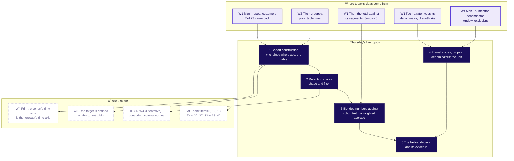

# Week 4 Thursday, 29 October 2026, rebuilt concept-first: the plan

Written 13 October 2026 by the planning session. It edits no repository file. It plans the rebuild of
`content/W04/D4` (Cohort and funnel, Module 2, Thursday 29 October 2026, calendar line W04/D4, IITGN
block W4-3 tentative) so that the row's five subtopics are taught first, each as its own chapter with
its own notebook and a simple, complete, everyday example, and the Zomato Gold case follows as the
application of each. The requester's review of 13 October 2026 (the last message but one in the
scratchpad's requester_messages.md) is the instruction this plan answers, and it ranks above every
document named below. The case material stays as built, because the
requester called the cases good; it moves later in the day, loses its toys to the concept chapters,
and gains titles a trainer can map to the curriculum.

Sources read for this plan: the Thursday row (`docs/curriculum/W4_Analyst_craft.md`, lines 314 to
418), `docs/05_Curriculum_Map_Schema.md`, the calendar line, `data/programme/facts.yaml` (decisions
`chapter-standard`, `teaching-approach`, `w4-case-led`, `w4-finding-once-found`, `faculty-blocks`,
the `cohort`, `campus_day`, `faculty` and `saturday_papers` blocks), the merged pack under
`content/W04/D4`, the Week 4 spine (section 8 and sections 2 to 4), the case file's Thursday section,
`docs/detailing/W04_research_teaching.md` (section 5, the Thursday concept ladder), the Week 1 to 3
rows, `content/W01/D1`, the Saturday bank's W4 paper, and the skills lesson-strategy,
lesson-architecture, curriculum-detailing, concept-packaging, training-deck-builder, notebook-builder,
day-pack-builder with the-standard.md and teaching-styles.md. The scratchpad's INTROSPECTION.md names
the conventions this plan follows: a `## SECTION n:` title carries the subtopic as the row words it,
the italic promise beneath asks the chapter's question, one chapter pairs with one notebook, and every
pack ships an INTERNAL coverage matrix. The documents it promises (DOCTRINE_EDITS.md, WORKFLOW.md,
SPINE_TEMPLATE.md, `scripts/coverage_check.py`) do not exist yet; this plan is written so that the
rebuilt pack passes the gate they describe once it lands.

---

## 1. Coverage now

The row's topic is **Cohort and funnel: why Retail-Plus frequency fell, and where the loss actually
happens**. Its subtopics, verbatim and in the row's order:

1. Cohort construction
2. Funnel stages, drop-off, denominators
3. Retention curves: shape and floor
4. Blended numbers against cohort truth
5. The fix-first decision and its evidence

The row's agenda, outcomes, interview angle, Kahoot plan and exercises need these concepts as well,
which the subtopic list leaves implicit: a cohort and the entry moment (month zero and age), panel
data (one row per member per month), the cohort table and why it is a triangle, retention and churn,
the retention curve, comparing cohorts at the same age against the same calendar month, a blended
rate as a size-weighted average and the mix effect behind Simpson's reversal, a funnel and its stages,
a step rate (the denominator is the step before) against overall conversion (the denominator is the
top), drop-off, the denominator artefact (a step people can skip, a rate above 100), the unit
(sessions against users or members), "a low step is a loss only when it moves", the split by segment,
platform and date that localises a loss, hypotheses before data (five causes with a test each), the
evidence a fix-first call carries, and censoring, named only, for the faculty block.

Counts below come from the merged pack on `main` (STUDENT markdown and notebook markdown together).

| Concept | Source | Where the built pack touches it now | Gap |
|---|---|---|---|
| Cohort construction | Row subtopic 1 | Half one S6 to S13 (the coaching toy, the twelve-member card, the dashboard's way), notebook 01, notebook 02's `pivot_table` cell, guided set Q1 and Q2, cheat sheet panels 1 and 2 | Buried inside the case. The word "cohort" is defined on S9 after the count, no chapter or notebook carries the name, and the method is never shown on a clean example before the case's card |
| Funnel stages, drop-off, denominators | Row subtopic 2 | Half one S27 to S37 (the four rates, the 118 artefact, two units, the release split), notebook 03, guided Q3 and Q4 (the toy funnel), the Kaapi and Co. drill, cheat sheet panel 4 | Buried inside the case. "Drop-off" appears nowhere (0 hits); "overall" conversion against step rate is implicit; the toy funnel sits inside the case chapter |
| Retention curves: shape and floor | Row subtopic 3 | S8 and S9 (rows by age), notebook 02 cells 5 to 8 (curves drawn), ch2 drill Q1 and Q2, Kahoot Q4 | Mostly missing as a taught idea. "Retention curve" appears twice (notes glossary, quiz), "floor" twice (a quiz distractor and one notebook line), "plateau" never. The case's curves slide 0.3 points a month, so the floor is never shown flattening |
| Blended numbers against cohort truth | Row subtopic 4 | S12 and S13 (the batch toy), S16 to S26 (the 38 decomposed, 13,218 of 35,000, the mean of rates), notebooks 01 and 02, ch2 drill Q3 and Q4, Kahoot Q3, cheat sheet panel 3 | Covered, inside the case. The weighted-average formula is named on S13 and asserted in notebook 02; the chapter title ("What is the 38 made of?") never names the topic |
| The fix-first decision and its evidence | Row subtopic 5 | Half two S38 to S42, the fix-first set (6 items), the Kalpa set, Kahoot Q8, S4's hypothesis ladder | Buried. The pattern (step, group, date, comparator, size, cost, objection, what would reverse it) is applied to Zomato without first being taught as a pattern on a simple example |
| Entry moment, month zero, age | Implicit (row: "the new idea is the entry-moment discipline") | S7, S9, guided set definitions, lab set, 16 "month zero" hits | Covered, inside the case |
| Panel data, one row per member per month | Implicit (notebook 01 uses `melt`) | 7 hits: cheat sheet, notebooks 01, 02, 04, notes | Buried; named in passing |
| The cohort table as a triangle | Implicit | 11 hits: notes, cheat sheet panel 1, S16 to S18, the GIF and still in `whiteboards/` | Covered as a picture; why the rows are short is said once |
| Retention and churn | Implicit (the row's outcomes say retention; churn is the interview's word) | "churn" once, in the interview extras | Churn missing as a defined term |
| Same age against same calendar month | Implicit (the row's "cohort comparison") | S8 and S9, ch2 drill Q2, lab set Q2, the day sheet's trap table | Covered, inside the case |
| Weighted average and the mean of rates | Implicit (row: "the blend decomposed") | 43 "weighted" hits; the mean-of-rates trap on S23's notes and ch2 drill Q3 | Covered, inside the case |
| Simpson's reversal, Week 1 Thursday | Row: "the room should say so" | Notes ORIGIN box and CALLBACK line (2 hits); day sheet "start from" | Missing from the deck and the notebooks |
| Step rate against overall conversion | Implicit (row: "the right denominator at each step") | 23 "step before" hits; "overall" 7, mostly in the lab set | Step rate covered; the overall rate is never contrasted with it on a slide |
| The denominator artefact, a skippable step | Row: "a funnel stage whose drop is a denominator artefact" | S30 (118 percent), notebook 03, ch3 drill Q1, lab set Q3, Kahoot Q5 | Covered, inside the case |
| The unit: sessions against members | Row: "sessions against users" (the ticket's caveat) | S31 and S32, notebook 03, guided Q4, Kahoot Q7, 39 "unit" hits | Covered, inside the case |
| A low step is a loss only when it moves | Implicit (row: "which stage owns the loss") | S28 and S29 (the toy), notebook 03 | Covered, inside the case |
| The split by segment, platform and date | Implicit (row: "the app team will dispute") | S33 to S35, notebook 03 cells 9 to 13 | Covered, inside the case |
| Hypotheses before data, five causes with tests | Row: "Thinking we train" | S4, the case-file activity, cheat sheet panel 5, Kahoot Q8 | Covered, as the case's opening board |
| Censoring, named for the block | Row: STOP BEFORE survival analysis | S36, S45, notes, fallback (8 hits) | Covered at the right depth; nothing more is taught |
| `pivot_table` from Week 2 Thursday | Row: START FROM groupby and time fields | 18 hits; S17's code block | Covered; the backward hook to Week 2 Thursday is in the notes only |

In one line: every concept is present somewhere in the pack and none is findable from a chapter
title, a notebook name, the day sheet's ladder or the exercise index; the floor, churn, drop-off and
the Simpson link are the four that are missing or nearly so.

---

## 2. The concept map

How the five connect, in words a trainer can say: a cohort fixes who joined when (1), so one cohort's
share month by month is a curve whose shape and floor can be read (2); a dashboard that averages all
cohorts into one number is a size-weighted blend, which the mix can hold flat while every curve falls
(3); a funnel is the other picture, a chain of steps in which each rate divides by the step before in
one unit, so a loss is a step that moved and an artefact is a step people can skip (4); the fix-first
call takes the worst cohort from 2 and 3 and the broken step from 4, and carries the step, the group,
the date, a comparator, the size, the cost and the objection answered (5). Weeks 1 and 2 gave the
pieces: the repeat count, the denominator habit, the segment reversal, `pivot_table`. Friday takes the
cohort's time axis into a forecast, Week 5 defines a target on the same table, the faculty block takes
the member who has not left yet, and Saturday tests all five.

The deck carries this as two slides, since a map reads at a glance only up to about nine boxes. The
concept-map slide (S3) draws the TODAY block alone, five boxes with their one-line meanings and the
two arrows into topic 5; the links slide (a D slide beside it, and the chapter-close map of each
concept chapter) draws BEFORE and AFTER with the day's box lit. The week map the merged deck shows on
S2 (Monday to Saturday, Thursday lit) moves to the same D slide, since the concept map now says where
Thursday sits.

**The roadmap slide the trainer reads the day from (S2).** A `cards` block with five cards, one per
subtopic, each with the row's words as its title, in this order and with these fields:

| Card | Eyebrow | Title (verbatim from the row) | Body |
|---|---|---|---|
| 1 | Morning, 25 minutes, then applied in chapter 5 | Cohort construction | Group people by the month they joined and compare the groups at the same age. A gym's joiners by hand, then Zomato Gold's 53,089 members |
| 2 | Morning, 15 minutes, then applied in chapter 6 | Retention curves: shape and floor | Read one cohort's share month by month: how fast it falls and where it stops falling. The gym's three curves, then Gold's eight |
| 3 | Morning, 20 minutes, then applied in chapter 6 | Blended numbers against cohort truth | Rebuild a dashboard's one number as a size-weighted average of its cohorts, and see how a new wave holds it flat. The gym's dashboard, then Gold's flat 38 |
| 4 | Morning, 25 minutes, then applied in chapter 7 | Funnel stages, drop-off, denominators | Divide each step by the step before, in one unit; a loss is a step that moved, and a rate above 100 is a step people skip. A college's admissions, then Gold's order flow |
| 5 | Afternoon, 10 minutes, then applied in chapter 9 | The fix-first decision and its evidence | Carry the step, the group, the date, a comparator, the size, the cost and the objection answered. The college's two problems, then Gold's two |

The footer line under the cards is the sentence the day earns, as the merged deck's S3 states it
("It is both, in two numbers that need different fixes ..."), so the whole result stands on screen
before it is built (the fast.ai move the spine already uses). The slide carries no facilitation words,
so `meta_scan.py` passes it; the durations on the eyebrows are the roadmap form the deck-builder skill
accepts for an hour's opening.

---

## 3. Concept chapters, first, 95 minutes of the morning and 10 of the afternoon

**Grouping.** Five chapters, one per subtopic, in a teaching order that differs from the row's list in
one place: retention curves (row subtopic 3) and the blend (row subtopic 4) run straight after cohort
construction, and the funnel (row subtopic 2) runs fourth. The three retention subtopics share one
picture (the cohort table) and one example world (the gym), so a learner builds the table once and
reads it three ways; the funnel is a second picture and a second world. The row's own agenda already
puts "retention curves ... the blend decomposed" after the funnel because it is an agenda of
applications on the event log; the day sheet maps each chapter back to its agenda item in section 6.
The fifth subtopic is a decision pattern, where the other four are techniques, so its concept chapter
opens the afternoon, immediately before the Zomato call that applies it, and still comes before its
application.

**Two worlds, both invented and labelled on every slide and in every notebook's first cell.** A
neighbourhood gym and its monthly joiners carry chapters 1 to 3 (one branch's thirty joiners for the
hand counts, the whole gym's 500 members for the dashboard). A college's admissions to one programme
carry chapters 4 and 5. Each is one shared world in lesson-architecture's sense, so the second and
third concepts cost the learner no new scenario, and each concept also meets the clearest example
before the connected one. Every toy value sits in the facts file under `toys:`, is written by the
generator into `data/` as a tiny CSV, and is asserted by the contract to sit at least five points from
any planted Kalpa value of the same kind (the blend's 41 above all) and from any case value the room has
not yet reached. The numbers below are the design targets for the generator; where a value lands too
near a plant, the build moves the toy, never the plant.

**The order inside every concept chapter** (the doctrine's application-before-theory, concept-packaging's
four beats and the styles blend, applied to a clean example): the owner's wrong reading on screen first;
a prediction and a vote; the hand count on the tiny rows; the picture that shows the mechanism; the
definition or formula named last as shorthand; a glimpse of the one-line code; the plausible wrong
number with the decision it would mislead; a rules slide of three or four complete sentences a learner
photographs; and one line on where Zomato Gold applies it, so the case chapter later opens on a known
idea. Each chapter's `## SECTION n:` title carries the subtopic as the row words it; the italic promise
beneath asks the chapter's question; every body slide's subtitle is a question and its title the
answer, as the standard sets. If `deck_md_check.py` is found to require a question mark on a SECTION
title, the title takes the form "Cohort construction: who joined when?", subtopic first and question
after, which satisfies the gate and the coverage rule at once.

### Chapter 1. Cohort construction (SECTION 1, 25 minutes, 8 slides)

- **From-scratch entry.** A learner who has never worked in a business knows what a batch is from
  coaching classes. A cohort is a batch: everyone who joined in the same month. The gym owner's first
  question, "who keeps coming?", cannot be answered from a monthly visit count, because the count
  mixes people in their first month with people in their fifth.
- **Misconception and prediction.** The owner reads April's visits by joining month: January joiners 5
  of 10, February 5 of 10, March 6 of 10, and says "the March batch is our best". Predict: counted by
  months since joining, which batch keeps the largest share in its own first month after joining? (a)
  January (b) February (c) March (d) all the same. Vote, argue in pairs, vote again.
- **The teaching example, carried through.** One branch of a neighbourhood gym (invented). Thirty
  joiners: ten in January, ten in February, ten in March 2026. A member is active in a month when she
  visited at least once. The roster is one row per member with her joining month and a 1 or 0 for each
  month February to June. By age (the joining month is month zero and is never counted): January 8, 6,
  5, 5, 5 of 10 at ages one to five (80, 60, 50, 50, 50 percent); February 7, 5, 3, 3 of 10 (70, 50, 30,
  30); March 6, 4, 3 of 10 (60, 40, 30). The April column reads 16 of 30, 53 percent, which names no
  batch. No other calendar blend of this roster is printed, because the May column lands within a point
  of Kalpa's 41 (the generator's contract asserts the printed values).
- **Definition derived from tiny numbers.** The roster is first made long: one row per member per
  month (panel data). Age is the month minus the joining month, counted in months. The cohort table
  has one row per joining month and one column per age, and each cell is the share of that cohort
  active at that age. Named last: retention of cohort c at age k equals the members of c active in
  their k-th month after joining, divided by the size of c. Worked: January at age two is 6 of 10, 60
  percent. Why the table is a triangle: March has only three ages so far, so its row is short.
- **Check question (the chapter's drill, item 3).** The May column reads January 5 of 10, February 3 of
  10, March 4 of 10. Which comparison says fairly which batch is weakest, and which batch is it?
  Answer: compare at the same age; at age two the three read 60, 50 and 40, so March is weakest, and
  the May column mixes ages four, three and two.
- **How Zomato Gold applies it later.** Chapter 5 counts the twelve-member card by age (May 3, 2, 1, 1
  of 4; June 2, 1, 1 of 3; the August sale-week members 0 of 5) and chapter 6 builds the same table on
  53,089 members with the same one `pivot_table`. Swiggy Instamart's published cohort table (Th2,
  checked 12 October 2026) is this chapter's real-company slide: a company publishes the same shape and
  states no denominator, which is the question to ask of any cohort chart.
- **Slides, 8.** Opener; the owner's reading and the predict; the roster as a panel grid; the age column
  and the hand count by age (the answer); the table as a triangle; the formula named last and the one
  `pivot_table` line (the Week 2 Thursday hook named in the body text); the plausible wrong answer
  ("March is our best batch", the retention budget sent to the wrong batch) with its check; the rules
  slide (a cohort is everyone who joined in the same month; the joining month is month zero; compare
  cohorts at the same age; a calendar column names no cohort) with the Swiggy card and the Zomato line.

### Chapter 2. Retention curves: shape and floor (SECTION 2, 15 minutes, 6 slides)

- **From-scratch entry.** One row of the table, drawn as a line, is a retention curve. The gym's
  January joiners made a New Year resolution; the curve says how fast the resolution wore off and how
  many kept the habit.
- **Misconception and prediction.** "January's batch halved in two months (80, then 60, then 50), so by
  month five almost nobody is left." Predict January's month five: (a) under 10 percent (b) about 25
  (c) 50 (d) back up to 80. Reveal: 50. The curve flattened at month three.
- **The teaching example, carried through.** The same roster. January's curve 80, 60, 50, 50, 50: a
  steep fall for two months, then flat at 50, the floor, the seven of ten who made it a habit.
  February's curve 70, 50, 30, 30: its floor is 30. March's curve 60, 40, 30: still falling, so it has no
  floor yet. Churn is the share lost: at age two, January has churned 40 percent (100 less 60); some
  teams quote month-to-month churn instead, and the chart must say which.
- **Definition derived from tiny numbers.** Shape is how fast the curve falls in its first ages; the
  floor is the level where it stops falling. Rule of thumb, labelled as this programme's construction:
  call a floor only when two successive ages read the same share, so March's floor is unknown, which
  is the plain-words version of censoring that the faculty block (tentative) takes up. Ranking three
  cohorts fairly means reading them at the same age: at age two, 60, 50 and 40.
- **Check question.** February read 50 at age two and 30 at ages three and four; the owner planned
  staffing for "February's floor of 50" after one month. What went wrong, and what is February's
  floor? Answer: a floor was read from one age; the floor is 30, and the plan overstated February's
  regulars by 20 points of ten joiners.
- **How Zomato Gold applies it later.** Chapter 6 draws eight Gold curves: every one drops to about
  38.5 at month two and then slides about 0.3 points a month, a floor that erodes slowly, and the
  month-one column falls 58 to 49 to 31 (chapter 6's drill ranks three rows at the same age). Blinkit's
  published figure (Th1, checked 12 October 2026), 46 percent of a cohort still ordering in the fourth
  quarter after joining while the cohort's spend grows, is this chapter's real-company slide: the
  survivors are the business. Kahoot Q4 asks what the floor means.
- **Slides, 6.** Opener; the predict; the three curves with their floors marked (the gym picture,
  drawn by the figure script); churn as the complement, one table; the plausible wrong answer (a floor
  read from one age) with the two-ages rule; the rules slide (shape says how fast a cohort leaves; the
  floor says who stayed; rank at the same age; a young cohort has no floor yet) with the Blinkit card
  and the Zomato line.

### Chapter 3. Blended numbers against cohort truth (SECTION 3, 20 minutes, 7 slides)

- **From-scratch entry.** An average of two groups is a weighted average, and the weights are the group
  sizes. A dashboard's one retention number over all members is such an average, so it moves when the
  mix of young and old cohorts moves, even when nobody's behaviour changed.
- **Misconception and prediction.** "If every cohort's rate falls, the overall rate must fall." The
  gym's dashboard, the share of all members who visited this month: December 50 percent. In January the
  older members fall from 50 to 40 percent and 400 New Year joiners arrive at 52.5 percent. Predict the
  January dashboard: (a) rises (b) falls (c) holds at 50 (d) cannot be read. Reveal: it holds.
- **The teaching example, carried through.** The whole gym now (the facts file's `toy_blend`, invented):
  100 older members, 50 of whom visited in December (50 percent) and 40 in January (40 percent); 400
  January joiners, 210 of whom visited (52.5 percent). January reads 250 of 500, 50 percent. The
  explorer's scene Th2 lets a learner slide the new wave's size and watch the line.
- **Definition derived from tiny numbers.** The stacked picture first: 40 plus 210 active over 100 plus
  400 members. Then the formula as its shorthand: blend equals the sum of (cohort size times cohort
  rate) over the sum of cohort sizes, which equals the direct count. (100 times 0.40 plus 400 times
  0.525) over 500 is 250 over 500. The plain mean of the two rates, 46.25, is the wrong number: it gives
  a cohort of 100 the same vote as a cohort of 400. "Cohort truth" is the table's rows read at the same
  age, which the blend averages away. The Week 1 Thursday link is said here in one sentence: Kalpa's
  monsoon sale lifted the total 6 percent while every segment fell, the same arithmetic, which is
  Simpson's reversal (the 1951 paper is in the pack's sources).
- **Check question.** Cohort X, 200 members, 60 percent then 55; cohort Y, 300 members, 40 then 36; a
  new cohort Z of 500 joins in the second month at 52 percent. The blend before and after? Does a
  0.2-point move mean little changed? Answer: 48.0 then 47.8; both old cohorts fell 4 to 5 points and
  the new cohort propped the number. (These values stay clear of the Saturday bank's Set 2, of the
  Kahoot's 46 and of the case's 38 and 36.)
- **How Zomato Gold applies it later.** Chapter 6 rebuilds the dashboard's September 38 as the
  size-weighted average of seven cohorts, 13,218 of 35,000, in the notebook's your-turn cell, asserts it
  equal to the direct count, shows the mean of rates at 36.9 against 35.9 counting everyone, and finds
  the August cohort outside the count. Swiggy's blend (Th3, checked 12 October 2026), users up 27.4
  percent while frequency fell 6.3 percent, is the real-company slide: a blend cannot say which.
- **Slides, 7.** Opener; the dashboard and the predict; the two cohorts' rates with the flat line over
  them (the gym picture); the stacked areas and the formula named last; the plausible wrong answer (the
  mean of rates, 46.25, and "nothing changed") with the check (the weighted average must equal the
  direct count); the Week 1 Thursday link; the rules slide (a blend is a size-weighted average; it moves
  with the mix as well as with behaviour; rebuild it from its cohorts before believing it; a plain mean
  of rates is never the blend) with the Swiggy card and the Zomato line.

### Chapter 4. Funnel stages, drop-off, denominators (SECTION 4, 25 minutes, 8 slides)

- **From-scratch entry.** A funnel is a chain of steps people pass through, fewer at each. Every
  learner in the room passed through one to be here: applications, an entrance test, a shortlist, an
  offer, joining.
- **Misconception and prediction.** "The step with the lowest rate is the one to fix." A college's
  admissions to one programme this cycle: 1,000 applications, 800 sat the entrance test, 400 were
  shortlisted, 300 accepted the offer, 240 joined. Last cycle: 1,000, 800, 400, 360, 288. Predict which
  step owns this cycle's loss: (a) shortlisting, the lowest at 50 percent (b) offer acceptance, 90 to 75
  (c) joining at 80 (d) the test, which 200 skip. Reveal: (b). Shortlisting is a selection step that is
  low by design and did not move.
- **The teaching example, carried through.** The college (invented). Step rates this cycle 80, 50, 75,
  80 percent; drop-off per step 20, 50, 25, 20; overall 24 percent (240 of 1,000) against 28.8 last
  cycle. Two more readings of the same college: a sister programme where the test is optional, 300 sat
  the test and 320 were shortlisted (230 of the test-takers plus 90 on board marks), so "test to
  shortlist" reads 107 percent, an artefact, and the honest rate is 230 of 300 among test-takers, 77
  percent (or 32 percent of applications, a different question); and the unit, since the 1,000
  applications came from 850 applicants, so joined reads 24 percent per application and 28 percent per
  applicant.
- **Definition derived from tiny numbers.** Step rate equals those who reached a step over those who
  reached the step before, in one unit; drop-off is 100 less the step rate; overall conversion divides
  by the top, and the step rates multiply to it (0.8 times 0.5 times 0.75 times 0.8 is 0.24). A loss is
  a step whose rate moved against its own past; a rate above 100 means the numerator holds people who
  never passed the denominator's step, so the step is skippable and the chart must count it among those
  who did pass. The unit is named on every chart: applications or applicants, sessions or members.
- **Check question.** The test team asks "how often does sitting our test lead to a shortlist?" Which
  rate answers them: shortlisted over test-takers (107 percent), shortlisted among test-takers (77),
  shortlisted over applications (32), or test-takers over applications (30)? Answer: the second; the
  first is the artefact and the other two answer other questions.
- **How Zomato Gold applies it later.** Chapter 7 reads the September funnel per session (68, 118, 34,
  80, 64), finds the 118 artefact (the home carousel skips search; 89 percent among sessions that
  searched), reads menu-to-cart at 34 per session and 61 per member, and splits add-to-cart to order by
  membership, platform and date to find Android members' 58 to 44 after 14 September. Amplitude's 7
  percent day-7 line (Th5) stays the real-company caveat on "what good means". Saturday items 13, 21,
  27 and 42 test these denominators.
- **Slides, 8.** Opener; the five stages as bars with both cycles (the college picture) and the predict;
  step rate, drop-off and overall on one table (the formula named last); the step that moved against
  the lowest step (the answer); the artefact (107 percent) and its fix; the unit (per application, per
  applicant); the plausible wrong answer ("redesign shortlisting, it loses half", a committee sent to a
  step that works) with the check (compare each step with its own past); the rules slide (each step
  divides by the step before, in one named unit; drop-off is the share lost at a step; a low step is a
  loss only when it moves; a rate above 100 is a skippable step) with the Zomato line.

### Chapter 5. The fix-first decision and its evidence (SECTION 8, 10 minutes, 6 slides, afternoon)

- **From-scratch entry.** When two problems compete for one team, the call is a sentence with numbers,
  and the evidence is what survives the meeting with the team that owns the step.
- **Misconception and prediction.** "Fix the biggest number first." The college's dean has two
  problems: 200 of 1,000 applicants skip the entrance test every cycle, and offer acceptance fell from
  90 to 75 percent. Predict which goes first: (a) the test's 20 percent no-show, the bigger count (b)
  offer acceptance (c) both at once (d) wait a cycle. Reveal: (b); the no-show has read 20 percent for
  three cycles and is a design feature until it moves.
- **The teaching example, carried through.** The same college. The split: 400 shortlisted, 250 from the
  state and 150 from other states; acceptance for in-state 92 to 90 percent, for other states 87 to 50,
  from the cycle the fee-payment deadline was shortened from 21 to 7 days after the offer (invented).
  Size: 60 students a cycle (360 expected at last cycle's rate against 300), 55 of them from other
  states. Cost: 60 times an annual fee of Rs 1.2 lakh, an assumption with a range of Rs 1 to 1.5 lakh,
  so Rs 60 to 90 lakh of fee income a year, invented. The objection from the admissions office, "our
  offers go out within two days, every one", is partly right: the offers held, the acceptances fell for
  one group after one date. The fact that would reverse the order: other-state acceptance falling before
  the deadline changed.
- **The pattern named last.** A fix-first page carries five lines: the call; the evidence (the step, the
  group it hurts most, the date, each with its number, and a comparator on the same step that held); the
  cost (the size in units a week or a cycle, times a value with its assumption and range); the objection
  (the true part conceded, then the split that answers the rest); and what would change the call. Before
  blaming anyone, the five causes of the morning's board are ruled out in order: the count, the
  definition, the cohorts, everyone, then the step.
- **Check question.** A page names the step and the size and nothing else. Which two lines would the
  admissions office attack first, and what fills them? Answer: the comparator (in-state held at 90 on
  the same step) and the date (the deadline change), which turn a fall into a cause.
- **How Zomato Gold applies it later.** Chapter 9's unguided set writes the same five lines for the
  membership lead: the Android checkout first (72.5 to 55 inside the checkout, iOS 71 to 70 and
  non-members 65 to 64 as comparators, about 1,133 to 1,317 orders a week, Rs 3.4 to 6.6 lakh of order
  value), then the sale-week cohort's payback; the app team's "checkout is fine" is answered the same
  way. The Kalpa set writes the page a second time in the lab. Saturday item 22 tests the evidence.
- **Slides, 6.** Opener; the dean's two problems and the predict; the split by group and date (the
  college picture); the size and the cost with its range; the objection conceded and answered; the
  five-line page filled for the college, which is also the rules slide, with the Zomato line.

Decision sentences, counted against the cap: the morning's concept block carries four (a cohort fixes
the entry moment so cohorts are compared at the same age; a curve's shape says how fast a cohort
leaves and its floor who stayed; a blend is a size-weighted average that the mix can hold flat; a
funnel step divides by the step before in one unit and a low step is a loss only when it moves), the
case chapters add none, and the afternoon adds the fifth (a fix-first call carries the step, the group,
the date, a comparator, the size, the cost and the objection). Five for the day, within the cap of
four per two hours.

---

## 4. Concept notebooks

Conventions, from the merged pack and the Week 4 spine: the smallest pandas and matplotlib that work,
each notebook defining its own three-line `check(name, ok)` (the merged notebooks do; none imports
`c2kit`), data read from `../data/` and never pasted into a cell, every code cell executed and saved,
at least three pictures from code and five passing checks per notebook, a **Predict before you run.**
cell with lettered options before each result and a **What happened.** cell after it, a MAP cell at the
top drawing the chapter's steps with the current one lit, a SUM cell at each group's end, and a last
cell that prints the check summary and names what the next notebook adds. The first cell asks the
chapter's question in full with **Who needs the answer.** and **The questions on the way.**, states
that the example is invented, and says in one sentence what the previous notebook established. The
generator writes the three toy CSVs and asserts their designed values in the contract, as it does for
the twelve rows; `C2_W04_D04_build_notebooks_INTERNAL.py` gains one builder per concept notebook.

New data files: `data/C2_W04_D04_toy_gym_roster_STUDENT.csv` (one row per member per month: member id,
joining month, month, visited), `data/C2_W04_D04_toy_gym_dashboard_STUDENT.csv` (month, cohort,
members, active), `data/C2_W04_D04_toy_admissions_STUDENT.csv` (programme, cycle, stage, count, plus
the applicants count and the by-group acceptance rows). Each is labelled invented in the facts file's
`toys:` block and in the first cell of the notebook that reads it.

### `C2_W04_D04_01_cohort_construction_STUDENT.ipynb` (about 15 cells)

1. MD title: "Cohort construction: how is a cohort built from a list of joiners, and why are cohorts
   compared at the same age?" with the two paragraphs, the invented label, and the line that this is the
   first of five concept notebooks and that the case notebooks (06 to 09) apply them.
2. MD setup note, then CODE: imports, `check`, load the roster, print its shape and three rows (SEE).
3. CODE MAP: the five steps (roster, one row per member per month, age, the table, compare at the same
   age) as a small matplotlib strip, step one lit. Picture 1.
4. MD: the owner's April reading and **Predict before you run.** (which batch keeps the most in its own
   first month: a, b, c, d).
5. CODE DO: the April column counted by calendar month: 5, 5, 6 of 10 and 16 of 30 (SEE).
6. CODE DO: age in months (year times 12 plus month, the joining month as month zero); one member's
   rows printed with her ages.
7. CODE DO: the cohort table with one `pivot_table`, printed as percents (SEE).
8. MD **What happened.** The answer is (a): 80, 70, 60 at age one; March, best in April, is weakest at
   the same age. The definitions, and the formula named last.
9. CODE SEE: the table as a heatmap with short rows at the bottom, why it is a triangle. Picture 2.
10. CODE CHECK: thirty members; three cohorts of ten; January's age-one share is 0.8; the April count is
    16 of 30; every row is counted over its whole cohort at every age; no row rises with age.
11. MD **The plausible wrong answer.** "March is our best batch, 60 percent came in April", the retention
    budget sent to the wrong batch. **Why it is wrong.** Ages mixed. CODE: the calendar reading beside
    the age reading as two panels. Picture 3.
12. MD and CODE, a second route: January's row recounted by a loop over members with no `pivot_table`,
    asserted equal to the table's row (check six).
13. MD **In the interview.** Saturday item 5's anchor as a question (a cohort groups customers by the
    moment they what?) and the first move of "retention dropped; walk me through it", answered in full.
14. CODE SUM: the table of what the notebook established (cohort; month zero; age; the table; same age)
    and the check summary.
15. MD: what notebook 02 adds (the rows drawn as curves, and where each stops falling).

### `C2_W04_D04_02_retention_curves_STUDENT.ipynb` (about 14 cells)

1. MD title: "Retention curves: what do a curve's shape and floor say, and how are three curves ranked
   fairly?", the paragraphs, the invented label, one sentence restating notebook 01's table.
2. CODE setup: load the same roster; rebuild the table in one cell (the chain from 01).
3. CODE MAP: the steps (the row as a curve, shape, floor, churn, ranking), step one lit. Picture 1.
4. MD **Predict before you run.** January's month five (a, b, c, d).
5. CODE DO: the three curves drawn, floors marked where two ages agree (SEE). Picture 2.
6. MD **What happened.** The answer is (c), 50; the floor is the seven of ten who kept the habit.
7. CODE DO: churn as 100 less retention, and the month-to-month version, in one table.
8. MD **Predict before you run.** Rank the three at age two (a, b, c, d).
9. CODE DO: the ranking at the same age beside the ranking by latest calendar month, two panels.
   Picture 3.
10. MD **What happened.** 60, 50, 40; March has no floor yet; one sentence naming censoring for the
    faculty block (tentative).
11. MD **The plausible wrong answer.** February's floor read as 50 after one age, staffing planned on it.
    **Why it is wrong.** The two-ages rule. CODE: February's row with the rule applied.
12. CODE CHECK: the rebuilt table equals 01's; January's ages three to five are equal; February's ages
    three and four are equal; March is still falling at its last age; churn plus retention is 100 in
    every cell; the age-two ranking is January, February, March.
13. CODE SUM and check summary.
14. MD: what notebook 03 adds (one number over all members while every row falls).

### `C2_W04_D04_03_blended_vs_cohort_STUDENT.ipynb` (about 15 cells)

1. MD title: "Blended numbers against cohort truth: how can one rate over all members hold flat while
   every cohort's rate falls?", the paragraphs, the invented label, one sentence restating 02.
2. CODE setup: load the dashboard file (December and January, two cohorts).
3. CODE MAP: direct count, each cohort's rate, the weighted average, the second route, the link to Week 1
   Thursday. Picture 1.
4. MD **Predict before you run.** The January dashboard rises, falls, holds or cannot be read.
5. CODE DO: the direct count per month, 50 of 100 and 250 of 500 (SEE).
6. MD **What happened.** The answer is (c).
7. CODE DO: each cohort's own rate per month, 50 to 40 and 52.5, drawn with the flat blend line over
   them. Picture 2.
8. MD **The plausible wrong answer.** The plain mean of rates, 46.25. **Why it is wrong.** One vote
   each. CODE: the weighted average computed and asserted equal to the direct count; the formula named
   in the markdown beneath.
9. CODE SEE: the stacked active members by cohort under the flat line (the decomposition picture, the
   same drawing the deck and the explorer's scene Th2 use). Picture 3.
10. MD: the Week 1 Thursday link in one paragraph (the monsoon sale's aggregate against its segments;
    Simpson's reversal, with the source already in the pack's sources file).
11. MD **Predict before you run.** The X, Y, Z check question (48.0 then 47.8).
12. CODE DO: X, Y, Z computed both ways, and **What happened.** beneath.
13. CODE CHECK: December blend 0.5; January blend 0.5; the weighted average equals the direct count in
    both months; the plain mean differs from the blend; the older cohort fell ten points; the X, Y, Z
    blend reads 0.48 then 0.478.
14. MD **In the interview.** "Blended retention is flat while every cohort declines; how?" answered in
    full, with the mechanism in one breath.
15. CODE SUM, check summary, and what notebook 04 adds (from who stays to which step people pass).

### `C2_W04_D04_04_funnel_denominators_STUDENT.ipynb` (about 16 cells)

1. MD title: "Funnel stages, drop-off, denominators: which step of a funnel owns a loss, on which
   denominator, in which unit?", the paragraphs, the invented label.
2. CODE setup: load the admissions file; print the five stages for both cycles.
3. CODE MAP: the steps (the stages as bars, step rate and drop-off, overall, the step that moved, the
   artefact, the unit). Picture 1 (the funnel as bars, both cycles).
4. MD **Predict before you run.** Which step owns this cycle's loss (a, b, c, d).
5. CODE DO: step rates (each over the step before), drop-off (100 less the step rate), overall (over the
   top), one table for both cycles (SEE).
6. MD **What happened.** The answer is (b); the lowest step did not move. The formula named last, and
   the check that the step rates multiply to the overall.
7. CODE SEE: step rates this cycle against last cycle, side by side. Picture 2.
8. MD **The plausible wrong answer.** "Redesign shortlisting, it loses half", the committee sent to a
   working step. **Why it is wrong.** Compare each step with its own past. CODE: the change per step.
9. MD and CODE, the artefact: the sister programme's optional test, 320 of 300 reads 107 percent; the
   fix, 230 of 300 among test-takers (77), and 32 percent of applications as a different question.
10. MD **Predict before you run.** Joined per application against per applicant (higher, lower, equal,
    above 100).
11. CODE DO: 240 of 1,000 against 240 of 850; the funnel in two units, two panels. Picture 3.
12. MD **What happened.** Name the unit on every chart; the same step reads higher per person because
    a person can try more than once.
13. CODE CHECK: the step rates multiply to 0.24; drop-off plus step rate is 100 at every step; last
    cycle's acceptance is 0.9; the artefact rate is above 1 and the fixed rate below 1; the
    per-applicant rate exceeds the per-application rate; shortlisting reads 0.5 in both cycles.
14. MD **In the interview.** The Saturday item 42 pattern (give the three step rates of a four-stage
    funnel) worked on the college's numbers, and "the owning team says the step is fine; what do you
    bring?" answered in full.
15. CODE SUM and check summary.
16. MD: what notebook 05 adds (which of two problems the dean fixes first).

### `C2_W04_D04_05_fix_first_evidence_STUDENT.ipynb` (about 14 cells)

1. MD title: "The fix-first decision and its evidence: which of two problems goes first, and what must
   the page carry to survive the meeting?", the paragraphs, the invented label.
2. CODE setup: load the admissions file's by-group rows and the assumption (fee, range).
3. CODE MAP: the five lines of a page (call, evidence, cost, objection, what would change it). Picture 1.
4. MD **Predict before you run.** Which goes first (a, b, c, d).
5. CODE DO: the split by group and cycle, 92 to 90 and 87 to 50, grouped bars (SEE). Picture 2.
6. MD **What happened.** The answer is (b); the no-show has not moved in three cycles.
7. CODE DO: the size (360 expected against 300, 60 lost, 55 from other states) and the cost (60 times
   Rs 1.2 lakh, Rs 72 lakh, in a range of Rs 60 to 90 lakh), drawn as a bar with its range. Picture 3.
8. MD: the objection ("offers go out within two days") conceded and answered; CODE: the comparator
   table on the same step.
9. MD **The plausible wrong answer.** "Fix the test first, 200 students never sit it." **Why it is
   wrong.** The step did not move. CODE: the test's step rate across three cycles.
10. CODE, a second route: the loss counted from joiners (288 against 240, 48 fewer) against 60 times 0.8,
    asserted equal.
11. CODE SEE: the five-line page printed from the numbers.
12. CODE CHECK: 60 lost; 55 of them from other states; in-state within two points; the cost midpoint is
    Rs 72 lakh; the two routes agree at 48; the test's step rate is equal in every cycle.
13. CODE SUM and check summary.
14. MD: the afternoon applies this page to Zomato Gold's two problems, and the lab to Kalpa's.

### The case notebooks, renamed and renumbered after the concept notebooks

| Now | Becomes | What changes inside |
|---|---|---|
| `C2_W04_D04_01_twelve_rows_STUDENT.ipynb` | `C2_W04_D04_06_case_cohort_construction_STUDENT.ipynb` | The coaching-batch toy cells (2 to 4) and the blend toy cells (13 and 14) go, since notebooks 01 and 03 now teach them on the gym; the first cell restates each rule in one line and says which concept notebook taught it; the card, the count by age and the dashboard's way stay |
| `C2_W04_D04_02_cohort_table_STUDENT.ipynb` | `C2_W04_D04_07_case_retention_and_blend_STUDENT.ipynb` | Unchanged in its cells; the first cell names chapters 1 to 3 as what it applies; the October estimate (cell 18) and the zone split (cell 20) are headed as depth material |
| `C2_W04_D04_03_funnel_STUDENT.ipynb` | `C2_W04_D04_08_case_funnel_denominators_STUDENT.ipynb` | Unchanged in its cells; the first cell names chapter 4 as what it applies; the toy-funnel comparison in its markdown points to notebook 04 |
| `C2_W04_D04_04_kalpa_lab_STUDENT.ipynb` | `C2_W04_D04_09_kalpa_lab_cohort_and_funnel_STUDENT.ipynb` | Unchanged; the first cell names the five chapters it re-runs on Kalpa; its empty your-turn cells and the plant rule stay exactly as they are |

Every file that names a notebook by number (the day sheet, the exercise index, the take-home, the
pre-read's "run notebooks 01 to 04", the lab note, the cheat sheet, the notes' reading path, the
explorer notes) is updated in the same pass, and the Wednesday pre-read's terms-only promise stays
true since no concept is pre-taught there.

---

## 5. The case chapters

Every case slide keeps its content; the toys, the real-company cards and one cut move out, and the
titles gain the topic they apply. Slide numbers below are the merged deck's; the rebuild renumbers.

| Merged slides | New section and title | Applies | Keep, trim or move | Minutes |
|---|---|---|---|---|
| S1 (the ticket) | Opening, S1 | | Keep as slide one, so the day still opens on the case | 3 |
| S2 (the week map) | Opening, a D slide beside the concept map | | Move; the roadmap (new S2) and the concept map (new S3) take its place | 4 |
| S3 (where today ends) | The roadmap's footer line | | Fold | |
| S4 (five causes with tests) | Opening, S4 | Feeds chapter 5 | Keep; the groups' own boards open the case block | 3 |
| SECTION 1 opener, S5 | SECTION 5: "Cohort construction on Zomato Gold" (promise: who entered when, counted by hand on twelve members?) | 1 | Keep the timeline slide with four questions trimmed to three | 2 |
| S6 (two coaching batches) | SECTION 1's opening analogy, one line | 1 | Move; the gym carries the concept now | |
| S7 to S11 (the card, two predicts, two answers) | SECTION 5 | 1 | Keep whole; the card is the case's L1 | 11 |
| S12, S13 (the blend toy) | SECTION 3 | 3 | Move; the toy is the concept chapter's own example | |
| S14 (Blinkit and Swiggy cards) | SECTION 1 (Swiggy) and SECTION 2 (Blinkit) real-company slides | 1, 2 | Move; one card each | |
| S15 (chapter 1 close) | SECTION 5 close | 1 | Keep, one slide, restated as "what the card showed" | 2 |
| SECTION 2 opener, S16 | SECTION 6: "Retention curves and the blend on 53,089 members" (promise: what is the dashboard's 38 made of?) | 1, 2, 3 | Keep | 2 |
| S17 to S19 (the `pivot_table`, every row falls, the dashboard's print) | SECTION 6 | 1, 2 | Keep; the code slide is now a glimpse, since notebook 01 built the same table | 8 |
| S20 to S23 (38.2 to 37.8, the wrong call, each month's 38, 13,218 of 35,000 both ways) | SECTION 6 | 3 | Keep; S22 merges into S21's answer slide | 12 |
| S24, S25 (counting everyone, 36 percent) | SECTION 6 | 3 | Keep | 5 |
| The October estimate and the zone split (notebook cells 18 and 20, S23's notes) | SECTION 6, D slides | 3 | Move to self-study | |
| S26 (chapter 2 close) | SECTION 6 close, with the ch2 drill's three rows read | 2, 3 | Keep | 3 |
| SECTION 3 opener, S27 | SECTION 7: "Funnel stages, drop-off, denominators on the event log" (promise: which stage owns the loss, for whom, since when?) | 4 | Keep | 2 |
| S28 (which step owns the loss, four rates) | SECTION 7 | 4 | Keep as the Brilliant opener | 3 |
| S29 (a low step is not a loss until it moves, the toy) | SECTION 4 | 4 | Move; it is the concept's prediction, now on the college | |
| S30 (118 percent, the carousel) | SECTION 7 | 4 | Keep | 5 |
| S31, S32 (per member or per session) | SECTION 7 | 4 | Keep, one predict and one answer | 5 |
| S33 to S35 (whose conversion fell; the step inside the checkout) | SECTION 7 | 4 | Keep whole; the day's central finding | 10 |
| S36 (seven checks before the call) | SECTION 7, three read aloud and four on a D slide | 4 | Trim | 3 |
| S37 (chapter 3 close) | SECTION 7 close | 4 | Keep | 2 |
| Half two SECTION 4, S38 to S42 (the fix-first call) | SECTION 9: "The fix-first decision on Zomato Gold" (promise: what is fixed first, on what evidence, at what cost?) | 5 | Keep; S41's wrong fix ("buy more sale members") becomes the chapter's anti-pattern slide | 25 |
| SECTION 5, S43 to S45 (the walk, the AI variant, the handoff) | SECTION 10: "What does the interviewer hear?" | 5 and all | Keep; the AI variant is read aloud, with no discussion | 10 |
| SECTION 6, S46 and S47 (Kahoot, the close) | SECTION 11: "What does the room carry out?" | all | Keep | 15 |
| The fallback deck, S1 to S10 | Unchanged | | Keep; runs only when the block slips | 120 |
| The Kaapi and Co. funnel drill (`ch3_funnel`) | The lab's practice set | 4 | Move; this is the row's "third funnel example", its own cut-first | |

Each case chapter's opener timeline keeps the step questions and adds the line "applies chapter n" in
the body text, which is the backward hook lesson-architecture asks for at every reuse.

---

## 6. Trainer and learner artefacts

### The day sheet's topic list, mapped to the row's trainer agenda

| Row agenda item | Row minutes | Sections that carry it | Minutes in the rebuilt day |
|---|---|---|---|
| 1. The blended retention number and the head of Retail-Plus's two questions | 10 | Opening: the ticket, the roadmap, the concept map, the five causes (the Retail-Plus questions open the lab, as built) | 10 |
| 2. Cohort construction: who entered when, tracked forward, never blended | 50 | SECTION 1 (25), SECTION 5 (15), SECTION 6's table step (10) | 50 |
| 3. The funnel: stages, drop-off per stage, denominators, the stage that owns the loss | 45 | SECTION 4 (25), SECTION 7 (30) | 55 |
| 4. Retention curves: shape, floor, cohort comparison; the blend decomposed | 40 | SECTION 2 (15), SECTION 3 (20), SECTION 6's curves and blend steps (20) | 55 |
| 5. Guided then unguided: the cohort study and the funnel on the event log, the stage to fix first | 60 | SECTION 8 (10), SECTION 9 (25), SECTION 10 (10); the guided items run inside SECTIONS 5 and 7 and are counted there | 45 |
| 6. Kahoot and close | 20 | SECTION 11 | 15 |
| Break | | | 10 |
| Total | 225 | | 240, the trainer's minutes on a faculty day |

The day sheet prints this table above its question ladder, so the trainer sees the row's topics and
their minutes before the questions; the ladder table gains a "Topic" column that names the subtopic
each part teaches or applies.

### The deck's roadmap slide and concept-map slide

Section 2 gives both in full. The roadmap is S2 (five cards, the row's words as titles, minutes and
the applying chapter on each eyebrow, the day's sentence as the footer). The concept map is S3 (the
five topics with their one-line meanings and the two arrows into topic 5), and each concept chapter's
rules slide repeats it with that chapter lit, which is the repeated connection diagram the deck-builder
skill asks for. The before-and-after links and the week map sit on one D slide after S3.

### Exercise items per concept

Five concept drills, new, each sat on paper inside its chapter in three to five minutes, letters
posted, the first item fully worked and the second half worked (the fade):

| Drill | File (with its solution in `solutions/`) | Items | Design items |
|---|---|---|---|
| Cohort construction | `unguided/C2_W04_D04_c1_cohort_construction_STUDENT.md` | 3: January's row by age (L1, worked); February's row (L1, half worked); which first table answers "which joining month is weakest" (L2, design) | 1 |
| Retention curves: shape and floor | `unguided/C2_W04_D04_c2_retention_curves_STUDENT.md` | 3: read January's floor (L2, worked); rank the three at age two (L2); can March's floor be called from 40 then 30 (L3, design) | 1 |
| Blended numbers against cohort truth | `unguided/C2_W04_D04_c3_blended_vs_cohort_STUDENT.md` | 3: the X, Y, Z blend both months (L2, worked); why the plain mean misleads (L3); which second route proves a blend (L3, design) | 1 |
| Funnel stages, drop-off, denominators | `unguided/C2_W04_D04_c4_funnel_denominators_STUDENT.md` | 4: step rates and overall from the college's counts (L1, worked; the merged guided set's Q3 and Q4 move here as its worked half); which step owns this cycle's loss (L3, design); the 107 percent artefact and its fix (L3); which denominator answers the test team (L3, design) | 2 |
| The fix-first decision and its evidence | `unguided/C2_W04_D04_c5_fix_first_evidence_STUDENT.md` | 2: the order of work and the fact that would reverse it (L5, design); the two lines a bare page is missing (L5, design) | 2 |

Fifteen new items, seven of them design items. The merged sets stay: the guided set's Q1 and Q2 (the
card) in SECTION 5, the ch2 drill in SECTION 6's close, the fix-first set in SECTION 9, the Kalpa set
and the practice set in the lab, with the Kaapi and Co. drill added to the lab's practice. The day then
carries 43 items, 23 of them design items, above the one-third rule; the exercise index gains a
"Topic" column and lists the concept drills first.

### Kahoot items per concept

The merged pack's eight items already cover the row's five plus the return question; they gain a topic
on their `*Tests:*` line and one stem edit:

| Item | Topic | Change |
|---|---|---|
| Q1, what a cohort fixes | Cohort construction | None |
| Q4, the level after month one | Retention curves: shape and floor | The stem says "floor" in the row's words ("what does that floor mean for the business?") and option d loses the word so it stops giving the key away; the distractor audit re-runs |
| Q3, the blend at 46 both months | Blended numbers against cohort truth | None; keep its 46 clear of the toy's wrong mean of 46.25 by saying "46 percent" in the stem and never 46.25 anywhere in the quiz |
| Q2, Q5, Q7 (the step that changed, the artefact, two units) | Funnel stages, drop-off, denominators | None |
| Q8, what comes first in a retention walk | The fix-first decision and its evidence | None |
| Q6, bread and milk | Wednesday's return question | None |

### Study-note and cheat-sheet sections named by topic

The notes gain a first part, "The five topics", before the case: five sections, each headed as a
question that opens with the subtopic's words ("Cohort construction: what is a cohort, and how is a
cohort table built?", "Retention curves: what do a curve's shape and floor say?", "Blended numbers
against cohort truth: how does a flat average hide a fall?", "Funnel stages, drop-off, denominators:
which step owns a loss?", "The fix-first decision and its evidence: what does a call carry?"), each
with **Who needs the answer.** and **The questions on the way.**, the plain explanation a newcomer could
repeat, the gym or college example with its picture, the formula, the trap, the Zomato application in
two lines and the interview question it answers. The case sections stay as part two. The glossary gains
cohort table, age and month zero, floor, churn, drop-off, overall conversion, step rate, artefact,
unit, blend, weighted average, comparator and mix. The notes grow from about 3,000 to about 4,000
words, which exceeds the spine's "2,000 to 3,000" line; section 8 flags the spine amendment.

The cheat sheet keeps its six panels and renames them by topic: panel 1 "Cohort construction: what does
the triangle say?" with the day's picture, which the hard rule fixes as panel one; panel 2 "Retention
curves: where is the floor?" with the gym's three curves beside Gold's; panel 3 "Blended numbers against
cohort truth: what is a blend made of?" with the formula and the gym toy; panel 4 "Funnel stages,
drop-off, denominators: how does a step read?" with step rate, drop-off, overall, the artefact and the
unit; panel 5 "The fix-first decision and its evidence: which cause is checked first, and what does the
page carry?" with the five causes and the five lines; panel 6 "The case in numbers" with Gold's values.
The twelve-member card, now applied in SECTION 5, moves into panel 6's left half so the spine's "panel
two the twelve members" promise is kept in substance.

The trainer files gain one INTERNAL coverage matrix (`internal/C2_W04_D04_coverage_INTERNAL.md`), the
rows of section 8, which is the file the planned `coverage_check.py` reads.

---

## 7. Minutes

The envelope (`campus_day` and `faculty` in `data/programme/facts.yaml`, the spine's section 3): two
blocks of 180 minutes with lunch between, the IITGN block W4-3 of 120 minutes (tentative) in the last
120 minutes of the afternoon, so the trainer holds 240 minutes, and the TA-led practice lab after the
second block, whose length the facts do not set. If the block slips, the merged fallback deck fills its
120 minutes unchanged.

| Block | Minutes | What runs |
|---|---|---|
| Morning | 10 | Opening: the ticket (3), the roadmap (2), the concept map (2), the five causes with their tests (3) |
| | 25 | SECTION 1 Cohort construction, the gym |
| | 15 | SECTION 2 Retention curves: shape and floor, the gym |
| | 20 | SECTION 3 Blended numbers against cohort truth, the gym's dashboard |
| | 25 | SECTION 4 Funnel stages, drop-off, denominators, the college |
| | 10 | Break (the seam between the concepts and the case; if the room needs it earlier, it falls after SECTION 3 and SECTION 4 opens the case block) |
| | 15 | SECTION 5 Cohort construction on Zomato Gold: the hypothesis boards, the twelve-member card |
| | 30 | SECTION 6 Retention curves and the blend on 53,089 members: the table, the curves, the 38 rebuilt, August outside |
| | 30 | SECTION 7 Funnel stages, drop-off, denominators on the event log: the 118, two units, the release split, three checks |
| Afternoon, first 60 | 10 | SECTION 8 The fix-first decision and its evidence, the college |
| | 25 | SECTION 9 The fix-first decision on Zomato Gold, unguided in groups |
| | 10 | SECTION 10 The interview room: the walk, the AI variant read, the handoff line |
| | 15 | SECTION 11 Kahoot and close |
| IITGN block | 120 | W4-3 (tentative): survival curves, censoring, a comparison of two retention curves; or the fallback deck |
| Lab | its length | Notebook 09 on Kalpa's Retail-Plus tier, the Kalpa set's second page, the practice set with the Kaapi and Co. drill added |

Slide arithmetic for the reply, never for the deck: half one carries about 58 live slides and 5 D
slides against 170 live minutes, under three minutes a slide, which holds because a predict slide and
its answer take four minutes as a pair; half two carries 16 slides in 60 minutes. The spine's size line
("half1 of at most 40 slides") is exceeded by design; section 8 flags it.

What moves, in order of size: the concept block (95 minutes) is carved out of the case's former 160 by
moving the three toys and the two real-company cards into the chapters that teach their ideas (about 25
minutes of the old case), by taking the `pivot_table` code slide down to a glimpse once notebook 01 has
built the same table (5), by sending the October estimate, the zone split and four of the seven checks
to D slides and notebook depth (10), by moving the Kaapi and Co. drill to the lab, which is the row's
own cut-first (10), by merging S22 into S21 (3) and by taking the interview room from 15 to 10 minutes
and the Kahoot and close from 20 to 15 (10). Every reveal, every predict-and-answer pair on the case's
own numbers, the hypothesis board, the fix-first set, the Kalpa lab and the handoff line stay.

---

## 8. Guards

Facts the build must not invent or move:

- The lab's length, which the facts do not set; the lab note keeps "cut from the end when time runs
  short".
- The faculty member's name and the block's status: W4-3 stays tentative, through the day sheet's
  `sync:faculty-day:W04/D4` block, and a STUDENT file names it only with the word tentative.
- Clock times, trainer names, marks and weights: none, anywhere.
- The date of the requester's review, which the provenance records as 13 October 2026 from the
  session log, and nothing else about it.
- Zomato Gold's price, current member counts, or any public case of a flat blend over falling cohorts
  (none verified; the case stays synthetic and says so). Every real-company fact stays the one the
  sources file already carries with its 12 October 2026 check date, and the chapters' references
  (Mixpanel's cohort-analysis post and IBM Technology's panel-data video for chapters 1 to 3,
  Amplitude's funnel-analysis post for chapter 4, IBM Technology's root-cause-analysis video for
  chapter 5) are re-verified on the build day and dated again; no URL from memory.
- The two-ages floor rule is this programme's construction and is labelled so wherever it appears.
- Every toy value is invented, labelled, recorded under `toys:` in the facts file, written by the
  generator and asserted by the contract to sit at least five points from any Kalpa planted value of
  the same kind (41 percent blended; 30 of 74, 36 of 88, 49 of 120; 26 of 32; 10 of 12 and 7 of 11; 31
  percent of sessions without a search; 7.8 and 24.5 percent) and from any case value the room has
  not yet reached in the running order (38; 58 to 31; 118 and 89; 34 and 61; 58 to 44; 72.5 to 55;
  about 33). No toy prints 38 as a blend, and no toy echoes the Saturday bank's Set 2 (50 and 46; 38
  and 35; 47.5; 41), its item 21 and 42 funnel (10,000; 6,000; 2,400; 600) or the Kahoot's 46.
- Kalpa's Retail-Plus numbers are plants: they appear in no concept chapter, no concept notebook and
  no file used before the lab, exactly as now; the Kalpa data files and their plants are unchanged,
  since Monday's lab is being rebuilt on Thursday's table (the requester's instruction of 13 October
  2026, recorded in requester_messages.md).
- Nothing spoils a later day: Friday's traps stay untaught, and the faculty block's content (survival
  curves, censoring beyond its name, hazard, tests of two curves) stays unopened.
- The hard rule "the case leads" still holds in the form that matters: slide one is the ticket, and
  the first notebook of the case block opens on it; the concept chapters sit between the ticket and
  the case's first count. The rule's test ("a pack whose deck opens on a topic title was not built from
  the row") and the question-ladder rule on chapter titles are the two lines INTROSPECTION.md flips;
  until CLAUDE.md, the standard and decision `teaching-approach` carry that flip, the rebuilt pack cites
  the requester's instruction of 13 October 2026 in its provenance as the reason its SECTION titles
  carry topic names.
- The approved spine (section 8) still reads "four notebooks", "half1 of at most 40 slides" and "notes
  of 2,000 to 3,000 words", and its envelope table runs the case for 160 minutes. The day session does
  not rewrite the spine; the orchestrating session adds a dated addendum to section 8 (or records the
  combined decision INTROSPECTION.md proposes) before or with the merge, so the pack and its spine
  agree.
- The Saturday paper is built from the bank and `paper_edits.yaml`; nothing in this rebuild changes an
  item, and the concept chapters teach each tested concept without using a tested item's numbers.
- Renumbering: every slide is `## S{n}.` or `## D{n}.` in sequence per deck, the cover's chapter strip
  prints seven pills on half one and four on half two, and the rendered deck is looked at slide by
  slide through LibreOffice before it ships, since the section count is the build's largest layout risk.
- `python3 scripts/verify.py content/W04/D4` and `python3 scripts/sync_programme.py --check` pass
  before the pack is called done, and the three cold reads INTROSPECTION.md names (the fresh
  graduate, the interviewer, and the trainer with the row open) are run and recorded in
  `internal/C2_W04_D04_cold_reads_INTERNAL.md`.

### The coverage matrix (the INTERNAL file's rows)

| Row subtopic, verbatim | Chapter title (SECTION) | Slides | Notebook | Exercise items | Kahoot items | Minutes |
|---|---|---|---|---|---|---|
| Cohort construction | SECTION 1 Cohort construction; applied in SECTION 5 Cohort construction on Zomato Gold | 8 concept slides; 7 case slides | `01_cohort_construction`; applied in `06_case_cohort_construction` and `09_kalpa_lab_cohort_and_funnel` | Drill c1 (3); guided Q1 and Q2; practice Q1, Q2 and Q4; Kalpa Q1 | Q1 | 25 + 15 + 10 |
| Funnel stages, drop-off, denominators | SECTION 4 Funnel stages, drop-off, denominators; applied in SECTION 7 on the event log | 8 concept slides; 9 case slides and 3 D slides | `04_funnel_denominators`; applied in `08_case_funnel_denominators` and `09` | Drill c4 (4); the Kaapi and Co. drill (4, in the lab); practice Q3 and Q5; Kalpa Q3 | Q2, Q5, Q7 | 25 + 30 |
| Retention curves: shape and floor | SECTION 2 Retention curves: shape and floor; applied in SECTION 6 Retention curves and the blend on 53,089 members | 6 concept slides; the curves steps of SECTION 6 | `02_retention_curves`; applied in `07_case_retention_and_blend` | Drill c2 (3); ch2 drill Q1 and Q2 | Q4 | 15 + 10 |
| Blended numbers against cohort truth | SECTION 3 Blended numbers against cohort truth; applied in SECTION 6 | 7 concept slides; the blend steps of SECTION 6 and 2 D slides | `03_blended_vs_cohort`; applied in `07` and `09` | Drill c3 (3); ch2 drill Q3 and Q4; practice Q6; Kalpa Q2 | Q3 | 20 + 20 |
| The fix-first decision and its evidence | SECTION 8 The fix-first decision and its evidence; applied in SECTION 9 on Zomato Gold and in the lab's Kalpa page | 6 concept slides; 5 case slides | `05_fix_first_evidence`; applied in the fix-first set and `09` | Drill c5 (2); fix-first set (6); Kalpa Q4; practice Q5 | Q8 | 10 + 25 |

Every row names a chapter whose SECTION title carries the subtopic as the row words it, a notebook
whose file name and first heading carry it, exercise items and a Kahoot item, which is what the planned
`coverage_check.py` reads; the implicit concepts of section 1 each sit inside one of these five rows
(the entry moment, panel data and the triangle in row 1; churn and same-age comparison in row 3; the
weighted average and Simpson in row 4; step rate, overall, drop-off, the artefact, the unit, "a low step
is a loss only when it moves" and the split in row 2; hypotheses before data, the comparator and the
cost in row 5; censoring, named only, in row 3's close).
