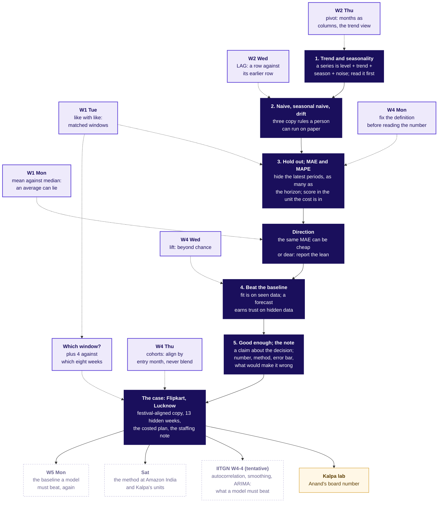

# Week 4 Friday, 30 October 2026, rebuilt concept-first: the plan

Written 13 October 2026 from the Friday row (`docs/curriculum/W4_Analyst_craft.md`, lines 419 to 522),
`docs/05_Curriculum_Map_Schema.md`, Friday's line in `docs/programme/calendar.md` (W04/D5, Fri 30 Oct,
teaching, M2, faculty block W4-4 tentative), the decisions `chapter-standard`, `teaching-approach`,
`w4-case-led` and `faculty-blocks` and the `cohort` and `campus_day` blocks of `data/programme/facts.yaml`,
the merged pack in `content/W04/D5`, section 9 of `docs/detailing/W04_analyst_craft_spine.md`, the Friday
case in `docs/detailing/W04_case_file.md`, the Week 1 to 3 rows, `content/W01/D1`, and the skills
lesson-strategy, lesson-architecture, curriculum-detailing, concept-packaging, training-deck-builder,
notebook-builder and day-pack-builder with `the-standard.md` and `teaching-styles.md`.

Skills used, and which parts: lesson-strategy (the learner's question, the clarity outcome, the anchor,
the seven-step grounded unit); lesson-architecture (one shared toy world, the map with promises, the
nine-slot unit, two examples per concept, the witness rule); curriculum-detailing (ideas counted as
decision sentences against the cap, depth targets, the continuity block); concept-packaging (the four
beats, the quiz rules); training-deck-builder (question slide then answer slide, concept slide then
applied slide, the map slide, one idea per slide); notebook-builder (MAP, DO, SEE, CHECK, SUM, the trap,
the your-turn cell); day-pack-builder (the question ladder, the blend of styles, the faculty seam).

The shape in one line: the day still opens on the ticket for ten minutes, then an agenda slide and a
concept map, then four concept chapters named by the row's subtopics (about 95 minutes on an invented
chai stall a weak learner can count), then the existing Flipkart case chapters as the application, the
staffing note, the Kahoot, the tentative IITGN block, and the Kalpa lab last.

---

## 1. Coverage now

### The topic and the subtopics, verbatim from the row

Day focus: **Forecasting basics · How much the plan delivers, against a baseline that is hard to beat**.

Subtopics (technique in service of the scenario):

1. Trend and seasonality, read before modelling
2. Naive, seasonal naive and drift baselines
3. Holding out; MAE and MAPE in the business's units
4. Beating the baseline; the vendor curve tested
5. The good-enough call and the forecast note

### Concepts the row leaves implicit that the agenda, outcomes, interview angle, exercises or Saturday bank need

A time series and its parts (level, trend, seasonality, noise; cycle named only); the season's length;
the horizon and the origin; the training periods and the hold-out; MAE; MAPE; the direction of the
error (bias); fit against forecast (data the rule saw against data it did not); the back-test; the
cost of over-forecasting and of under-forecasting; the plan quantile (the share of periods a plan
should cover); good enough as a claim about the decision; the forecast note's lines; the window a
percentage is measured against (finance's plus 4 against two windows); a growth factor on a seasonal
copy (finance's rule); the festival-aligned copy, which is this programme's own extension of the
seasonal naive and must be labelled as such.

### Where the built pack touches each, and the gap

| Concept | Where the pack touches it now | Gap |
|---|---|---|
| Trend and seasonality, read before modelling | half1 S7 (one picture, four names, 3 minutes), S5 and S6 (the peak by hand), the S19 notes; notebook 01 has no trend or season cell beyond the twelve bars; `unguided/ch1_shapes` Q1 and `practice/lab_set` Q1 read three invented series; the notes give it one paragraph; the cheat sheet has no panel for it; no Kahoot item | Buried. No from-scratch entry (what a time series is, what a season is, how long a season is, how growth is read without the season fooling you), no concept notebook, no Kahoot item, and the row's words "read before modelling" appear in no learner file |
| Naive, seasonal naive and drift baselines | half1 S8 (one table with the canteen toy, 4 minutes); notebook 01 cells 2 and 3 (one code cell); cheat sheet panel 3; Kahoot Q1 applied. The row's term "seasonal naive" appears 14 times across five STUDENT files and never on a half1 slide: the deck calls it "same week last year", "the house bot" and "the seasonal copy". Drift gets one table row and is cut first | Covered thinly under other names. A trainer reading half1 cannot find the subtopic by its row name; no concept notebook; the moving-festival extension is taught as if it were a standard rule |
| Holding out; MAE and MAPE in the business's units | half1 S16 (hold-out, origin, horizon), S17 (MAE on 10, 5, 10; MAPE in one sentence); notebook 02 cells 2 and 3; Kahoot Q2 and Q5; `practice/lab_set` Q3; Saturday items 7, 36, 38 | Half covered. MAPE is defined once and never computed in any notebook or exercise, although Saturday item 38 tests it. The reason to hide the latest periods rather than a random sample is one clause on S16. The direction of the error is taught only inside the case (S22 to S24) and the word bias appears in no learner file |
| Beating the baseline; the vendor curve tested | half1 S18 to S21 and S24; notebook 02 cells 5 to 14; `unguided/ch2_scoreboard` Q1 and Q2; Kahoot Q3; Saturday items 14, 23, 43 | Covered inside the case only. The idea underneath, fit measured on periods the rule saw against forecast error on periods it did not, has no from-scratch example, so the room first meets it on the vendor's 91 fitted weeks |
| The good-enough call and the forecast note | half1 S26 (one sentence) and S24; half2 S2 to S5 (the note's five lines); `unguided/ch2_scoreboard` Q2 (the row's mid-session item); Kahoot Q4; Saturday items 24, 37 | Thin. Good enough is never sized against a decision unit (a shift of 120 shipments) in a worked step; the note is taught as a form in the afternoon, after the case is done, with no concept entry of its own |
| The horizon rule; the origin | S16 states it; notebook 02 cell 2 | Stated, never worked on tiny numbers |
| The back-test | S30; notebook 03 cells 2 to 4 | Case only; the link to the hold-out (a hold-out that holds a festival) is one clause |
| Direction of the error, and its cost in each direction | S22 to S24, S32; notebook 02 cell 13, notebook 03 cells 8 to 11 | Case only; no tiny-numbers version of "same MAE, different rupees" |
| The plan quantile | S32 (the 100-weeks derivation), S33; notebook 03 cells 8 to 11; Kahoot Q7; `practice/lab_set` Q6 | Covered, and the 100-weeks derivation is already from scratch. It sits beyond the row's five subtopics and must be labelled as the spine's L5 addition |
| The window a percentage is measured against | S31; Kahoot Q8 | Case only; the hook back to Week 1 Tuesday's matched windows is missing |
| Fit against forecast | S20, S21; notebook 02 cells 10 to 12 | Case only |

What a trainer sees: there is no agenda slide; the day sheet names its blocks "Round one, two, three"
and never by the row's subtopics; the notebooks are named `twelve_rows`, `holdout_scoreboard`,
`festive_plan` and `kalpa_lab`; the study notes' and cheat sheet's headings are the case's questions. A
headings-only read of the pack tells the case's story and never names the five subtopics. The explorer
already carries scenes F1 (series = trend + season + noise), F2 (the hold-out slider), F3 (the festival
marker) and F4 (the cost curve), and the deck calls F1 from S7 alone.

---

## 2. The concept map

How the day's concepts connect to each other, to Weeks 1 to 3 and to the rest of Week 4. This is the
map slide (one node per concept, numbered arrows, today lit) and the first picture of the notes and the
cheat sheet; the half2 copy carries the case's numbers on the nodes.



The hooks the map carries, each named at the point of reuse (lesson-architecture's backward hook):

| Today's idea | Where it came from | Where it goes |
|---|---|---|
| MAE is a mean of misses; MAPE a mean of ratios | Week 1 Monday, the mean and when it lies (one giant miss moves it) | Week 5 Tuesday, the metric trap |
| Hide the latest periods; compare plus 4 on the same window | Week 1 Tuesday, like with like: matched windows | The capstone's plan line |
| `shift(52)` is LAG by a season | Week 2 Wednesday, LAG and the month-on-month comparison | Week 5, lag features |
| The two years overlaid by week of year | Week 2 Thursday's pivot trend view; Week 4 Thursday's cohort table gave the week a time axis | The faculty block's seasonal plots |
| The error measure is fixed before anyone scores | Week 4 Monday: the definition is fixed before the number is read | Week 5 Monday: the metric chosen before the model |
| A forecast must beat the baseline | Week 4 Wednesday: lift is "beyond chance"; Thursday: "beyond the blend" | Week 5 Monday: the baseline a propensity model must beat |
| Align by distance from the festival | Week 4 Thursday: align cohorts by entry month, never blend | Saturday's transfer drill at Amazon India |

### The agenda slide a trainer reads the day from

The deck-builder skill bans agenda slides as programme framing. The requester has asked for one, and
the standard already allows "a slide that asks the day's question and lists the chapter questions in
order", so the slide is written as that list with the row's topic words on every line. It is the first
slide after the ticket (S4), its notes fence carries the minutes, and the same list is the day sheet's
first table.

```
Title: Five topics, then the case that uses them
Subtitle (italic): Which questions does Friday answer, and in which order?

| Chapter | Topic, in the curriculum's words | The question it answers |
|---|---|---|
| 1 | Trend and seasonality, read before modelling | What does a series tell you before any rule is chosen? |
| 2 | Naive, seasonal naive and drift baselines | What does each copy rule copy, and when does the copy fail? |
| 3 | Holding out; MAE and MAPE in the business's units | How is a forecast scored honestly, in cups and in rupees? |
| 4 | Beating the baseline; the good-enough call and the forecast note | When does a forecast earn trust, when is it good enough, and what do you send? |
| 5 to 7 | The case: Flipkart, the Lucknow fulfilment centre | How much is coming, how wrong could we be, and how many packer shifts a week? |
| Lab | The same method on Kalpa Retail | Which revenue forecast does Anand put in front of the board? |

Notes: LIVE, 3 minutes. Read the topic column aloud; these are the five subtopics of the curriculum row,
in its order, with subtopics 4 and 5 taught in one chapter. Say the minutes: 22, 23, 30, 20, then the
case. The concept map follows.
```

The concept map slide (S5) is the mermaid above with the Week 1 to 3 nodes collapsed to one row and
today's nodes lit; its notes name explorer scene F1 as the picture to open on the projector.

---

## 3. Concept chapters, first, about 95 minutes

### Why four chapters for five subtopics

Subtopics 4 and 5 share one decision: a forecast earns trust by beating the baseline on hidden periods,
and it is good enough when a better one would change no decision; the note is what carries that
verdict. Taught apart they would repeat the same toy. Everything else gets a chapter of its own.

### The ideas, counted against the cap

Curriculum-detailing counts decision sentences, and the cap is four per two hours of teaching, so six
in the morning's 180 minutes. The concept chapters carry six: read the shape before any rule (trend by
the same point a season apart; a season is a repeat on a fixed beat); a baseline is a copy rule, and
there are three; hide the latest periods, at least as many as the horizon, and score with MAE in the
unit the cost is in; report the direction of the miss beside its size; fit is measured on seen periods
and trust is earned on hidden ones; good enough is a claim about the decision, and the note carries
number, method, error bar and what would make it wrong. The case chapters that follow in the morning
add no new idea: the festival-aligned copy is a variant of the seasonal naive, as curriculum-detailing
allows ("demote an idea to a variant"). The afternoon's 60 minutes add one: the plan quantile.

### The one toy world: the gate chai stall (invented)

One shared world across all four concept chapters, which lesson-architecture asks for, with a cameo
world for the exercises so the learner meets the method once on numbers they have not seen. The stall
is a chai stall at a hostel gate. It sells about 100 cups on a weekday and about 60 on a Sunday, when
the hostel empties for the day; the two exam fortnights of each semester lift a day to about 140 cups;
Diwali week drops it to about 40, since the hostel empties; the level grows by about 10 percent a year
as the hostel fills; day-to-day wobble is a few cups. The stall owner buys milk every evening for the
next three days, in 10-litre cans of 40 cups, and a cup unsold wastes about Rs 6 of milk while a cup
short loses about Rs 12 of margin. Every number is invented, labelled invented wherever it appears,
written by the day's seeded generator to `data/C2_W04_D05_chai_stall_daily_STUDENT.csv` (730 days
from 30 September 2024, so its Diwalis fall on the real dates of F5) and recorded in the facts file
under `toy.*` ids. Its witnesses, one per teaching point: a weekly beat (the Sunday dip); a yearly beat
in two shapes, a peak (exams) and a dip (Diwali), so seasonality is seen as a repeat up or down; a
festival that moves between the two years (31 October 2024, 20 October 2025); growth large enough to
read (10 percent) against a wobble small enough to ignore (a few cups); and two unit costs that differ.

The cameo world for the exercises is a hostel mess's weekly rice (invented): about 25 kg a weekday, 40 kg
on Sunday for the biryani, closed for Diwali week.

The lesson-strategy brief, in one screen: the learner's question is "how do I forecast next month's
number, say how wrong I could be, and defend the choice against a louder forecast?"; by the end a
learner can read a series' shape, run the three baselines by hand, hold out and score in the business's
unit, say why a close fit proves nothing, and write the forecast note; the anchor is the chai stall's
milk order, carried through the four chapters and then replaced by the Lucknow ticket; the reference
lock stays the row's: Forecasting: Principles and Practice chapter 5 (its 5.2 and 5.8 addresses now
redirect to `toolbox.html`, checked 12 October 2026 per `docs/detailing/W04_research_teaching.md`,
re-verified on the build day) and the Khan Academy unit the row names for the error measure.

Each chapter below runs the blend in `teaching-styles.md`: the question first (Brilliant), the
misconception and a vote (Veritasium, peer instruction), the hand count on tiny numbers (StatQuest),
the picture before the formula (3Blue1Brown), a glimpse of the code (Krish Naik), the map node
(ByteByteGo) and the plain sentence to repeat (Feynman). Each chapter's slides run: the `## SECTION n:`
opener whose title is the topic in the row's words and whose italic promise is the question; the map
slide with **Who needs the answer.** and the smaller questions as a timeline; a predict slide; its
answer slide with the toy's picture; the derivation on tiny numbers; the formula named last with the
worked example; a check question and its answer; how the Lucknow case uses it; the rules slide (three
to five complete sentences, no closing paragraph).

### Chapter 1. Trend and seasonality, read before modelling

- **Promise.** What does a series tell you before any rule is chosen?
- **Who needs the answer.** The stall owner tonight, who orders milk for three days; later the FC
  planner, who books shifts weeks ahead. A reading that mistakes the weekly beat for growth orders milk
  that sours.
- **From-scratch entry.** A time series is one number per equal period, in time order: cups a day,
  shipments a week, revenue a month. A forecast is a number for a period nobody has seen yet. Everything
  else in the day is a way of copying the past into that empty slot and then checking how wrong the copy
  was. Four shapes can sit in a series at once: the level (about 100 cups), the trend (the slow climb),
  the season (a repeat on a fixed beat, up or down), and the noise (what is left). A cycle, a rise and
  fall with no fixed length, is named once and set aside, since two years cannot show one.
- **Misconception and prediction.** "This Monday sold 100 cups and yesterday, Sunday, sold 60, so the
  stall is up 67 percent." Vote: (a) yes, the stall is growing fast; (b) no, that is the weekly beat;
  (c) you cannot tell from two days. The reveal is (b), with (c) as the honest first answer.
- **The example carried through.** The stall's first fourteen days: Monday to Saturday about 100 cups,
  Sunday about 60, twice over. Then the same fourteen days a year later: about 110 and 66.
- **Derived from tiny numbers.** The season's length is the number of periods before the pattern
  repeats: 7 days here, 52 weeks or 12 months elsewhere. The season's shape is each period's share of an
  ordinary one: Sunday 60 over 100, 0.6. The trend is read by comparing the same point a season apart,
  never neighbouring points: this Monday against last Monday, this Monday against the same Monday a year
  ago, 110 over 100, plus 10 percent a year. Named last: a series is level plus trend plus season plus
  noise; the formula is a shorthand for the picture. Worked example: the exam fortnight is 140 cups in
  both years against a level of 100 and then 110, so the season keeps its shape (1.4 of an ordinary day)
  while the level grows; Diwali week is 0.4 both years, a dip, which is why "seasonal" never means
  "spike". The moving festival shows as the dip landing eleven days earlier in the second year, which
  chapter 2 will need.
- **The trap.** The plausible wrong number: plus 67 percent, Monday against Sunday; the decision it
  misleads: 67 percent more milk ordered; the check: the same day a week earlier, 100 against 100; the
  fix: plus 0 percent this week, plus 10 percent on the year.
- **Check question.** "The mess used 25 kg of rice on Monday and 40 kg on Sunday. Which comparison tells
  you whether the mess is growing?" (a) Sunday against Monday; (b) this Sunday against last Sunday;
  (c) the average of the week against the average of the same week a year ago; (d) either (b) or (c).
  Key (d).
- **How the Lucknow case applies it.** The 104 weeks read the same way: a level of about 210,000, a
  trend of about 4 percent a year read from the latest 39 training weeks against the same weeks a year
  earlier (notebook 06 computes it), two seasons (the festival weeks, and the week holding the first of
  the month), no cycle two years can show, noise of a few percent. The festive peak sits two weeks
  before Diwali's week in both years, and Diwali's week moves (31 October 2024, 20 October 2025, 8
  November 2026, F5), so "the same calendar week" and "the same distance from the festival" are
  different copies: chapter 2's extension.
- **Explorer.** Scene F1 (the three sliders) on the derivation slide.
- **Size.** 8 slides after the opener; 22 minutes. Depth target: name it and use it.

### Chapter 2. Naive, seasonal naive and drift baselines

- **Promise.** What does each copy rule copy, and when does the copy fail?
- **Who needs the answer.** The stall owner, who needs a rule a person can run on paper before any
  spreadsheet opens; later the FC planner, whose house bot is one of these rules.
- **From-scratch entry.** A baseline is the simplest rule that could be right, and its job is to be
  beaten. Three rules copy the past in three ways: the naive copies the last value; the seasonal naive
  copies the value one season back; the drift copies the last value and adds the average step so far.
  Each is one line of arithmetic, so each can be checked by hand.
- **Misconception and prediction.** "The rule with the most maths forecasts best." Vote on next
  Sunday's cups given the last four days 98, 104, 101, 103 and last Sunday's 61: (a) the naive, 103;
  (b) the drift, about 105; (c) the seasonal naive, 61; (d) all three within five cups. Key (c): when
  the beat is strong, the dumbest copy that respects it wins.
- **The example carried through.** The stall's last four days and its Sundays; then the first day of
  the exam fortnight, where the naive copies an ordinary day (about 100) and misses by 40 while a
  yearly seasonal copy lands near 140; then Diwali, which moved eleven days between the two years.
- **Derived from tiny numbers.** Naive: tomorrow is 103. Drift: 103 plus (103 minus 98) over 3, about
  104.7, so 105. Seasonal naive with a beat of 7: next Sunday is 61. Named last, as the shorthand:
  naive y-hat(T plus h) equals y(T); seasonal naive y-hat(T plus h) equals y(T plus h minus m), with m
  the season's length; drift y-hat(T plus h) equals y(T) plus h times (y(T) minus y(1)) over (T minus 1).
  Every symbol is read aloud in words on the slide. Worked example: finance's habit, "last year plus 4
  percent", is the seasonal naive times a growth factor read as chapter 1 reads trend.
- **The trap.** The yearly seasonal copy on a festival that moves: it copies the 40 cups of 31 October
  2024 into 31 October 2025, an ordinary 110-cup day, and the 100 cups of 20 October 2024 into Diwali
  2025. The wrong numbers: 40 and 100; the decision: milk short by about 70 cups on one day and sour by
  about 60 on another; the check: the calendar; the fix: copy the day at the same distance from the
  festival. This fix is this programme's own extension of the seasonal naive, called festival-aligned,
  and the slide says so.
- **Check question.** At the mess, the last four days used 25, 26, 25 and 27 kg and last Sunday 42 kg.
  "Which rule, and what does it say for next Sunday?" (a) naive, 27; (b) drift, about 27.7; (c) seasonal
  naive, 42; (d) the mean of the four, 25.75. Key (c). A second, design item for the exercise set: the
  mess closes for Diwali week; which baseline do you trust for the week after, and why?
- **How the Lucknow case applies it.** The naive repeats the week of 22 June 2026; the seasonal naive
  with m equal to 52 is "the same week last year", which the tournament calls the house bot; the drift's
  step is about 70 shipments a week over 91 weeks; finance's rule is the seasonal naive times 1.04; the
  festival-aligned copy moves the source week by the festival's shift inside the stretch from five weeks
  before Diwali's week to four after. Saturday items 6, 28 and 41 test this chapter, so drift stays in
  the notebook and the notes even where the live minutes cut it first, as the row says.
- **Explorer.** Scene F3's festival marker, shown once here and again in the case.
- **Size.** 8 slides after the opener; 23 minutes. Depth target: use it.

### Chapter 3. Holding out; MAE and MAPE in the business's units

- **Promise.** How is a forecast scored honestly, in cups and in rupees?
- **Who needs the answer.** The stall owner, who wants to know how wrong the milk order could be before
  trusting a rule; later the regional operations head, who must say yes or no to a vendor's curve
  before a shift is booked.
- **From-scratch entry.** A rule is judged on periods it never saw. Hide the latest periods, as many as
  the forecast must reach ahead (the horizon), forecast them from the last period the rule may see (the
  origin), and count the misses. Hiding the latest periods, rather than a random handful, matters twice:
  tomorrow looks most like the newest days, and a random hole lets a copy rule peek at the hidden day's
  neighbours, which it never has for a real tomorrow.
- **Misconception and prediction.** "Judge the rule on the fourteen days it has seen." Vote on which
  three days to hide to judge a three-day milk order: (a) the last three; (b) three days at random; (c)
  the three busiest; (d) any three, it makes no difference. Key (a), with the peek shown: the naive on
  three random hidden days scores better than on the last three (invented target), a flattery no real
  tomorrow offers.
- **The example carried through.** Fourteen days of the stall; hide days 12, 13 and 14; the origin is
  day 11; the horizon is 3; the naive says 100 for each hidden day; the actuals are 110, 95 and 100.
- **Derived from tiny numbers.** The misses are plus 10, minus 5 and 0. MAE drops the signs and
  averages: (10 plus 5 plus 0) over 3, 5 cups. MAPE divides each miss by that day's actual before
  averaging: (10 over 110 plus 5 over 95 plus 0 over 100) over 3, about 4.8 percent. The direction is
  the average miss with its sign kept: plus 5 over 3, about plus 1.7 cups, a slight lean high. In the
  business's units: a cup unsold wastes Rs 6 and a cup short loses Rs 12, so the three misses cost 10
  times Rs 6 plus 5 times Rs 12, Rs 120; a percent cannot be priced, which is why the planner's score
  is MAE in the unit the cost is in and MAPE is for comparing stalls of different sizes. Named last:
  MAE equals the mean of the absolute misses; MAPE equals the mean of the absolute misses each divided
  by its actual. Worked example of MAPE breaking: on Diwali day the stall sold 5 cups and the rule said
  20; a miss of 15 cups is 300 percent and swamps the average, while MAE barely moves.
- **The trap.** "MAE 10 is the error": two rules with misses (plus 10, minus 10) and (plus 10, plus 10)
  share an MAE of 10. The first costs Rs 60 plus Rs 120, Rs 180; the second, always over, costs Rs 120.
  Same MAE, different rupees. The decision it misleads: milk ordered at the forecast when every miss
  runs short; the check: the sign; the fix: report the MAE and the lean together.
- **Check question.** "Five hidden days missed by 12, minus 8, 5, minus 15 and 6 kg: what is the MAE,
  and which way does the rule lean?" (a) 9.2 kg, no lean; (b) 9.2 kg, leaning short; (c) 0 kg, since
  the misses cancel; (d) 46 kg. Key (a): the signed misses add to zero, so the rule has no lean, and it
  still misses by 9.2 kg on an average day, which is why both numbers are reported. The design item for
  the set: which score do you tell the milkman, cups or percent, and which do you use to compare this
  stall with one twice its size?
- **How the Lucknow case applies it.** The latest thirteen weeks, 29 June to 21 September 2026, are
  hidden; the origin is 22 June; the horizon is ten weeks, to the week of 30 November; MAE is counted in
  shipments and priced at Rs 5.42 for a spare shipment (an idle packer-shift of Rs 650 over 120) and
  Rs 25 for a late one; the vendor's misses run high on 12 of 13 weeks and cost least while scoring
  worst, which the room will have met on the stall's two patterns. Saturday items 7, 36, 37 and 38 test
  this chapter.
- **Explorer.** Scene F2's split slider.
- **Size.** 10 slides after the opener; 30 minutes. Depth target: explain why.

### Chapter 4. Beating the baseline; the good-enough call and the forecast note

- **Promise.** When does a forecast earn trust, when is it good enough, and what do you send?
- **Who needs the answer.** The stall owner, offered a "model" by a nephew with a laptop; later the
  regional operations head, offered a vendor's curve that fits history within 2 percent.
- **From-scratch entry.** Fit is how close a rule sits to the periods it was built on; forecast error
  is how far it misses the periods it never saw. A curve bent through every past point has a fit of
  zero and can say anything about tomorrow. A forecast earns trust only by beating the baseline on
  hidden periods, by the measure fixed in chapter 3. Good enough is a claim about the decision: a better
  forecast is worth having only if it would change what gets ordered. The forecast note carries four
  things: the number, the method (what it copies), the error bar (the MAE on hidden periods, in the
  unit and in rupees), and what would make it wrong.
- **Misconception and prediction.** "The model that fits history best will forecast best." Four days of
  cups: 100, 104, 98, 110 (invented). Vote on day 5: (a) the straight line through the four, about 109;
  (b) the curve that passes through all four exactly; (c) the naive, 110; (d) they will all land within
  five cups. Day 5 sold 102. The exact-fit curve says 168; the line says 109; the naive says 110. Key:
  the exact fit is the worst forecast in the room.
- **The example carried through.** The same four days, then seven hidden days on which the nephew's
  rule (the mean of the last seven days) races the seasonal naive, then the milk cans.
- **Derived from tiny numbers.** The cubic's fit is 0 on days 1 to 4 and its forecast misses day 5 by
  66; the line's fit is a few cups and its forecast misses by 7. On the seven hidden days the seasonal
  naive scores about 4 cups and the seven-day mean about 12 (invented targets), so the nephew's rule
  loses to the baseline and does not get the milk order. Good enough: milk comes in cans of 40 cups; a
  rule better by 8 cups a day changes the cans ordered on none of the seven days, so it is good enough
  for this decision and the owner stops improving. Named last: in-sample fit against out-of-sample
  error, and the rule that nothing goes to the order unless it beats the seasonal naive on hidden days.
  Worked example: the stall's note to the milkman, four lines, printed from the notebook's variables:
  "3 cans a day for Monday to Saturday, 2 on Sunday, from the same-day-last-week copy; it missed the
  last three hidden days by 5 cups a day, about Rs 40 a day; wrong if exams start early or the hostel
  closes".
- **The trap.** The plausible wrong note: "the model fits 100 percent of history; order for 168 cups".
  The decision: four cans of milk sour. The check: the score on hidden days. The fix: the baseline's
  number with its error bar.
- **Check question.** The row's own mid-session item, with a decision unit added: three model-against-
  baseline pairs (a model at 9,800 against the baseline's 9,831 on hidden weeks; one at 6,000 on the
  weeks it was fitted to; one at 6,200 on hidden weeks none of which is festive), and a shift of 120
  shipments: which earns a place, and which is good enough to change nothing? This is `ch2_scoreboard`
  Q2 today, re-homed here. The design item for the set: which first line does the note carry?
- **How the Lucknow case applies it.** The vendor's curve fits its 91 weeks within 1.4 percent and
  misses the thirteen hidden weeks by 16,400 a week, 67 percent worse than the seasonal naive; the
  planner's decision unit is a shift of 120 shipments, so a forecast closer by 100 shipments changes no
  shift; the staffing note's five lines are the stall's four plus one line to each stakeholder. Saturday
  items 14, 23, 24, 37 and 43 and the interview questions [S] "How do you evaluate a forecast?", [F]
  "What baseline must any forecast beat, and why?" and [F] "A vendor promises 22 percent growth; how do
  you test the claim?" are asked here, as questions.
- **Explorer.** None; the picture is the notebook's two curves.
- **Size.** 8 slides after the opener; 20 minutes. Depth target: handle it breaking.

---

## 4. Concept notebooks

Four concept notebooks, one per chapter, named by topic, numbered 01 to 04; the case notebooks follow
as 05 to 07 with the topic they apply in their names; the Kalpa lab is 08. Week 4's rules hold: pandas,
the standard library and matplotlib, a three-line `check(name, ok)`, no helper layer, at most 22 cells,
at least five checks and three pictures drawn from code cells, every number in the facts file, every
toy labelled invented, executed cold. The MAP cell is a markdown cell with a mermaid fence of the eight
notebooks with this one lit, as the Week 4 decks draw their maps; it does not count toward the three
pictures. The invented stall data is loaded from `../data/`, never pasted into a cell.

### 01 `C2_W04_D05_01_trend_and_seasonality_STUDENT.ipynb` (16 cells)

| Cell | Kind | What it carries |
|---|---|---|
| 0 | MD, title | "Trend and seasonality, read before modelling: what does a series tell you before any rule is chosen?" Week 4 Friday, concept notebook 1 of 4. **Who needs the answer.** **The questions on the way.** The chai stall labelled invented. |
| 1 | CODE, setup | imports, `check`, load `chai_stall_daily` (730 rows: date, cups, weekday, exam_fortnight, diwali_week); print the first rows; checks: 730 rows, consecutive dates |
| 2 | MD, MAP | mermaid: the eight notebooks with 01 lit; the flow level, trend, season, noise |
| 3 | MD, DO | What is a time series, what is a forecast; **Predict before you run.** Monday 100, Sunday 60: growing or the weekly beat? (a) to (c) |
| 4 | CODE | the first 14 days as a table and a bar chart (picture 1); check: seven weekdays each appear twice |
| 5 | MD, SEE | **What happened.** (b); the weekly beat; season and season length defined |
| 6 | MD, DO | How do you read growth without the season fooling you? **Predict:** which pair of days |
| 7 | CODE | the same 14 days a year later side by side (picture 2); the ratio of same-weekday totals; check: growth between 8 and 12 percent (invented target) |
| 8 | MD, SEE | **What happened.** Trend is the change between the same point a season apart; the formula named |
| 9 | MD, DO | Does the season keep its shape while the level grows? Exams and Diwali as a yearly beat. **Predict:** is Diwali a peak or a dip at the stall? |
| 10 | CODE | weekly totals, the two years overlaid by week of year (picture 3); exam ratio about 1.4 both years, Diwali about 0.4; checks on both ratios |
| 11 | MD, trap | **The plausible wrong answer.** plus 67 percent; **Why it is wrong.** the beat; the check; the fix. The moving festival noted for notebook 02 |
| 12 | MD, DO | What is left when trend and season are taken out? |
| 13 | CODE | residual = cups minus (same day last year times growth); histogram (picture 4); checks: mean near 0, spread a few cups |
| 14 | MD, SUM | table: the four readings on the stall; how Lucknow is read the same way |
| 15 | CODE | the Lucknow glimpse: load `weekly_shipments`; growth of the latest 39 training weeks against a year earlier, about 4.0 percent; check; the 104 weeks with Diwali's weeks marked (picture 5); then the answers to every question on the way, with numbers, in the trailing markdown |

Checks: six. Pictures: five.

### 02 `C2_W04_D05_02_naive_seasonal_naive_drift_STUDENT.ipynb` (17 cells)

| Cell | Kind | What it carries |
|---|---|---|
| 0 | MD, title | "Naive, seasonal naive and drift baselines: what does each copy, and when does the copy fail?" Notebook 1 found the beat of 7 and growth of about 10 percent. |
| 1 | CODE, setup | load the stall; `check`; the last 14 days printed |
| 2 | MD, MAP | mermaid: 02 lit; the three copies as three arrows into tomorrow's empty slot |
| 3 | MD, DO | **Predict:** next Sunday from 98, 104, 101, 103 and last Sunday's 61: (a) to (d) |
| 4 | CODE | the three rules by hand on the last 14 days; a picture of the 14 days with the three forecasts as dots (picture 1); checks: naive equals the last value, drift about 105, seasonal naive equals last Sunday |
| 5 | MD, SEE | **What happened.** (c); the three formulas named, each read in words |
| 6 | MD, DO | The first exam day: **Predict** the naive's miss and the yearly copy's |
| 7 | CODE | the naive and the yearly seasonal copy (364 days back, to keep the weekday) on the 28 days around the exam fortnight; small multiples, one rule per panel (picture 2); checks: the naive misses the first exam day by more than 30, the copy by less than 10 |
| 8 | MD, SEE | **What happened.**; a note on why 364 and never 365 for a daily series with a weekly beat |
| 9 | MD, trap | **The plausible wrong answer.** the yearly copy puts 40 cups on 31 October 2025 and 100 on Diwali 2025. **Why it is wrong.** Diwali moved eleven days. |
| 10 | CODE | the two Diwali fortnights by calendar and by distance from Diwali (picture 3); the aligned copy's misses; checks: the calendar copy's worst miss above 50, the aligned copy's below 15 |
| 11 | MD, SEE | the fix, named as this programme's festival-aligned extension; finance's rule as the seasonal naive times a growth factor |
| 12 | MD, DO | Drift on a plain climb: the stall's weekly totals over 12 weeks |
| 13 | CODE | drift on weekly totals; the line extended (picture 4); check: the step equals the first-to-last change over 11 |
| 14 | MD, SUM | table: rule, what it copies, the stall's number, when it fails |
| 15 | CODE | the Lucknow glimpse: `shift(52)` on the full weekly series shown as one line of code with its first rows; drift's step about 70 a week; check |
| 16 | MD, close | answers to the questions on the way; notebook 03 scores these rules on days they never saw |

Checks: seven. Pictures: four.

### 03 `C2_W04_D05_03_holdout_mae_mape_STUDENT.ipynb` (19 cells)

| Cell | Kind | What it carries |
|---|---|---|
| 0 | MD, title | "Holding out; MAE and MAPE in the business's units: how is a forecast scored honestly?" |
| 1 | CODE, setup | load the stall; `check`; the costs Rs 6 and Rs 12 as variables, labelled invented |
| 2 | MD, MAP | mermaid: 03 lit; hide, forecast, miss, score, price |
| 3 | MD, DO | Which days do we hide? **Predict:** (a) to (d) |
| 4 | CODE | split 14 days into 11 training and 3 hidden; the shaded picture (picture 1); checks: the hidden days are the latest, 11 plus 3 equals 14, the horizon equals the hidden count |
| 5 | MD, SEE | **What happened.** (a); origin, horizon, training and hidden periods defined; the peek computed in one line: the naive on three random hidden days against the last three |
| 6 | MD, DO | How is a miss counted? **Predict** the MAE of plus 10, minus 5, 0 |
| 7 | CODE | MAE and MAPE by hand on the three misses; checks: MAE 5.0, MAPE about 4.8 percent |
| 8 | MD, SEE | **What happened.**; both formulas named; the unit |
| 9 | MD, DO | When does MAPE break? **Predict** the percent miss on a 5-cup Diwali day forecast at 20 |
| 10 | CODE | the per-day percent misses as bars with Diwali's 300 percent (picture 2); MAE and MAPE with and without that day; check: MAPE more than triples, MAE moves by under 2 cups |
| 11 | MD, SEE | MAE in the unit the cost is in; MAPE across stalls of different sizes |
| 12 | MD, DO | Which way is the rule wrong? **Predict** which pattern costs more, (plus 10, minus 10) or (plus 10, plus 10) |
| 13 | CODE | the two patterns: MAE, the signed mean, the rupees at Rs 6 and Rs 12; misses as sticks above and below zero (picture 3); checks: equal MAE, costs Rs 180 and Rs 120 |
| 14 | MD, trap | **The plausible wrong answer.** "MAE 10 is the error". **Why it is wrong.** the lean; the check; the fix: report both |
| 15 | MD, SUM | table: the stall's split, MAE 5, MAPE 4.8 percent, lean plus 1.7, Rs 120 |
| 16 | CODE | the Lucknow glimpse: the 104 weeks split at 91, 29 June to 21 September 2026 hidden, origin 22 June, horizon 10 (picture 4); the two unit costs Rs 5.42 and Rs 25 printed from `costs`; checks: 13 hidden weeks, the latest |
| 17 | MD | ### In the interview: the [S] question asked, as a question with its tag, and the structure a hire-grade answer follows, in four lines |
| 18 | MD, close | answers with numbers; notebook 04 asks when a forecast earns trust |

Checks: eight. Pictures: four.

### 04 `C2_W04_D05_04_beating_the_baseline_good_enough_STUDENT.ipynb` (18 cells)

| Cell | Kind | What it carries |
|---|---|---|
| 0 | MD, title | "Beating the baseline; the good-enough call and the forecast note: when does a forecast earn trust, and what do you send?" |
| 1 | CODE, setup | load the stall; `check`; the four days and day 5 selected from the file; the can size 40 |
| 2 | MD, MAP | mermaid: 04 lit; fit, hidden days, baseline, decision, note |
| 3 | MD, DO | **Predict** day 5: the line, the exact-fit curve, the naive |
| 4 | CODE | `numpy.polyfit` degree 1 and degree 3 on days 1 to 4; fit error of each; forecasts for day 5 (109 and 168) against 102 (picture 1: the two curves and the actual); checks: the cubic's fit error under 0.01, its day-5 miss above 50, the line's below 10 |
| 5 | MD, SEE | **What happened.**; fit against forecast named; in-sample and out-of-sample as the words an interviewer uses |
| 6 | MD, DO | Does the clever rule beat the baseline? **Predict:** the seven-day mean against the seasonal naive on 7 hidden days |
| 7 | CODE | the scoreboard on 7 hidden days: MAE of each, lean of each (picture 2: small multiples); checks: the seasonal naive wins, both scored on the same hidden days |
| 8 | MD, SEE | **What happened.**; the rule: nothing goes to the order unless it beats the seasonal naive on hidden days; the M5 and PLOS ONE facts from the case file with their check dates |
| 9 | MD, DO | Is a better rule worth having? **Predict** whether 8 cups a day changes the cans |
| 10 | CODE | cans equal ceiling of forecast over 40 for both rules on the 7 days; days on which the cans differ (picture 3: cans per day, two rules); check: the count of differing days is 0 |
| 11 | MD, SEE | good enough is a claim about the decision; the owner stops improving |
| 12 | MD, DO | What does the note say? the four lines |
| 13 | CODE | the note printed from variables (number, method, error bar in cups and Rs, what would make it wrong); check: the note holds four lines and names the unit |
| 14 | MD, trap | **The plausible wrong answer.** "fits 100 percent of history; order for 168". **Why it is wrong.**; the check; the fix |
| 15 | MD, SUM | table: fit 0 against miss 66; the baseline's 4 against the clever rule's 12; cans unchanged; the four lines |
| 16 | CODE | the Lucknow glimpse: the vendor file's `kind` column counted (fitted, holdout, forecast); the shift of 120 as the decision unit: a forecast closer by 100 shipments changes how many shifts? 0; check |
| 17 | MD, close | answers with numbers; the interview questions [F] and [F] as questions with tags; notebook 05 opens the case on twelve printed weeks |

Checks: six. Pictures: three.

### The case notebooks, renamed and renumbered

| Today | Becomes | What its title cell adds |
|---|---|---|
| `01_twelve_rows` | `C2_W04_D05_05_case_shape_and_baselines_STUDENT.ipynb` | "Applies concept notebooks 01 and 02 to Flipkart's weeks." Its canteen toy cell (cells 2 and 3) is removed, since chapter 2 taught it on the stall; the ticket stays as its first cell |
| `02_holdout_scoreboard` | `C2_W04_D05_06_case_holdout_scoreboard_STUDENT.ipynb` | "Applies concept notebooks 03 and 04: the thirteen hidden weeks, MAE in shipments, the vendor's fit against its forecast." Its toy MAE cell (cells 2 and 3) shrinks to one sentence pointing back at notebook 03 |
| `03_festive_plan` | `C2_W04_D05_07_case_good_enough_forecast_note_STUDENT.ipynb` | "Applies concept notebook 04 and adds the costed plan." The cost cushion opens on the stall's two costs (Rs 12 over Rs 18, a share of two days in three) before the 100-weeks derivation |
| `04_kalpa_lab` | `C2_W04_D05_08_kalpa_lab_forecast_note_STUDENT.ipynb` | Unchanged in content; the title names the method it re-runs: shape, baselines, hold-out, the note. Its plants stay in the empty your-turn cells |

Every concept notebook's last cell names the case notebook that applies it, and every case notebook's
first cell names the concept notebooks it applies, with the stall's numbers restated in one sentence so
each file stands alone.

---

## 5. The case chapters

The existing three case chapters keep their content and follow the concept chapters as SECTIONS 5, 6
and 7. Each step is tagged with the concept chapter it applies; the opener's title carries the topic
words so a trainer sees what is being applied; the trims fit the minutes.

### SECTION 5: The case, part 1: trend, seasonality and baselines on Flipkart's weeks (morning, 30 minutes, was 40)

Promise: What shape do the 104 weeks have, and what would the three baselines say for one week?

| Today's slide | Applies | Keep, move or trim |
|---|---|---|
| S4 four questions | | Keep as the chapter map |
| S5, S6 which week ships most | Chapter 1 (the season's shape read off the twelve rows) | Keep |
| S7 four shapes | Chapter 1 | Move into chapter 1 as its derivation picture |
| S8 four rules | Chapter 2 | Shrink to one slide that maps the row's names to the tournament's: seasonal naive equals same week last year equals the house bot; the canteen column goes, the stall taught it |
| S9, S10 three rules on Diwali 2025's week | Chapter 2 | Keep |
| S11 the calendar copy lands late | Chapter 2's extension | Keep; the slide names festival-aligned as the programme's construction |
| S12 Diwali's week moves in 2026 | Chapter 1 | Keep |
| S13 Flipkart's public facts | | Keep |
| S14 chapter close | | Keep; the map node added |

Title change: `## SECTION 5: Trend, seasonality and baselines, on Flipkart's weeks`.

### SECTION 6: The case, part 2: holding out, MAE and the vendor curve tested (morning, 30 minutes, was 45)

Promise: How does each baseline score on the thirteen weeks it never saw, and does the vendor's curve
beat the seasonal naive?

| Today's slide | Applies | Keep, move or trim |
|---|---|---|
| S15 five questions | | Keep |
| S16 hide the last thirteen weeks | Chapter 3 | Keep its applied half (which weeks, the origin, the horizon of ten); the definitions move to chapter 3 |
| S17 MAE toy | Chapter 3 | Move the 8.3 toy into chapter 3; keep one line here: shipments, because the cost is per shipment |
| S18, S19 scoreboard | Chapters 2 and 3 | Keep |
| S20, S21 the vendor's fit against its forecast | Chapter 4 | Keep |
| S22, S23 priced misses | Chapter 3's direction | Keep; the slide recalls the stall's two patterns in one line |
| S24 why the vendor still loses | Chapter 4 | Keep |
| S25 second route | Chapter 3 | Keep |
| S26 close | Chapter 4 | Keep; "good enough" now points back to chapter 4's cans |

Title change: `## SECTION 6: Holding out, MAE and the vendor curve tested, on thirteen hidden weeks`.

### SECTION 7: The case, part 3: the good-enough call and the staffing note (afternoon, 35 minutes, was 75)

Promise: Which forecast goes to the plan, how many packer shifts a week, and what does being wrong cost
in each direction?

| Today's slide | Applies | Keep, move or trim |
|---|---|---|
| S27 five questions | | Keep |
| S28, S29 the bot's busiest week in 2026 | Chapter 2's extension | Keep; the round-three reveal stays |
| S30 the 2025 back-test | Chapter 3 (a hold-out that holds a festival) | Keep, 4 minutes |
| S31 plus 22 and plus 4 against two windows | Chapter 1, and Week 1 Tuesday's matched windows named | Keep |
| S32, S33 the cost and the 0.82 point | Chapter 3's direction; the plan quantile, the day's one afternoon idea | Keep; open on the stall's Rs 12 over Rs 18 before the 100 weeks |
| S34 the plan in shifts | Chapter 4's decision unit | Keep |
| S35 what the other plans would cost | | Trim to its last row and one sentence |
| S36 what two years cannot tell us | | Trim to three doubts: the festival moves, the hidden weeks hold no festival, capacity caps the peak |
| S37 close | | Keep |

Title change: `## SECTION 7: The good-enough call and the staffing note, for the festive window`.

Half2's S1a to S1c (the concept board built region by region) are replaced by one concept map slide
with the case's numbers on the nodes, since the map now opens the day. S6 to S9 (the interview room and
the guesstimate) become self-study slides numbered D and run in the TA lab's first fifteen minutes.

---

## 6. Trainer and learner artefacts

### The day sheet's topic list, mapped to the row's trainer agenda

| Row agenda item | Row minutes | Where it runs now | Minutes | Slides and files |
|---|---|---|---|---|
| 1. Two forecasts eighteen points apart; what would make either wrong | 10 | The ticket, S1 to S3; then the agenda and the map, S4 and S5 | 10 plus 5 | half1 |
| 2. Trend and seasonality read off two years; the Diwali shape | 40 | Chapter 1 on the stall, then SECTION 5's peak by hand and the festival plot | 22 plus 12 | half1; notebooks 01 and 05 |
| 3. Baselines: last value, seasonal naive, drift; built by hand | 45 | Chapter 2 on the stall, then SECTION 5's three rules on Diwali 2025's week and the calendar trap | 23 plus 18 | half1; notebooks 02 and 05; `guided/same_week_rule` |
| 4. Error measured honestly: hold out, MAE, the vendor against the seasonal naive | 50 | Chapter 3, chapter 4's fit-against-forecast half, then SECTION 6 | 30 plus 10 plus 30 | half1; notebooks 03, 04 and 06 |
| 5. Guided then unguided: the forecast with its error bar and the good-enough call | 55 | Chapter 4's good-enough and note half, SECTION 7, the staffing-note items in groups; the note's prose and the Kalpa board number in the lab | 10 plus 35 plus 15 | half1, half2; notebooks 07 and 08; `unguided/staffing_note`, `unguided/kalpa_board` |
| 6. Kahoot, close; tomorrow's transfer drill and recap | 20 | Kahoot and close, the handoff line; Saturday's preview in the pre-read | 10 | half2; `kahoot/` |

The day sheet keeps its sync blocks for the module and the faculty block, prints this table first, then
the question ladder, then the traps table with the two new trap rows (plus 67 percent; MAE 10 twice),
then the checkpoints (after chapter 2: three learners say 103, 105 and 61; after chapter 3: every
notebook prints MAE 5.0 and MAPE 4.8 percent; after chapter 4: every notebook prints 168 and 109).

### The deck's agenda and concept-map slides

Section 2 gives both. The agenda is S4 and the map is S5 of half1; half2 opens on the map with the
case's numbers. Every `## SECTION` opener's title carries the topic in the row's words and the kicker
reads "Concept n of 4" or "Case part n of 3".

### Exercise items per concept

Four new three-item sets, set at the hostel mess (invented), each with one design item at least; item
1 of each is the chapter's live check question and items 2 and 3 are sat in the lab's opening twenty
minutes. The existing sets stay, each with a line naming the concept chapter it applies.

| Set | Items | Design items | Where sat |
|---|---|---|---|
| `unguided/C2_W04_D05_c1_trend_seasonality_STUDENT.md` | three mess series read for shape (today's `ch1_shapes` Q1, re-set); which comparison reads growth; the season's length counted from a printed 16-week table | 1 | chapter 1 check, lab |
| `unguided/C2_W04_D05_c2_baselines_STUDENT.md` | naive, seasonal naive and drift for next Sunday's rice; the week after the Diwali closure, which baseline and why; naive and seasonal naive from two printed months (new numbers, never the bank's) | 2 | chapter 2 check, lab |
| `unguided/C2_W04_D05_c3_holdout_mae_mape_STUDENT.md` | MAE and lean of five misses; which three days to hide for a three-day order; cups or percent for the milkman, and for comparing two stalls | 2 | chapter 3 check, lab |
| `unguided/C2_W04_D05_c4_beat_baseline_good_enough_STUDENT.md` | fit 0 and 168 against the line's 109: which to trust; three model-against-baseline pairs with a decision unit (today's `ch2_scoreboard` Q2, re-homed); the note's first line | 2 | chapter 4 check, lab |
| `guided/same_week_rule` (applies 2 and 3) | unchanged | 1 | SECTION 5 |
| `unguided/ch1_shapes` | retired; its Q1 moves to the c1 set, its Q2 and Q3 to the c2 set | | |
| `unguided/ch2_scoreboard` (applies 3 and 4) | Q1 the leaky score kept; Q2 moves to the c4 set; a new Q2 reads the direction off a printed error table; Q3 kept | 2 | SECTION 6 |
| `unguided/staffing_note` (applies 4) | three items plus a fourth, today's Kahoot Q8 on which window plus 4 is measured against; the five-line note | 3 | SECTION 7 and the lab |
| `unguided/kalpa_board` | unchanged | 2 | lab |
| `practice/lab_set` | Q1 and Q3 re-set at the stall and mess so they do not duplicate the c1 and c3 sets; the rest unchanged | 1 | lab |

About 33 items, 16 of them design items, which keeps the day above a third.

### Kahoot items per concept

Eight items, twenty seconds each and forty for item 7, in the row's order where the row gives one.

| Item | Tests | Concept |
|---|---|---|
| 1 (row Q1) | The seasonal naive for the next festival week, with the festival week named | Chapter 2 applied |
| 2 (row Q2) | MAE in the business's unit against MAPE in percent, and when each | Chapter 3 |
| 3 (row Q3, trap) | A curve that fits every past week within 2 percent | Chapter 4 |
| 4 (row Q4) | What "good enough" is a claim about | Chapter 4 |
| 5 (row Q5) | Which periods to hide, and how many | Chapter 3 |
| 6 (row, return) | Thursday's flat blend over falling cohorts | Return question |
| 7 | The plan share from two costs | Case part 3 |
| 8 (new) | Monday 100 cups, Sunday 60: which comparison reads growth | Chapter 1 |

Today's Q8 (which window plus 4 is measured against) moves to the staffing-note set as its fourth item.
The distractor audit runs as before.

### Study-note and cheat-sheet sections named by topic

Every heading stays a question, as the standard requires, and now opens on the topic in the row's
words so a trainer and a learner can find it.

Study notes (under 3,000 words: about 1,400 on the concepts, 1,200 on the case, 400 on the rest):

1. Trend and seasonality, read before modelling: what does a series tell you before any rule is chosen?
2. Naive, seasonal naive and drift baselines: what does each copy, and when does the copy fail?
3. Holding out; MAE and MAPE in the business's units: how is a forecast scored honestly?
4. Beating the baseline; the vendor curve tested: why is a close fit no proof?
5. The good-enough call and the forecast note: when do you stop improving, and what do you send?
6. The case: how much is coming to Flipkart's Lucknow centre, and how wrong could the forecast be? (the
   three case sections compressed under it, every number kept)
7. Can you answer these without notes? The interview questions, the words, the reading path.

Cheat sheet, `C2_W04_D05_forecasting_basics_STUDENT.md` and its rebuilt PDF, seven panels: (1) the
anchor, the concept map beside the day's picture, a series split into level, trend, season and noise,
drawn once on the stall and once on Lucknow; (2) trend and seasonality, how each is read, with the
stall's 110 over 100 and Lucknow's 4 percent and two seasons; (3) the three baselines as formulas with
the stall's 103, 105 and 61 and Lucknow's names beside them; (4) hold-out, MAE, MAPE and the lean, with
5 cups, 4.8 percent and the thirteen weeks; (5) beating the baseline and good enough, with 0 against 66,
the shift of 120 and the note's lines; (6) the case's plan, the scoreboard, the festival placement, 0.82
and 20,275; (7) what the interviewer listens for.

---

## 7. Minutes

The envelope on Friday 30 October 2026, from `facts.yaml` and the calendar: two blocks of 180 minutes
with lunch between, the IITGN block W4-4 (tentative, 120 minutes) in the last 120 of the afternoon, so
the trainer holds 240 minutes, and the TA-led lab after the second block, whose length no source gives.

| Block | Minutes | What runs | Slides |
|---|---|---|---|
| Morning | 10 | The ticket: two forecasts eighteen points apart; the tournament's rule; where today ends | half1 S1 to S3 |
| | 5 | The agenda and the concept map | S4, S5 |
| | 22 | Chapter 1, trend and seasonality, on the stall | SECTION 1 plus 8 |
| | 23 | Chapter 2, the three baselines, on the stall | SECTION 2 plus 8 |
| | 30 | Chapter 3, hold-out, MAE, MAPE and the lean, on the stall | SECTION 3 plus 10 |
| | 10 | Break | |
| | 20 | Chapter 4, beating the baseline, good enough, the note, on the stall | SECTION 4 plus 8 |
| | 30 | Case part 1: the twelve weeks by hand, the three rules, the calendar trap | SECTION 5 plus 8 |
| | 30 | Case part 2: the thirteen hidden weeks, the scoreboard, the vendor tested, the priced misses | SECTION 6 plus 8 |
| Afternoon, first 60 | 35 | Case part 3: the festival placed, the 2025 back-test, the two windows, the cushion, the plan | half2, SECTION 7 plus 9 |
| | 15 | The staffing note's lettered items in groups; the prose finishes in the lab | half2 S2 to S5 |
| | 10 | The handoff line, the Kahoot, the close | half2 S10 to S12 |
| IITGN block | 120 | W4-4 (tentative), or the fallback deck's rolling-origin hour, unchanged | fallback |
| Lab | its length | The interview room in pairs (15); the four concept sets (20); notebook 08 on Kalpa; the Kalpa board set; the practice set; the staffing note's prose | lab files |

Morning: 10 plus 5 plus 22 plus 23 plus 30 plus 10 plus 20 plus 30 plus 30 equals 180. Afternoon's
first hour: 35 plus 15 plus 10 equals 60. Concept time is 95 minutes, 100 with the agenda and map, inside
the 60 to 120 asked for.

What moves, and what it costs:

- The interview room (15) and the guesstimate (3) leave the trainer's afternoon for the lab's first
  fifteen minutes, run by the TA from the transcripts and scorecards; the slides become D slides. The
  cost: the hire-grade answer is no longer heard from the trainer. If the block slips, the fallback's
  four parts already fill 120 minutes, so the interview room stays in the lab either way.
- The staffing note shrinks from 27 to 15 live minutes; groups decide the lettered items in class and
  write the five lines in the lab.
- Case part 1 loses S7 and most of S8 to the concept chapters (10 minutes); case part 2 loses S16's
  definitions and S17's toy (15 minutes); case part 3 loses S35's table and three of S36's doubts (40
  minutes, mostly the role-card objections shortened to one exchange each).
- Slide counts: half1 grows from 40 to about 62 and half2 shrinks to about 22 with four D slides; the
  spine's caps (40 and 15) must be amended with the rest of section 9, since the spine outranks the row.
- Ideas: six in the morning's 180, one in the afternoon's 60, within the cap.

Decisions the requester must make before the build:

1. Does the ticket still open the day for ten minutes before the concepts (recommended, since the row's
   first agenda item is the two forecasts and the standard's first rule is that the case leads), or do
   the concepts open cold?
2. Does the interview room move to the lab, as above, or does the staffing note shrink further?
3. Does the plan quantile stay as the case's L5 step, labelled as beyond the row's subtopics, or move to
   the fallback hour?
4. Is `half1` allowed to grow to about 62 slides, or does the morning split into two files (`concepts`
   and `half1`)?

---

## 8. Guards

### Facts the build must not invent

- The lab's length: no source gives it; the day sheet says "the lab's length".
- The faculty member's name, and any date of the block beyond "tentative"; the block renders from
  `sync:faculty-day:W04/D5` and every STUDENT mention says tentative.
- Clock times, anywhere; durations only.
- Diwali's dates: 31 October 2024, 20 October 2025, 8 November 2026, from F5 and `facts.yaml` only.
- The FPP3 links: the row's URLs are verified 13 September 2026; the research note found on 12 October
  2026 that 5.2 and 5.8 redirect to `toolbox.html` anchors. The build re-verifies on its day, cites the
  address that resolves with that date, and writes "to be found" where nothing resolves. No URL from
  memory.
- The Kalpa plants (the two Octobers' ratio, the first year below the second, the vendor's fit and its
  hold-out miss, its 22 percent, the month-aligned copy's October): TRAINER and INTERNAL files only, and
  the lab notebook's empty your-turn cells, until the lab finds them (`w4-finding-once-found`).
- Marks and weights: none in any learner file; the Kahoot and the Saturday paper are ungraded.
- The chai stall and the hostel mess are invented and say so at every appearance; their numbers are
  targets the seeded generator asserts and the facts file records under `toy.*`.
- The festival-aligned copy is this programme's construction and is labelled as such on the slide, in
  the notebook and in the notes; the seasonal naive, the naive, the drift, MAE and MAPE are the textbook
  terms and are introduced by those names first, with "same week last year", "the house bot" and "the
  seasonal copy" given as aliases afterwards.
- The plan quantile sits beyond the row's five subtopics and is labelled in the trainer notes as the
  spine's L5 addition; nothing teaches exponential smoothing, ARIMA, autocorrelation or any fitted model
  beyond the four-point curve that exists only to show fit against forecast.
- No concept chapter spoils a later day: the sampling distribution and intervals belong to Week 2's
  blocks and are not reopened; Week 5's model baseline is named as what comes next, never taught.

### Records that change with this rebuild

- `data/programme/facts.yaml`: a new decision, proposed id `w4-d5-concept-first`, status open until the
  requester closes it, text: Week 4 Friday is rebuilt with concept chapters named by the row's subtopics
  before its case chapters, each concept on an invented example with its own notebook, the case chapters
  following as applications; it amends `w4-case-led` for Friday only. Then `python3
  scripts/sync_programme.py`.
- `docs/detailing/W04_analyst_craft_spine.md`, section 9: the envelope table, the artefact sizes (decks
  and notebooks) and the styles table rewritten to this plan; section 12's lines 1, 3 and 16 amended so
  the acceptance test allows the agenda and map slides after the ticket and the new sizes.
- The explorer is reused, scenes F1 to F4; no rebuild. Each deck slide that uses a scene names it in its
  notes fence.
- The board card moves with `python3 scripts/board_sync.py --status W04/D5 review-1` after the
  orchestrating session's review, as CLAUDE.md sets; the day session never opens or merges the pull
  request.

### The coverage matrix the build must satisfy

| Subtopic, verbatim | Chapter title | Slides | Notebook | Exercise items | Kahoot items | Saturday bank items |
|---|---|---|---|---|---|---|
| Trend and seasonality, read before modelling | SECTION 1: Trend and seasonality, read before modelling; applied in SECTION 5 | 8 concept slides; S5, S6, S12, S31 of the case | `01_trend_and_seasonality`; applied in `05_case_shape_and_baselines` | c1 set, 3 items (1 design); lab set Q1 | Item 8 | none in the bank; the case items lean on it |
| Naive, seasonal naive and drift baselines | SECTION 2: Naive, seasonal naive and drift baselines; applied in SECTION 5 | 8 concept slides; S8 to S11 of the case | `02_naive_seasonal_naive_drift`; applied in `05` | c2 set, 3 items (2 design); guided same_week_rule, 3 items | Item 1 | 6, 28, 41 |
| Holding out; MAE and MAPE in the business's units | SECTION 3: Holding out; MAE and MAPE in the business's units; applied in SECTION 6 | 10 concept slides; S16 to S19, S22 to S25 of the case | `03_holdout_mae_mape`; applied in `06_case_holdout_scoreboard` | c3 set, 3 items (2 design); ch2_scoreboard Q1 and new Q2; lab set Q3, Q5 | Items 2, 5 | 7, 36, 37, 38 |
| Beating the baseline; the vendor curve tested | SECTION 4: Beating the baseline; the good-enough call and the forecast note; applied in SECTION 6 | 4 of the 8 concept slides; S20, S21, S24, S26 of the case | `04_beating_the_baseline_good_enough` cells 3 to 8; applied in `06` cells 10 to 14 | c4 set Q1; ch2_scoreboard Q3; lab set Q4 | Item 3 | 14, 23, 43 |
| The good-enough call and the forecast note | SECTION 4, the other 4 slides; applied in SECTION 7 and the staffing note | S32 to S34, S37 of the case; half2 S2 to S5 | `04` cells 9 to 15; applied in `07_case_good_enough_forecast_note` and `08_kalpa_lab_forecast_note` | c4 set Q2, Q3 (design); staffing_note, 4 items and the note; kalpa_board, 3 items | Items 4, 7 | 24, 37 |

Two further rows the matrix carries so the row's implicit needs are proven: the direction of the error
(chapter 3 slides 8 and 9, notebook 03 cells 12 to 14, c3 set Q1, case S22 to S24) and the interview
angle (the four questions as questions with their tags on chapter 3's and chapter 4's closing slides,
in notebook 03 cell 17 and notebook 04 cell 17, in the extras transcripts and in the day sheet's one-
breath answers). A build that cannot fill a cell of this matrix has not covered the row, and says so
rather than shipping.
